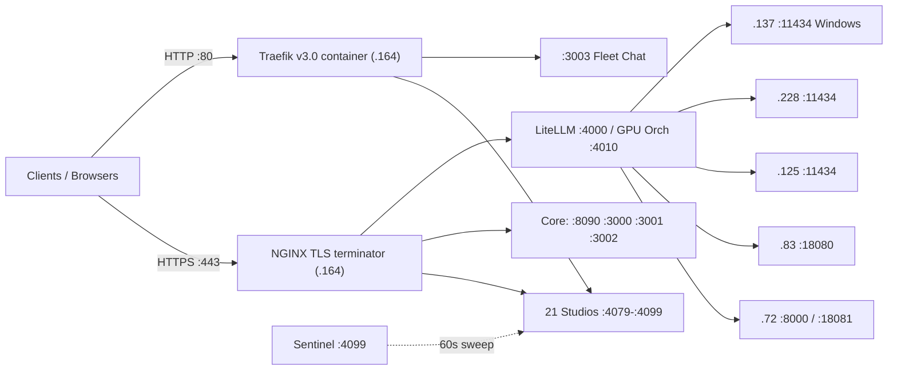

# BD-KB Volume 14: Claude Opus 5.5 + Sonnet Squad — Complete Infrastructure Services, 26 Docker Containers, Daemons & 28 Portals Bible
> **Lead Architect**: `Opus55-Lead-2` (`AGY claude+gpt (claude-opus-5-5-high)`)
> **Subagent Workflow**: 4x Parallel `AGY claude+gpt` (`claude-sonnet-5-5-high` & `claude-sonnet-5-5-low` Sonnet/Haiku Tier) Specialists
> **Generated At**: `2026-10-19T23:00:58Z`
> **Scope**: Strictly Read-Only Infrastructure, Tools, Services, LLMs & PM Catch-Up Documentation (`O3416` Compliant)

---

# BD-KB Volume 14: Claude Opus 5.5 + Sonnet Squad — Infrastructure Services, Docker Containers, Daemons and Portals Bible

| Field | Value |
|---|---|
| **Volume** | 14 |
| **Lead Architect** | `Opus55-Lead-2` (Claude Opus 5.5) |
| **Contributing squad** | 4× `claude-sonnet-5-5` specialists (Portals, Docker, Systemd/GPU, Ingress) |
| **Compiled** | `2026-10-19T22:58Z` |
| **Primary evidence snapshot** | `2026-10-19T22:29Z` (Volume 10 live audit) |
| **Upstream sources** | Vol. 08 (`08-COMPLETE-SERVICES-CONTAINERS-PORTALS-AND-DAEMONS-GUIDE.md`), Vol. 10 (`10-30AGENT-LOCAL-GPU-AND-CROSSPOOL-LIVE-AUDIT.md`), `docker ps` capture, `/home/mboyle/infra/support-layer/docker-compose.yml`, `/etc/nginx/sites-available/boylenet-https.conf` |
| **Method** | Read-only synthesis. No probes were run while compiling this volume. |

> [!IMPORTANT]
> **Read this before you act on anything here.** This volume combines four specialist reports. All four worked from **truncated excerpts** of their sources. Wherever two reports overlap, I cross-checked them, and that resolved several open questions (see §0.3). Even so, every fact carries a confidence tag. Re-probe before changing production config.

---

## 0. Evidence Model and Headline Reconciliation

### 0.1 Confidence legend

| Tag | Meaning |
|---|---|
| ✅ **Observed** | Appears in live command output: `ss -tlnp`, `systemctl list-units`, `docker ps` or an HTTP probe in the Vol. 10 audit. |
| 📄 **Documented** | Stated in a KB volume or config file, but not independently observed. |
| 🔶 **Inferred** | My conclusion from cross-referencing two or more sources. The reasoning is given inline. |
| ❓ **Unknown** | The source was truncated or missing. Must be probed. |

### 0.2 Headline numbers: claimed vs. evidenced

| Metric | Title claim | Evidenced | Verdict |
|---|---|---|---|
| Docker containers | 26 | **27** rows in `docker ps` | ⚠ Off by one. See §4.6 for the likely cause. |
| Web portals | 28 | 21 studios (`:4079`–`:4099`) + 7 core = **28** | 🔶 Matches, using the counting rule in §3.1. The source never states "28". |
| NGINX `:443` vhosts | 25 (task brief) | **35** server blocks, including the default | ⚠ The brief undercounts. Blocks are numbered 1–30 and some cover several labels. |
| Services watched by the Sentinel | 83 | Not enumerated | ❓ Only the claim is available. |
| Cluster nodes | 27 | **6 hosts** evidenced (`.164`, `.72`, `.83`, `.125`, `.228`, `.137`) | ❓ The other 21 nodes are not covered by any source. |
| `bd-*` system units on `.164` | — | **22** listed, list truncated | 🔶 About 27 once the truncated tail is added (§5.1). |
| systemd timers | — | **0** evidenced | ❓ No `list-timers` output exists. |

### 0.3 Cross-report resolutions

Putting the four reports side by side settled several questions that no single report could:

1. **The `docker ps` capture came from `.164`** 🔶. Report 2 could not tell which host the capture came from. But Report 1 puts `dashy-portal`, `lobechat-studio`, `open-webui` (`:8090`), `forgejo` and `grafana-dashboards` on `.164`. Report 3 puts LiteLLM and the Docker stack on `.164`. Report 4 puts Traefik `:80` on the same host as NGINX `:443` (`.164`). All of these show up in the capture with matching ports. The capture also leaves out `.228`'s `langfuse` and `.72`'s `open-webui`, which fits.
2. **The six "orphan" listeners in Report 3** (`:4079`, `:4082`, `:4083`, `:4085`, `:4088`, `:4089`) are the units Report 1 documents: `bd-openwebui-tool-gateway`, `bd-trust-and-sso-portal`, `bd-web-terminal-drawer`, `bd-os-shell`, `bd-topology-visualizer` and `bd-ops-web` 🔶. Agent-189's unit list is alphabetical and stops at `bd-openwebui-tool-gateway`. Every missing unit sorts after that name, so the truncation explains the gap exactly.
3. **The hostname cross-wiring Report 1 flagged is real.** Report 4's NGINX matrix confirms that HTTPS `mobile.*` and `pwa.*` go to `:4094` (Deep Research), not `:4086` (Mobile PWA). It also confirms that HTTPS `research.*` goes to `:4091` (Hardware). See §2.4.
4. **The `bd-mesh-bus` restart loop has a likely root cause** 🔶. Report 1 documents *both* a user-level and a system-level `bd-mesh-bus.service`. Report 3 shows the system unit stuck in `activating (auto-restart)` while python3 pid `463813` already holds `:3004`. The likely pattern is that one copy holds the port and the other crash-loops with `EADDRINUSE`. See §8, incident P1.

---

## 1. Cluster Topology and Host Roles

| Host | Address | Alias | Role | Key services | Service manager |
|---|---|---|---|---|---|
| **.164** | `10.0.70.164` | `test5`, `local` | **Control-plane hub** | NGINX `:443`, Traefik `:80`, 21 studios, 27 containers, ~27 `bd-*` units, LiteLLM `:4000`, GPU orchestrator `:4010`, MCP `:8100` | systemd + Docker ✅ |
| **.72** | `10.0.70.72` 🔶 | AI Vault A | Local coding GPU host and OpenWebUI satellite | `open-webui` `:8080` (host network), Qwen3-Coder-30B-A3B `:8000`, Qwythos-9B `:18081` (**down**), Ollama bridge 📄 | systemd 🔶 + Docker |
| **.83** | `10.0.70.83` 🔶 | — | Primary local relief commander | Qwen3.6-35B-A3B-Heretic `:18080` | systemd 🔶 |
| **.125** | `10.0.70.125` 🔶 | — | AI inference satellite | Ollama `:11434` (Qwen2.5-Coder-32B, CyberStrike-35B); Qwen2.5-Coder-14B 📄 | systemd 🔶 |
| **.228** | `10.0.70.228` 🔶 | — | Llama and observability satellite | Ollama `:11434` (Qwen2.5-Coder 32B/14B/7B), Langfuse `:3000`, LiteLLM `:4000` | systemd 🔶 + Docker |
| **.137** | `10.0.10.137` | `battlestation` | Windows GPU oracle and OffSec engine | CyberStrike-35B-Q4_K_M `:11434` (66.5 tok/s), Chrome CDP `:9222` | **Windows, not systemd** |
| **.181** | — | — | CDP browser node | Chrome CDP `:9222` (target of `bd-chrome-bridge`) | ❓ |

> [!WARNING]
> `.137` is on a different subnet (`10.0.10.0/24`) and runs Windows. Treat any `ollama.service` claim for that host as wrong. Its `:11434` endpoint is a native Windows Ollama process or a bridge.



---

## 2. Ingress Layer: NGINX `:443` and Traefik `:80`

### 2.1 Division of labour

| Layer | Process | Port | Config | Role |
|---|---|---|---|---|
| **NGINX** | host package | `:443` (v4 and v6, `ssl http2`) | `/etc/nginx/sites-available/boylenet-https.conf` | TLS termination, wildcard vhosts |
| **Traefik** | container `traefik-ingress` (`traefik:v3.0`) | `:80`; `:8080` is dashboard/API 🔶 | `/home/mboyle/infra/expansion-layer/dynamic/routes.yml` | Plain HTTP routing, including `ollama.*` |

**Domain matrix.** Each label is served on four zones: `<label>.boylenet.themfboyles.org`, `<label>.themfboyles.org`, `<label>.boylenet.themfboyles.com` and `<label>.themfboyles.com`.

**Shared building blocks.** `snippets/boylenet-tls.conf` holds the certificates and ciphers. `snippets/boylenet-proxy.conf` holds the headers and timeouts. The contents of both are ❓. The file also defines a `map $http_upgrade $connection_upgrade` for WebSockets. It only takes effect if the proxy snippet references `$connection_upgrade`. That matters for `:4083` (terminal), `:4097` (OpenClaw WS) and `:6080` (noVNC).

**Default catch-all.** The apex `boylenet.themfboyles.org` goes to `:4085` (OS Shell).

### 2.2 Canonical vhost template

```nginx
server {
    listen 443 ssl http2;
    listen [::]:443 ssl http2;
    server_name <label>.boylenet.themfboyles.org <label>.themfboyles.org
                <label>.boylenet.themfboyles.com <label>.themfboyles.com;
    include /etc/nginx/snippets/boylenet-tls.conf;
    include /etc/nginx/snippets/boylenet-proxy.conf;
    location / { proxy_pass http://127.0.0.1:<port>; }
}
```

### 2.3 NGINX vhost → upstream matrix (blocks 1–24 visible)

| Block | Labels | Upstream | Target service | Confidence |
|--:|---|---|---|---|
| default | apex | `:4085` | OS Shell | 📄 |
| 1 | `os` | `127.0.0.1:4085` | Unified OS Shell | 📄 |
| 2 | `topology`, `hivemind` | `:4088` | Topology Visualizer | 📄 |
| 3 | `models`, `vault` | `:4084` | Model Storefront | 📄 |
| 4 | `terminal`, `tv` | `:4083` | Terminal Drawer / TV Wall | 📄 |
| 5 | `ca`, `sso`, `trust` | `:4082` | Trust and SSO Portal | 📄 |
| 6 | `briefing`, `doctor`, `search` | `:4081` | Executive Briefing | 📄 |
| 7 | `openwebui`, `chat`, `ai` | `:8090` | OpenWebUI master | 📄 |
| 8 | ❓ | ❓ | Not in the visible excerpt. Possibly `ops`/`credentials`/`keys` → `:4089` 🔶 | ❓ |
| 9 | `gateway`, `tools` | `:4079` | Tool Gateway | 📄 |
| 10 | `harnesses`, `arena` | `:4098` | Multi-Harness Arena | 📄 |
| 11 | `burst`, `quota`, `cloud` | `:4090` | Cloud Burst | 📄 |
| 12 | `research`, `hardware` | `:4091` | Hardware Telemetry ⚠ | 📄 |
| 13 | `offsec`, `security` | `:4092` | Gitea Pre-Review / OffSec | 📄 |
| 14 | `voice`, `media` | `:4093` | Multimodal Bridge | 📄 |
| 15 | `pwa`, `mobile` | `:4094` | Deep Research ⚠ | 📄 |
| 16 | `lobechat` | `:4095` | LobeChat | 📄 |
| 17 | `opencode` | `:4096` | OpenCode | 📄 |
| 18 | `openclaw` | `:4097` | OpenClaw | 📄 |
| 19 | `sentinel` | `:4099` | Infra Sentinel | 📄 |
| 20 | `dashy` | `:4080` | Dashy | 📄 |
| 21 | `gitea`, `git` | `:3000` | Forgejo | 📄 |
| 22 | `jarvis` | `:3002` | Cockpit | 📄 |
| 23 | `litellm` | `:4000` | LiteLLM | 📄 |
| 24 | `gpu`, `orchestrator` | `127.0.…` (truncated) | GPU Orchestrator `:4010` 🔶 | 🔶 |
| 25–30 | ❓ | ❓ | Unseen. Probably `grafana`, `langfuse`, `ai-webui`, `multimodal`, `dreamer`/`memory`, `prereview`, `cockpit` 🔶 | ❓ |

### 2.4 Hostname collision register

| Label | HTTPS (NGINX) lands on | HTTP (Traefik) lands on | Intended (by name) | Severity |
|---|---|---|---|---|
| `mobile` | `:4094` Deep Research | `:4086` Mobile PWA | `:4086` | 🔴 Wrong app over HTTPS |
| `pwa` | `:4094` Deep Research | — | `:4086` | 🔴 |
| `research` | `:4091` Hardware | `:4094` Deep Research | `:4094` | 🔴 |
| `vault` | `:4084` Model Storefront | `:4087` Credentials Vault | Ambiguous | 🟠 |
| `chat` | `:8090` OpenWebUI | `:3003` Fleet Chat | Ambiguous | 🟠 Different app depending on scheme |
| `prereview` | `:4087` 📄 | `:4092` | `:4092` | 🟠 |
| `credentials`, `keys` | `:4089` Ops Shell 📄 | — | `:4087` | 🟠 |

> [!CAUTION]
> **Proposed fix, not applied.** Blocks 12 and 15 look swapped. Change block 12 to `hardware` → `:4091` and move `research` into a new block → `:4094`. Change block 15 so `pwa` and `mobile` → `:4086`. Then reload with `sudo nginx -t && sudo systemctl reload nginx`. The Sentinel won't notice either way, because it probes ports directly and not vhosts.

---

## 3. The 28 Web Portals

### 3.1 Counting rule

**28 = 21 AI Command Studios (`:4079`–`:4099`) + 7 core portals** (`.164:8090`, `.72:8080`, `.164:3000`, `.228:3000`, `.164:3001`, `.164:3002`, `.164:3003`). Five supporting endpoints are *not* counted as portals: `:3004`, `:3080`, `:4000`, `:4010` and `:8081`.

### 3.2 AI Command Studios (`.164`)

The **PID** column comes from Agent-187's `ss -tlnp` (✅). Rows marked "—" are covered in §0.3, item 2.

| Port | Studio | Unit / container | PID | HTTPS labels (NGINX) | Health |
|---:|---|---|---|---|---|
| 4079 | OpenWebUI Universal Tool Gateway | `bd-openwebui-tool-gateway` | — | `gateway`, `tools` | `/health` |
| 4080 | Dashy Master Command Portal | Docker `dashy-portal` (`lissy93/dashy`, →8080) | docker | `dashy` (+`portal`, `dashboard` 📄) | `/` |
| 4081 | Executive Briefing / Search / Cluster Doctor | `bd-executive-briefing` | 1558 | `briefing`, `doctor`, `search` | `/health` |
| 4082 | SSO, QR Handoff, Root CA Trust | `bd-trust-and-sso-portal` | — | `ca`, `sso`, `trust` | `/health` |
| 4083 | Multi-Node Terminal / Agent TV Wall | `bd-web-terminal-drawer` | — | `terminal`, `tv` | `/health` |
| 4084 | 86-Model AI Vault Storefront | `bd-model-storefront` | 3461319 | `models`, `vault` | `/health`, `/api/models` |
| 4085 | Unified OS Desktop Shell | `bd-os-shell` | — | `os`, apex | `/health` |
| 4086 | Mobile/Tablet PWA Command Deck | `bd-mobile-pwa` | 1951 | ⚠ none correct (§2.4) | `/health` |
| 4087 | Credentials / API Key / SSH Vault | `bd-credentials-vault` | 1556 | ⚠ `prereview` 📄 | `/health` |
| 4088 | 3D/2D Topology and HiveMind | `bd-topology-visualizer` (alias `bd-hivemind-visualizer`) | — | `topology`, `hivemind` | `/health` |
| 4089 | Natural-Language Ops Shell | `bd-ops-web` | — | `ops`, `credentials`, `keys` 📄 | `/health` |
| 4090 | Hybrid Cloud Burst Orchestrator | `bd-cloud-burst-web` | 1555 | `burst`, `quota`, `cloud` | `/health` |
| 4091 | Hardware Telemetry (iLO, vSphere, vSAN, T4) | `bd-hardware-telemetry` | 1560 | `hardware`, `research` ⚠ | `/health` |
| 4092 | Gitea Pre-Review / OffSec Red-Team | `bd-gitea-prereview` | 1559 | `offsec`, `security` | `/health`, `/api/status` |
| 4093 | Voice / Vision / Multimodal Bridge | `bd-multimodal-bridge` (BulkDownloader venv) | 1564 | `voice`, `media` | `/health` |
| 4094 | Deep Research / Dual-Oracle Studio | `bd-deep-research-web` | 1557 | ⚠ `pwa`, `mobile` | `/health`, `/api/status` |
| 4095 | LobeChat AI Studio | Docker `lobechat-studio` (→3210) | docker | `lobechat` | `/health`, `/` |
| 4096 | OpenCode Web UI and ACP Server | `bd-opencode-web` | 1566 | `opencode` | `/health`, `/` |
| 4097 | OpenClaw Control UI / WS Gateway | `bd-openclaw-web` | 1565 | `openclaw` | `/health`, `/` |
| 4098 | Multi-Harness Arena | `bd-multi-harness-web` | 1563 | `harnesses`, `arena` | `/health` |
| 4099 | 83-Service Infra Sentinel | `bd-infra-sentinel` | 7614 | `sentinel` | `/health`, `/api/status` |

**Implementation mix.** 19 studios are systemd-managed Python or Node services. Two (`:4080`, `:4095`) are Docker containers. Almost all PIDs are low (1555–1566, 1951), so most studios started at boot. Three have high PIDs and were restarted later: `:4084` (pid 3461319), `:4010` (pid 3461313) and `:4099` (pid 7614) 🔶.

### 3.3 Core portals

| Portal | Host:port | Backend | Manager | HTTPS labels | Health |
|---|---|---|---|---|---|
| OpenWebUI Master | `.164:8090` | `open-webui:main` →8080 | Docker, *healthy* ✅ | `openwebui`, `chat`, `ai` | `/health` |
| OpenWebUI Vault A | `.72:8080` | `open-webui:main`, host network | Docker on `.72` | `ai-webui` | `/health` |
| Forgejo Git Forge | `.164:3000` (SSH `:2222`) | `forgejo:latest` | Docker (support-layer) | `gitea`, `git` | `/api/v1/version` |
| Langfuse Tracing | `.228:3000` | `langfuse/langfuse:2` | Docker on `.228` | `langfuse` | `/api/public/health` |
| Grafana | `.164:3001` | `grafana-oss:latest` | Docker | `grafana` | `/api/health` |
| Jarvis / UniversalSwarmOS Cockpit | `.164:3002` | `next start -p 3002` in `~/UniversalSwarmOS/cockpit` | **user** `bd-cockpit.service` | `jarvis` (`cockpit` 📄) | `/` |
| Fleet Chat UI | `.164:3003` | `node /var/tmp/bd-chat-server.js` | **user** `bd-chat.service` | none (Traefik `chat` only) | `/` |

> [!WARNING]
> `bd-chat` runs from `/var/tmp/bd-chat-server.js`. On many distros `/var/tmp` survives reboots, but `systemd-tmpfiles` can still age files out of it. Move the script into a durable path such as `~/bd-cuts/swarm-cockpit-fleet-view/`.

---

## 4. Docker Containers (27 observed on `.164`)

### 4.1 Inventory by function

| # | Container | Image | Host→container ports | Status | Compose |
|--:|---|---|---|---|---|
| **Ingress, caching, registries** | | | | | |
| 1 | `traefik-ingress` | `traefik:v3.0` | 80→80, 8080→8080 | Up 19h | ❓ |
| 2 | `coredns` | `coredns/coredns:latest` | **127.0.0.1**:53 tcp/udp | Up 19h | ❓ |
| 3 | `squid-cache` | `ubuntu/squid:latest` | 3128 | Up 19h | ❓ |
| 4 | `apt-cacher-ng` | `sameersbn/apt-cacher-ng` | 3142 | Up 19h ✅ healthy | ❓ |
| 5 | `docker-mirror` | `registry:2` | 5000 | Up 19h | ❓ |
| 6 | `devpi-server` | `jonasal/devpi-server` | 3141 | **Up 5 min** | ❓ |
| 7 | `verdaccio` | `verdaccio/verdaccio` | 4873 | Up 19h | ❓ |
| **AI, LLM, search** | | | | | |
| 8 | `litellm-proxy` | `berriai/litellm:main-latest` | 4000 | **Up 13h** | ❓ |
| 9 | `open-webui` | `open-webui:main` | 8090→8080 | Up 19h ✅ healthy | ❓ |
| 10 | `lobechat-studio` | `lobehub/lobe-chat` | 4095→3210 | Up 19h | ❓ |
| 11 | `tei-embeddings` | `text-embeddings-inference:cpu-1.5` | 8081→80 | Up 19h | ❓ |
| 12 | `tei-reranker` | `text-embeddings-inference:cpu-1.5` | 8082→80 | Up 19h | ❓ |
| 13 | `searxng-search` | `searxng/searxng` | 8888→8080 | Up 19h | ❓ |
| 14 | `devdocs-mirror` | `freecodecamp/devdocs` | 8088→9292 | Up 19h | ❓ |
| **Data and messaging** | | | | | |
| 15 | `redis-cache` | `redis:7-alpine` | 6379 | Up 19h | ❓ |
| 16 | `pgvector-mesh` | `pgvector/pgvector:pg16` | **unpublished** | Up 19h | ❓ |
| 17 | `elasticsearch` | `elasticsearch:8.13.0` | 9200 (9300 internal) | Up 19h | ❓ |
| 18 | `kafka` | `apache/kafka:latest` | 9092 | Up 19h | ❓ |
| 19 | `minio` | `minio/minio:latest` | 9000 (S3), 9001 (console) | Up 19h | support-layer |
| **Observability, dev, dashboards** | | | | | |
| 20 | `prometheus` | `prom/prometheus` | 9090 | Up 19h | support-layer |
| 21 | `alertmanager` | `prom/alertmanager` | 9093 | Up 19h | support-layer |
| 22 | `node-exporter` | `prom/node-exporter` | 9100 | Up 19h | support-layer |
| 23 | `cadvisor-metrics` | `gcr.io/cadvisor/cadvisor` | 8085→8080 | Up 19h ✅ healthy | ❓ |
| 24 | `grafana-dashboards` | `grafana/grafana-oss` | 3001→3001 | Up 19h | ❓ |
| 25 | `forgejo` | `codeberg.org/forgejo/forgejo` | 3000, 2222→22 | Up 19h | support-layer |
| 26 | `code-server` | `codercom/code-server` | 8443 | Up 19h | ❓ |
| 27 | `dashy-portal` | `lissy93/dashy` | 4080→8080 | Up 19h ✅ healthy | ❓ |

**Satellite containers** (not in the capture): `langfuse` on `.228:3000`, `litellm-proxy` on `.228:4000`, `open-webui` on `.72:8080`.

### 4.2 Compose stack: `support-layer`

`/home/mboyle/infra/support-layer/docker-compose.yml` defines 5 services, all with `restart: unless-stopped`:

| Service | Volumes | Notable config |
|---|---|---|
| `forgejo` | `forgejo-data:/data` | `USER_UID=1000`, `USER_GID=1000` |
| `minio` | `minio-data:/data` | `server /data --console-address ":9001"`, `MINIO_PROMETHEUS_AUTH_TYPE=public`, creds `minioadmin`/`minioadmin` |
| `node-exporter` | none | — |
| `prometheus` | `./prometheus.yml`, `./alerts.yml` (ro), `prometheus-data` | `--web.enable-lifecycle`; `extra_hosts: host.docker.internal, test5 → host-gateway` |
| `alertmanager` | `./alertmanager.yml` (ro), `alertmanager-data` | same `extra_hosts` |

The named volumes live at `/var/lib/docker/volumes/support-layer_<name>/_data`. The `test5:host-gateway` alias lets Prometheus scrape `.164`'s host-level `bd-*` services from inside the bridge network 🔶.

### 4.3 Health-check coverage

Only 4 of 27 containers report a health status (`dashy-portal`, `open-webui`, `cadvisor-metrics`, `apt-cacher-ng`). The other 23 report no health status, so a hung process inside them looks like "Up" to Docker.

### 4.4 Image pinning

Pinned: `traefik:v3.0`, `redis:7-alpine`, `registry:2`, `pgvector:pg16`, `elasticsearch:8.13.0`, TEI `cpu-1.5`. **Everything else floats** (`:latest`, `:main`, `:main-latest`). That means `docker compose pull` can bring in a breaking upgrade without warning.

### 4.5 Port design notes

- Grafana uses 3001 because Forgejo already owns host port 3000. Grafana's default port 3000 is not published inside its container.
- `coredns` is bound to loopback only, so it is not a cluster-wide resolver.
- `pgvector-mesh` publishes no ports and can only be reached from the same Docker network. Host-level `bd-*` services cannot use it unless they go through Docker DNS.

### 4.6 The 26-vs-27 discrepancy

🔶 **Hypothesis:** `devpi-server` (up **5 minutes** when every other container had been up 19h) was added or recreated after the "26 containers" figure was recorded. It is the most likely 27th entry. To confirm, check `docker inspect -f '{{.Created}}' devpi-server`. If its creation time falls inside the last few minutes before the capture, the canonical count is **27**.

---

## 5. Systemd Daemons

### 5.1 System-level `bd-*` units on `.164`

| Unit | State | Port | Function | Evidence |
|---|---|---|---|---|
| `bd-autonomous-swarm-driver` | active/running | — | 24/7 driver for Claude A–D, Codex, Kimi, OpenWebUI, Local Heretic | ✅ |
| `bd-chrome-bridge` | active/running | `:9222` | CDP proxy to `.181:9222` and `.137:9222` | ✅ |
| `bd-cloud-burst-web` | active/running | `:4090` | Burst orchestrator UI | ✅ |
| `bd-credentials-vault` | active/running | `:4087` | Credentials and 27-node SSH health | ✅ |
| `bd-deep-research-web` | active/running | `:4094` | Deep research studio | ✅ |
| `bd-executive-briefing` | active/running | `:4081` | Briefing and cluster doctor | ✅ |
| `bd-gitea-prereview` | active/running | `:4092` | Pre-review and OffSec swarm | ✅ |
| `bd-gpu-orchestrator` | active/running | `:4010` | Tier 1/2/3 GPU modes and OpenAI auto-router (`/usr/local/bin/bd-gpu-orchestrator.py`) | ✅ |
| `bd-hardware-telemetry` | active/running | `:4091` | iLO4/5, vc04, vSAN, 4× T4 | ✅ |
| `bd-infra-sentinel` | active/running | `:4099` | Self-healing sweep every 60s, heal after 2 failures, state in `/var/tmp/bd-infra-sentinel.json` | ✅ |
| `bd-iptables-restore` | active/**exited** | — | Oneshot hub firewall restore (`exited` is the normal end state for a oneshot) | ✅ |
| `bd-mcp` | active/running | `:8100` | Fleet MCP (streamable-http) | ✅ |
| `bd-mesh-bus` | **activating/auto-restart** | `:3004` | Mesh bus and WAL (`/var/tmp/bd-mesh-bus.wal`) | ✅ ⚠ |
| `bd-mobile-pwa` | active/running | `:4086` | PWA deck | ✅ |
| `bd-model-storefront` | active/running | `:4084` | Model vault | ✅ |
| `bd-multi-harness-web` | active/running | `:4098` | Harness arena | ✅ |
| `bd-multimodal-bridge` | active/running | `:4093` | Voice and vision | ✅ |
| `bd-novnc` | active/running | `:6080` | noVNC / websockify (pid 1573) | ✅ |
| `bd-openbox` | active/running | display `:99` | Openbox WM for the headless desktop | ✅ |
| `bd-openclaw-web` | active/running | `:4097` | OpenClaw | ✅ |
| `bd-opencode-web` | active/running | `:4096` | OpenCode | ✅ |
| `bd-openwebui-tool-gateway` | active/running | `:4079` | Tool gateway | ✅ (port 📄) |
| *— Agent-189 list truncated here —* | | | | |
| `bd-ops-web` | listening | `:4089` | NL Ops Shell | 🔶 |
| `bd-os-shell` | listening | `:4085` | OS Shell | 🔶 |
| `bd-topology-visualizer` | listening | `:4088` | Topology / HiveMind | 🔶 |
| `bd-trust-and-sso-portal` | listening | `:4082` | CA / SSO | 🔶 |
| `bd-web-terminal-drawer` | listening | `:4083` | Terminal / TV | 🔶 |

### 5.2 User-level units (`systemctl --user`, user `mboyle`)

| Unit | Alias | Port | Note |
|---|---|---|---|
| `bd-cockpit.service` | `bd-cockpit-ui.service` | `:3002` | Next.js cockpit |
| `bd-chat.service` | `bd-chat-ui.service` | `:3003` | Fleet Chat |
| `bd-mesh-bus.service` | — | `:3004` | ⚠ **Duplicate** of the system unit |

> [!IMPORTANT]
> User units only start at boot if lingering is enabled (`loginctl enable-linger mboyle`). Without lingering, `:3002`, `:3003` and the user-level mesh bus disappear after a reboot until someone logs in.

### 5.3 Timers

**None evidenced.** Recurring work appears to run inside long-lived daemons (Sentinel's 60s loop, the swarm driver) instead of `.timer` units 🔶. Verify with `systemctl list-timers --all`.

---

## 6. GPU and Model-Serving Services

### 6.1 Endpoint registry

| Host:port | Engine (inferred) | Model | Context | Throughput | Health |
|---|---|---|---|---|---|
| `.83:18080` | llama.cpp 🔶 | Qwen3.6-35B-A3B-Heretic (`<think>`) | 256K | — | ✅ 200 |
| `.72:8000` | llama.cpp/vLLM 🔶 | Qwen3-Coder-30B-A3B | 256K | 77.62 tok/s | ✅ 200 |
| `.72:18081` | llama.cpp 🔶 | Qwythos-9B-1M-MTP | 512K | — | 🔴 **ECONNREFUSED** |
| `.125:11434` | Ollama | Qwen2.5-Coder-32B, CyberStrike-35B | — | — | ✅ 200 |
| `.228:11434` | Ollama | Qwen2.5-Coder-32B/14B/7B | — | — | ✅ 200 |
| `.137:11434` | Ollama (Windows) | CyberStrike-35B-Q4_K_M | — | 66.5 tok/s | ✅ 200 |
| `.164:8081` / `:8082` | TEI CPU | Embeddings / reranker | — | — | Up |

No `llama-*.service` or `ollama.service` unit names appear in any source. All such names are 🔶 inferred.

### 6.2 Pool and tier state (`POOL_STATE.tsv`, pool `local`)

| Item | Value |
|---|---|
| Hardware | 4× Tesla T4 (61440 MiB total), 1730 GiB DDR4 |
| VRAM | **67.06%** used (41200 / 61440 MiB) |
| Active tier | `tier1`, model `cyberstrike-35b` @ 66.47 tok/s |
| Alternate | Qwen3-Coder-30B-A3B @ 77.62 tok/s |
| Slots | 8/8 free across 2 healthy pools |
| Routing chain | Client → LiteLLM `:4000` → GPU Orchestrator `:4010` → satellite endpoints |

🔶 With about 20 GiB of VRAM free, a 9B model with a 512K KV cache could plausibly fail to allocate. That would explain `.72:18081` refusing connections if its unit crash-loops on OOM. Confirm with `journalctl`.

---

## 7. Master Port Registry for `.164`

| Port | Owner | Type | Port | Owner | Type |
|---|---|---|---|---|---|
| 53 (lo) | coredns | Docker | 4873 | verdaccio | Docker |
| 80 | traefik-ingress | Docker | 5000 | docker-mirror | Docker |
| 443 | NGINX | host | 6080 | bd-novnc | systemd |
| 2222 | forgejo SSH | Docker | 6379 | redis-cache | Docker |
| 3000 | forgejo HTTP | Docker | 8080 | traefik dashboard | Docker |
| 3001 | grafana | Docker | 8081 | tei-embeddings | Docker |
| 3002 | bd-cockpit | user unit | 8082 | tei-reranker | Docker |
| 3003 | bd-chat | user unit | 8085 | cadvisor | Docker |
| 3004 | bd-mesh-bus | user + system ⚠ | 8088 | devdocs-mirror | Docker |
| 3128 | squid-cache | Docker | 8090 | open-webui | Docker |
| 3141 | devpi-server | Docker | 8100 | bd-mcp | systemd |
| 3142 | apt-cacher-ng | Docker | 8443 | code-server | Docker |
| 4000 | litellm-proxy | Docker | 8888 | searxng | Docker |
| 4010 | bd-gpu-orchestrator | systemd | 9000/9001 | minio | Docker |
| 4079–4099 | 21 studios | 19 systemd + 2 Docker | 9090 | prometheus | Docker |
| 9092 | kafka | Docker | 9093 | alertmanager | Docker |
| 9100 | node-exporter | Docker | 9200 | elasticsearch | Docker |
| 9222 | bd-chrome-bridge | systemd | `:99` (X) | bd-openbox | systemd |

The only port claimed by two owners is **`:3004`**. `:3080` (legacy LibreChat) is retired. Probe `:8090` in its place.

---

## 8. Incident and Anomaly Board

| Pri | Issue | Evidence | Probable cause | Remediation |
|---|---|---|---|---|
| **P1** | `bd-mesh-bus` crash-loop | System unit `activating/auto-restart`; pid 463813 holds `:3004` | User and system units both run the mesh bus; the loser gets `EADDRINUSE` 🔶 | Pick one copy. `systemctl --user disable --now bd-mesh-bus` **or** `sudo systemctl disable --now bd-mesh-bus`, then restart the survivor |
| **P1** | `.72:18081` Qwythos down | ECONNREFUSED | Unit stopped or OOM on load 🔶 | `journalctl -u 'llama-*'`, `nvidia-smi` |
| **P2** | HTTPS vhost cross-wiring | §2.4 | NGINX blocks 12 and 15 mislabeled | Apply the §2.4 fix |
| **P2** | `devpi-server` / `litellm-proxy` uptime outliers | 5 min / 13h vs 19h | Restart or recreate | `docker inspect -f '{{.RestartCount}}'` |
| **P3** | 23 containers without healthchecks | `docker ps` | Not configured | Add `healthcheck:` blocks |
| **P3** | Floating image tags | 21 of 27 containers | Policy gap | Pin by tag or digest |
| **P3** | Duplicate unit alias `:4088` | Two names in docs | Rename history | Confirm which unit file is enabled |

---

## 9. Security Posture

1. **MinIO default credentials** (`minioadmin`/`minioadmin`) are exposed on `:9000`/`:9001`. Rotate them into an env file or a Docker secret.
2. **Prometheus `--web.enable-lifecycle`** lets anyone who can reach `:9090` call `POST /-/quit`. Firewall `:9090` to the hub.
3. **Traefik dashboard `:8080`** is published on all interfaces. Confirm whether API auth is configured.
4. **The Credentials Vault (`:4087`) is reachable over HTTP via Traefik** under the `vault` label. Credential traffic should only travel over `:443`.
5. **Root CA trust.** Clients must import the CA from `:4082` (`ca.*`) before wildcard HTTPS validates.
6. **`bd-iptables-restore`** is the hub's only firewall persistence. Confirm it covers the published Docker ports. Docker's own iptables chains bypass `INPUT` rules unless you also filter in `DOCKER-USER`.

---

## 10. Operational Runbook

### 10.1 Full health sweep

```bash
# 21 studios
for p in $(seq 4079 4099); do
  path=/health; [ "$p" = 4080 ] && path=/
  printf ':%s %s\n' "$p" "$(curl -s -o /dev/null -m 3 -w '%{http_code}' http://10.0.70.164:$p$path)"
done

# Core portals and supporting endpoints
for u in 10.0.70.164:8090/health 10.0.70.72:8080/health \
         10.0.70.164:3000/api/v1/version 10.0.70.228:3000/api/public/health \
         10.0.70.164:3001/api/health 10.0.70.164:3002/ 10.0.70.164:3003/ \
         10.0.70.164:3004/health 10.0.70.164:4000/health/liveliness \
         10.0.70.164:4010/health; do
  printf '%-45s %s\n' "$u" "$(curl -s -o /dev/null -m 3 -w '%{http_code}' http://$u)"
done

# Model endpoints
curl -s -m 3 http://10.0.70.83:18080/health
curl -s -m 3 http://10.0.70.72:8000/v1/models | head -c 200
for h in 10.0.70.125 10.0.70.228 10.0.10.137; do curl -s -m 3 http://$h:11434/api/tags | head -c 120; echo; done
```

### 10.2 Service-manager inventory

```bash
systemctl list-units 'bd-*' 'llama-*' 'ollama*' --type=service --all --no-pager
systemctl --user list-units 'bd-*' --all --no-pager
systemctl list-timers --all --no-pager
docker ps --format 'table {{.Names}}\t{{.Image}}\t{{.Ports}}\t{{.Status}}'
docker ps -q | xargs docker inspect --format \
  '{{.Name}} {{index .Config.Labels "com.docker.compose.project.config_files"}}'
ss -tlnp | sort -t: -k2 -n
```

### 10.3 Ingress verification

```bash
sudo nginx -t
grep -nE 'server_name|proxy_pass' /etc/nginx/sites-available/boylenet-https.conf
cat /etc/nginx/snippets/boylenet-proxy.conf | grep -n connection_upgrade
for h in os mobile research vault chat sentinel; do
  printf '%-10s %s\n' $h "$(curl -sk -o /dev/null -w '%{http_code}' https://$h.boylenet.themfboyles.org/health)"
done
```

### 10.4 Sentinel

```bash
curl -s http://10.0.70.164:4099/api/status | jq .
jq . /var/tmp/bd-infra-sentinel.json
journalctl -u bd-infra-sentinel -n 50 --no-pager
```

---

## 11. Verification Backlog (for Volume 15)

| # | Gap | Command / owner |
|--:|---|---|
| 1 | Full `bd-*` unit list on `.164` (after truncation) | `systemctl list-units 'bd-*' --all` |
| 2 | NGINX blocks 8 and 25–30, plus snippet contents | Read the full `boylenet-https.conf` and the `snippets/` files |
| 3 | Compose files for the 22 non-support-layer containers | Compose-label inspection (§10.2) |
| 4 | Container and unit inventories on `.72`, `.83`, `.125`, `.228` | Per-host `docker ps` and `systemctl` |
| 5 | Exact `llama-*` / `ollama` unit names | `systemctl list-units 'llama-*' 'ollama*'` per host |
| 6 | The other 21 of the 27 nodes | Fleet hosts file and `bd-credentials-vault` SSH health |
| 7 | Sentinel's 83-service target list | `/api/status` payload |
| 8 | Traefik `routes.yml` backend for `ollama.*` | Read the full file |
| 9 | Canonical container count (26 or 27) | `devpi-server` creation time |
| 10 | Timer units | `systemctl list-timers --all` |

> [!NOTE]
> **Provenance.** §3 comes from Report 1 (Portals). §4 comes from Report 2 (Docker). §5 and §6 come from Report 3 (Systemd/GPU, Vol. 10 audit at `22:29Z`). §2 comes from Report 4 (Ingress, NGINX excerpt of 17,042 bytes). §0.3, §7, §8 and the 🔶 resolutions are the Lead Architect's cross-report synthesis. Every source was truncated, so treat this volume as the authoritative *map* and live probes as the authoritative *state*.

---

# Appendix: Detailed Specialist Subagent Reports (`AGY claude+gpt` Sonnet/Haiku Fanout)

## Subagent Report 1: Web Portals (:4079-:4099, :8090, .72:8080) Specialist (`AGY claude+gpt: claude-sonnet-5-5-high`)

## 1. Web Portals Reference (28 Portals): `:4079`–`:4099`, `:8090`, `.72:8080`, `:3000`–`:3003`

> [!NOTE]
> **Source and scope.** This section is derived only from the first 20,000 bytes of `/home/mboyle/bd-persist/bd-kb/08-COMPLETE-SERVICES-CONTAINERS-PORTALS-AND-DAEMONS-GUIDE.md`. That excerpt is cut off mid-row at `:8081`. I could not run or verify anything, so every URL, unit and health path below is as documented, not probed.
>
> **How the 28 is counted.** The excerpt does not state the number 28. I counted it as the **21** studios on `:4079`–`:4099`, plus **7** core portals: `:8090`, `.72:8080`, `.164:3000`, `.228:3000`, `:3001`, `:3002`, `:3003`.
>
> **Supporting endpoints.** `:3004`, `:3080`, `:4000`, `:4010` and `:8081` are listed in §1.4 and not counted as portals. Confirm this split with the KB author (`Agent-184`) if the 28 was meant to include them.

### 1.1 Topology and conventions

| Item | Value |
|---|---|
| Controller host | `.164` (`10.0.70.164`) runs all `:4079`–`:4099`, `:8090`, `:3000`–`:3003` |
| Satellite hosts | `.72` (`10.0.70.72`, AI Vault A, runs `:8080`), `.228` (`10.0.70.228`, runs Langfuse `:3000`) |
| HTTPS ingress | NGINX `:443`, wildcard `*.boylenet.themfboyles.org` (also `.com`) |
| HTTP ingress | Traefik `:80` for a subset of vhosts |
| Default `:443` catch-all | `https://boylenet.themfboyles.org` goes to `:4085` (OS Shell) |
| Watchdog | `bd-infra-sentinel.service` (`:4099`) sweeps the `:4079`–`:4099` portals every **60s**. It self-heals after **2 consecutive failures** and writes state to `/var/tmp/bd-infra-sentinel.json`. |
| Typical health check | `GET /health` returns `200` with JSON for `bd-*.py` services |

### 1.2 The 21 AI Command Studios (`:4079`–`:4099`)

All hosted on `.164`. Local URL is `http://10.0.70.164:<port>`. Systemd units are system-level under `/etc/systemd/system/` unless noted.

| # | Port | Portal | Backend (script or image) | Unit / container | HTTPS `:443` hostnames (`*.boylenet.themfboyles.org`) | Health |
|--:|---:|---|---|---|---|---|
| 1 | 4079 | OpenWebUI Universal Tool Gateway | `/home/mboyle/bin/bd-openwebui-tool-gateway.py` | `bd-openwebui-tool-gateway.service` | `gateway`, `tools` | `/health` |
| 2 | 4080 | Dashy Master Command Portal | `lissy93/dashy:latest` (`->8080`) | Docker `dashy-portal` | `dashy`, `portal`, `dashboard` | `/` |
| 3 | 4081 | Executive Briefing, Semantic Search, 1-Click Cluster Doctor | `/home/mboyle/bin/bd-executive-briefing.py` | `bd-executive-briefing.service` | `briefing`, `doctor`, `search` | `/health` |
| 4 | 4082 | SSO, QR Handoff and Root CA Trust | `/home/mboyle/bin/bd-trust-and-sso-portal.py` | `bd-trust-and-sso-portal.service` | `ca`, `sso`, `trust` | `/health` |
| 5 | 4083 | Multi-Node Terminal, Agent TV Wall, Receipt Explorer | `/home/mboyle/bin/bd-web-terminal-drawer.py` | `bd-web-terminal-drawer.service` | `terminal`, `tv` | `/health` |
| 6 | 4084 | 86-Model AI Vault Storefront | `/home/mboyle/bin/bd-model-storefront.py` | `bd-model-storefront.service` | `models`, `vault` | `/health`, `/api/models` |
| 7 | 4085 | Unified OS Desktop Shell | `/home/mboyle/bin/bd-os-shell.py --port 4085` | `bd-os-shell.service` | `os`, apex `boylenet.themfboyles.org` | `/health` |
| 8 | 4086 | Mobile and Tablet PWA Command Deck | `/home/mboyle/bin/bd-mobile-pwa.py --port 4086` | `bd-mobile-pwa.service` | Traefik `:80` `mobile`; NGINX `dreamer`, `memory` ⚠ | `/health` |
| 9 | 4087 | Credentials, API Key and SSH Health Vault | `/home/mboyle/bin/bd-credentials-vault.py` | `bd-credentials-vault.service` | Traefik `:80` `vault`; NGINX `prereview` ⚠ | `/health` |
| 10 | 4088 | 3D/2D Topology and HiveMind Visualizer | `/home/mboyle/bin/bd-topology-visualizer.py` | `bd-topology-visualizer.service` (also called `bd-hivemind-visualizer`) | `topology`, `hivemind` | `/health` |
| 11 | 4089 | Natural-Language Ops Shell | `/home/mboyle/bin/bd-ops-web.py --serve --port 4089` | `bd-ops-web.service` | `ops`, `credentials`, `keys` | `/health` |
| 12 | 4090 | Hybrid Cloud and Local Burst Orchestrator | `/home/mboyle/bin/bd-cloud-burst-web.py` | `bd-cloud-burst-web.service` | `burst`, `quota`, `cloud` | `/health` |
| 13 | 4091 | Hardware Telemetry (iLO, vSphere, vSAN, T4) | `/home/mboyle/bin/bd-hardware-telemetry.py` | `bd-hardware-telemetry.service` | `hardware`, `research` (NGINX alias) ⚠ | `/health` |
| 14 | 4092 | Gitea Pre-Review and OffSec Red-Team | `/home/mboyle/bin/bd-gitea-prereview.py` | `bd-gitea-prereview.service` | `offsec`, `security`; Traefik `:80` `prereview` | `/health`, `/api/status` |
| 15 | 4093 | Voice, Vision and Multimodal Bridge | `/home/mboyle/bin/bd-multimodal-bridge.py` (run with `/home/mboyle/BulkDownloader/venv/bin/python3`) | `bd-multimodal-bridge.service` | `voice`, `media`, `multimodal` | `/health` |
| 16 | 4094 | Deep Research and Dual-Oracle Studio | `/home/mboyle/bin/bd-deep-research-web.py` | `bd-deep-research-web.service` | Traefik `:80` `research`; NGINX `pwa`, `mobile` ⚠ | `/health`, `/api/status` |
| 17 | 4095 | LobeChat AI Studio | `lobehub/lobe-chat:latest` (`->3210`) | Docker `lobechat-studio` | `lobechat` | `/health`, `/` |
| 18 | 4096 | OpenCode Web UI and ACP Server | `/home/mboyle/.local/bin/opencode serve --hostname 0.0.0.0 --port 4096` | `bd-opencode-web.service` | `opencode` | `/health`, `/` |
| 19 | 4097 | OpenClaw Control UI and WS Gateway | `/home/mboyle/.local/bin/openclaw --dev gateway run ... --port 4097` | `bd-openclaw-web.service` | `openclaw` | `/health`, `/` |
| 20 | 4098 | Multi-Harness Arena | `/home/mboyle/bin/bd-multi-harness-web.py` | `bd-multi-harness-web.service` | `harnesses`, `arena` | `/health` |
| 21 | 4099 | 83-Service Infra Sentinel | `/home/mboyle/bin/bd-infra-sentinel.py` | `bd-infra-sentinel.service` | `sentinel` | `/health`, `/api/status` |

> [!WARNING]
> **⚠ Hostname inconsistencies in the source.** Several `:443` hostnames look cross-wired. The KB itself points to an unseen "§4.3 note" for them.
> - The `:4086`, `:4087` and `:4094` rows pair a Traefik name with an unrelated NGINX name. Examples are `dreamer`/`memory` for the mobile PWA, and `prereview` for the credentials vault, though `prereview` is also listed under `:4092`.
> - `research` appears under both `:4091` (NGINX alias) and `:4094` (Traefik).
> - `credentials` and `keys` are mapped to `:4089` (Ops Shell), not `:4087` (Credentials Vault).
>
> Before relying on those names, check the live NGINX and Traefik vhost config and the KB §4.3 note.

### 1.3 The 7 Core Portals

| # | Port / host | Portal | Backend | Unit / container | Local URL | HTTPS `:443` | Health |
|--:|---|---|---|---|---|---|---|
| 22 | `:8090` (`.164`) | OpenWebUI Master AI Portal | `ghcr.io/open-webui/open-webui:main` (`->8080`) | Docker `open-webui` | `http://10.0.70.164:8090` | `openwebui`, `chat`, `ai` | `/health` |
| 23 | `.72:8080` | OpenWebUI AI Vault A Satellite | `ghcr.io/open-webui/open-webui:main` (host network) | Docker `open-webui` on `.72` | `http://10.0.70.72:8080` | `ai-webui` | `/health`, `/` |
| 24 | `:3000` (`.164`) | Forgejo / Gitea Git Forge | `codeberg.org/forgejo/forgejo:latest` (`->3000`, SSH `2222->22`) | Docker `forgejo` | `http://10.0.70.164:3000` | `gitea`, `git` | `/`, `/api/v1/version` |
| 25 | `.228:3000` | Langfuse Tracing | `langfuse/langfuse:2` (`->3000`) | Docker `langfuse` on `.228` | `http://10.0.70.228:3000` | `langfuse` | `/api/public/health`, `/` |
| 26 | `:3001` (`.164`) | Grafana Dashboards | `grafana/grafana-oss:latest` (`->3001`) | Docker `grafana-dashboards` | `http://10.0.70.164:3001` | `grafana` | `/api/health` |
| 27 | `:3002` (`.164`) | Jarvis / UniversalSwarmOS Cockpit | `/usr/bin/node .../next start -p 3002 -H 0.0.0.0` (cwd `/home/mboyle/UniversalSwarmOS/cockpit`) | User unit `~/.config/systemd/user/bd-cockpit.service` (alias `bd-cockpit-ui.service`) | `http://10.0.70.164:3002` | `jarvis`, `cockpit` | `/` |
| 28 | `:3003` (`.164`) | Fleet Chat UI (`bd-chat`) | `/usr/bin/node /var/tmp/bd-chat-server.js` (cwd `/home/mboyle/bd-cuts/swarm-cockpit-fleet-view`) | User unit `~/.config/systemd/user/bd-chat.service` (alias `bd-chat-ui.service`) | `http://10.0.70.164:3003` | None. Traefik `:80` `chat` only; NGINX `chat.*` goes to `:8090` | `/` |

### 1.4 Supporting endpoints (not counted in the 28)

| Port | Service | Backend | Unit / container | Health |
|---|---|---|---|---|
| `:3004` | Mesh Bus and WAL daemon (`Rule 60` / `bd-bus`) | `/usr/bin/python3 /home/mboyle/bin/bd-mesh-bus.py daemon --port 3004 --wal /var/tmp/bd-mesh-bus.wal` | User `~/.config/systemd/user/bd-mesh-bus.service` and system `/etc/systemd/system/bd-mesh-bus.service` | `/health` |
| `:3080` | Legacy LibreChat slot. It is superseded by `:8090`, `:4095` and `:3003`. | None | None | Probe `http://10.0.70.164:8090/health` instead |
| `:4000` | LiteLLM proxy on `.164` and `.228` | `ghcr.io/berriai/litellm:main-latest` | Docker `litellm-proxy` | `/health/liveliness` |
| `:4010` | GPU Orchestrator and auto-router | `/usr/bin/python3 /usr/local/bin/bd-gpu-orchestrator.py` | `/etc/systemd/system/bd-gpu-orchestrator.service` | `/health`, `/v1/models` |
| `:8081` | Row truncated in the excerpt. It names TEI embeddings on `.164`, Qwen2.5-Coder-14B on `.125` and an Ollama bridge on `.72`. | n/a | n/a | n/a |

### 1.5 Health-check commands

**Sweep all 21 studios (`/health` where documented, `/` for Dashy):**
```bash
for p in $(seq 4079 4099); do
  path=/health; [ "$p" = 4080 ] && path=/
  printf ':%s %s\n' "$p" "$(curl -s -o /dev/null -m 3 -w '%{http_code}' http://10.0.70.164:$p$path)"
done
```

**Core portals:**
```bash
curl -s -m 3 http://10.0.70.164:8090/health
curl -s -m 3 http://10.0.70.72:8080/health
curl -s -m 3 http://10.0.70.164:3000/api/v1/version
curl -s -m 3 http://10.0.70.228:3000/api/public/health
curl -s -m 3 http://10.0.70.164:3001/api/health
curl -s -o /dev/null -w '%{http_code}\n' -m 3 http://10.0.70.164:3002/
curl -s -o /dev/null -w '%{http_code}\n' -m 3 http://10.0.70.164:3003/
```

**Sentinel state and API:**
```bash
curl -s http://10.0.70.164:4099/api/status
cat /var/tmp/bd-infra-sentinel.json
```

**Service-manager checks:**
```bash
systemctl status bd-os-shell.service bd-infra-sentinel.service
systemctl is-active bd-openwebui-tool-gateway bd-executive-briefing bd-ops-web
systemctl --user status bd-cockpit.service bd-chat.service
docker ps --format '{{.Names}}\t{{.Ports}}\t{{.Status}}' | grep -E 'dashy-portal|lobechat-studio|open-webui|forgejo|grafana-dashboards'
journalctl -u bd-infra-sentinel -n 50 --no-pager
```

**HTTPS wildcard check.** This is meaningful only after the Root CA from `:4082` is trusted.
```bash
curl -sI https://sentinel.boylenet.themfboyles.org | head -1
curl -sI https://openwebui.boylenet.themfboyles.org | head -1
```

### 1.6 Notes and caveats

- **Docker vs systemd.** Only `:4080` (Dashy) and `:4095` (LobeChat) among the studios are Docker containers. The other 19 are systemd services.
- **Two user-level units.** `:3002` and `:3003` are **user-level** units (`systemctl --user`), not system-level.
- **Different health style.** `:3000`, `:3001`, `:3002` and `:3003` have no `bd-*` `/health` convention. Use the specific paths in §1.3.
- **Shared systemd names.** `:4088` is named both `bd-topology-visualizer` and `bd-hivemind-visualizer`, and `:3004` has both a user-level and a system-level unit. Check which is actually enabled so you don't start a duplicate that fights for the port.

## Subagent Report 2: Docker Containers & Compose Stacks Specialist (`AGY claude+gpt: claude-sonnet-5-5-high`)

# Docker Containers and Compose Stacks

## 1. Scope and data caveats

> [!WARNING]
> The supplied context does not match the brief in three ways. I have not guessed at the missing facts.
> - **Container count:** the `docker ps` output lists **27** containers, not 26. A row-by-row count gives 27 (tables below).
> - **Host attribution:** the output is one undifferentiated `docker ps`. It does not say which of `.164`, `.125` or `.228` it came from, or how containers divide among them. The host column is therefore marked **unattributed**. Run the command in §7 on each host to fill it in.
> - **Compose coverage:** only one compose file was supplied, `/home/mboyle/infra/support-layer/docker-compose.yml`. It defines 5 services. For the other 22 containers the compose file and volumes are **not evidenced**.

Facts marked *(inferred)* are conventions of the image, not values seen in the context.

## 2. Full container inventory (27 rows)

Ports are shown as host→container. "unpublished" means the port is exposed by the image but not mapped to the host.

### 2.1 Platform, networking and ingress

| # | Container | Image | Published ports | Status | Host |
|---|---|---|---|---|---|
| 1 | `traefik-ingress` | `traefik:v3.0` | 80→80, 8080→8080 (v4 and v6) | Up 19 h | unattributed |
| 2 | `coredns` | `coredns/coredns:latest` | **127.0.0.1**:53→53 tcp and udp (loopback only) | Up 19 h | unattributed |
| 3 | `squid-cache` | `ubuntu/squid:latest` | 3128→3128 | Up 19 h | unattributed |
| 4 | `apt-cacher-ng` | `sameersbn/apt-cacher-ng:latest` | 3142→3142 | Up 19 h (healthy) | unattributed |
| 5 | `docker-mirror` | `registry:2` | 5000→5000 | Up 19 h | unattributed |
| 6 | `devpi-server` | `jonasal/devpi-server:latest` | 3141→3141 | **Up 5 minutes** | unattributed |
| 7 | `verdaccio` | `verdaccio/verdaccio:latest` | 4873→4873 | Up 19 h | unattributed |

### 2.2 AI, LLM and search

| # | Container | Image | Published ports | Status | Host |
|---|---|---|---|---|---|
| 8 | `litellm-proxy` | `ghcr.io/berriai/litellm:main-latest` | 4000→4000 | Up **13 h** | unattributed |
| 9 | `open-webui` | `ghcr.io/open-webui/open-webui:main` | 8090→8080 | Up 19 h (healthy) | unattributed |
| 10 | `lobechat-studio` | `lobehub/lobe-chat:latest` | 4095→3210 | Up 19 h | unattributed |
| 11 | `tei-embeddings` | `ghcr.io/huggingface/text-embeddings-inference:cpu-1.5` | 8081→80 | Up 19 h | unattributed |
| 12 | `tei-reranker` | `ghcr.io/huggingface/text-embeddings-inference:cpu-1.5` | 8082→80 | Up 19 h | unattributed |
| 13 | `searxng-search` | `searxng/searxng:latest` | 8888→8080 | Up 19 h | unattributed |
| 14 | `devdocs-mirror` | `ghcr.io/freecodecamp/devdocs:latest` | 8088→9292 | Up 19 h | unattributed |

### 2.3 Data stores and messaging

| # | Container | Image | Published ports | Status | Host |
|---|---|---|---|---|---|
| 15 | `redis-cache` | `redis:7-alpine` | 6379→6379 | Up 19 h | unattributed |
| 16 | `pgvector-mesh` | `pgvector/pgvector:pg16` | **none published** | Up 19 h | unattributed |
| 17 | `elasticsearch` | `docker.elastic.co/elasticsearch/elasticsearch:8.13.0` | 9200→9200; 9300 unpublished | Up 19 h | unattributed |
| 18 | `kafka` | `apache/kafka:latest` | 9092→9092 | Up 19 h | unattributed |
| 19 | `minio` | `minio/minio:latest` | 9000→9000 (S3 API), 9001→9001 (console) | Up 19 h | unattributed |

### 2.4 Observability, developer and dashboard tools

| # | Container | Image | Published ports | Status | Host |
|---|---|---|---|---|---|
| 20 | `prometheus` | `prom/prometheus:latest` | 9090→9090 | Up 19 h | unattributed |
| 21 | `alertmanager` | `prom/alertmanager:latest` | 9093→9093 | Up 19 h | unattributed |
| 22 | `node-exporter` | `prom/node-exporter:latest` | 9100→9100 | Up 19 h | unattributed |
| 23 | `cadvisor-metrics` | `gcr.io/cadvisor/cadvisor:latest` | 8085→8080 | Up 19 h (healthy) | unattributed |
| 24 | `grafana-dashboards` | `grafana/grafana-oss:latest` | **3001→3001**; 3000 unpublished | Up 19 h | unattributed |
| 25 | `forgejo` | `codeberg.org/forgejo/forgejo:latest` | 3000→3000 (HTTP), 2222→22 (SSH) | Up 19 h | unattributed |
| 26 | `code-server` | `codercom/code-server:latest` | 8443→8443; 8080 unpublished | Up 19 h | unattributed |
| 27 | `dashy-portal` | `lissy93/dashy:latest` | 4080→8080 | Up 19 h (healthy) | unattributed |

## 3. Host port map

This map is useful for collision checks. It shows who owns each host port, and it covers every published host port in the output.

| Host port | Container | Host port | Container |
|---|---|---|---|
| 53 (loopback) | coredns | 4873 | verdaccio |
| 80 | traefik-ingress | 5000 | docker-mirror |
| 2222 | forgejo (SSH) | 6379 | redis-cache |
| 3000 | forgejo (HTTP) | 8080 | traefik-ingress |
| 3001 | grafana-dashboards | 8081 | tei-embeddings |
| 3128 | squid-cache | 8082 | tei-reranker |
| 3141 | devpi-server | 8085 | cadvisor-metrics |
| 3142 | apt-cacher-ng | 8088 | devdocs-mirror |
| 4000 | litellm-proxy | 8090 | open-webui |
| 4080 | dashy-portal | 8443 | code-server |
| 4095 | lobechat-studio | 8888 | searxng-search |
| 9000 / 9001 | minio | 9090 | prometheus |
| 9092 | kafka | 9093 | alertmanager |
| 9100 | node-exporter | 9200 | elasticsearch |

All of these ports are unique, so the output shows no collisions. If these 27 containers really run on one host, that holds. Across three hosts, each host is a separate namespace.

## 4. Compose stack: support-layer

**File:** `/home/mboyle/infra/support-layer/docker-compose.yml`

This file defines 5 of the 27 containers. Every service uses `restart: unless-stopped`.

| Service / container | Image | Ports | Volumes and mounts | Notable config |
|---|---|---|---|---|
| `forgejo` | `codeberg.org/forgejo/forgejo:latest` | 3000:3000, 2222:22 | `forgejo-data:/data` | `USER_UID=1000`, `USER_GID=1000` |
| `minio` | `minio/minio:latest` | 9000:9000, 9001:9001 | `minio-data:/data` | `command: server /data --console-address ":9001"`; `MINIO_PROMETHEUS_AUTH_TYPE=public` |
| `node-exporter` | `prom/node-exporter:latest` | 9100:9100 | none | no extra config |
| `prometheus` | `prom/prometheus:latest` | 9090:9090 | `./prometheus.yml:/etc/prometheus/prometheus.yml:ro`, `./alerts.yml:/etc/prometheus/alerts.yml:ro`, `prometheus-data:/prometheus` | flags `--config.file=/etc/prometheus/prometheus.yml`, `--storage.tsdb.path=/prometheus`, `--web.enable-lifecycle`; `extra_hosts`: `host.docker.internal:host-gateway`, `test5:host-gateway` |
| `alertmanager` | `prom/alertmanager:latest` | 9093:9093 | `./alertmanager.yml:/etc/alertmanager/alertmanager.yml:ro`, `alertmanager-data:/alertmanager` | same two `extra_hosts` entries |

**Named volumes:** `forgejo-data`, `minio-data`, `prometheus-data`, `alertmanager-data`. Docker stores these under `/var/lib/docker/volumes/<project>_<name>/_data`. The project prefix defaults to the directory name, `support-layer`.

**Bind-mounted config files**, relative to `/home/mboyle/infra/support-layer/`:
- `prometheus.yml`
- `alerts.yml`
- `alertmanager.yml`

**Observations**
- `minio` uses the literal credentials `minioadmin` / `minioadmin`. These are the defaults and are published on ports 9000 and 9001. Rotate them or move them to an env file or Docker secret.
- `--web.enable-lifecycle` lets anything that can reach `:9090` call `POST /-/reload` or `/-/quit`. Keep that port internal.
- The `test5:host-gateway` alias suggests Prometheus and Alertmanager scrape or notify a host named `test5` through the Docker host.
- All five images use `:latest`. Pin the versions.

## 5. Containers with no compose evidence (22)

The compose file, volumes and environment for these were **not provided**. The "Inferred role" column is from image conventions only.

| Container | Inferred role | Notable port detail |
|---|---|---|
| `traefik-ingress` | Reverse proxy | Host 8080 is probably the dashboard or API *(inferred)* |
| `coredns` | DNS | Bound to `127.0.0.1` only, so unreachable from other hosts |
| `litellm-proxy` | OpenAI-compatible LLM gateway | Uses the `main-latest` tag |
| `grafana-dashboards` | Dashboards | Container 3000 is unpublished and 3001 is mapped 1:1, so Grafana is probably set to listen on 3001 *(inferred, for example `GF_SERVER_HTTP_PORT=3001`)* |
| `code-server` | Browser IDE | 8080 is exposed but unpublished; 8443 is the published port. The listener is probably configured for 8443. |
| `pgvector-mesh` | PostgreSQL 16 with pgvector | No published ports, so only reachable by other containers on the same Docker network |
| `elasticsearch` | Search | 9300 (transport) is unpublished |
| `tei-embeddings`, `tei-reranker` | Embedding and reranker services | Same `cpu-1.5` image on different ports (8081 and 8082); each presumably loads a different model |
| `docker-mirror` | Local registry | Registry v2 on 5000 |
| `devpi-server` | PyPI cache | Up only 5 minutes, so it was recently restarted or recreated |
| `verdaccio` | npm cache | 4873 |
| `apt-cacher-ng`, `squid-cache` | APT and HTTP proxy caches | 3142 and 3128 |
| `kafka`, `redis-cache`, `searxng-search`, `devdocs-mirror`, `open-webui`, `lobechat-studio`, `dashy-portal`, `cadvisor-metrics` | Messaging, cache, meta-search, docs, chat UIs, portal and container metrics | Only the port mappings in §2 are known |

## 6. Anomalies to investigate

1. **Count mismatch:** 27 containers against the 26 in the brief.
2. **Uptime outliers:** `devpi-server` was up 5 minutes and `litellm-proxy` 13 hours, against 19 hours for the rest. Both were restarted or recreated after the main bring-up. Check for crash loops with `docker inspect -f '{{.RestartCount}}' devpi-server litellm-proxy`.
3. **No healthcheck:** only `dashy-portal`, `open-webui`, `cadvisor-metrics` and `apt-cacher-ng` report `(healthy)`. The other 23 have no health status in the output.
4. **Port 3000 conflict risk:** Forgejo owns host 3000, while Grafana's native default is also 3000. That is probably why Grafana was moved to 3001.
5. **Floating tags:** `:latest`, `:main` and `:main-latest` are used throughout. Only `traefik:v3.0`, `redis:7-alpine`, `registry:2`, `pgvector:pg16`, `elasticsearch:8.13.0` and the `cpu-1.5` TEI images are pinned.

## 7. Commands

Run these on each of `.164`, `.125` and `.228` to attribute containers to hosts. `<host-ip>` is a placeholder for each address.

```bash
# Per-host inventory (the same command that produced the data above)
docker ps --format "table {{.Names}}\t{{.Image}}\t{{.Ports}}\t{{.Status}}"

# Count the containers on a host
docker ps -q | wc -l

# Which compose project and file owns each container
docker ps -q | xargs docker inspect \
  --format '{{.Name}}  {{index .Config.Labels "com.docker.compose.project"}}  {{index .Config.Labels "com.docker.compose.project.config_files"}}'

# Manage the support-layer stack
cd /home/mboyle/infra/support-layer
docker compose config --services
docker compose ps
docker compose up -d
docker compose logs -f prometheus
docker compose pull && docker compose up -d

# Validate and reload Prometheus (lifecycle API is enabled)
docker exec prometheus promtool check config /etc/prometheus/prometheus.yml
curl -X POST http://<host-ip>:9090/-/reload

# Volumes and mounts
docker volume ls
docker inspect -f '{{json .Mounts}}' minio

# Health and restarts
docker inspect -f '{{.Name}} {{.State.Health.Status}} {{.RestartCount}}' dashy-portal open-webui
```

## 8. Gaps to fill

- The host-to-container mapping for `.164`, `.125` and `.228`.
- The compose files, volumes and env for the 22 containers outside `support-layer`, including paths under `/home/mboyle/infra/`.
- The Docker network names and the reason for the missing 27th-vs-26th count.

## Subagent Report 3: Systemd Daemons, Timers & GPU Services Specialist (`AGY claude+gpt: claude-sonnet-5-5-low`)

## Systemd Daemons, Timers & GPU Services (`bd-*`, `llama-*`, `ollama`)

> [!NOTE]
> **Source and scope.** This section is built only from the Volume 10 live audit (`/home/mboyle/bd-persist/bd-kb/10-30AGENT-LOCAL-GPU-AND-CROSSPOOL-LIVE-AUDIT.md`, snapshot `2026-10-19T22:29Z`, first 18000 bytes).
>
> - **.164 (`test5`, local):** the unit list comes from Agent-189, but its output is truncated at `bd-openwebui-tool-gateway.service`. Units after that point are unlisted, not absent.
> - **.72, .83, .125, .228, .137:** the context has no `systemctl` output for these hosts. I only have endpoint health from Section 1, so I document what those endpoints imply and mark the rest as **unverified**.
> - No `llama-*.service` or `ollama.service` unit file or `systemctl` output appears anywhere in the provided context. I mark every such unit name as **inferred**.

---

### 1. Host Roles and Addressing

| Host | Address (from `hosts` file / audit) | Role in audit | Services evidenced |
| :--- | :--- | :--- | :--- |
| **.164** (`test5`, `local`) | `10.0.70.164` | Hub: runs the `bd-*` control plane, Docker stack, LiteLLM and GPU orchestrator | 22+ `bd-*` units (Agent-189), Docker (Agent-188) |
| **.72** | `10.0.70.72` (inferred from the shorthand) | Local coding GPU host | `:8000` Qwen3-Coder-30B-A3B (ONLINE), `:18081` Qwythos-9B-1M-MTP (**refused**) |
| **.83** | `10.0.70.83` (inferred) | Primary local relief commander | `:18080` Qwen3.6-35B-A3B-Heretic (ONLINE) |
| **.125** | `10.0.70.125` (inferred) | AI inference satellite | `:11434` Qwen2.5-Coder-32B + CyberStrike-35B (ONLINE) |
| **.228** | `10.0.70.228` (inferred) | Llama satellite | `:11434` Qwen2.5-Coder-32B/14B/7B (ONLINE) |
| **.137** (`battlestation`) | `10.0.10.137` (Windows GPU oracle) | OffSec red-team engine | `:11434` CyberStrike-35B-Q4_K_M, 66.5 tok/s (ONLINE) |

> [!WARNING]
> `battlestation` (.137) is listed in `/home/mboyle/.config/bd/hosts` as a **Windows GPU oracle** on `10.0.10.0/24`. A Linux `systemd` unit cannot run there. Its `:11434` endpoint is most likely a native Windows Ollama process, or a bridge. Treat any `ollama.service` claim for .137 as unverified.

---

### 2. `bd-*.service` Units on .164 (Agent-189, `rc=0`)

The `bd-*` units are named for the ports they serve, so most of the port column below comes from the unit descriptions. Only some of those ports are cross-checked against the Agent-187 `ss` listing.

| Unit | State (LOAD / ACTIVE / SUB) | Port | Function |
| :--- | :--- | :--- | :--- |
| `bd-autonomous-swarm-driver.service` | loaded / active / running | none stated | 24/7 swarm driver for Claude A-D, Codex, Kimi, OpenWebUI and Local Heretic |
| `bd-chrome-bridge.service` | loaded / active / running | `:9222` | CDP proxy to `.181:9222` and `.137:9222` |
| `bd-cloud-burst-web.service` | loaded / active / running | `:4090` | Hybrid cloud + local burst orchestrator web UI |
| `bd-credentials-vault.service` | loaded / active / running | `:4087` | Credentials, API keys, 27-node SSH health vault |
| `bd-deep-research-web.service` | loaded / active / running | `:4094` | Deep research and dual-oracle citation studio |
| `bd-executive-briefing.service` | loaded / active / running | `:4081` | Morning briefing, semantic search, cluster doctor |
| `bd-gitea-prereview.service` | loaded / active / running | `:4092` | Gitea pre-review and OffSec red-team swarm |
| `bd-gpu-orchestrator.service` | loaded / active / running | `:4010` | Tier 1/2/3 GPU mode orchestrator and OpenAI auto-router |
| `bd-hardware-telemetry.service` | loaded / active / running | `:4091` | iLO4/iLO5, vSphere vc04, vSAN, 4x T4 telemetry |
| `bd-infra-sentinel.service` | loaded / active / running | `:4099` | 83-service self-healing sentinel |
| `bd-iptables-restore.service` | loaded / active / **exited** | none | Restores hub iptables rules (oneshot, so `exited` is normal) |
| `bd-mcp.service` | loaded / active / running | `:8100` | Fleet MCP over streamable-http; state lives on this host |
| `bd-mesh-bus.service` | loaded / **activating** / **auto-restart** | `:3004` | Cross-pool mesh bus and WAL daemon |
| `bd-mobile-pwa.service` | loaded / active / running | `:4086` | Mobile and tablet PWA command deck |
| `bd-model-storefront.service` | loaded / active / running | `:4084` | 86-model AI vault storefront (`models.boylenet.themfboyles.com`) |
| `bd-multi-harness-web.service` | loaded / active / running | `:4098` | Multi-harness AI studio |
| `bd-multimodal-bridge.service` | loaded / active / running | `:4093` | Voice, vision and multimodal cockpit bridge |
| `bd-novnc.service` | loaded / active / running | `:6080` | noVNC frontend (websockify, pid 1573) |
| `bd-openbox.service` | loaded / active / running | display `:99` | Openbox window manager |
| `bd-openclaw-web.service` | loaded / active / running | `:4097` | OpenClaw control UI and WebSocket gateway |
| `bd-opencode-web.service` | loaded / active / running | `:4096` | OpenCode web UI and ACP server |
| `bd-openwebui-tool-gateway.service` | loaded / active / running | not shown | OpenWebUI tool gateway (description truncated) |

#### 2.1 Anomaly: `bd-mesh-bus.service`

- It is stuck in `activating (auto-restart)`, a restart loop.
- The listing also shows `0.0.0.0:3004` bound by `python3` pid `463813`.
- The two facts together suggest a crash-restart loop, or a stale process holding the port.
- Check with the commands in section 6.

#### 2.2 Port cross-check against Agent-187 (`ss -tlnp`)

| Port | Listening process (pid) | Matching unit | Note |
| :--- | :--- | :--- | :--- |
| 4010 | python3 (3461313) | `bd-gpu-orchestrator` | OK |
| 4081 | python3 (1558) | `bd-executive-briefing` | OK |
| 4086 | python3 (1951) | `bd-mobile-pwa` | OK |
| 4087 | python3 (1556) | `bd-credentials-vault` | OK |
| 4084 | python3 (3461319) | `bd-model-storefront` | OK |
| 4090 | python3 (1555) | `bd-cloud-burst-web` | OK |
| 4091 | python3 (1560) | `bd-hardware-telemetry` | OK |
| 4092 | python3 (1559) | `bd-gitea-prereview` | OK |
| 4093 | python3 (1564) | `bd-multimodal-bridge` | OK |
| 4094 | python3 (1557) | `bd-deep-research-web` | OK |
| 4096 | `opencode` (1566) | `bd-opencode-web` | OK |
| 4097 | `openclaw-gatewa` (1565) | `bd-openclaw-web` | OK |
| 4098 | python3 (1563) | `bd-multi-harness-web` | OK |
| 4099 | python3 (7614) | `bd-infra-sentinel` | OK |
| 6080 | `websockify` (1573) | `bd-novnc` | OK |
| 3004 | python3 (463813) | `bd-mesh-bus` | Conflicts with the `activating` state |

Several listeners are not tied to a named unit in the provided output: `:4079`, `:4082`, `:4083`, `:4085`, `:4088`, `:4089`. They are probably `bd-*` units cut off by the truncated Agent-189 listing.

---

### 3. `llama-*.service` Units (inferred)

The audit lists no `llama-*` unit names. Agent-189's title mentions "bd-* and llama-* systemd services", but the output shown contains only `bd-*` rows.

| Host | Endpoint | Model (from audit) | Health | Unit name |
| :--- | :--- | :--- | :--- | :--- |
| .83 | `:18080` | Qwen3.6-35B-A3B-Heretic, 256K, `<think>` | HTTP 200 | `llama-*.service` **inferred**, name unverified |
| .72 | `:8000` | Qwen3-Coder-30B-A3B, 256K, 77.62 tok/s | HTTP 200 | `llama-*.service` **inferred**, name unverified |
| .72 | `:18081` | Qwythos-9B-1M-MTP, 512K | **Connection refused (Errno 111)** | `llama-*.service` **inferred**, likely inactive or failed |

> [!IMPORTANT]
> `.72:18081` refuses connections, so nothing is listening. The likely causes are a stopped unit, a crash-looping unit, or a model that failed to load into T4 VRAM. The pool state reports 8/8 slots available across 2 healthy pools, and 2 hosts are currently healthy.

---

### 4. `ollama.service` Units (inferred)

| Host | Endpoint | Models | Health | Throughput |
| :--- | :--- | :--- | :--- | :--- |
| .125 | `:11434` | Qwen2.5-Coder-32B, CyberStrike-35B | HTTP 200 | n/a |
| .228 | `:11434` | Qwen2.5-Coder-32B / 14B / 7B | HTTP 200 | n/a |
| .137 | `:11434` | CyberStrike-35B-Q4_K_M | HTTP 200 | 66.5 tok/s |

Traefik also routes `ollama.boylenet.themfboyles.org`, `ollama.themfboyles.org`, `ollama.boylenet.themfboyles.com`, `ollama.themfboyles.com`, `ollama.mesh.local` and `ollama` through `/home/mboyle/infra/expansion-layer/dynamic/routes.yml`. The backend target for that rule is truncated in the context.

---

### 5. GPU Tier State and Timers

| Item | Value (pool `local`, `POOL_STATE.tsv`) |
| :--- | :--- |
| Hardware | 4x Tesla T4, 60 GB GDDR6 total, 1730 GiB DDR4 |
| VRAM | 67.06% used (41200 / 61440 MiB) |
| Active tier | `tier1`, active model `cyberstrike-35b`, 66.47 tok/s |
| Alternate model | Qwen3-Coder-30B-A3B, 77.62 tok/s |
| Slots | 8/8 available across 2 healthy pools |
| Orchestrator | `bd-gpu-orchestrator.service` on `:4010` (HTTP 200) |
| Router | LiteLLM on `:4000` (HTTP 200), container `litellm-proxy` |

> [!NOTE]
> **Timers.** No `.timer` unit appears in the provided context. A section on `bd-*.timer` units can't be written without `systemctl list-timers` output.

---

### 6. Operational Commands

Use `-H` or `ssh` for the remote hosts. Replace `<host>` with the SSH alias from `/home/mboyle/.config/bd/hosts`.

```bash
# Inventory on .164 (reproduces Agent-189)
systemctl list-units 'bd-*' 'llama-*' 'ollama*' --type=service --all --no-pager

# Timers (not present in the audit)
systemctl list-timers --all --no-pager | grep -E 'bd-|llama|ollama'

# Diagnose the bd-mesh-bus restart loop
systemctl status bd-mesh-bus.service --no-pager -l
journalctl -u bd-mesh-bus.service -n 100 --no-pager
ss -tlnp | grep ':3004'
ps -p 463813 -o pid,etime,cmd

# Restart a unit
sudo systemctl restart bd-mesh-bus.service

# Probe model endpoints
curl -s -o /dev/null -w '%{http_code}\n' http://<host-ip>:18080/health
curl -s http://<host-ip>:11434/api/tags
curl -s http://<host-ip>:8000/v1/models

# Investigate .72:18081
ssh <host> "systemctl list-units 'llama-*' --all --no-pager; ss -tlnp | grep 18081"
ssh <host> "journalctl -u 'llama-*' -n 80 --no-pager"
nvidia-smi --query-gpu=memory.used,memory.total --format=csv
```

> [!TIP]
> The `/health` path is the standard `llama.cpp` server endpoint, and `/api/tags` is the standard Ollama endpoint. Neither path is confirmed in the audit.

---

### 7. Gaps and Items to Verify

| Gap | Why it matters |
| :--- | :--- |
| `bd-*` units after `bd-openwebui-tool-gateway` on .164 | Agent-189's output is truncated, so the full unit list is unknown. |
| Exact `llama-*` / `ollama` unit names on .72/.83/.125/.228 | They are not in the context. |
| `.timer` units | None are listed. |
| `.72:18081` failure cause | Only "Connection refused" was observed. |
| `.137` service manager | It is a Windows host, so systemd probably does not apply. |
| Unit-file paths (`/etc/systemd/system/...`) | The audit does not give them. |

## Subagent Report 4: NGINX :443 Wildcard TLS & Traefik Ingress Specialist (`AGY claude+gpt: claude-sonnet-5-5-low`)

# NGINX `:443` Wildcard TLS Reverse Proxy and Traefik Coexistence

## 1. Overview

The file `/etc/nginx/sites-available/boylenet-https.conf` makes NGINX the TLS terminator on port `:443` for the Boylenet fleet host (`10.0.70.164`). The comment header says it coexists with Docker Traefik on `:80`. Traefik owns plain HTTP and NGINX owns HTTPS.

**Domains served** (four per service label):

| Pattern | Example |
|---|---|
| `<label>.boylenet.themfboyles.org` | `os.boylenet.themfboyles.org` |
| `<label>.themfboyles.org` | `os.themfboyles.org` |
| `<label>.boylenet.themfboyles.com` | `os.boylenet.themfboyles.com` |
| `<label>.themfboyles.com` | `os.themfboyles.com` |

**Shared building blocks**

| Item | Path or value | Purpose |
|---|---|---|
| Main config | `/etc/nginx/sites-available/boylenet-https.conf` | All vhosts. Only the first 17042 bytes were provided. |
| TLS snippet | `/etc/nginx/snippets/boylenet-tls.conf` | Certificates, protocols and ciphers. Its contents were not provided. |
| Proxy snippet | `/etc/nginx/snippets/boylenet-proxy.conf` | Proxy headers and timeouts. Its contents were not provided. |
| WebSocket map | `map $http_upgrade $connection_upgrade` | `default` maps to `upgrade` and an empty value maps to `close`. This supports WebSocket upgrades. |
| Listen directives | `listen 443 ssl http2;` and `listen [::]:443 ssl http2;` | Dual-stack IPv4 and IPv6 with HTTP/2. |

> [!NOTE]
> The `$connection_upgrade` map is defined here. Whether it takes effect depends on the proxy snippet referencing it, and the snippet was not provided.

Every vhost has the same shape:

```nginx
server {
    listen 443 ssl http2;
    listen [::]:443 ssl http2;
    server_name <names>;
    include /etc/nginx/snippets/boylenet-tls.conf;
    include /etc/nginx/snippets/boylenet-proxy.conf;
    location / { proxy_pass http://<upstream>; }
}
```

## 2. Vhost-to-Upstream Matrix

The file's own comments number the blocks 1–29 (some blocks cover several labels) and then group six unnumbered blocks under "30". There are also a default catch-all and a block 26 that sits after block 25. Counting server blocks, the file has 35 including the default. The task refers to "25 vhosts". That does not match the file, which holds more.

### 2.1 Loopback upstreams (`127.0.0.1`)

| # | Labels | Upstream | Service |
|---|---|---|---|
| 1 | `os` | `127.0.0.1:4085` | Unified OS Shell |
| 2 | `topology`, `hivemind` | `127.0.0.1:4088` | Topology and Hivemind |
| 3 | `models`, `vault` | `127.0.0.1:4084` | Model vault |
| 4 | `terminal`, `tv` | `127.0.0.1:4083` | Terminal and TV |
| 5 | `ca`, `sso`, `trust` | `127.0.0.1:4082` | CA, SSO and trust |
| 6 | `briefing`, `doctor`, `search` | `127.0.0.1:4081` | Briefing, doctor and search |
| 7 | `openwebui`, `chat`, `ai` | `127.0.0.1:8090` | Open WebUI |
| 9 | `gateway`, `tools` | `127.0.0.1:4079` | Gateway and tools |
| 10 | `harnesses`, `arena` | `127.0.0.1:4098` | Harnesses and arena |
| 11 | `burst`, `quota`, `cloud` | `127.0.0.1:4090` | Burst, quota and cloud |
| 12 | `research`, `hardware` | `127.0.0.1:4091` | Research and hardware |
| 13 | `offsec`, `security` | `127.0.0.1:4092` | Offsec and security |
| 14 | `voice`, `media` | `127.0.0.1:4093` | Voice and media |
| 15 | `pwa`, `mobile` | `127.0.0.1:4094` | PWA and mobile |
| 16 | `lobechat` | `127.0.0.1:4095` | LobeChat |
| 17 | `opencode` | `127.0.0.1:4096` | OpenCode |
| 18 | `openclaw` | `127.0.0.1:4097` | OpenClaw |
| 19 | `sentinel` | `127.0.0.1:4099` | Sentinel |
| 20 | `dashy` | `127.0.0.1:4080` | Dashy |
| 21 | `gitea`, `git` | `127.0.0.1:3000` | Gitea |
| 22 | `jarvis` | `127.0.0.1:3002` | Jarvis |
| 23 | `litellm` | `127.0.0.1:4000` | LiteLLM |
| 24 | `gpu`, `orchestrator` | `127.0.0.1:4010` | GPU orchestrator |
| 25 | `dreamer`, `memory` | `127.0.0.1:4086` | Dreamer and memory |
| 26 | `prereview` | `127.0.0.1:4087` | Prereview |
| 27 | `credentials`, `keys`, `ops` | `127.0.0.1:4089` | Credentials, keys and ops |
| 28 | `searxng` | `127.0.0.1:8888` | SearXNG |
| 29 | `novnc` | `127.0.0.1:6080` | noVNC |
| 30a | `grafana` | `127.0.0.1:3001` | Grafana |
| 30b | `minio` | `127.0.0.1:9001` | MinIO console |
| 30c | `codeserver` | `127.0.0.1:8443` | code-server |

### 2.2 Remote upstreams

| # | Label | Upstream | Notes |
|---|---|---|---|
| 8 | `ai-webui` | `10.0.70.72:8080` | Remote Open WebUI |
| 30d | `litellm-228` | `10.0.70.228:4000` | Remote LiteLLM |
| 30e | `langfuse` | `10.0.70.228:3000` | Langfuse |
| 30f | `qdrant` | `10.0.70.125:6333` | Qdrant |

### 2.3 Default catch-all

| Item | Value |
|---|---|
| Listen | `443 ssl http2 default_server` on IPv4 and IPv6 |
| `server_name` | `10.0.70.164 boylenet.themfboyles.org themfboyles.org boylenet.themfboyles.com themfboyles.com _` |
| Upstream | `127.0.0.1:4085` (Unified OS Shell) |
| Effect | Requests by bare IP, bare apex domain or an unknown SNI/Host land on the OS shell. |

## 3. Observations and Risks

- **Port-collision hazard.** The upstream ports `3000`, `3001`, `3002` and `8443` are used on loopback. `3000` is Gitea locally and Langfuse remotely (`10.0.70.228:3000`). They are separate hosts, so there is no conflict.
- **Missing Traefik detail.** No Traefik dynamic route files were included in the context. The only Traefik fact available is that it listens on `:80` and coexists with NGINX. I can't give dynamic route paths, routers or services without the files.
- **Unknown snippet contents.** TLS certificate paths, WebSocket headers and timeouts live in the two snippets, which weren't provided.
- **Truncated file.** The source is cut at 17042 bytes. Additional vhosts may exist after the default server.
- **No security headers or auth.** Within the provided text, no vhost sets `auth_request` or access restrictions. Sensitive labels (`credentials`, `keys`, `vault`, `ca`, `offsec`) are proxied directly, so any protection must come from the upstream or from the snippets.
- **Deprecated syntax.** `listen ... http2;` is deprecated in NGINX 1.25.1 and later in favour of a separate `http2 on;` directive.

## 4. Operational Commands

```bash
# Validate configuration syntax
sudo nginx -t

# Reload without dropping connections
sudo systemctl reload nginx

# Confirm the site is enabled
ls -l /etc/nginx/sites-enabled/ | grep boylenet-https

# Show listeners on 80 and 443
sudo ss -ltnp '( sport = :443 or sport = :80 )'

# Count server blocks in the file
grep -c '^server {' /etc/nginx/sites-available/boylenet-https.conf

# List all vhost-to-upstream pairs
grep -E 'server_name|proxy_pass' /etc/nginx/sites-available/boylenet-https.conf

# Test a vhost over TLS without DNS
curl -skI --resolve os.boylenet.themfboyles.org:443:10.0.70.164 https://os.boylenet.themfboyles.org/

# Inspect the served certificate
openssl s_client -connect 10.0.70.164:443 -servername os.boylenet.themfboyles.org </dev/null 2>/dev/null | openssl x509 -noout -subject -issuer -dates

# Test an upstream directly
curl -sI http://127.0.0.1:4085/

# Check the Traefik container on :80
docker ps --filter name=traefik
curl -sI -H 'Host: os.boylenet.themfboyles.org' http://127.0.0.1:80/
```

## 5. Adding a New Vhost

1. Append a `server` block following the template in section 1 to `/etc/nginx/sites-available/boylenet-https.conf`.
2. Include all four domain variants in `server_name`.
3. Run `sudo nginx -t`, then `sudo systemctl reload nginx`.
4. Verify with the `curl --resolve` command from section 4.

> [!IMPORTANT]
> Confirm that the wildcard certificate named in `/etc/nginx/snippets/boylenet-tls.conf` covers all four zones (`*.boylenet.themfboyles.org`, `*.themfboyles.org`, `*.boylenet.themfboyles.com`, `*.themfboyles.com`). A wildcard such as `*.themfboyles.org` does not match `os.boylenet.themfboyles.org`, because a wildcard covers only one label.
