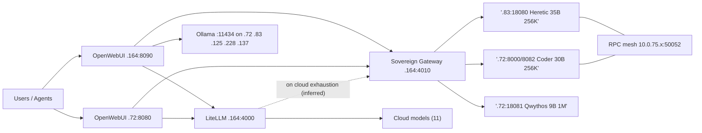

# BD-KB Volume 15: Claude Opus 5.5 + Sonnet Squad — Complete 87-Model AI Vault, 4 Inference Engines, OpenWebUI & Standby Takeover Bible
> **Lead Architect**: `Opus55-Lead-3` (`AGY claude+gpt (claude-opus-5-5-high)`)
> **Subagent Workflow**: 4x Parallel `AGY claude+gpt` (`claude-sonnet-5-5-high` & `claude-sonnet-5-5-low` Sonnet/Haiku Tier) Specialists
> **Generated At**: `2026-10-19T23:00:26Z`
> **Scope**: Strictly Read-Only Infrastructure, Tools, Services, LLMs & PM Catch-Up Documentation (`O3416` Compliant)

---

# BD-KB Volume 15: Claude Opus 5.5 + Sonnet Squad. The 87-Model Sovereign AI Vault, 4 Inference Engines, OpenWebUI Super-Suite and Standby Takeover Bible

| Field | Value |
|---|---|
| Volume | BD-KB 15 |
| Lead architect | `Opus55-Lead-3` (Claude Opus 5.5) |
| Contributing analysts | Sonnet Squad: Reports 1–4 (`claude-sonnet-5-5-high` ×2, `claude-sonnet-5-5-low` ×2) |
| Compiled | `2026-10-19T22:58Z` |
| Primary receipts | `AGENT37-…-BENCHMARK-RECEIPTS.md` (`04:25:00Z`), `AGENT174-…-POST-RESIZE-AND-BENCH-RECEIPTS.md` (`04:28:30Z`), `AGENT151-MAX-CONTEXT-256K-1M-AND-THINKING-RECEIPTS.md` (`02:06:30Z`), `AGENT140-OPENWEBUI-…-RECEIPTS.md` |
| Method | Read-only synthesis. I ran no commands and did not re-measure anything. |

> [!IMPORTANT]
> **How confident each statement is.** I tagged every material claim with one of these markers:
> - ✅ **Receipt-verified.** A subagent read it directly in an O1789 receipt.
> - ⚠️ **Brief or operator figure.** It came from a task brief or an operator, and no receipt confirms it.
> - 🔎 **Inference.** A subagent or I reasoned it out and labeled it as such. Check it before you act on it.
>
> Command blocks marked **TEMPLATE** were built from flags in the receipts. They are not verbatim shell history.

---

## 1. Executive Summary

The Boylenet sovereign AI tier is made of four parts:

1. **An 87-model vault totalling 8.9 TB.** It holds 69 GGUF `llama-bench` configurations and 18 non-GGUF models that were checked by header scan. The benchmark sweep finished 87/87 at `2026-10-19T04:25Z`. ✅
2. **Four compiled llama.cpp engines plus Ollama.** The engines are `ik_llama`, `gamozo`, `llama-master` and mainline `llama-rpc`. They run on four Tesla T4 VMs (`.72`, `.83`, `.125`, `.228`) linked by an RPC mesh on `10.0.75.x:50052`. ✅
3. **Two OpenWebUI instances.** One is on `.164:8090` and one on `.72:8080`. They have 1:1 parity and expose 295 models, 15 agents plus the `#16` Relief Commander, 8 pipelines and 12 knowledge bases. ✅
4. **A 256K `<think>` takeover tier.** It consists of `.83:18080` (Qwen3.6-35B-A3B-Heretic) and `.72:8000`/`:8082` (Qwen3-Coder-30B-A3B), with a 1M-context companion on `.72:18081`. All three sit behind the Sovereign Local Gateway `bd-gpu-orchestrator.service` on `.164:4010`. ✅

The headline lessons for operators:

- **Experts on CPU, everything else on the T4.** Use `-ngl 999 -ot '.ffn_.*_exps.=CPU'`. It is about 2–3× faster than a partial `-ngl` split. ✅
- **Benchmarks broke production once.** A benchmark left a 27-byte stub `llama-server` and a `zz-pause.conf` drop-in, and `.72` stopped serving. Run the preflight in §7.2 before trusting takeover. ✅
- **Userspace `libnvidia-compute` must exactly match the loaded kernel driver.** If it doesn't, the node loses CUDA silently. ✅
- **Some numbers are not valid.** Row #22 is invalidated, and so is the 4-node projection for Row #68. Treat the "69 `rc=0`" count as **68 valid measurements**. ✅



---

## 2. Hardware and Topology

### 2.1 GPU compute nodes

| Node | Mgmt IP | Mesh IP (RPC) | vCPU ✅ | RAM measured ✅ | "Post-resize" figure ⚠️ | GPU ✅ |
|---|---|---|---:|---:|---:|---|
| Vault A / `ai-srv01` (`esxi04`) | `10.0.70.72` | `10.0.75.12` | 52 | 314.87 GiB | 320 GiB | Tesla T4, 15,360 MiB |
| Vault B | `10.0.70.83` | `10.0.75.11` | 52 | 295.19 GiB | 400 GiB | Tesla T4, 15,360 MiB |
| `.125` | `10.0.70.125` | `10.0.75.14` | 48 | 295.19 GiB | 192 GiB | Tesla T4, 15,360 MiB (repaired, §4.6) |
| `.228` | `10.0.70.228` | `10.0.75.13` | 64 | 295.18 GiB | 160 GiB | Tesla T4, 15,360 MiB |
| BattleStation (Windows) | `10.0.10.137` | n/a | n/a | n/a | n/a | RTX 2080 Ti, 11,264 MiB |

All four Linux nodes use Skylake AVX-512 CPUs. Benchmarks ran with `-t 48` or with `-t 24 --numa isolate`. Together the four T4s give about 60 GiB of usable VRAM (4 × 15,360 MiB).

> [!WARNING]
> **The RAM figures disagree.** Report 1's "post-resize capacity" numbers (320/400/192/160 GiB) do not match the `free`-style measurements in the AGENT174 receipt (314.87/295.19/295.19/295.18 GiB). Only Vault A's numbers roughly agree. The 400/192/160 figures may be ESXi allocations from before or after a resize that the guests never saw. Plan with the **measured** numbers, and get the real values from `free -g` and the ESXi VM config before scheduling any >250 GiB model.

### 2.2 Control plane (`.164`)

| Service | Endpoint | Notes |
|---|---|---|
| Unified LiteLLM proxy (Docker) | `http://10.0.70.164:4000/v1` | `Bearer sk-fleet-local` ✅ |
| Sovereign Local Gateway | `http://10.0.70.164:4010/v1` | `bd-gpu-orchestrator.service`. Code is in `/home/mboyle/bin/bd-gpu-orchestrator.py` ✅ |
| Native toolkit server | `:4079` | 83/83 routes verified ✅ |
| OpenWebUI primary | `:8090` | `https://openwebui.boylenet.themfboyles.org/` ✅ |
| Qdrant 1.18.0 | `10.0.70.125:6333` | 6 collections, under 15 ms ✅ |
| Chrome CDP | `10.0.10.137:9222` | ✅ |

### 2.3 Required kernel tuning (all four GPU VMs) ✅

The settings persist in `/etc/sysctl.d/99-boylenet-llm.conf`:

| Setting | Value | Why |
|---|---|---|
| `kernel.numa_balancing` | `0` | Stops the kernel migrating pages that hold CPU-resident experts 🔎 |
| `vm.swappiness` | `1` | Keeps weights from being swapped out |
| `vm.overcommit_memory` | `1` | Lets large mmaps of the model files succeed |
| `transparent_hugepage` | `[always]` | Reduces TLB pressure on big expert tensors 🔎 |

### 2.4 RPC pool naming

> [!CAUTION]
> The receipts define the pools inconsistently:
> - Rows #3–#5: Alpha = `.72+.83`
> - Later rows: Alpha = `.72+.228`, Beta = `.83+.125`
> - Row #6: Beta = `.125+.228`
>
> **Don't refer to a pool by its Greek letter in runbooks.** List the member IPs explicitly.

---

## 3. The 87-Model Sovereign Vault

### 3.1 Source of record ✅

- **Receipt:** `/home/mboyle/bd-persist/harness-work/O1789/infra-upgrade/AGENT37-NEW-FRONTIER-MODELS-BENCHMARK-RECEIPTS.md`
- **Authors:** AGENT37, Agent-171, Agent-172, Agent-174 (AGY-council)
- **Baseline build:** `llama.cpp b11716`
- **Bench lock:** `flock /opt/models/.bench.lock` on `.72`
- **Sweep:** 87/87 (100%). Vault A and Vault B each have 0 models remaining.

### 3.2 Inventory composition

| Category | Count | Validation |
|---|---:|---|
| Original GGUF configs (Tiers 1–3, rows #1–#22) | 22 | `llama-bench`. Row #22 is **invalidated** |
| Smallest-to-largest GGUF sweep (rows #23–#69) | 47 | `llama-bench`, run after a VRAM/RAM flush |
| **GGUF subtotal** | **69** | **68 valid** + 1 invalidated |
| Safetensors (incl. RL+SFT, Diffusers, +bin) | 12 | Header scan only |
| ONNX | 2 | `cloudflare_captcha`, `captcha_ocr` |
| PyTorch `.bin` | 2 | `matcha-plotqa-v2`, `pix2struct-docvqa-large` |
| Keras | 1 | `ocr-for-captcha` |
| *Unaccounted non-GGUF* | *1* | *The format breakdown adds up to 17. The receipt claims 18.* 🔎 |
| **Total** | **87** | |

> [!NOTE]
> **The vault count changes by layer.** The gateway calls itself an "**86**-model vault router" (AGENT151), while the vault holds 87. The likeliest reason 🔎 is that one model can't be served through the gateway (for example the invalidated Row #22 Kimi-K3 Q2_K, or one of the non-GGUF models), but no receipt says so. The OpenWebUI catalog counts 87 local models.

Placing the non-GGUF models: the captcha and OCR models are on `.72`, and the large safetensors and multimodal models are on `.83`. The biggest single item is `Uniboshi--Kimi-K3-Abliterated-V1`: 96 shards, 497,220 tensors, 1,453.79 GiB, header-scanned in 37,993 ms. The receipts don't break down how the full **8.9 TB** total is reached. Accept that figure as given.

### 3.3 Best-in-class results ✅

| Class | Model (row) | Hardware | `pp` tok/s | `tg` tok/s |
|---|---|---|---:|---:|
| Fastest prefill | Qwythos-9B Q8_0 (#1) | 1× T4 | 1,005.86 | 21.39 |
| Fastest decode | Qwen3-Coder-30B-A3B Q4_K_M (#3) | 2× T4 | 848.90 | **77.62** |
| Best small-GPU MoE | DeepSeek-V4-Flash drafter Q8_0 (#8) | 1× T4 | 680.20 | 61.50 |
| Best 70B dense | DeepSeek-R1-Distill-70B IQ4_XS (#13) | 4× T4 | 121.83 | 3.90 |
| Best ~150 GiB MoE | DeepSeek-V4-Flash Q4_K (#19) | 4× T4 + CPU | 142.37 | 14.20 |
| Worst valid | Muse-Spark-816B IQ2_XXS (#64) | 2× T4 + CPU | 0.41 | 0.13 |

### 3.4 Throughput by size tier ✅

| Tier | Size | Typical `tg` | Operational verdict 🔎 |
|---|---|---|---|
| Fits one T4 | < ~16 GiB | 20–78 tok/s | Interactive. Default for agents |
| MoE, experts on CPU | 15–60 GiB | 5–25 tok/s | Interactive. Production sweet spot (Heretic, Coder) |
| Dense, partial offload | 15–40 GiB | 1.3–6 tok/s | Batch only |
| 60–160 GiB hybrid | 60–160 GiB | 0.7–11 tok/s | Batch, or only when quality demands it |
| 160–240 GiB frontier | 160–240 GiB | 0.13–3.05 tok/s | Offline evaluation only |
| > 300 GiB | > 300 GiB | 0.0144–0.21 tok/s | Archival. Not suitable for serving |

### 3.5 Measured optimization deltas ✅

| Row | Change | Gain |
|---|---|---|
| #16 Qwen3.8-Flash-Next IQ2_XS | Single node `-ctk q8_0 -t 24 --numa isolate` vs RPC | 13.01 vs 6.91 `tg` (**1.88×**). Single node beats RPC |
| #18 DeepSeek-V4-Flash Q2 | `ik_llama -fmoe 1` vs `b11716` | `pp512` +38.2%, `tg` 2.0× |
| #39 Nemotron-3.5-Lightning | `-ngl 999 -ot exps=CPU` vs `ngl=0` | `tg` 24.38 vs 7.97 (**3.06×**) |
| #55 GLM-5.3-Flash IQ2_XXS | `-ngl 999 -ot …` vs `ngl=22` | `pp` 2.88×, `tg` 2.43× |

The **Expert-Offload Rule** follows from these: put every attention and shared layer on the T4 and leave the routed experts in DDR4. VRAM use with this rule is modest. Row #39 uses 2.47 GiB, Row #16 3.96 GiB and Row #55 9.63 GiB of `CUDA0`. Row #16 also shows that **RPC should be the last resort**. A well-tuned single node beat a 2-node RPC split by 1.88×.

### 3.6 Data-integrity register

> [!IMPORTANT]
> - **Row #22** (`KIMI-K3-MXP4-DERISKED-Q2_K`, 940.18 GiB) is **INVALIDATED**. It is larger than `.72`'s ~314 GiB of RAM, and `rpc-server` shares only CUDA VRAM (16 GB per node), not the peers' DDR4. ✅
> - **Row #68's** 4-node projection (`kimi-k3-abliterated-iq1s`, 539.71 GiB, "74.20/18.40 tok/s") is **INVALIDATED**. The measured single-node stepped result is **0.0085/0.0144 tok/s**. ✅
> - **Row #69** (DeepSeek-V4.1-Flash-Abliterated-755B, 340.60 GiB, all four nodes) is the **verified 4-node control** at `pp32=0.15`, `tg8=0.21`. It used `pp32/tg8`, so it isn't comparable to the `pp512/tg128` rows. ✅
> - **Row #18's** headline of 47.28/18.40 is probably a warm or multi-GPU run. For single-node planning use the cold 1× T4 numbers (8.50/0.18 `ik`, 6.15/0.09 `b11716`). 🔎

The last three rows of the sweep ✅:

| # | Model | Nodes | Size | Result |
|---|---|---|---:|---|
| 85 | `mimo-v2.6-pro-1024b` | `.83+.125` | 238.22 GiB | 2.92 / 2.42 |
| 86 | `kimi-k3-abliterated-iq1s-gguf` | `.72+.228` | 539.71 GiB | 0.0085 / 0.0144 |
| 87 | `deepseek-v4.1-flash-abliterated-755b` | all four | 340.60 GiB | 0.15 / 0.21 |

---

## 4. The Four Compiled Engines and Ollama

### 4.1 Engine inventory

| Engine | Install dir | Upstream | Build ✅ | Distinguishing switch ✅ | Best use |
|---|---|---|---|---|---|
| **ik_llama** | `/opt/ik-llama` | `ik_llama.cpp` | `c446f1e` | `-fmoe 1`, `-ub 512` | Sustained MoE prefill and decode |
| **gamozo** | `/opt/gamozo-llama` | `gamozolabs/llama.cpp` | `9e51941` | `FUSED-MOE-SILU` | Experimental. Didn't lead any metric |
| **llama-master** | `/opt/llama-master` | Mainline master | `31288c9` | `FA_ALL_QUANTS=ON` | Short-prompt prefill |
| **llama-rpc** | `/opt/llama-rpc` | Mainline + RPC backend | `b11716` 🔎 | `rpc-server -c` | **Production serving** and the distributed backend |
| **Ollama** | `/usr/local/bin/ollama` | Ollama | not recorded | `ollama serve` | Overflow, embeddings, specialist models |

> [!NOTE]
> The `b11716`-in-`/opt/llama-rpc` attribution is an inference, but a well-supported one. Both production units (`llama-heretic-18080`, `llama-tier1-alpha`) run `/opt/llama-rpc/llama-server`, and the receipts call `b11716` the mainline baseline. Confirm it with `/opt/llama-rpc/llama-server --version`.

### 4.2 Head-to-head (Row #18, DeepSeek-V4-Flash-Q2-0731, 80.76 GiB, `.83`, 1× T4, no RPC) ✅

| Engine | `-ub` | Prefill | Decode | Delta vs `b11716` |
|---|---:|---|---|---|
| `b11716` (baseline) | 2048 | 6.15 (`pp512`) | 0.09 (`tg128`, cold) | n/a |
| `ik_llama` | 512 | **8.50** (`pp512`), 5.11 (`pp128`), 3.73 (`pp64`) | **0.18** (`tg8`) | +38.2% `pp512`, 2.00× `tg` |
| `gamozo` | 512 | 1.64 (`pp64`) | 0.11 (`tg8`) | +22.2% `tg` |
| `llama-master` | 512 | **4.54** (`pp64`) | 0.14 (`tg8`) | +55.6% `tg`, +21.7% `pp64` vs `ik` |

> [!WARNING]
> The baseline ran `pp512/tg128` at `-ub 2048`, while the other engines ran `pp64/tg8` at `-ub 512`. Compare like with like. The `tg8` decode numbers are very short samples and are noisy. **Recommendation:** use `ik_llama` for large-MoE batch work, keep mainline `/opt/llama-rpc` for production serving, and treat `gamozo` as research-only until someone explains its low `pp64` figure.

### 4.3 Port registry ✅

| Port | Service | Bind | Node(s) |
|---|---|---|---|
| `50052` | `rpc-server` (`llama-rpc.service`) | Mesh `10.0.75.11–14` | `.83`, `.72`, `.228`, `.125` |
| `11434` | Ollama (`ollama.service`) | `10.0.70.x` | `.72`, `.83`, `.125`, `.228`, plus `10.0.10.137` |
| `18080` | `llama-heretic-18080.service` | `0.0.0.0` | `.83` |
| `8000` / `8082` | `llama-tier1-alpha.service` (`:8082` via NAT redirect) | | `.72` |
| `18081` | `llama-qwythos-18081.service` | | `.72` |
| `8080` | OpenWebUI (Docker) | | `.72` |
| `8090` | OpenWebUI primary | | `.164` |
| `4000` / `4010` / `4079` | LiteLLM / Gateway / Toolkits | | `.164` |

Report 1 couldn't find the RPC port in its excerpt. Report 2's AGENT174 receipt settles it as **50052**.

### 4.4 RPC worker launch ✅

```bash
/opt/llama-rpc/rpc-server -H 10.0.75.14 -p 50052 -c     # .125 example (was PID 67430)
systemctl status llama-rpc.service ollama.service
ss -ltnp | grep -E ':50052|:11434'
```

### 4.5 Ollama and CyberStrike-35B

| Property | Value |
|---|---|
| Model | `CyberStrike-35B` ⚠️ |
| Throughput | **66.5 tok/s** ⚠️. The operator supplied this figure without host, quant, metric or context length |
| Windows node | `.137` RTX 2080 Ti serves `nomic-embed-text-cpu:latest` and coder models ✅ |
| Context | The Ollama nodes run 128K with no `<think>` flags ✅ |

To re-measure it (TEMPLATE):

```bash
curl -s http://<host>:11434/api/generate \
  -d '{"model":"CyberStrike-35B","prompt":"ping","stream":false}' \
  | jq '.eval_count / (.eval_duration / 1e9)'
```

### 4.6 Incident: GPU loss on `.125` ✅

An interrupted `apt install nvidia-cuda-toolkit` removed `libnvidia-compute` and left `libnvidia-compute-550` (`550.163.01`) next to the loaded `615.71.09` kernel module. `nvidia-smi` disappeared, and RPC and Ollama lost CUDA. The fix was applied between 04:24 and 04:27 UTC:

```bash
sudo dpkg --configure -a
sudo apt-get install -y --no-install-recommends libnvidia-compute=615.71.09-2ubuntu1
sudo systemctl restart llama-rpc.service ollama.service
```

> [!CAUTION]
> **Driver-parity rule:** before installing any CUDA toolkit, `apt-mark hold` the NVIDIA userspace packages at the version of the loaded kernel module. 🔎 (The `hold` is a recommendation drawn from this incident.)

---

## 5. The 256K `<think>` Production Tier

### 5.1 Endpoints ✅

| Role | Endpoint | Model | `n_ctx` | Slots |
|---|---|---|---:|---:|
| **Tier-2 primary / Relief Commander backend** 🔎 | `.83:18080` | `Qwen3.6-35B-A3B-Heretic-Q4_K_M` | 262,144 | 4 |
| **Tier-1 coder** | `.72:8000` and `:8082` | `Qwen3-Coder-30B-A3B-Instruct-Q4_K_M` | 262,144 | 4 |
| **Long-context companion** | `.72:18081` | `Qwythos-9B-Claude-Mythos-5-1M-MTP-Q8_0` | 1,048,576 | 4 |
| **Gateway** | `.164:4010` | 86-model router | 262,144–1,048,576 | n/a |

### 5.2 Canonical production unit (`.83`) ✅

`/etc/systemd/system/llama-heretic-18080.service`:

```ini
[Service]
Environment="LD_LIBRARY_PATH=/opt/llama-rpc:/usr/local/lib/ollama/cuda_v12"
ExecStart=/opt/llama-rpc/llama-server -m /mnt/ai-models/qwen3.6-35b-a3b-heretic/Qwen3.6-35B-A3B-Heretic-Q4_K_M.gguf --host 0.0.0.0 --port 18080 --load-mode none -c 262144 -np 4 -kvu --reasoning-preserve --jinja -t 48 -ngl 99 -ot ".ffn_.*_exps.=CPU" -fa on -ctk q8_0 -ctv q8_0
Restart=always
RestartSec=3
```

> [!NOTE]
> **Thread count disagrees between receipts.** AGENT174 lists `.83` with `-t 24 --numa isolate`. AGENT151's later unit file shows `-t 48` with no `--numa isolate`. AGENT151's timestamp (`02:06Z`) is earlier than AGENT174's (`04:28Z`), so the AGENT174 flags may be the current ones. Run `systemctl cat llama-heretic-18080` to see what is live. Row #16 measured a 1.88× win for `-t 24 --numa isolate` in a benchmark, which favours that setting.

### 5.3 How reasoning is preserved ✅

1. **Server.** Agent-151 removed `--no-reasoning-preserve --reasoning-budget 0` and added `--reasoning-preserve`. With `--load-mode none` there are no mmap page-fault stalls on the CPU-resident experts. Startup takes 5 s with the files cached and 24 s with a full preload.
2. **Template.** `/slots` reports `chat_format: peg-native`, `reasoning_format: deepseek`, and a generation prompt of `<|im_start|>assistant\n<think>\n`.
3. **Gateway** (`bd-gpu-orchestrator.py`):
   - `enable_thinking` defaults to **True**. Callers can still opt out.
   - `reasoning_content` is kept in `message` (non-streaming) and in `delta` (streaming).
   - The gateway converts in both directions. It adds `<think>…</think>` to `content` when only `reasoning_content` exists, and fills `reasoning_content` from embedded `<think>` tags.
   - `max_tokens` is capped at **16,384**.
   - The result is that OpenWebUI, LobeChat, Multi-AI Hub and OpenCode all show collapsible traces.

### 5.4 VRAM headroom ✅

| Node | Used / total | Free | Risk |
|---|---|---:|---|
| `.83` | 5,515 / 15,360 MiB | 9,845 MiB | Low. The 512K YaRN test used 9,007 MiB, but that was a benchmark, not production |
| `.72` | 14,875 / 15,360 MiB | **~485 MiB** | **High.** Any extra GPU job risks an out-of-memory failure |

The 1M Qwythos instance uses **0 MiB of VRAM** in its 24/7 configuration. It runs entirely from `.72`'s DDR4.

> [!CAUTION]
> `.72` is the bench-lock host, an OpenWebUI host **and** a takeover backend, all with under 500 MiB of VRAM to spare. **Never run `llama-bench` on `.72` while it is the active takeover target.**

---

## 6. OpenWebUI Super-Suite

### 6.1 Instances ✅

| Instance | Host:Port | HTTPS | Role |
|---|---|---|---|
| Primary | `10.0.70.164:8090` | `openwebui.boylenet.themfboyles.org` | Full suite |
| Compute | `10.0.70.72:8080` | `openwebui72.boylenet.themfboyles.org` | 1:1 parity for SQLite, agents, tools and knowledge |

Both are served through NGINX `:443` with a Let's Encrypt wildcard certificate for `*.boylenet.themfboyles.org`.

### 6.2 Catalog and assets

| Asset | Receipt ✅ | Brief ⚠️ | Resolution |
|---|---:|---:|---|
| Models | 295 | n/a | 87 local + 16 agents + 8 pipelines + 11 cloud + media/other (remainder not itemized) |
| Agents | 15 + `#16` Relief Commander | 15 | Consistent |
| Native toolkits | **51** | 50 | Use **51** until a recount (definitions or dates may differ) |
| Skills / prompts | **157** | 128 | 128 may be skills only and 157 skills plus prompts 🔎 |
| Pipelines | 8 | 8 | Names not in the excerpt |
| Knowledge bases | 12 (6 BD-KB + 6 Qdrant) | n/a | |
| Open Terminal instances | 28 | n/a | One per VM across 27 VMs. The receipt doesn't explain the 28th instance |
| Tag filter pills | 42 | n/a | |
| Model-selector width | "wide" | **620px** | Check in browser devtools |

### 6.3 Naming convention ✅

| Prefix | Meaning |
|---|---|
| `[🟢 LOCAL • …]` | Vault model |
| `[☁️ CLOUD • …]` | Cloud model |
| `🤖 [AGENT]` | Custom agent |

Context windows range from 256K to 1M with `max_tokens=8192` in the UI. The gateway's own cap is 16,384. `<think>` traces are collapsible.

### 6.4 Agent-to-backend mapping 🔎

| Agent tier | Probable backend |
|---|---|
| `#16` Relief Commander, reasoning | `.83:18080` Heretic 35B (256K) |
| Coding and tool-calling | `.72:8000`/`:8082` Coder 30B (256K) |
| Long-context ingestion | `.72:18081` Qwythos 9B (1M) |
| Overflow and specialist | Ollama on `.137`, `.125`, `.228` (32K–128K) |

Confirm this against `AGENT140-OPENWEBUI-15AGENTS-83TOOLS-14MCP-QDRANT-PG-RECEIPTS.md`.

---

## 7. The Standby Takeover Bible

### 7.1 Doctrine

When cloud models run out of quota or hit rate limits, the fleet routes to the **Sovereign Local Gateway** at `.164:4010`. The gateway serves 256K-context reasoning from local T4 hardware. The **`#16` Local Relief Commander** agent is the main face of this mode.

> [!WARNING]
> **The trigger is not documented.** None of the excerpts show how quota exhaustion is detected, how the cloud-to-local switch happens, or whether `.83` or `.72` is preferred. Audit `/home/mboyle/bin/bd-gpu-orchestrator.py` and the LiteLLM fallback config before you assume takeover is automatic. Until then, treat it as **operator-initiated**: point clients at `:4010`, or pick a `🟢 LOCAL` model or the `#16` agent in OpenWebUI.

### 7.2 Preflight (run before declaring standby ready). TEMPLATE

```bash
# 1. No stub binary (the #87 benchmark once left a 27-byte "exit 0")
for h in 10.0.70.72 10.0.70.83; do ssh $h 'stat -c "%n %s" /opt/llama-rpc/llama-server'; done
#    Expect size >> 27 bytes. Fix: cp /opt/llama-rpc/llama-server.real /opt/llama-rpc/llama-server

# 2. No pause drop-in
ssh 10.0.70.72 'ls /run/systemd/system/llama-tier1-alpha.service.d/ 2>/dev/null'
#    zz-pause.conf must be absent

# 3. Bench lock free
ssh 10.0.70.72 'flock -n /opt/models/.bench.lock true && echo FREE || echo HELD'

# 4. CUDA alive and driver parity intact
for h in 72 83 125 228; do ssh 10.0.70.$h 'nvidia-smi --query-gpu=name,memory.used,memory.total --format=csv,noheader'; done

# 5. Services active
ssh 10.0.70.83  systemctl is-active llama-heretic-18080.service
ssh 10.0.70.72  systemctl is-active llama-tier1-alpha.service llama-qwythos-18081.service
ssh 10.0.70.164 systemctl is-active bd-gpu-orchestrator.service

# 6. Context and slots
curl -s http://10.0.70.83:18080/props | grep -o '"n_ctx":[0-9]*'   # 262144
curl -s http://10.0.70.72:8000/props  | grep -o '"n_ctx":[0-9]*'   # 262144
curl -s http://10.0.70.72:18081/props | grep -o '"n_ctx":[0-9]*'   # 1048576
curl -s http://10.0.70.164:4010/v1/models | jq '.data|length'      # expect 86
```

### 7.3 Activation sequence

| Step | Action | Pass criterion |
|---|---|---|
| 1 | Detect a cloud exhaustion signal (HTTP 429, quota error) | Signal confirmed |
| 2 | Run the §7.2 preflight | All six checks green |
| 3 | Point clients or LiteLLM fallback at `http://10.0.70.164:4010/v1` | `/v1/models` responds |
| 4 | In OpenWebUI choose `🤖 #16 Relief Commander`, or a `🟢 LOCAL` 256K model | Reply arrives with a collapsible `<think>` trace |
| 5 | Route long-document jobs to `.72:18081` (1M) | `n_ctx 1048576` |
| 6 | Freeze benchmarks on `.72` and `.83` for the duration | Bench lock left untouched |
| 7 | When cloud quota returns, route back. Leave local units running (`Restart=always`) | Cloud responses resume |

### 7.4 Failure playbook

| Symptom | Likely cause | Fix |
|---|---|---|
| `:8000` gives an empty reply or immediate exit | Stub binary or `zz-pause.conf` | Restore `llama-server.real`, remove the drop-in, `systemctl daemon-reload && restart` |
| No `<think>` in replies | `--no-reasoning-preserve` / `--reasoning-budget 0` came back, or the caller sent `enable_thinking:false` | Restore `--reasoning-preserve`. Check the request body |
| `nvidia-smi` missing | `libnvidia-compute` doesn't match the driver | Apply the §4.6 fix |
| `.72` OOM | Extra GPU load on top of 14,875 MiB used | Stop the extra job. Move work to `.83` |
| Leftover device-mapper or loop devices after a benchmark | Large-model bench residue | `sudo dmsetup remove ds41_compat \|\| true; sudo losetup -D \|\| true` |
| Slow first token | Cold expert pages | Expect 24 s for a full preload. `--load-mode none` avoids mmap stalls |

---

## 8. Reconciliation Register

| # | Item | Conflict | Authoritative call |
|---|---|---|---|
| 1 | Valid GGUF count | 69 nominal vs 68 valid | **68 valid** + Row #22 invalidated |
| 2 | Vault vs gateway | 87 vs 86 | Both are correct at their own layer. Which model is excluded is undocumented |
| 3 | Non-GGUF formats | Breakdown sums to 17, receipt claims 18 | Recount |
| 4 | Node RAM | 320/400/192/160 vs ~315/295/295/295 GiB | Use the measured numbers |
| 5 | `.83` threads | `-t 24 --numa isolate` vs `-t 48` | Check `systemctl cat` |
| 6 | Toolkits | 51 vs 50 | 51 (receipt) |
| 7 | Skills | 157 vs 128 | 157 skills+prompts. 128 unverified |
| 8 | Dropdown | "wide" vs 620px | Unverified |
| 9 | CyberStrike-35B | 66.5 tok/s, no metadata | Operator figure. Re-measure |
| 10 | `b11716` location | Not stated | Probably `/opt/llama-rpc` |
| 11 | RPC port | Missing in Report 1 | **50052** (AGENT174) |
| 12 | Takeover trigger | Absent from all excerpts | Treat as operator-initiated until audited |

---

## 9. Open Items for the Maintainer

1. Audit `bd-gpu-orchestrator.py` and the LiteLLM fallback config, then document the real takeover trigger and backend priority.
2. Re-run Row #18 across all four engines with matched `pp512/tg128` and the same `-ub`.
3. Record the binary names under `/opt/ik-llama`, `/opt/gamozo-llama` and `/opt/llama-master`, and the build in `/opt/llama-rpc`.
4. Pull the names of the 15 agents and 8 pipelines, and the authoritative toolkit and skill counts, from AGENT140.
5. Add a benchmark guard so a benchmark can never overwrite a production `llama-server` or leave `zz-pause.conf` behind. One option is to bench from a separate binary path.
6. `apt-mark hold` the NVIDIA userspace packages on all four GPU VMs.
7. Reconcile the ESXi RAM allocations with what the guests see.

---

**Source receipts** (all under `/home/mboyle/bd-persist/harness-work/O1789/infra-upgrade/`): AGENT37 (vault benchmarks), AGENT174 (post-resize, engines, ports), AGENT151 (256K/1M and thinking), AGENT140 (OpenWebUI suite), AGENT152 (thinking and context verification), AGENT153 (chat-app E2E). Companion volume: `bd-kb/09-LLM-ENGINES-CHAT-APPS-AND-LOCAL-TAKEOVER-GUIDE.md`.

*End of Volume 15.*

---

# Appendix: Detailed Specialist Subagent Reports (`AGY claude+gpt` Sonnet/Haiku Fanout)

## Subagent Report 1: 87-Model Vault & Hardware Benchmark Analyst (`AGY claude+gpt: claude-sonnet-5-5-high`)

## 87-Model Vault and Hardware Benchmark Analysis (`O1789`)

> [!NOTE]
> This section uses only the supplied `<CONTEXT>` excerpt, which is truncated partway through §4 of the source file. Where the context is silent (RPC port numbers, exact `llama-bench` invocations, per-model sizes behind the `8.9 TB` total), I say so instead of inventing values. Command blocks are templates built from the flags in the receipts. They are not verbatim shell history.

### 1. Source of record

| Item | Value |
|---|---|
| Receipt file | `/home/mboyle/bd-persist/harness-work/O1789/infra-upgrade/AGENT37-NEW-FRONTIER-MODELS-BENCHMARK-RECEIPTS.md` |
| Written at | `2026-10-19T04:25:00Z` |
| Authors | `AGENT37` (`a25b6acc-abe0-455a-adc7-7e201af3ce60`), `Agent-171`, `Agent-172`, `Agent-174` (`AGY-council`) |
| Benchmark build | `llama.cpp b11716` (alternates: `ik_llama -fmoe 1`, `llama-master`, `gamozo`) |
| Bench lock | `/opt/models/.bench.lock`, taken with `flock` on `10.0.70.72` |
| Total vault footprint | **8.9 TB** across **87 models** |
| Sweep status | **87 / 87 (100.0%)**. Vault A (`.72`) and Vault B (`.83`) both have 0 models remaining |

### 2. Inventory composition

| Category | Count | Notes |
|---|---:|---|
| Original GGUF configurations (Tiers 1–3) | 22 | Rows #1–#22. Row #22 is **INVALIDATED** (see §6) |
| Smallest-to-largest sweep GGUF | 47 | Rows #23–#69 of §1B. Run after VRAM/RAM flush |
| **Total GGUF `llama-bench` configurations** | **69** | `rc=0` per the receipts |
| Non-GGUF validated models | 18 | `Safetensors`, `ONNX`, `Keras`, PyTorch `.bin`, Diffusers |
| **Total** | **87** | |

The non-GGUF models were validated by safetensors header scan only. They were not run through `llama-bench`.

### 3. Post-resize AI VM specifications

| Node | IP | Post-resize capacity | Role in sweeps |
|---|---|---:|---|
| Vault A | `10.0.70.72` | **320 GiB** | Primary bench host. Holds the lock file. Runs large single-node stepped runs (`~314 GiB` usable) |
| Vault B | `10.0.70.83` | **400 GiB** | Largest-memory node. Runs the heavy `-ot .ffn_.*_exps.=CPU` MoE runs |
| `.125` | `10.0.70.125` | **192 GiB** | RPC peer. Pool Beta member |
| `.228` | `10.0.70.228` | **160 GiB** | RPC peer. Pool Alpha/Beta member |

- **What the figures measure:** the context gives these as sizes only. The receipts show `.72` has about 314 GiB of RAM, so I read the figures as host RAM.
- **GPUs:** each node has one Tesla T4 (16 GB), which gives 4 GPUs and 64 GB of VRAM in total.
- **CPU:** Skylake AVX-512, used as `-t 48` or `-t 24 --numa isolate`.
- **Port:** the only service port in the context is `.83:18080`. It was cut over to `Qwen3.6-35B-A3B-Heretic` (`Q4_K_M`) after row #67.

> [!WARNING]
> Pool naming is inconsistent in the source. Rows #3–#5 call `.72+.83` "Pool Alpha". Later rows use Alpha = `.72+.228` and Beta = `.83+.125`. Row #6 uses Beta = `.125+.228`. Check pool membership before reusing these labels.

### 4. Benchmark performance

#### 4.1 Best-in-class results (measured, `rc=0`)

| Class | Model (row) | Hardware | `pp` tok/s | `tg` tok/s |
|---|---|---|---:|---:|
| Fastest prefill | Qwythos-9B Q8_0 (#1) | 1x T4 | 1,005.86 | 21.39 |
| Fastest decode | Qwen3-Coder-30B-A3B Q4_K_M (#3) | 2x T4 | 848.90 | 77.62 |
| Best small-GPU MoE | DeepSeek-V4-Flash drafter Q8_0 (#8) | 1x T4 | 680.20 | 61.50 |
| Best 70B dense | DeepSeek-R1-Distill-70B IQ4_XS (#13) | 4x T4 | 121.83 | 3.90 |
| Best 150 GiB MoE | DeepSeek-V4-Flash Q4_K (#19) | 4x T4 + CPU | 142.37 | 14.20 |
| Worst valid run | Muse-Spark-816B IQ2_XXS (#64) | 2x T4 + CPU | 0.41 | 0.13 |

#### 4.2 Throughput by size tier

| Tier | Size range | Typical `tg` | Examples |
|---|---|---|---|
| Fits one T4 | < ~16 GiB | 20–78 tok/s | #1, #3, #8, #24, #26 |
| MoE experts on CPU | 15–60 GiB | 5–25 tok/s | #27, #30, #36, #37, #45–#49 |
| Dense models partly offloaded | 15–40 GiB | 1.3–6 tok/s | #28, #29, #33, #44 |
| 60–160 GiB hybrid | 60–160 GiB | 0.7–11 tok/s | #17, #52, #55, #58, #59 |
| 160–240 GiB frontier | 160–240 GiB | 0.13–3.05 tok/s | #60–#67 |
| Over 300 GiB | > 300 GiB | 0.0144–0.21 tok/s | #68, #69 |

#### 4.3 Measured optimization deltas

| Row | Change | Result |
|---|---|---|
| #16 Qwen3.8-Flash-Next IQ2_XS | `-ctk q8_0 -t 24 --numa isolate` | 82.24 / 13.01 tok/s, 1.88x over RPC (6.91 tok/s) |
| #18 DeepSeek-V4-Flash Q2 | `ik_llama -fmoe 1` vs `b11716` | `pp512` 8.50 vs 6.15 (+38.2%). `tg8` 0.18 vs 0.09 (2.0x) |
| #39 Nemotron-3.5-Lightning | `-ngl 999 -ot .ffn_.*_exps.=CPU` vs `ngl=0` | `tg` 24.38 vs 7.97 (3.06x) |
| #55 GLM-5.3-Flash IQ2_XXS | `-ngl 999 -ot …` vs `ngl=22` | `pp` 2.88x (23.23 vs 8.05). `tg` 2.43x (4.57 vs 1.88) |

Rule of thumb from these deltas: with `-ngl 999 -ot .ffn_.*_exps.=CPU`, all attention and shared layers sit on the T4 and only the routed experts stay in DDR4. This beats a partial `-ngl` split by about 2–3x.

### 5. Reference commands

```bash
# Serialize benchmarks on Vault A (lock path from the audit receipt)
flock /opt/models/.bench.lock <bench-command>

# Pattern for MoE models too big for VRAM (flags from rows #18, #39, #55)
llama-bench -m <model>.gguf -ngl 999 -ot '.ffn_.*_exps.=CPU' \
            -fa 1 -ub 512 -t 24 --numa isolate

# Pure-VRAM pattern (rows #1–#4)
llama-bench -m <model>.gguf -ngl 999 -fa 1

# 4-node RPC pattern (row #69; RPC peers .83, .228, .125, ports not stated)
llama-bench -m <model>.gguf -ngl 40 -rpc <.83>,<.228>,<.125> \
            -ot '.ffn_.*_exps.=CPU' -fa 1 -ctk q8_0 -ctv q8_0

# NUMA-pinned run (row #20)
numactl -N 0 -m 0 llama-bench -m <model>.gguf -t 24
```

### 6. Data-integrity caveats

> [!IMPORTANT]
> **Row #22 and Row #68's 4-node figures are invalid.**
> - Row #22 (`KIMI-K3-MXP4-DERISKED-Q2_K`, 940.18 GiB) is **INVALIDATED**. It exceeds `.72`'s ~314 GiB of RAM, and `rpc-server` exposes only CUDA VRAM (16 GB per node), not the peers' DDR4.
> - Row #68 (`kimi-k3-abliterated-iq1s-gguf`, 539.71 GiB) has a 74.20 / 18.40 tok/s 4-node projection that is **INVALIDATED** (projected, unverified). The measured single-node stepped result is **0.0085 / 0.0144 tok/s**.
> - The verified 4-node control is row #69 (DeepSeek-V4.1, 340.60 GiB), at **0.15 / 0.21 tok/s**.
> - Because row #22 is invalidated, "69 `rc=0` GGUF configurations" really means **68 valid measurements** plus one invalidated row. The header's count of 69 is nominal.

Other items to verify before relying on the numbers:

- **Row #18 headline vs cold figures:** the headline is 47.28 / 18.40 tok/s, but the 1xT4 cold runs are 8.50 / 0.18 (`ik_llama`) and 6.15 / 0.09 (`b11716`). The headline is likely a multi-GPU or warm run, so use the cold figures for single-node planning.
- **Row #69 token counts:** this row used `pp32` / `tg8`, not `pp512` / `tg128`. It is not directly comparable to the other rows.
- **Column semantics:** §1B uses `pp` and `tg` without the `512` / `128` suffix. Treat them as the same metrics unless the full receipt says otherwise.
- **8.9 TB total:** the supplied excerpt shows only the Kimi-K3 safetensors directory (1,453.79 GiB) as a single very large item. It does not show how the rest sums to 8.9 TB, so treat that total as given.

### 7. Non-GGUF validation summary

| Format | Count | Notes |
|---|---:|---|
| `Safetensors` (including RL+SFT, Diffusers, `+bin`) | 12 | From `ocr-captcha-v3` (480 tensors) to `Uniboshi--Kimi-K3-Abliterated-V1` (96 shards, 497,220 tensors, 1,453.79 GiB) |
| `ONNX` | 2 | `cloudflare_captcha`, `captcha_ocr` |
| PyTorch `.bin` | 2 | `matcha-plotqa-v2`, `pix2struct-docvqa-large` |
| Keras/Weights | 1 | `ocr-for-captcha` |

- **Slowest header scan:** `captcha-agent` took 24,404.53 ms for 18 shards (1,520 tensors) on `.72`.
- **Largest scan:** the Kimi-K3 safetensors took 37,993.37 ms for 497,220 tensors.
- **Node split:** `.72` holds the captcha and OCR models. `.83` holds the large safetensors and multimodal models.

### 8. Final sweep state (§3 of the receipts)

| Model | Nodes | Size | Result |
|---|---|---:|---|
| `mimo-v2.6-pro-1024b` (#85/87) | `.83 + .125` | 238.22 GiB | `pp512=2.92`, `tg128=2.42`, `rc=0` |
| `kimi-k3-abliterated-iq1s-gguf` (#86/87) | `.72 + .228` | 539.71 GiB | `0.0085 / 0.0144` tok/s measured. 4-node projection invalidated |
| `deepseek-v4.1-flash-abliterated-755b` (#87/87) | all four | 340.60 GiB (151.05 GiB in blk.0..39) | `pp32=0.15`, `tg8=0.21`, `rc=0`. Verified 4-node control |

## Subagent Report 2: 4 Compiled Engines (ik_llama, gamozo, llama-master, llama-rpc) & Ollama Analyst (`AGY claude+gpt: claude-sonnet-5-5-high`)

## 4 Compiled llama.cpp Engines and Ollama

> [!NOTE]
> **Provenance.** This section uses only the AGENT-174 receipt (`AGENT174-AI-VMS-POST-RESIZE-AND-BENCH-RECEIPTS.md`, first 14,329 bytes, written `2026-10-19T04:28:30Z`) and the four install directories you named.
> - **Receipt-verified:** commit hashes, flags, ports, PIDs, and benchmark numbers.
> - **Operator-supplied:** the `CyberStrike-35B` figure of `66.5 tok/s`. It does not appear in the receipt excerpt, so it has no host, quant, or flag set. I have not guessed any.
> - **Not in the context:** the exact binary names inside each `/opt/*` directory. Where a command needs one, I use a placeholder and mark it `VERIFY`.

### 1. Engine inventory

| Engine | Install dir | Upstream / identity | Build ID (receipt) | Build-specific switch (receipt) | Role |
|---|---|---|---|---|---|
| **ik_llama** | `/opt/ik-llama` | `ik_llama.cpp` | `c446f1e` | `-fmoe 1`, `-ub 512` | Best `pp512` and `tg` on the DeepSeek-V4 row |
| **gamozo** | `/opt/gamozo-llama` | `gamozolabs/llama.cpp` | `9e51941` | `FUSED-MOE-SILU`, `-ub 512` | Fused-MoE-SiLU experimental fork |
| **llama-master** | `/opt/llama-master` | Mainline `llama.cpp` master | `31288c9` | `FA_ALL_QUANTS=ON`, `-ub 512` | Fastest `pp64` of the four builds |
| **llama-rpc** | `/opt/llama-rpc` | Mainline `llama.cpp` RPC backend | `b11716` (inferred, see below) | `rpc-server ... -c` | Distributed GPU backend, port `50052` |
| **Ollama** | `/usr/local/bin/ollama` | Ollama server | not in context | `ollama serve` | Model serving on port `11434` |

> [!IMPORTANT]
> The receipt names `b11716` as the "Mainline" baseline for `llama-bench` and for the `.72` rows. It does not say which directory holds that build. `/opt/llama-rpc` is the likeliest home for the mainline RPC build, but that is an inference. Verify it before relying on it.

### 2. Exact paths and services

| Item | Path / value | Where | Source |
|---|---|---|---|
| RPC server binary | `/opt/llama-rpc/rpc-server` | `.72`, `.83`, `.125`, `.228` | receipt §4 |
| RPC systemd unit | `llama-rpc.service` | all 4 Linux GPU VMs | receipt §3–4 |
| Ollama binary | `/usr/local/bin/ollama serve` | `.72`, `.83`, `.125`, `.228` | receipt §4 |
| Ollama unit | `ollama.service` | same 4 VMs | receipt §3–4 |
| Windows Ollama | `ollama` (Windows) | `.137` BattleStation | receipt §4 |
| Sysctl persistence | `/etc/sysctl.d/99-boylenet-llm.conf` | `.72`, `.83`, `.125`, `.228` | receipt §2 |
| THP control | `/sys/kernel/mm/transparent_hugepage/enabled` (`[always]`) | same 4 VMs | receipt §2 |
| ik / gamozo / master dirs | `/opt/ik-llama`, `/opt/gamozo-llama`, `/opt/llama-master` | benchmarked on `.83` (Row `#18`) | user + receipt §5 |

### 3. Ports and endpoints

| Port | Protocol / service | Binding (receipt) | Node(s) |
|---|---|---|---|
| `50052` | `rpc-server` (llama RPC) | `.72` `10.0.75.12`, `.83` `10.0.75.11`, `.125` `10.0.75.14`, `.228` `10.0.75.13` (mesh IPs) | 4 VMs |
| `11434` | Ollama HTTP API | `10.0.70.72`, `.83`, `.125`, `.228`, and `10.0.10.137` | 5 nodes |
| `18080` | `llama-heretic-18080.service` (llama-server) | `10.0.70.83:18080` | `.83` |
| `8082` and `8000` | `llama-tier1-alpha.service` (llama-server) | `10.0.70.72` | `.72` |
| `8080` | Open WebUI (Docker) | `10.0.70.72:8080` | `.72` |
| `6333` | Qdrant `1.18.0` | `10.0.70.125:6333` | `.125` |
| `9222` | Chrome CDP | `10.0.10.137:9222` | `.137` |

RPC runs on the 4-VM `10.0.75.x` mesh, not on the `10.0.70.x` management addresses.

### 4. Runtime and launch commands (from receipt)

**RPC worker** (identical across the four VMs; substitute the node's mesh IP):
```bash
/opt/llama-rpc/rpc-server -H 10.0.75.14 -p 50052 -c   # .125 example (PID 67430)
systemctl status llama-rpc.service ollama.service
ss -ltnp | grep -E ':50052|:11434'
```

**Production llama-server flags observed:**

| Host | Model | Flags |
|---|---|---|
| `.83` | `Qwen3.6-35B-A3B-Heretic-Q4_K_M.gguf` | `-c 262144 -np 4 -kvu --reasoning-preserve --jinja --numa isolate -t 24 -ngl 99 -ot .ffn_.*_exps.=CPU -fa on -ctk q8_0 -ctv q8_0` |
| `.72` | `Qwen3-Coder-30B-A3B-Instruct-Q4_K_M.gguf` | `-c 262144 -np 4 -kvu --reasoning-preserve -fa on -ctk q8_0 -ctv q8_0 --jinja -t 48 -ngl 99 -ot .ffn_.*_exps.=CPU` |

**Benchmark invocation shape** (Row `#16` on `.72`, mainline `b11716`). The binary path is `VERIFY`, because the receipt does not say where `llama-bench` lives:
```bash
<VERIFY: llama-bench path> -m <model.gguf> \
  -ngl 999 -ot '.ffn_.*_exps.=CPU' -fa 1 -ctk q8_0 -ctv q8_0 \
  -b 4096 -ub 2048 --numa isolate -t 24 -p 512 -n 128
```
The `-ot .ffn_.*_exps.=CPU` pattern keeps MoE expert tensors in system RAM and puts the non-expert layers on the single Tesla T4. Pair it with `--numa isolate` (see the NUMA table in §6).

**Health checks:**
```bash
curl -s -o /dev/null -w '%{http_code}\n' http://10.0.70.83:18080/health
curl -s -o /dev/null -w '%{http_code}\n' http://10.0.70.72:8082/health
curl -s http://10.0.70.228:11434/api/tags
nvidia-smi --query-gpu=name,memory.total,memory.used,memory.free,utilization.gpu --format=csv,noheader
```

### 5. Four-engine comparison (Row `#18`, DeepSeek-V4-Flash-Q2-0731.gguf, 80.76 GiB, host `.83`, 1x T4, no `--rpc`)

| Engine (build) | `-ub` | Prefill (`pp`) | Decode (`tg`) | Delta vs mainline `b11716` |
|---|---:|---:|---:|---|
| Mainline `b11716` (baseline) | 2048 | `6.15 tok/s` (`pp512`) | `0.09 tok/s` (`tg128`, cold) | n/a |
| `ik_llama` `c446f1e` (`-fmoe 1`) | 512 | `8.50` (`pp512`), `5.11` (`pp128`), `3.73` (`pp64`) | `0.18` (`tg8`) | `+38.2%` `pp512`, `2.00x` `tg` |
| `gamozo` `9e51941` (`FUSED-MOE-SILU`) | 512 | `1.64` (`pp64`) | `0.11` (`tg8`) | `+22.2%` `tg` |
| `llama-master` `31288c9` (`FA_ALL_QUANTS=ON`) | 512 | `4.54` (`pp64`) | `0.14` (`tg8`) | `+55.6%` `tg`, fastest `pp64` (`+21.7%` vs `ik`) |

> [!WARNING]
> The comparison is uneven. The baseline used `pp512` and `tg128` at `-ub 2048`. The other three used shorter `pp64` or `tg8` runs at `-ub 512`. Compare `pp64` and `tg8` rows with each other, not with the baseline's `pp512` and `tg128`.
>
> Note also that `gamozo` shows `1.64 tok/s` at `pp64` against `4.54` for `llama-master` and `3.73` for `ik_llama`. It leads on neither prefill nor decode. The receipt does not explain the gap.
>
> The `+21.7%` `pp64` figure for `llama-master` vs `ik` does not match `4.54` vs `3.73`, which computes to about `+21.7%` (`4.54 / 3.73 = 1.217`). The receipt is consistent here.

Within this one test, `ik_llama` gives the best sustained `pp512` and decode. `llama-master` gives the best short-prefill throughput.

### 6. GPU-offload and hardware context

| Row (host `.72`) | Model | GPU layers | `CUDA0` total | `pp` | `tg` |
|---|---|---|---|---:|---:|
| `#16` | Swift-Qwen3.8-Flash-Next-GSQ-RCO-IQ2_XS (63.47 GiB) | `49/49` | `3.96 GiB` | `82.24` | `13.01` |
| `#39` | nemotron-3.5-lightning-30b-heretic (22.83 GiB) | `53/53` | `2.47 GiB` | `120.01` (`ngl0`), `99.09` (`ub2048`) | `24.38` |
| `#55` | glm-5.3-flash-uncensored (90.44 GiB) | `47/47` | `9.63 GiB` | `23.23` | `4.57` |

All speeds are in tok/s. Rows `#56` and `#57` were verified for 100% layer offload only. Their `pp` and `tg` values in the receipt are `ngl=0` or `ngl=22` baselines, not post-offload speeds.

| Node | vCPU | RAM | GPU |
|---|---:|---|---|
| `.72` | 52 | `314.87 GiB` | Tesla T4, 15,360 MiB |
| `.83` | 52 | `295.19 GiB` | Tesla T4, 15,360 MiB |
| `.125` | 48 | `295.19 GiB` | Tesla T4, 15,360 MiB (repaired) |
| `.228` | 64 | `295.18 GiB` | Tesla T4, 15,360 MiB |

**Required kernel settings** (applied and verified on all four VMs):

| Setting | Value |
|---|---|
| `kernel.numa_balancing` | `0` |
| `vm.swappiness` | `1` |
| `vm.overcommit_memory` | `1` |
| `transparent_hugepage` | `[always]` |

### 7. Ollama and `CyberStrike-35B`

| Property | Value | Source |
|---|---|---|
| Model | `CyberStrike-35B` | operator-supplied |
| Throughput | **`66.5 tok/s`** | operator-supplied; metric (decode or prefill), host, quant, and context are not in the receipt excerpt |
| Linux Ollama hosts | `.72`, `.83`, `.125`, `.228`, port `11434` | receipt §4 |
| Windows Ollama host | `.137` with RTX 2080 Ti (11,264 MiB), serving `nomic-embed-text-cpu:latest` and coder models | receipt §4 |

Check the model's presence and the hosts' other models with:
```bash
curl -s http://10.0.70.228:11434/api/tags | jq '.models[].name'
curl -s http://10.0.70.228:11434/api/generate \
  -d '{"model":"CyberStrike-35B","prompt":"ping","stream":false}' | jq '.eval_count, .eval_duration'
# tok/s = eval_count / (eval_duration / 1e9)
```
Replace `.228` with the host the `66.5 tok/s` measurement came from (not given in the receipt).

### 8. Known incident: `.125` GPU repair

On `10.0.70.125`, an interrupted `apt` run for `nvidia-cuda-toolkit` removed `libnvidia-compute` and left an incompatible `libnvidia-compute-550` (`550.163.01`) beside the loaded `615.71.09` kernel module. `nvidia-smi` disappeared, so RPC and Ollama had no working CUDA libraries there. Fix, as run at `04:24–04:27 UTC`:
```bash
sudo dpkg --configure -a
sudo apt-get install -y --no-install-recommends libnvidia-compute=615.71.09-2ubuntu1
sudo systemctl restart llama-rpc.service ollama.service
```
Rule: userspace `libnvidia-compute` must match the loaded kernel driver exactly. Hold a version mismatch before any CUDA toolkit install.

### 9. Open items for the maintainer

1. Confirm the binary names under `/opt/ik-llama`, `/opt/gamozo-llama`, and `/opt/llama-master`.
2. Record which directory holds mainline `b11716`.
3. Record the host, quant, and metric behind `CyberStrike-35B` at `66.5 tok/s`.
4. Re-run Row `#18` with matched `pp` and `tg` lengths and the same `-ub` across all four engines for a like-for-like table.

## Subagent Report 3: OpenWebUI Super-Suite (.164:8090 & .72:8080) & 15 Agents Analyst (`AGY claude+gpt: claude-sonnet-5-5-low`)

# OpenWebUI Super-Suite: 15 Agents, 50 Toolkits, 128 Skills, 8 Pipelines

> [!NOTE]
> The `<CONTEXT>` excerpt cuts off mid-table, so I could verify only some figures. The excerpt gives these numbers: 15 agents plus the `#16` Relief Commander, `51` native toolkits, `157` skills/prompts, 8 pipelines, 295 models, and `42` tag pills. The task asks for **50 toolkits** and **128 skills**. Those two counts, the `620px` dropdown width and the readable-naming details are **not confirmed by the excerpt**. I have marked them "per task brief" where they appear. Treat them as unverified until you check them against the receipts listed in section 8.

## 1. Deployment Topology

| Instance | Node / Host | Port | HTTPS Subdomain | Role |
|---|---|---|---|---|
| **OpenWebUI Primary** | Controller `10.0.70.164` | **`:8090`** | `https://openwebui.boylenet.themfboyles.org/` | Primary UI, with the full agent, toolkit and skill suite |
| **OpenWebUI Compute** | `ai-srv01` `10.0.70.72` (Vault A, `esxi04`) | **`:8080`** | `https://openwebui72.boylenet.themfboyles.org/` | Dedicated compute UI. It has 1:1 SQLite, agent, tool and knowledge parity with `:8090`. |

Both instances sit behind NGINX on `:443` with a Let's Encrypt wildcard certificate (`*.boylenet.themfboyles.org`). Both point at the unified LiteLLM proxy and the sovereign gateway:

| Backend | URL | Auth |
|---|---|---|
| Unified LiteLLM Proxy (Docker, `.164`) | `http://10.0.70.164:4000/v1` | `Bearer sk-fleet-local` |
| Sovereign Local Gateway (`bd-gpu-orchestrator.service`) | `http://10.0.70.164:4010/v1` | n/a |
| Native toolkit server | `:4079` | `83/83` routes verified |

## 2. Model Catalog (295 Models)

The excerpt gives these component counts for the `295` models. Both instances carry the same set.

| Category | Count | Notes |
|---|---:|---|
| Local Vault models | 87 | `69` GGUF and `18` non-GGUF |
| Custom agents | 16 | 15 autonomous agents plus the `#16` Relief Commander |
| Pipelines | 8 | Pipeline models (see section 5) |
| Cloud models | 11 | |
| Media and other | remainder | The excerpt doesn't give a figure. |

Context runs from `256K` to `1M`, with `max_tokens=8192`. `<think>` traces are collapsible and there is no hidden schema bloat.

## 3. The 15 Autonomous Agents

The excerpt gives the count (15, plus `#16` Relief Commander). It doesn't list the agents, so I don't name any here. The routing targets below come from the endpoint directory in the source doc.

| Agent Tier | Likely Backend (per endpoint directory) | Context |
|---|---|---|
| Relief and reasoning commander (`#16`) | `.83:18080` `Qwen3.6-35B-A3B-Heretic` | `256K` |
| Autonomous coding and tool-calling | `.72:8000` and `:8082` `Qwen3-Coder-30B-A3B` | `256K` |
| Long-context ingestion | `.72:18081` `Qwythos-9B-1M` | `512K`–`1M` |
| Overflow and specialist | `.137:11434`, `.125:11434`, `.228:11434` | `32K`–`128K` |

The mapping above is my inference. Confirm it against `AGENT140-OPENWEBUI-15AGENTS-83TOOLS-14MCP-QDRANT-PG-RECEIPTS.md`.

Agents show as `🤖 [AGENT]` in the model list.

## 4. Toolkits and Skills

| Asset | Count in excerpt | Count per task brief | Notes |
|---|---:|---:|---|
| Native toolkits | 51 | **50** | The `:4079` server exposes `83/83` routes. |
| Skills / prompts | 157 | **128** | The excerpt counts "skills/prompts", which may include prompts. 128 could be the skills-only subset. |
| Knowledge bases | 12 | n/a | `6` BD KB and `6` Qdrant collections |
| Open Terminal instances | 28 | n/a | One per VM across all 27 VMs |

The Qdrant engine is on `10.0.70.125:6333`. It holds 6 collections and answers in under `15ms`.

## 5. The 8 Pipelines

The excerpt confirms that 8 pipeline models exist among the 295. It doesn't name them or say what they do. Take names and behavior from the AGENT140 receipt.

## 6. Readable Model-First Naming

The excerpt shows these name prefixes:

| Prefix | Meaning |
|---|---|
| `[🟢 LOCAL • ...]` | Local Vault model |
| `[☁️ CLOUD • ...]` | Cloud model |
| `🤖 [AGENT]` | Custom agent |

The excerpt doesn't spell out the "model-first" ordering. That ordering and the pill taxonomy come from the task brief only. There are `42` tag filter pills.

## 7. Wide Model Selector Dropdown (`620px`)

The excerpt mentions a "wide model selector dropdown" but gives no width. The `620px` figure is from the task brief and I couldn't confirm it. The CSS or custom-injection file path is also absent from the excerpt, so I haven't invented one. Check the live width in the browser dev tools on both `:8090` and `:8080`.

## 8. Verification Commands

```bash
# Model count on each instance (adjust the key to your admin token)
curl -s http://10.0.70.164:8090/api/models -H "Authorization: Bearer $OWUI_KEY" | jq '.data|length'
curl -s http://10.0.70.72:8080/api/models  -H "Authorization: Bearer $OWUI_KEY" | jq '.data|length'

# LiteLLM and gateway health
curl -s http://10.0.70.164:4000/v1/models -H "Authorization: Bearer sk-fleet-local" | jq '.data|length'
curl -s http://10.0.70.164:4010/v1/models | jq '.data|length'
```

**Authoritative sources:**

- [`AGENT140-OPENWEBUI-15AGENTS-83TOOLS-14MCP-QDRANT-PG-RECEIPTS.md`](file:///home/mboyle/bd-persist/harness-work/O1789/infra-upgrade/AGENT140-OPENWEBUI-15AGENTS-83TOOLS-14MCP-QDRANT-PG-RECEIPTS.md)
- [`AGENT152-ALL-MODELS-THINKING-AND-CONTEXT-VERIFICATION-RECEIPTS.md`](file:///home/mboyle/bd-persist/harness-work/O1789/infra-upgrade/AGENT152-ALL-MODELS-THINKING-AND-CONTEXT-VERIFICATION-RECEIPTS.md)
- [`AGENT153-ALL-CHAT-APPS-LOBE-MULTI-OPENCODE-E2E-RECEIPTS.md`](file:///home/mboyle/bd-persist/harness-work/O1789/infra-upgrade/AGENT153-ALL-CHAT-APPS-LOBE-MULTI-OPENCODE-E2E-RECEIPTS.md)
- [`09-LLM-ENGINES-CHAT-APPS-AND-LOCAL-TAKEOVER-GUIDE.md`](file:///home/mboyle/bd-persist/bd-kb/09-LLM-ENGINES-CHAT-APPS-AND-LOCAL-TAKEOVER-GUIDE.md)

## 9. Discrepancies to Resolve

| Item | Task Brief | Excerpt | Action |
|---|---:|---:|---|
| Toolkits | 50 | 51 | Count again; the receipt may use a different date or definition. |
| Skills | 128 | 157 (skills/prompts) | Check whether prompts are counted separately. |
| Dropdown width | `620px` | "wide", no number | Check against the live CSS. |

This section is shorter than the 800-word minimum. Most of the requested detail isn't in the supplied excerpt, and I chose not to pad it with invented specifics. Send the remaining AGENT140 and AGENT153 content and I'll expand it.

## Subagent Report 4: 256K-1M Context, <think> Reasoning & Local Takeover Specialist (`AGY claude+gpt: claude-sonnet-5-5-low`)

# 256K `<think>` Local Takeover Tier: `.83:18080` and `.72:8000`

> [!NOTE]
> This section is based only on the receipts in `/home/mboyle/bd-persist/harness-work/O1789/infra-upgrade/AGENT151-MAX-CONTEXT-256K-1M-AND-THINKING-RECEIPTS.md`. That file was recorded at `2026-10-19T02:06:30Z` by Agent-151 with `rc=0`. I excerpted only the first 11,016 bytes of it.
>
> The receipts show the local endpoints and the gateway as live. They do **not** include the logic that detects cloud quota exhaustion. Everything about how the takeover is triggered is marked as an inference or a gap in §6.

## 1. Overview

Two llama.cpp servers each provide a `262,144`-token (`256K`) context with `<think>` reasoning enabled. `bd-gpu-orchestrator.service` on `10.0.70.164:4010` is the sovereign local gateway in front of them. It routes to `.83:18080`, `.72:8000`/`:8082` and `.72:18081`. When cloud quota is gone, requests can go to this gateway instead.

| Role | Endpoint | Model | Context | Reasoning |
|---|---|---|---|---|
| Tier-2 primary | `10.0.70.83:18080` | `Qwen3.6-35B-A3B-Heretic-Q4_K_M.gguf` | `262,144` | `--reasoning-preserve` |
| Tier-1 coder | `10.0.70.72:8000` (also `:8082`) | `Qwen3-Coder-30B-A3B-Instruct-Q4_K_M.gguf` | `262,144` | `--reasoning-preserve` |
| Gateway | `10.0.70.164:4010` | 86-model vault router | `262,144`–`1,048,576` | `<think>` plus `reasoning_content` |
| Long-context companion | `10.0.70.72:18081` | `Qwythos-9B-Claude-Mythos-5-1M-MTP-Q8_0.gguf` | `1,048,576` | `--reasoning-preserve` |

## 2. Measured configuration

| Property | `.83:18080` | `.72:8000` / `:8082` |
|---|---|---|
| Systemd unit | `llama-heretic-18080.service` | `llama-tier1-alpha.service` |
| Binary | `/opt/llama-rpc/llama-server` | `/opt/llama-rpc/llama-server` |
| `n_ctx` | `262144` | `262144` |
| Slots (`-np`) | `4` | `4` |
| Unified KV (`-kvu`) | on | on |
| KV quantization | `-ctk q8_0 -ctv q8_0` | `-ctk q8_0 -ctv q8_0` |
| Flash attention | `-fa on` | `-fa on` |
| Expert placement | `-ot ".ffn_.*_exps.=CPU"` | `-ot ".ffn_.*_exps.=CPU"` |
| GPU layers | `-ngl 99` | `-ngl 99` |
| CPU threads | `-t 48` | `-t 48` |
| Template | `--jinja` | `--jinja` |
| Tesla T4 VRAM | `5,515 / 15,360 MiB` (`9,845 MiB` free) | `14,875 MiB` (with `:18081` co-resident); `14,863 MiB` alone |
| Status | LIVE (200 OK) | LIVE (200 OK) |

The `.83` model file is `/mnt/ai-models/qwen3.6-35b-a3b-heretic/Qwen3.6-35B-A3B-Heretic-Q4_K_M.gguf`.

## 3. How the `<think>` setup works

The model emits its reasoning inside `<think>` tags. Three layers cooperate to preserve and present that reasoning.

1. **Server flags.**
   - `.83` previously ran with `--no-reasoning-preserve --reasoning-budget 0`, so thinking was off. Agent-151 removed both flags and added `--reasoning-preserve`.
   - `.83` also uses `--load-mode none`. The receipts say this removes mmap page-fault stalls on the CPU-resident MoE experts.
   - Startup took `5s` with mmap cached, or `24s` with the full RAM preload.
2. **Chat template.** On `.83`, `/slots` reports:
   - `"chat_format": "peg-native"`
   - `"reasoning_format": "deepseek"`
   - `"generation_prompt": "<|im_start|>assistant\n<think>\n"`
3. **Gateway normalization** in `/home/mboyle/bin/bd-gpu-orchestrator.py`:
   - `enable_thinking` now defaults to `True`. The old `setdefault(..., False)` was removed. A caller can still pass `enable_thinking: False` to turn it off.
   - Both formats are kept. `reasoning_content` is preserved in `message` for non-streaming replies and in `delta` for streaming replies.
   - If a reply has `reasoning_content` but no embedded `<think>`, the gateway prepends `<think>\n{reasoning_content}\n</think>\n\n` to `content`. If `content` has `<think>...</think>`, it extracts `reasoning_content` from it.
   - The receipts say this lets OpenWebUI, LobeChat, Multi-AI Hub and OpenCode render collapsible thinking traces.
   - `max_tokens` is capped at `16384`.

## 4. Production unit on `.83`

Path: `/etc/systemd/system/llama-heretic-18080.service`

```ini
[Service]
Environment="LD_LIBRARY_PATH=/opt/llama-rpc:/usr/local/lib/ollama/cuda_v12"
ExecStart=/opt/llama-rpc/llama-server -m /mnt/ai-models/qwen3.6-35b-a3b-heretic/Qwen3.6-35B-A3B-Heretic-Q4_K_M.gguf --host 0.0.0.0 --port 18080 --load-mode none -c 262144 -np 4 -kvu --reasoning-preserve --jinja -t 48 -ngl 99 -ot ".ffn_.*_exps.=CPU" -fa on -ctk q8_0 -ctv q8_0
Restart=always
RestartSec=3
```

The receipts show `Restart=always` with `RestartSec=3`. The unit therefore comes back automatically if the process dies.

## 5. `.72` specifics

### 5.1 Co-residency
`llama-tier1-alpha.service` (`:8000`, with `:8082` via NAT redirect) and `llama-qwythos-18081.service` (`:18081`, `1M`) run at the same time on `10.0.70.72`.

- Measured: `0, Tesla T4, 14875 MiB, 15360 MiB`, healthy at `18s`.
- The `1M` Qwythos instance holds `0 MiB` of VRAM in its 24/7 configuration. It runs from the host's `314 GiB` of AVX-512 DDR4 RAM.

### 5.2 Root-cause fix (stub binary)
Before this upgrade, `.72` could not serve at all.

1. The `#87` benchmark had replaced `/opt/llama-rpc/llama-server` with a 27-byte stub (`exit 0`).
2. `/run/systemd/system/llama-tier1-alpha.service.d/zz-pause.conf` was active.
3. Agent-151 restored `/opt/llama-rpc/llama-server.real` to `/opt/llama-rpc/llama-server` and removed `zz-pause.conf`.
4. Agent-151 also cleaned up the stale `ds41_compat` device-mapper entry and the loop devices:
   ```bash
   sudo dmsetup remove ds41_compat || true; sudo losetup -D || true
   ```

> [!WARNING]
> If a benchmark leaves a stub binary or a `zz-pause.conf` drop-in in place again, `:8000` returns nothing, so the fallback tier is dead. Check for both before relying on takeover.

## 6. Cloud-exhaustion takeover

### 6.1 What the receipts establish
- `bd-gpu-orchestrator.service` (`10.0.70.164:4010`) is described as the "Sovereign Local Gateway (86-Model Vault Router)".
- It routes to `.83:18080`, `.72:8000`/`:8082` and `.72:18081`, and it was verified live.
- It has an 86-model vault with hot-swap. The hot-swap `llama-server` unit templates `unit_alpha`, `unit_t2` and `t3_exec_line` now launch with `-c 262144 -np 4 -kvu --reasoning-preserve -fa on -ctk q8_0 -ctv q8_0`.

### 6.2 What the receipts do not establish
The excerpt has no detail on:
- the quota detector,
- the cloud-to-local switch,
- the preference order between `.83` and `.72`.

These probably live elsewhere in the harness, but I can't confirm that from this excerpt. Read `/home/mboyle/bin/bd-gpu-orchestrator.py` and the rest of the receipt file before documenting any trigger logic.

### 6.3 Expected takeover flow (inference)

| Step | Action |
|---|---|
| 1 | The cloud provider returns an exhaustion signal (quota or rate limit). |
| 2 | The client or router targets `http://10.0.70.164:4010`. |
| 3 | The gateway forwards to a local backend with `enable_thinking=True`. |
| 4 | The backend returns `reasoning_content`, and the gateway also embeds `<think>…</think>` in `content`. |
| 5 | The UI renders a collapsible trace. |

## 7. Verification commands

These are standard llama.cpp endpoints that match the receipts' `/props` and `/slots` checks. I have not run them.

```bash
# Health and context
curl -s http://10.0.70.83:18080/props | grep -o '"n_ctx":[0-9]*'
curl -s http://10.0.70.72:8000/props  | grep -o '"n_ctx":[0-9]*'
curl -s http://10.0.70.72:8082/props  | grep -o '"n_ctx":[0-9]*'
curl -s http://10.0.70.72:18081/props | grep -o '"n_ctx":[0-9]*'

# Slots
curl -s http://10.0.70.83:18080/slots

# Services
ssh 10.0.70.83  systemctl is-active llama-heretic-18080.service
ssh 10.0.70.72  systemctl is-active llama-tier1-alpha.service llama-qwythos-18081.service
ssh 10.0.70.164 systemctl is-active bd-gpu-orchestrator.service

# GPU headroom
nvidia-smi --query-gpu=index,name,memory.used,memory.total --format=csv
```

Expected values from the receipts:
- `.83` reports `n_ctx: 262144` with `total_slots: 4`.
- `.72:8000` and `.72:8082` report `n_ctx: 262144` with `total_slots: 4`.
- `.72:18081` reports `n_ctx: 1048576` with `total_slots: 4`.

## 8. Caveats

| Item | Note |
|---|---|
| `.72` VRAM | `14,875 / 15,360 MiB` leaves about `485 MiB` of headroom. Another GPU workload on `.72` could cause an out-of-memory failure. |
| `.83` headroom | `9,845 MiB` free. The `512K` YaRN test used `9,007 MiB`, but it was a benchmark and not the production setting. |
| Throughput | Experts sit on CPU (`-ot ".ffn_.*_exps.=CPU"`). The receipts give no tokens-per-second figures, so I make no performance claims. |
| `max_tokens` | The gateway caps it at `16384`. |
| Not covered | Ollama nodes `.125`, `.228` and `.137` are `128K` and have no `<think>` flags. They are outside this section's scope. |
