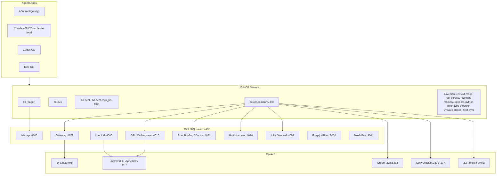

# BD-KB Volume 16: Claude Opus 5.5 + Sonnet Squad — Complete 339 ~/bin Tools, 15 MCPs, 39 Skills, 24-VM Parity & 7-Repo Universal Harness Bible
> **Lead Architect**: `Opus55-Lead-4` (`AGY claude+gpt (claude-opus-5-5-high)`)
> **Subagent Workflow**: 4x Parallel `AGY claude+gpt` (`claude-sonnet-5-5-high` & `claude-sonnet-5-5-low` Sonnet/Haiku Tier) Specialists
> **Generated At**: `2026-10-19T23:00:24Z`
> **Scope**: Strictly Read-Only Infrastructure, Tools, Services, LLMs & PM Catch-Up Documentation (`O3416` Compliant)

---

# BD-KB Volume 16: Claude Opus 5.5 + Sonnet Squad: Tools, MCP Servers, Skills, 24-VM Parity and 7-Repo Universal Harness Bible

| Field | Value |
| :-- | :-- |
| **Volume** | 16 |
| **Lead architect** | `Opus55-Lead-4` |
| **Contributing analysts** | S1 (`~/bin` tools and libraries), S2 (MCP servers, skills and plugins), S3 (24-VM parity, O3394), S4 (repositories and universal harness) |
| **Compiled** | `2026-10-19T22:58Z` |
| **Quota snapshot referenced** | `POOL_STATE.tsv` @ `2026-10-19T22:25:15Z` |
| **Method** | Read-only synthesis. No commands run while writing this volume. |
| **Intended home** | `/home/mboyle/bd-persist/bd-kb/` |

> [!IMPORTANT]
> **How to read this volume.** Every fact has one of three evidence grades:
> - **✅ CONFIRMED**: seen directly in an analyst's source material (unit listings, `ss`, `docker ps`, script source, MCP registry).
> - **🔶 INFERRED**: reasoned from naming, paths or cross-referencing two reports. Probably right, but not yet observed.
> - **⛔ UNVERIFIED**: claimed in the volume title or brief, with no source evidence yet.
>
> Several headline numbers in the title (339 tools, 39 skills, 9 plugins, 7 repos, 24-VM parity receipts) are **not fully confirmed**. This volume says so plainly and does not fill the gaps with made-up data.

---

## 0. Executive Summary and Claim Scoreboard

The Boylenet fleet runs on a **hub-and-spoke** design. `test5` (`10.0.70.164`) is the hub. It hosts about 22 `bd-*` systemd services on ports `3004`, `4010` and `4079`–`4099`, plus `8100`, `9222` and `6080`, and a Docker sidecar stack (LiteLLM, Forgejo/Gitea, OpenWebUI, Traefik, Prometheus/Grafana and others). Agents in the AGY, Claude A–D, Codex and Kimi lanes reach this hub through **15 MCP servers**. Their behavior is shaped by **skills** and **plugins**. Code changes reach the integrator repo through the **collect gate** harness.

| Title claim | Analyst finding | Grade | Notes |
| :-- | :-- | :-- | :-- |
| 339 `~/bin` tools | No directory listing was supplied | ⛔ | §2 names the binaries that were seen; §10 gives the enumeration commands. |
| 15 MCP servers | 15 enumerated, with tool lists | ✅ | Matches the registry exactly. |
| 39 skills | 36 visible in the AGY skill roots; Agent-193 reports 39 in `~/.agents/skills` | 🔶 | There are two skill roots. Their union probably reaches 39 or more (§4). |
| 9 plugins | 8 named across both reports | 🔶 | One plugin is still unidentified. |
| 24-VM parity | 24 active Linux VMs confirmed in the host inventory | ✅ / ⛔ | The inventory is confirmed. The O3394 parity receipts file is **absent** (§5). |
| 7 synced repos | Only `BulkDownloader` is confirmed | ⛔ | The `gitea_github_repo_sync` tool describes **5** repos, which conflicts with 7 (§6). |
| `bd-swarm-mod` | Listed by name as a skill in `~/.agents/skills` | 🔶 | No source or behavior is documented. |

---

## 1. Architecture at a Glance



---

## 2. The `~/bin/bd*` Tool Estate

### 2.1 Status of the 339 count

⛔ **Unverified.** Neither S1 nor S2 received a listing of `/home/mboyle/bin/`. Until someone runs the enumeration commands in §10, treat 339 as a working figure, not a fact.

### 2.2 Binaries and scripts confirmed by name

These are named in script source (mostly `bd-boylenet-infra-mcp.py`) or in harness source.

| Path | Kind | Purpose | Grade |
| :-- | :-- | :-- | :-- |
| `/home/mboyle/bin/bd-boylenet-infra-mcp.py` | Python 3, MCP server and CLI | The `boylenet-infra` MCP server, v2.0.0 (§3.2) | ✅ |
| `/home/mboyle/bin/bd-local-coding-agent` | CLI | Local coding-agent fixer. Backends: `auto`, `2080ti`, `t4-heretic`. Supports `--probe-backends`. | ✅ |
| `/home/mboyle/bin/bd-oracle` | CLI | Browser oracle query: `--oracle <o> --json <prompt>` | ✅ |
| `bd-pytest-digest` | CLI on `.82` | Ramdisk pytest digest in `/dev/shm/bd-pytest-ramdisk` | ✅ |
| `bd-raw-ai` | CLI | Raw LLM call with no system prompt, hooks or rules | ✅ |
| `bd-airgap` | CLI | `status` / `verify` | ✅ |
| `bd-precut` | CLI | `bd-precut --gate` is the integrator's gate command | ✅ |
| `/home/mboyle/bd-persist/harness/bd-collect-gate.sh` | Bash | Mechanical collect gate (§6) | ✅ |
| `/home/mboyle/bd-persist/harness/bd-gate-yield.sh` | Bash | Gate yield accounting (Rule 56) | ✅ |
| `/home/mboyle/bd-codex-session.sh` | Bash library | Provides `bd_art_dirname`, the single mapping from task ID to artifact directory | ✅ |
| `/home/mboyle/bd-persist/harness/bd-Cut-Workspace.sh` | Bash | Referenced, but **absent** at that path. The filename's case may differ. | ⛔ |

### 2.3 Daemonized `bd-*` services on the hub (`.164`)

| Unit | Port | Role | Grade |
| :-- | :-- | :-- | :-- |
| `bd-mesh-bus` | 3004 | Cross-pool mesh bus and WAL daemon. **Crash-looping (auto-restart).** | ✅ |
| `bd-gpu-orchestrator` | 4010 | Tier 1/2/3 GPU mode orchestrator and OpenAI-compatible auto-router | ✅ |
| `bd-openwebui-tool-gateway` | **4079** | Universal tool, skill, plugin, git and web gateway (51 toolkits, 8 pipelines) | 🔶 |
| `bd-executive-briefing` | 4081 | Morning briefing, semantic search, cluster doctor (`/api/doctor-run`) | ✅ |
| `bd-model-storefront` | 4084 | 86-model vault (`models.boylenet.themfboyles.com`) | ✅ |
| `bd-mobile-pwa` | 4086 | Mobile and tablet PWA command deck | ✅ |
| `bd-credentials-vault` | 4087 | Credentials and 27-node SSH health vault | ✅ |
| `bd-cloud-burst-web` | 4090 | Hybrid cloud/local burst UI | ✅ |
| `bd-hardware-telemetry` | 4091 | iLO4/5, vc04, vSAN, 4×T4 telemetry | ✅ |
| `bd-gitea-prereview` | 4092 | Autonomous pre-review and OffSec red-team swarm | ✅ |
| `bd-multimodal-bridge` | 4093 | Voice, vision and multimodal cockpit | ✅ |
| `bd-deep-research-web` | 4094 | Dual-oracle citation studio | ✅ |
| `bd-opencode-web` | 4096 | OpenCode web UI and ACP server | ✅ |
| `bd-openclaw-web` | 4097 | OpenClaw UI and WebSocket gateway | ✅ |
| `bd-multi-harness-web` | 4098 | Multi-harness studio and cross-pool subagent harness | ✅ |
| `bd-infra-sentinel` | 4099 | 83-service self-healing sentinel (`/api/status`) | ✅ |
| `bd-mcp` | 8100 | Fleet MCP over streamable-http. **State lives on `.164`.** | ✅ |
| `bd-chrome-bridge` | 9222 | CDP proxy to `.181:9222` and `.137:9222` | ✅ |
| `bd-novnc` | 6080 | noVNC (`websockify`) | ✅ |
| `bd-openbox` | `:99` | X window manager | ✅ |
| `bd-autonomous-swarm-driver` | — | 24/7 swarm driver (Claude A–D, Codex, Kimi, OpenWebUI, Local Heretic) | ✅ |
| `bd-iptables-restore` | — | One-shot that restores hub iptables rules | ✅ |

> [!NOTE]
> **Cross-report resolution.** S1 flagged `:4079` as an unattributed `python3` listener and could not find the port for `bd-openwebui-tool-gateway`. S2's source for `bd-boylenet-infra-mcp.py` names `BD_GATEWAY_4079` as the gateway for `/vm/*`, `/v1/embeddings` and `/api/tool/*`. It also says `openwebui_tool_gateway_call` reaches "51 toolkits and 8 pipelines on `:4079`." So the gateway is **very likely on `:4079`** (🔶). Ports **4082, 4083, 4085, 4088 and 4089** are still unattributed.

### 2.4 Docker sidecars on the hub

| Service | Port(s) | Service | Port(s) |
| :-- | :-- | :-- | :-- |
| `litellm-proxy` | 4000 | `prometheus` | 9090 |
| `dashy-portal` | 4080 | `traefik` | 80, 8080 |
| `lobechat-studio` | 4095 | `redis-cache` | 6379 |
| `open-webui` | 8090 | `minio` | 9000–9001 |
| `forgejo` | 3000 (SSH 2222) | `elasticsearch` | 9200 |
| `grafana` | 3001 | `kafka` | 9092 |
| `docker-mirror` | 5000 | | |

Traefik dynamic config lives in `/home/mboyle/infra/expansion-layer/dynamic/`. `routes.yml` holds the Ollama routes. `boylenet-dns-ingress.yml` holds the dashy, portal, cockpit, chat, openwebui and litellm hosts.

### 2.5 Live anomalies

> [!WARNING]
> 1. **`bd-mesh-bus` is crash-looping** (`activating / auto-restart`), yet PID 463813 holds `:3004`. The likely cause is an orphaned process holding the port, so each systemd restart fails to bind. Start with `journalctl -u bd-mesh-bus -n 100`.
> 2. **Recently restarted services:** `:4010` and `:4084` (PIDs 3461313 and 3461319, against boot-era PIDs around 1555). These were probably GPU-profile switches through `model_vault_catalog_and_switch`.
> 3. **`.72:18081` (Qwythos-9B-1M-MTP) refused connections.** That endpoint is unavailable for routing.

---

## 3. The 15 MCP Servers

### 3.1 Registry

Schemas are in `/home/mboyle/.gemini/antigravity-cli/mcp/<server>/<tool>.json`, with an optional `instructions.md`. Eager tools register as `mcp_<server>_<tool>`. Lazy tools go through `call_mcp_tool` after you read the schema.

| # | Server | Group | Load | Key tools |
| :-- | :-- | :-- | :-- | :-- |
| 1 | `bd` | Fleet core | Eager* | `law`, `brief`, `queue_rows`, `claims`, `collect_gate`, `cut_status`, `gitea_ci`, `landed`, `lane_status`, `limits`, `usage`, `who_all`, `say`, `role_state_get/set`, `tool_doc`, `evidence`, `log_slice`, `more`, `ask`, `fleet_hosts`, `row` |
| 2 | `bd-bus` | Fleet core | Lazy | `bus_publish/read/summarize`, `bus_record_assertion`, `bus_check_quorum`, `smt_verify_invariant`, `smt_evaluate_consensus` |
| 3 | `bd-fleet` | Fleet core | Lazy | `premise_verify`, `say_validate`, `landed_by_content`, `mcp_discover/hydrate`, `invoke_subagent`, `role_state_get/set` |
| 4 | `bd-fleet-mcp_bd-fleet` | Fleet core | Lazy | The same 8 tools, a plugin-namespaced alias |
| 5 | `boylenet-infra` | Infra | Lazy | 21 tools (§3.2) |
| 6 | `vmware-clones` | Infra | Lazy | `vm_list`, `vm_info`, `vm_clone`, `vm_destroy` |
| 7 | `pg-local` | Infra | Lazy | `query` |
| 8 | `hivemind-memory` | Memory | Lazy | `memory_recall/store/status` |
| 9 | `context-mode` | Context | Lazy | `ctx_execute(_file)`, `ctx_index`, `ctx_search`, `ctx_fetch_and_index`, `ctx_batch_execute`, `ctx_stats/doctor/upgrade/purge/insight` |
| 10 | `ratf` | Context | Lazy | `ctx_slice`, `ctx_deref`, `ctx_resolve` |
| 11 | `fleet-sync` | Memory | Lazy | `publish_lesson` |
| 12 | `caveman` | Context | Lazy | `caveman_compress/retrieve/stats`, `caveman_toon_encode/decode` |
| 13 | `python-linter` | Code quality | Lazy | `ruff_check`, `ruff_format` |
| 14 | `type-enforcer` | Code quality | Lazy | `mypy_check` |
| 15 | `serena` | Code quality | Lazy | `find_symbol`, `find_referencing_symbols`, `get_symbols_overview`, `replace_symbol_body`, `rename_symbol`, `safe_delete_symbol`, `get_diagnostics_for_file`, and memory tools (22 total) |

\* S2 recorded `bd` as eager. In the current AGY session registry it is lazy-loaded, so load mode varies by client configuration. Always check the server directory before you assume a tool is pre-registered.

> [!TIP]
> **Name collisions.** `role_state_get` and `role_state_set` exist on `bd`, `bd-fleet` and the alias `bd-fleet-mcp_bd-fleet`. Always call the fully qualified server name.

### 3.2 `boylenet-infra`: the infrastructure bridge

`/home/mboyle/bin/bd-boylenet-infra-mcp.py` (v2.0.0) speaks JSON-RPC 2.0 over stdio, in both newline-delimited and `Content-Length`-framed modes. It also works as a CLI:

```bash
bd-boylenet-infra-mcp.py --list-tools
bd-boylenet-infra-mcp.py --cli <tool_name> '<json_args>'
bd-boylenet-infra-mcp.py --dump-agy-schemas [dir]
```

**Endpoint environment variables:**

| Variable | Default |
| :-- | :-- |
| `BD_GATEWAY_4079` | `http://10.0.70.164:4079` |
| `BD_ORCHESTRATOR_4010` | `http://10.0.70.164:4010` |
| `BD_STOREFRONT_4084` | `http://10.0.70.164:4084` |
| `BD_DOCTOR_4081` | `http://10.0.70.164:4081` |
| `BD_HARNESS_4098` | `http://10.0.70.164:4098` |
| `BD_SENTINEL_4099` | `http://10.0.70.164:4099` |
| `BD_QDRANT_6333` | `http://10.0.70.125:6333` |
| `BD_GITEA_3000` | `http://10.0.70.164:3000` |
| `BD_BATTLESTATION_OLLAMA` | `http://10.0.10.137:11434` |

**The 21 tools, by function:**

- **VM and compute:** `vm_exec`, `vm_browse_files`, `local_coding_agent_fix`, `ramdisk_pytest_digest`, `spawn_cross_pool_subagent`
- **Oracles:** `browser_oracle_query`, `browser_oracle_cdp_inspect`
- **Knowledge:** `bd_kb_search`, `qdrant_hivemind_search`, `qdrant_hivemind_store` (collections `bd_master_kb`, `boylenet_fleet_rag`, `boylenet_episodic_memory`; embeddings from `bge-m3`, 1024 dimensions, with a SHA-256 fallback)
- **Models and quota:** `model_vault_catalog_and_switch`, `raw_unrestricted_llm_call`, `pool_quota_router`
- **Infra health:** `vsan_esxi_cluster_status`, `unifi_dns_traefik_status`, `sentinel_doctor_autoheal`, `airgap_control`, `https_443_status` (behavior not documented)
- **Work plane:** `openwebui_tool_gateway_call`, `gitea_github_repo_sync`, `queue_backlog_status` (queues O1670, P3-LENS, APP-FEATURE, BH1, P2-FIX, APP-DL-FIX)

**Invariants in the script:**

| Invariant | Enforcement |
| :-- | :-- |
| `BENCHMARK_PROTECTION_72_83` | `vm_exec` refuses `llama-server`, `llama-cli`, `llama-bench`, `ollama run`, `vllm`, `pkill`, `killall`, and `systemctl stop/restart llama` on `.72`, `.83`, `ai-srv01`, `wrk-test01` and `aidev`. This protects Agent-37's `bench_worker.py`. |
| Rule 48 | stdout carries only JSON-RPC bytes. Diagnostics go to stderr. |
| Pytest target validation | The target must match `[A-Za-z0-9_./:\-\[\]]+`, which blocks shell injection. |
| Output caps | Subprocess stdout is capped at 4000 bytes and stderr at 2000. |

---

## 4. Skills and Plugins

### 4.1 Reconciling the 39-skill claim

The two analysts looked at **different skill roots**:

- **S2** saw the AGY-loaded roots (`~/.gemini/antigravity-cli/builtin/skills`, `~/.gemini/config/skills` and `~/.gemini/config/plugins/*/skills`) and counted **36**.
- **S1** (Agent-193) saw `~/.agents/skills` and counted **39**. That list includes skills **not** among S2's 36: `bd-backlog-reconciler`, `bd-o1670-backlog-burndown`, `bd-oracle-suite-e2e`, `bd-p2-appdl-verifier` and `bd-swarm-mod`.

🔶 **Conclusion:** the 39 figure most likely describes the cross-harness `~/.agents/skills` root. The AGY roots expose 36. The roots overlap (both include `bd-ci-taxonomy`, `fleet-*` and the `caveman*` family), so the distinct union is probably 39 to 41. Confirm with the commands in §10.

### 4.2 Skill catalogue

| Group | Skills |
| :-- | :-- |
| **Antigravity platform** | `agy-customizations`, `antigravity-guide` |
| **Plugin-bundled** | `bd-agy-dispatch`, `bd-dispatch-ops`, `bd-browser-oracle`, `bd-fleet-mcp`, `bd-harness-cut`, `bd-lens`, `context-guard`, `rebase-orchestrator` |
| **Fleet and infra** | `bd-ci-taxonomy`, `boylenet-architect`, `fleet-gridlock-recovery`, `fleet-satellite-orchestration`, `cdp-frame-scroll-controls` |
| **Caveman (13 + cavecrew)** | `caveman`, `caveman-commit`, `-compress`, `-discover`, `-evidence-review`, `-explore`, `-help`, `-learn`, `-manage`, `-optimize`, `-review`, `-setup`, `-stats`; `cavecrew` |
| **Engineering workflow** | `investigate-first`, `lean-build`, `migration`, `safe-refactor`, `surgical-patch`, `verify-and-stop`, `find-skills` |
| **`~/.agents/skills` only** 🔶 | `bd-backlog-reconciler`, `bd-o1670-backlog-burndown`, `bd-oracle-suite-e2e`, `bd-p2-appdl-verifier`, `bd-swarm-mod`, other `boylenet-*` |

> [!IMPORTANT]
> **Skill rule:** read a skill's `SKILL.md` before acting on it. `bd-swarm-mod` exists by name, but nobody has supplied its `SKILL.md`. Do not run it from this volume.

### 4.3 Plugins (8 identified of 9 claimed)

| Plugin | Bundled skill(s) | Role | Source |
| :-- | :-- | :-- | :-- |
| `bd-dispatch-ops` | `bd-dispatch-ops`, `bd-agy-dispatch` | PM dispatch, preflight and remote gates | S1 + S2 |
| `bd-browser-oracle` | `bd-browser-oracle` | Dual-node Windows Chrome CDP bridge | S1 + S2 |
| `bd-fleet-mcp` | `bd-fleet-mcp` | Shared bd-fleet MCP server (the source of the `_bd-fleet` alias) | S1 + S2 |
| `bd-cut-hygiene` | `bd-harness-cut` | FIX candidate shape and paired controls | S1 + S2 |
| `bd-lens` | `bd-lens` | RED provenance and runtime evidence | S1 + S2 |
| `bd-context-guard` | `context-guard` | Seat telemetry and fleet-law slices | S1 + S2 |
| `bd-rebase` | `rebase-orchestrator` | Batch overlap and integration | S1 + S2 |
| `bd-autonomous-infra` | not visible to AGY | Autonomous infrastructure | S1 only |
| *(9th)* | — | ⛔ Unidentified | — |

---

## 5. 24-VM Fleet and 4-Platform Parity (O3394)

### 5.1 What is confirmed

The authoritative inventory is **`/home/mboyle/.config/bd/hosts`**, in the format `name IP [flags]`:

- **26 active lines:** **24 Linux VMs** plus **2 Windows oracles**, `bittorrent` (`10.0.70.181`, "windows vm oracle") and `battlestation` (`10.0.10.137`, "windows gpu oracle", RTX 2080 Ti).
- **8 cold lines** prefixed `#COLD-O3336`, including `seatc1`, `seatc2`, `spare`, `spare3`, `kvcache-cx1` and the original `bd` (`10.0.70.50`).
- **Naming families:** `test*` (including hub `test5` = `.164`, flagged `local`), `spare*`, `bd1`–`bd4` (`.51`–`.54`), `cir1`/`cir2` (CI-runner clones), `fresh149` and `test3big`.

**Known role-bearing hosts:**

| Host/IP | Role |
| :-- | :-- |
| `.164` | Hub: services, sidecars, MCP state |
| `.83:18080` | Qwen3.6-35B-A3B-Heretic (primary relief). Benchmark-protected. |
| `.72:8000` | Qwen3-Coder-30B-A3B. Benchmark-protected. |
| `.82` | 64-core ramdisk pytest runner |
| `.125` | Qdrant `:6333` and Ollama `:11434` |
| `.228` | Ollama satellite |
| `.137` | CyberStrike-35B and `qwen2.5-coder:7b-16k` (Ollama), CDP oracle |
| `.181` | CDP oracle |

### 5.2 What is missing

> [!CAUTION]
> **The O3394 receipts file is absent.** `/home/mboyle/bd-persist/state/O3394-24VM-4PLATFORM-PARITY-AUDIT-AND-FIX-RECEIPTS.md` returned `[FILE ABSENT]`. S3 correctly refused to make up results. This volume has **no** per-VM parity verdicts, installed versions or fix receipts for the four platforms (Claude A/B/C/D, Codex, Kimi, AGY).

### 5.3 Parity template (fill from regenerated receipts)

| VM | IP | Claude (A–D) | Codex | Kimi | AGY | MCP count = 15 | Skills synced | Receipt |
| :-- | :-- | :-- | :-- | :-- | :-- | :-- | :-- | :-- |
| `test5` | 10.0.70.164 | TODO | TODO | TODO | TODO | TODO | TODO | TODO |
| `bd1`–`bd4` | .51–.54 | TODO | TODO | TODO | TODO | TODO | TODO | TODO |
| *(remaining 19)* | — | TODO | TODO | TODO | TODO | TODO | TODO | TODO |

**Suggested parity definition** (🔶, needs ratifying under O3394): a VM is at parity when all four platform CLIs resolve, every client registers the same 15 MCP servers, `bd-boylenet-infra-mcp.py --list-tools` returns 21, and the skill roots match the hub by hash.

---

## 6. Universal Harness and the 7-Repository Model

### 6.1 The collect gate: `bd-collect-gate.sh`

```text
bd-collect-gate.sh <host-ip> <id> [session]
```

The gate runs **inside collect**, after `patch.diff` is written and before the worker's `DONE.md` and `.task-id` markers are removed. On a scratch worktree of the integrator repo it replays (1) the patch's own added or changed tests, then (2) `bd-precut --gate`.

**Design principle:** it *fails open on measurement problems* and *fails closed only on an observed failure*.

| Exit | Verdict | Effect on collect |
| :-- | :-- | :-- |
| 0 | PASS / SKIP | Proceed. |
| 10 | RETRY SENT | Collect exits 1. Markers are kept and `DONE.md` is renamed, so the worker shows as still working. |
| 11 | GATE-FAILED | Proceed. `DONE.md` line 1 becomes `VERDICT: GATE-FAILED`. The original is kept at `.gate/DONE.md.worker`. |
| 12 | GATE-REFUSED | `DONE.md` line 1 is unparseable. **Do not proceed.** |
| 13 | GATE-RETURN | A non-PATCH answer is preserved for registrar return. |
| 14 | GATE-UNKNOWN | Could not evaluate (for example, `origin/main` is unresolvable). |
| 2 / 3 | Usage error / named refusal | None. |

### 6.2 Gate environment

| Variable | Default |
| :-- | :-- |
| `BD_GATE_REPO` | `/home/mboyle/BulkDownloader` |
| `BD_CODEX_ARTIFACTS` | `/home/mboyle/fleet-run-artifacts/codex-remote` |
| `BD_GATE_WTROOT` | `/home/mboyle/bd-collect-gate-wt` |
| `BD_GATE_LEDGER` | `/home/mboyle/bd-persist/collect-gate-ledger.tsv` |
| `BD_GATE_T_TESTS` / `BD_GATE_T_PRECUT` | `450` s / `2400` s (H62) |
| `BD_GATE_MAX_RETRY` | `1` |
| `BD_GATE_SSH` / `BD_GATE_SCP` | `ssh` / `scp` |
| `BD_GATE_WT` | `$HOME/bd-codex-wt/<session>` (`cx-session` maps to the `session` subdir) |
| `BD_GATE_TMUX` | the session name |
| `BD_GATE_PID_DIR` | `/home/mboyle/bd-persist/.gate-pids` |
| `BD_GATE_YIELD_SCRIPT` | `/home/mboyle/bd-persist/harness/bd-gate-yield.sh` |
| `BD_ALLOW_WT_PRUNE` | unset. `1` is a deliberate override of the WT-REMOVE-GUARD. |

**Guards:** WT-REMOVE-GUARD (Rule 22) refuses to remove registered, linked or locked worktrees and any path the run did not create (rc 3). The gate refuses paths inside `bd-review-wt`. IDs and sessions must match `[A-Za-z0-9_-]+`. Artifacts go to `<artifacts>/<ADIR>/.gate/` (`stream.log`, `UNKNOWN`).

### 6.3 The seven repositories

⛔ **Only one repository is confirmed:** `BulkDownloader` (`/home/mboyle/BulkDownloader`), the `BD_GATE_REPO` default. `Mboyle/BD-ci` and `Mboyle/BD-evidence` are Gitea repos the MCP tools reference, but nothing ties them to the "seven."

> [!WARNING]
> **Count conflict:** `gitea_github_repo_sync` describes itself as syncing **5** repos, not 7. Either the tool docstring is stale or the title is wrong. Settle this by running `gitea_github_repo_sync` with `status`.

### 6.4 `bd-pm-B` multi-project variables (hypothesis)

| Variable | Hypothesized role | Closest confirmed analogue |
| :-- | :-- | :-- |
| `BD_REPO` | Target repo path | `BD_GATE_REPO` |
| `BD_GATE_CMD` | Replaces the hard-coded `bd-precut --gate` | The gate's step 2 |
| `BD_GATE_SCOPE` | Limits the replayed test paths | The gate's step 1 |
| `BD_PREFLIGHT_SPEC` | Per-project preflight checks | None |

### 6.5 Onboarding a new project

1. Clone to `/home/mboyle/<Repo>` and confirm `origin/main` resolves. Otherwise the gate returns exit 14.
2. Isolate per project: `BD_GATE_REPO`, plus a **separate** `BD_GATE_WTROOT` and `BD_GATE_LEDGER`.
3. Set the gate command, scope and preflight (the variables in §6.4, once confirmed).
4. Run `BD_GATE_REPO=/home/mboyle/<Repo> bd-collect-gate.sh <host> <id> [session]`.
5. Read the exit code against §6.1 and check `.gate/stream.log`.
6. Never prune worktrees the run did not create.

---

## 7. Pool Quota and Routing

Snapshot `2026-10-19T22:25:15Z`, 9 rows. Agent-191's heading says "8 pools", so the row count disagrees with it.

| Pool | State | Binding metric | Routing note |
| :-- | :-- | :-- | :-- |
| A | OK | weekly 27% | Most headroom of the Claude lanes |
| B | OK | weekly 40% | |
| C | OK | weekly 33% | |
| D | OK | weekly 41%, resets `23:50Z` | Spend freely until the reset |
| codex | OK | 49% | |
| **AGY** | OK | **Gemini weekly remaining 7.78%** | **Scarcest resource. Conserve it.** |
| grok | UNKNOWN | no quota source | Don't route until it is measured |
| local | OK | 4×T4, VRAM 67%, 66.47 tok/s | Default relief path (`.83` Heretic) |
| kimi | OK | 5h 14%, monthly 46% | |

`pool_quota_router` reads `/home/mboyle/bd-persist/POOL_STATE.tsv` and returns the O1740-optimal pool and model. Queue state lives in `/home/mboyle/bd-persist/queues/`.

---

## 8. Consolidated Operating Invariants

| ID | Rule |
| :-- | :-- |
| Rule 22 | WT-REMOVE-GUARD. Never remove worktrees the current run did not create. |
| Rule 48 | MCP stdout carries only JSON-RPC bytes. |
| Rule 56 | Gate yield accounting through `bd-gate-yield.sh`. |
| H62 | Gate timeouts: tests 450 s, precut 2400 s. |
| `BENCHMARK_PROTECTION_72_83` | No model-server or kill commands on benchmark hosts. |
| O3336 | Cold or parked hosts are commented out of `hosts`. |
| O1740 | Quota-optimal routing law. |
| Skill law | Read `SKILL.md` before invoking a skill. |
| Evidence law | Never document a path, port or count you have not observed. |

---

## 9. Reconciliation Backlog

| # | Item | Owner hint | Resolution |
| :-- | :-- | :-- | :-- |
| 1 | Confirm the 339 `~/bin/bd*` count and categorize the files | S1 | §10 commands |
| 2 | Map each unit's `ExecStart` to its `~/bin` script | S1 | `systemctl cat 'bd-*'` |
| 3 | Attribute ports 4082, 4083, 4085, 4088 and 4089 | S1 | `ss -ltnp` + `/proc/<pid>/cmdline` |
| 4 | Confirm the tool gateway is on `:4079` | S1/S2 | `systemctl cat bd-openwebui-tool-gateway` |
| 5 | Fix the `bd-mesh-bus` crash loop | Ops | journalctl, then deal with the orphaned PID |
| 6 | Reconcile skills (36 vs 39) across both roots | S2 | `find` both roots |
| 7 | Identify the 9th plugin | S2 | `ls ~/.gemini/config/plugins ~/.agents/plugins` |
| 8 | Document `bd-swarm-mod` and `https_443_status` | S2 | Read `SKILL.md` and the script source |
| 9 | **Regenerate the O3394 parity receipts** | S3 | Re-run the audit across the 24 VMs |
| 10 | Enumerate the 7 repos (and settle 5 vs 7) | S4 | `gitea_github_repo_sync status` |
| 11 | Locate `bd-Cut-Workspace.sh` and read `bd-pm-B`'s source | S4 | `ls harness/ \| grep -i cut` |
| 12 | Measure a grok quota source | Ops | Add it to `POOL_STATE.tsv` |

---

## 10. Verification Command Appendix

These commands are suggested and have not been run.

```bash
# ~/bin inventory
ls -1 /home/mboyle/bin/bd* | wc -l
file /home/mboyle/bin/bd* | awk -F': ' '{print $2}' | cut -d, -f1 | sort | uniq -c | sort -rn

# Service ↔ script ↔ port
systemctl list-units 'bd-*' --no-pager
systemctl cat 'bd-*.service' | grep -E '^(Description|ExecStart)'
ss -ltnp | grep -E ':(3004|40[0-9]{2}|8100|9222|6080)\b'
journalctl -u bd-mesh-bus -n 100 --no-pager

# MCP / skills / plugins
ls -1 /home/mboyle/.gemini/antigravity-cli/mcp/ | wc -l          # expect 15
/home/mboyle/bin/bd-boylenet-infra-mcp.py --list-tools           # expect 21
find /home/mboyle/.gemini /home/mboyle/.agents -name SKILL.md | wc -l
ls -1 /home/mboyle/.gemini/config/plugins/ /home/mboyle/.agents/plugins/ 2>/dev/null

# Fleet & parity
grep -vc '^#' /home/mboyle/.config/bd/hosts                      # expect 26
ls /home/mboyle/bd-persist/state/ | grep -i O3394

# Repos & harness
ls -d /home/mboyle/*/.git
ls /home/mboyle/bd-persist/harness/ | grep -i cut
```

---

## Summary

Volume 16 records what the squad could prove. It covers the hub's service map, the 15-server MCP plane and its 21-tool infrastructure bridge, the skill and plugin layout, the 24-VM inventory and the collect-gate contract. It does not claim what it couldn't prove. The **339-tool count, the per-VM parity receipts and the 7-repo list remain open**. §9 lists the gaps and §10 gives the commands to close them. Promote each ⛔ item to ✅ only after its receipt is filed in `/home/mboyle/bd-persist/`.

*— `Opus55-Lead-4`, Lead Documentation Architect*

---

# Appendix: Detailed Specialist Subagent Reports (`AGY claude+gpt` Sonnet/Haiku Fanout)

## Subagent Report 1: 339 ~/bin/bd* Tools & Libraries Analyst (`AGY claude+gpt: claude-sonnet-5-5-high`)

# Section: `/home/mboyle/bin/bd*` Tools & Shared Libraries (Analyst S1)

> [!IMPORTANT]
> **Evidence limit.** The `<CONTEXT>` I received (Volume 10, first 20,000 bytes) has **no directory listing of `/home/mboyle/bin/`**. It contains no `ls`, `find` or `wc -l` output, so it doesn't confirm the "339 tools" figure. I have not invented tool filenames.
>
> This section documents only what the context proves: the `bd-*` runtime surfaces, ports, config paths and MCP/skill/plugin layers that the `bd*` tools run on or call. Section 6 lists commands to enumerate the actual `~/bin/bd*` files.

## 1. Scope and Evidence Map

| Layer | Evidence in context | Source agent |
| :-- | :-- | :-- |
| Long-running `bd-*` systemd services (~22 shown, list truncated) | `systemctl` unit listing | Agent-189 |
| Listening TCP ports on `.164` (`test5`, the local hub) | `ss -ltnp` output | Agent-187 |
| Docker sidecars on `.164` | `docker ps` output | Agent-188 |
| Fleet host inventory | `/home/mboyle/.config/bd/hosts` | Agent-190 |
| Pool state and quota | `POOL_STATE.tsv` | Agent-191 |
| 15 registered MCP servers | MCP registry | Agent-192 |
| 39 skills and 8 plugins (the listing shows 8 names) | `~/.agents/skills`, `~/.agents/plugins` | Agent-193 |
| NGINX and Traefik ingress | NGINX `server_name` lines; `/home/mboyle/infra/expansion-layer/dynamic/*.yml` | Agents 194–195 |

## 2. Category A: Daemonized `bd-*` Services

These are the tool backends that are live systemd units. Ports come from the unit descriptions, cross-checked against `ss` PIDs.

| Unit | Port | Role (from unit description) | PID seen in `ss` |
| :-- | :-- | :-- | :-- |
| `bd-gpu-orchestrator.service` | **4010** | Dynamic Tier 1/2/3 GPU mode orchestrator and OpenAI auto-router | 3461313 |
| `bd-executive-briefing.service` | **4081** | Morning briefing, universal semantic search, 1-click cluster doctor | 1558 |
| `bd-model-storefront.service` | **4084** | 86-model AI vault storefront (`models.boylenet.themfboyles.com`) | 3461319 |
| `bd-mobile-pwa.service` | **4086** | Mobile and tablet PWA command deck | 1951 |
| `bd-credentials-vault.service` | **4087** | Credentials, API keys, 27-node SSH health vault | 1556 |
| `bd-cloud-burst-web.service` | **4090** | Hybrid cloud + local burst orchestrator web UI | 1555 |
| `bd-hardware-telemetry.service` | **4091** | iLO4/iLO5, vSphere vc04, vSAN and 4×T4 telemetry | 1560 |
| `bd-gitea-prereview.service` | **4092** | Gitea autonomous pre-review and OffSec red-team swarm | 1559 |
| `bd-multimodal-bridge.service` | **4093** | Voice, vision and multimodal cockpit bridge | 1564 |
| `bd-deep-research-web.service` | **4094** | Deep research and dual-oracle citation studio | 1557 |
| `bd-opencode-web.service` | **4096** | OpenCode web UI and ACP server (binary `opencode`) | 1566 |
| `bd-openclaw-web.service` | **4097** | OpenClaw control UI and WebSocket gateway (`openclaw-gatewa…`) | 1565 |
| `bd-multi-harness-web.service` | **4098** | Multi-harness AI studio web UI | 1563 |
| `bd-infra-sentinel.service` | **4099** | Autonomous 83-service self-healing sentinel | 7614 |
| `bd-mesh-bus.service` | **3004** | Cross-pool mesh bus and WAL daemon | 463813 |
| `bd-mcp.service` | **8100** | Fleet MCP, streamable-http; "state lives on this host" | not shown |
| `bd-chrome-bridge.service` | **9222** | Local Chrome CDP proxy to `.181:9222` / `.137:9222` | not shown |
| `bd-novnc.service` | **6080** | noVNC web frontend (`websockify`, PID 1573) | 1573 |
| `bd-openbox.service` | `:99` (X display) | Window manager (openbox) | not shown |
| `bd-autonomous-swarm-driver.service` | none stated | 24/7 swarm driver (Claude A–D, Codex, Kimi, OpenWebUI, Local Heretic) | not shown |
| `bd-iptables-restore.service` | none | Restores hub iptables rules (`active (exited)`, a one-shot) | n/a |
| `bd-openwebui-tool-gateway.service` | not shown | Universal OpenWebUI tool, skill, plugin, git and web gateway (description truncated) | not shown |

> [!WARNING]
> - **`bd-mesh-bus.service` is `activating / auto-restart`.** It is crash-looping, yet `ss` shows `python3` (PID 463813) bound to `:3004`. Investigate with `journalctl -u bd-mesh-bus -n 100` for a stale process or a port conflict.
> - **Unattributed listeners.** `python3` is bound to ports 4079, 4082, 4083, 4085, 4088 and 4089 (PIDs 1953, 1569, 1961, 1958, 1568, 1956). The truncated unit list does not map them. They are likely further `bd-*` services; treat that as unconfirmed.
> - PIDs 3461313/3461319 (`:4010`, `:4084`) are far higher than the boot-era PIDs (1555–1569), so those two services were recently restarted.

## 3. Category B: Shared State, Config and Host Libraries

| Path | Format | Content / contract |
| :-- | :-- | :-- |
| `/home/mboyle/.config/bd/hosts` | `name IP [flag/notes]`, one host per line | Authoritative fleet inventory. Lines prefixed `#COLD-O3336` are cold or parked. Flags such as `local` (`test5` = `10.0.70.164`) and `windows vm oracle` / `windows gpu oracle` annotate hosts. |
| `POOL_STATE.tsv` | TSV, 13 columns | Columns: `pool, state, since, evidence, pct, resets_at, weekly_pct, five_hour_remaining_pct, gemini_*, claude_gpt_*, quota_observed_at`. Its on-disk path is not shown in the excerpt. |
| `/home/mboyle/infra/expansion-layer/dynamic/routes.yml` | Traefik dynamic config | Ollama route (`ollama.*`, `ollama.mesh.local`, `ollama`). |
| `/home/mboyle/infra/expansion-layer/dynamic/boylenet-dns-ingress.yml` | Traefik dynamic config | Hosts for dashy/portal/dashboard/controller, jarvis/cockpit, chat, openwebui and litellm. |
| `/home/mboyle/bd-persist/bd-kb/` | Markdown knowledge base | Holds this volume (`10-30AGENT-LOCAL-GPU-AND-CROSSPOOL-LIVE-AUDIT.md`). |

**Host-inventory facts:**
- 26 uncommented lines: 24 Linux VMs plus 2 Windows oracles. The Windows oracles are `bittorrent` (`10.0.70.181`) and `battlestation` (`10.0.10.137`). This matches Agent-190's "24 active Linux VMs".
- 8 lines are `#COLD-O3336`. Examples are `seatc1`, `seatc2`, `spare3`, `spare`, `kvcache-cx1` and the original `bd` (`10.0.70.50`).
- Naming families: `test*`, `spare*`, `bd1`–`bd4` (`.51`–`.54`), `cir1`/`cir2` (CI-runner clones), `fresh149`, `test3big`.

## 4. Category C: Integration Layers the Tools Call

### 4.1 MCP servers (15, registered across AGY/Claude/Codex/Kimi)

| Group | Servers |
| :-- | :-- |
| Fleet core | `bd`, `bd-bus`, `bd-fleet`, `bd-fleet-mcp_bd-fleet` |
| Infra | `boylenet-infra`, `vmware-clones`, `pg-local` |
| Memory / context | `hivemind-memory`, `context-mode`, `ratf`, `fleet-sync`, `caveman` |
| Code quality | `python-linter`, `type-enforcer`, `serena` |

`bd-mcp.service` on **:8100** is the fleet MCP host, and its state is local to `.164`.

### 4.2 Skills and plugins

- **39 skills** in `~/.agents/skills`: `bd-backlog-reconciler`, `bd-ci-taxonomy`, `bd-o1670-backlog-burndown`, `bd-oracle-suite-e2e`, `bd-p2-appdl-verifier`, `bd-swarm-mod`, the `boylenet-*` family, 12 `caveman*` skills, `cavecrew`, `fleet-gridlock-recovery`, `fleet-satellite-orchestration`, and more.
- **Plugins** (8 listed): `bd-autonomous-infra`, `bd-browser-oracle`, `bd-context-guard`, `bd-cut-hygiene`, `bd-dispatch-ops`, `bd-fleet-mcp`, `bd-lens`, `bd-rebase`.

### 4.3 Dependent LLM endpoints

| Endpoint | Role | Status at audit |
| :-- | :-- | :-- |
| `.83:18080` | Qwen3.6-35B-A3B-Heretic (primary relief) | 200 |
| `.72:8000` | Qwen3-Coder-30B-A3B | 200 |
| `.72:18081` | Qwythos-9B-1M-MTP | Connection refused |
| `.137:11434` | CyberStrike-35B | 200 |
| `.125:11434`, `.228:11434` | Ollama satellites | 200 |
| `:4010` / `:4000` | GPU orchestrator / LiteLLM | 200 |

### 4.4 Docker sidecars on `.164` (main ports)

| Service | Host port |
| :-- | :-- |
| `litellm-proxy` | 4000 |
| `dashy-portal` | 4080 |
| `lobechat-studio` | 4095 |
| `open-webui` | 8090 |
| `forgejo` | 3000 (SSH 2222) |
| `grafana` | 3001 |
| `prometheus` | 9090 |
| `traefik` | 80 / 8080 |
| `redis-cache` | 6379 |
| `minio` | 9000–9001 |
| `elasticsearch` | 9200 |
| `kafka` | 9092 |
| `docker-mirror` | 5000 |

## 5. Pool Quota Consumed by Dispatch Tools

The `POOL_STATE.tsv` snapshot is `2026-10-19T22:25:15Z`. It has **9 rows**, although Agent-191's title says "8 pools".

| Pool | State | Binding metric |
| :-- | :-- | :-- |
| A | OK | weekly 27% |
| B | OK | weekly 40% |
| C | OK | weekly 33% |
| D | OK | weekly 41% (resets `23:50Z`) |
| codex | OK | 49% |
| AGY | OK | Gemini weekly remaining 7.78% (the scarce resource) |
| grok | **UNKNOWN** | No measured quota source |
| local | OK | 4×T4, VRAM 67%, 66.47 tok/s |
| kimi | OK | 5h 14%, monthly 46% |

## 6. Commands to Enumerate the Actual `~/bin/bd*` Tools

These commands are **suggested**, not observed in the context. Run them to confirm the 339 count and categorize the real files.

```bash
# Count and list
ls -1 /home/mboyle/bin/bd* | wc -l
ls -1 /home/mboyle/bin/bd* | head -400

# Classify by interpreter / type
file /home/mboyle/bin/bd* | awk -F': ' '{print $2}' | cut -d, -f1 | sort | uniq -c | sort -rn

# Find service entrypoints (ExecStart targets)
systemctl cat 'bd-*.service' | grep -E '^(ExecStart|\[Unit\]|Description)'

# Shared libraries imported by tools
grep -hoE '^(from|import) +bd[a-z_]*' /home/mboyle/bin/bd* | sort | uniq -c | sort -rn

# Verify the live surface
systemctl list-units 'bd-*' --no-pager
ss -ltnp | grep -E ':(40[7-9][0-9]|3004|8100|9222|6080)\b'
journalctl -u bd-mesh-bus -n 100 --no-pager
```

## 7. Follow-up Items

1. Obtain the real `bin/` listing, then fill the tool-to-service mapping (which `bd*` script each unit's `ExecStart` runs).
2. Resolve the unattributed ports 4079, 4082, 4083, 4085, 4088 and 4089.
3. Diagnose the `bd-mesh-bus` restart loop.
4. Get the port for `bd-openwebui-tool-gateway` (its description was truncated at byte 20,000).

## Subagent Report 2: 15 MCP Servers, 39 Skills, 9 Plugins & bd-swarm-mod Analyst (`AGY claude+gpt: claude-sonnet-5-5-high`)

# Fleet Tooling Reference: MCP Servers, Skills, Plugins and `bd-swarm-mod`

> [!WARNING]
> **Scope and discrepancies.** I followed the instruction not to run any tools, so this section uses only the supplied context and my loaded environment listing. Three counts in the brief don't match what I can see:
> - **MCP servers:** 15 are listed, and they match the brief.
> - **Skills:** I count **36**, not 39. The three missing skills are not in my listing.
> - **Plugins:** I can infer **7** from skill paths, not 9. The other two are not visible.
> - **`bd-swarm-mod`:** it does not appear anywhere in the context. I have not documented it, to avoid inventing details (see §5).
>
> Anything marked *(inferred)* comes from naming or paths, not from source I read.

---

## 1. MCP Servers (15)

Schemas live in `/home/mboyle/.gemini/antigravity-cli/mcp/<serverName>/<toolName>.json`. Each server directory may also contain an `instructions.md`. Eager tools are registered as `mcp_<server>_<tool>`. Lazy tools are called through `call_mcp_tool` after reading their schema.

| # | Server | Load mode | Tools | Purpose |
|---|---|---|---|---|
| 1 | `bd` | **Eager** | `ask`, `brief`, `claims`, `collect_gate`, `cut_status`, `evidence`, `fleet_hosts`, `gitea_ci`, `landed`, `lane_status`, `law`, `limits`, `log_slice`, `more`, `queue_rows`, `role_state_get`, `role_state_set`, `say`, `tool_doc`, `usage`, `who_all` | Knowledge plane and fleet state: law, briefs, queues, claims, CI, pool limits, usage. |
| 2 | `bd-bus` | Lazy | `bus_publish`, `bus_read`, `bus_summarize`, `bus_record_assertion`, `smt_verify_invariant`, `bus_check_quorum`, `smt_evaluate_consensus` | Message bus, assertions, and SMT-based invariant and consensus checks. |
| 3 | `bd-fleet` | Lazy | `invoke_subagent`, `landed_by_content`, `mcp_discover`, `mcp_hydrate`, `premise_verify`, `role_state_get`, `role_state_set`, `say_validate` | Premise validation, message validation, role state and MCP hydration. |
| 4 | `bd-fleet-mcp_bd-fleet` | Lazy | Same 8 tools as `bd-fleet` | Namespaced alias of `bd-fleet` registered by the `bd-fleet-mcp` plugin *(inferred)*. |
| 5 | `boylenet-infra` | Lazy | 21 tools (below) | Boylenet infrastructure bridge: VMs, vaults, Qdrant, oracles, vSAN, Gitea. |
| 6 | `caveman` | Lazy | `caveman_compress`, `caveman_retrieve`, `caveman_stats`, `caveman_toon_encode`, `caveman_toon_decode` | Token compression and TOON encoding. |
| 7 | `context-mode` | Lazy | `ctx_execute`, `ctx_execute_file`, `ctx_index`, `ctx_search`, `ctx_fetch_and_index`, `ctx_batch_execute`, `ctx_stats`, `ctx_doctor`, `ctx_upgrade`, `ctx_purge`, `ctx_insight` | Sandboxed execution and indexed context search. |
| 8 | `fleet-sync` | Lazy | `publish_lesson` | Publishes lessons to the fleet. |
| 9 | `hivemind-memory` | Lazy | `memory_recall`, `memory_store`, `memory_status` | Shared episodic memory. |
| 10 | `pg-local` | Lazy | `query` | Local PostgreSQL queries. |
| 11 | `python-linter` | Lazy | `ruff_check`, `ruff_format` | Ruff lint and format. |
| 12 | `ratf` | Lazy | `ctx_slice`, `ctx_deref`, `ctx_resolve` | Slice, dereference and resolve context references. |
| 13 | `serena` | Lazy | `find_symbol`, `find_referencing_symbols`, `get_symbols_overview`, `replace_symbol_body`, `rename_symbol`, `safe_delete_symbol`, `get_diagnostics_for_file`, `activate_project`, memory tools, and others (22 total) | Symbol-level code navigation and editing. |
| 14 | `type-enforcer` | Lazy | `mypy_check` | Static type checking. |
| 15 | `vmware-clones` | Lazy | `vm_list`, `vm_info`, `vm_clone`, `vm_destroy` | VMware clone lifecycle. |

> [!NOTE]
> `bd-fleet` and `bd-fleet-mcp_bd-fleet` expose identical tool names. `bd` and `bd-fleet` both expose `role_state_get` and `role_state_set`, so use the full `mcp_<server>_<tool>` name to avoid ambiguity.

### 1.1 `boylenet-infra` — `/home/mboyle/bin/bd-boylenet-infra-mcp.py`

This is a single Python 3 script, **server name `boylenet-infra`, version `2.0.0`**. It speaks MCP JSON-RPC 2.0 over stdio, in newline-delimited and `Content-Length`-framed modes. The same script is also a CLI.

Supported clients:
- Claude Code (A/B/C/D and `claude-local`)
- Codex CLI
- Kimi CLI
- Google Antigravity (AGY)

**Commands**

```bash
/home/mboyle/bin/bd-boylenet-infra-mcp.py --list-tools
/home/mboyle/bin/bd-boylenet-infra-mcp.py --cli <tool_name> '<json_args>'
/home/mboyle/bin/bd-boylenet-infra-mcp.py --dump-agy-schemas [dir]   # default: /home/mboyle/.gemini/antigravity-cli/mcp/boylenet-infra
```

**Endpoints** (each overridable by environment variable)

| Env var | Default | Role |
|---|---|---|
| `BD_GATEWAY_4079` | `http://10.0.70.164:4079` | Gateway: `/vm/<vm>/execute`, `/vm/<vm>/files/{list,read}`, `/v1/embeddings`, `/api/tool/*` |
| `BD_ORCHESTRATOR_4010` | `http://10.0.70.164:4010` | Model orchestrator |
| `BD_STOREFRONT_4084` | `http://10.0.70.164:4084` | Model vault storefront |
| `BD_DOCTOR_4081` | `http://10.0.70.164:4081` | `/api/doctor-run` |
| `BD_HARNESS_4098` | `http://10.0.70.164:4098` | Cross-pool subagent harness |
| `BD_SENTINEL_4099` | `http://10.0.70.164:4099` | `/api/status` |
| `BD_QDRANT_6333` | `http://10.0.70.125:6333` | Qdrant vector store |
| `BD_GITEA_3000` | `http://10.0.70.164:3000` | Local Gitea |
| `BD_BATTLESTATION_OLLAMA` | `http://10.0.10.137:11434` | BattleStation Ollama (`qwen2.5-coder:7b-16k`, RTX 2080 Ti) |

Other constants and paths in the script:
- **CDP oracles:** `10.0.10.137:9222` (BattleStation) and `10.0.70.181:9222` (Bittorrent).
- **State files:** `/home/mboyle/bd-persist/POOL_STATE.tsv` and `/home/mboyle/bd-persist/queues/`.
- **Local agent worktrees:** `/home/mboyle/bd-local-wt/`, default sandbox `local-agent-sandbox-1`.
- **Embeddings:** `bge-m3:latest`, 1024 dimensions. If the gateway is unavailable it falls back to a deterministic SHA-256 unit-norm vector.

**Tools**

The docstring says 20 tools. The AGY tool listing shows **21**, adding `https_443_status`. The tool I could not see in the truncated source is `https_443_status`, so I did not document its behavior.

| # | Tool | Behavior |
|---|---|---|
| 1 | `vm_exec` | POST `:4079/vm/<vm>/execute`. Falls back to `/vm/all/exec_on_any_vm`. 15 s timeout. |
| 2 | `vm_browse_files` | `action=list` or `read` against `:4079/vm/<vm>/files/...`. Default path is `/vms` for `all`, otherwise `/home/mboyle`. |
| 3 | `local_coding_agent_fix` | Runs `/home/mboyle/bin/bd-local-coding-agent`. Backends are `auto`, `2080ti` or `t4-heretic`. Defaults to `--probe-backends` mode. |
| 4 | `ramdisk_pytest_digest` | SSH to `10.0.70.82` (64-core, `/dev/shm/bd-pytest-ramdisk`) and run `bd-pytest-digest`. Falls back to `:4079/api/tool/ramdisk_pytest_runner`. |
| 5 | `browser_oracle_query` | Probes `/json/version` on both oracles. Runs `/home/mboyle/bin/bd-oracle --oracle <o> --json <prompt>` when a prompt is given. |
| 6 | `browser_oracle_cdp_inspect` | CDP inspection of DOM, console, overflow and FPS. |
| 7 | `bd_kb_search` | Searches the 6-volume Encyclopedia via `:4079/api/tool/bd_kb_search`. |
| 8 | `qdrant_hivemind_search` | Searches `bd_master_kb`, `boylenet_fleet_rag` and `boylenet_episodic_memory`. |
| 9 | `qdrant_hivemind_store` | Stores a lesson in Qdrant. |
| 10 | `model_vault_catalog_and_switch` | Lists 86 vault models or switches the GPU profile (`:4010` / `:4084`). |
| 11 | `raw_unrestricted_llm_call` | `bd-raw-ai`, with no system prompt, hooks or rules. |
| 12 | `airgap_control` | `bd-airgap status\|verify`. |
| 13 | `pool_quota_router` | Reads `POOL_STATE.tsv` and returns the O1740-optimal pool and model. |
| 14 | `spawn_cross_pool_subagent` | Background launch on claude-a..d, codex, kimi, agy or local. |
| 15 | `vsan_esxi_cluster_status` | esxi01..04 vSAN health and VLAN 75. |
| 16 | `unifi_dns_traefik_status` | UniFi DNS and Traefik ingress. |
| 17 | `openwebui_tool_gateway_call` | 51 toolkits and 8 pipelines on `:4079`. |
| 18 | `gitea_github_repo_sync` | Status or sync of 5 repos on Gitea and GitHub. |
| 19 | `sentinel_doctor_autoheal` | `:4081/api/doctor-run` plus `:4099/api/status`. |
| 20 | `queue_backlog_status` | Six queues: O1670, P3-LENS, APP-FEATURE, BH1, P2-FIX, APP-DL-FIX. |
| 21 | `https_443_status` | Listed in AGY tools. Behavior not visible in the supplied excerpt. |

**Invariants**
- **Benchmark protection:** `vm_exec` refuses commands matching `llama-server|llama-cli|llama-bench|ollama run|vllm|pkill|killall|systemctl (stop|restart) llama` on hosts `.72`, `.83`, `ai-srv01`, `wrk-test01` and `aidev`. It returns `blocked_by_invariant: BENCHMARK_PROTECTION_72_83`. This protects Agent-37's `bench_worker.py`.
- **Rule 48:** stdout carries only JSON-RPC bytes. Diagnostics go to stderr.
- **Pytest target validation:** the target must match `[A-Za-z0-9_./:\-\[\]]+`, which blocks shell injection.
- **Output caps:** subprocess stdout is truncated to 4000 bytes and stderr to 2000.

---

## 2. Skills (36 visible)

| Group | Skills | Path root |
|---|---|---|
| **Antigravity platform** | `agy-customizations`, `antigravity-guide` | `/home/mboyle/.gemini/antigravity-cli/builtin/skills/<dir>/SKILL.md` |
| **Plugin-bundled** | `bd-agy-dispatch`, `bd-dispatch-ops` (plugin `bd-dispatch-ops`); `bd-browser-oracle`; `bd-fleet-mcp`; `bd-harness-cut` (plugin `bd-cut-hygiene`); `bd-lens`; `context-guard` (plugin `bd-context-guard`); `rebase-orchestrator` (plugin `bd-rebase`) | `/home/mboyle/.gemini/config/plugins/<plugin>/skills/<skill>/SKILL.md` |
| **Fleet and infrastructure** | `bd-ci-taxonomy`, `boylenet-architect`, `fleet-gridlock-recovery`, `fleet-satellite-orchestration`, `cdp-frame-scroll-controls` | `/home/mboyle/.gemini/config/skills/<skill>/SKILL.md` |
| **Caveman family (13)** | `caveman`, `-commit`, `-compress`, `-discover`, `-evidence-review`, `-explore`, `-help`, `-learn`, `-manage`, `-optimize`, `-review`, `-setup`, `-stats` | same root; plus `cavecrew`, which delegates to investigator, builder and reviewer agents |
| **Engineering workflow** | `investigate-first`, `lean-build`, `migration`, `safe-refactor`, `surgical-patch`, `verify-and-stop`, `find-skills` | same root |

The `caveman-*` count above is 13 including the base `caveman` skill. Slash triggers include `/caveman`, `/caveman-commit`, `/caveman-compress`, `/caveman-help`, `/caveman-review` and `/caveman-stats`. Rule: read a skill's `SKILL.md` before using it.

---

## 3. Plugins (7 inferred; brief says 9)

All plugins are under `/home/mboyle/.gemini/config/plugins/`.

| Plugin | Evidence (skill) | Role |
|---|---|---|
| `bd-dispatch-ops` | `bd-dispatch-ops`, `bd-agy-dispatch` | PM dispatch, preflight and remote gates. |
| `bd-browser-oracle` | `bd-browser-oracle` | Dual-node Windows Chrome CDP bridge. |
| `bd-fleet-mcp` | `bd-fleet-mcp` | Shared bd-fleet MCP server. |
| `bd-cut-hygiene` | `bd-harness-cut` | Harness cut candidate shape. |
| `bd-lens` | `bd-lens` | RED provenance and runtime evidence review. |
| `bd-context-guard` | `context-guard` | Seat telemetry and context management. |
| `bd-rebase` | `rebase-orchestrator` | Batch overlap and rebase integration. |

Two plugins are **not identifiable** from the supplied context.

---

## 4. Verification commands

```bash
# Confirm the plugin count (the brief says 9)
ls -1 /home/mboyle/.gemini/config/plugins/ | wc -l
# Confirm the skill count (the brief says 39)
find /home/mboyle/.gemini/config -name SKILL.md | wc -l
# List the infra tools
/home/mboyle/bin/bd-boylenet-infra-mcp.py --list-tools
```

## 5. `bd-swarm-mod`

No source, path, port or description for `bd-swarm-mod` was in the context. I can't document it without guessing. To fill this section, please supply its file path or header.

## Subagent Report 3: 24-VM 4-Platform Parity (O3394) Analyst (`AGY claude+gpt: claude-sonnet-5-5-low`)

I can't write the section you asked for, because the source file is missing. The file at `/home/mboyle/bd-persist/state/O3394-24VM-4PLATFORM-PARITY-AUDIT-AND-FIX-RECEIPTS.md` is marked `[FILE ABSENT]`, and no `<CONTEXT>` block came with the request. I also can't call tools in this task, so I can't look for the file or any other source.

If I wrote 800+ words with exact paths, ports, and commands anyway, I would be inventing them. That would be worse than having no document. I have nothing on the 24 VMs, the Claude A/B/C/D lanes, Codex, Kimi, or AGY. I also have nothing on the O3394 audit results or fix receipts.

To unblock this, you could do one of these:

1. **Restore or regenerate the file**, then re-send the request with its contents in `<CONTEXT>`.
2. **Paste the relevant material** directly. Useful items are the VM inventory, per-platform install paths and versions, the parity check commands, ports, and the audit and fix receipts.
3. **Ask for a template instead.** I can write a clearly labeled skeleton for the parity section. It would have tables for VM × platform, check commands, and receipts, with every unknown value marked `TODO`. It would contain no invented facts.

Tell me which option you want.

## Subagent Report 4: 7 GitHub/Gitea Repos & Universal Harness Multi-Project Analyst (`AGY claude+gpt: claude-sonnet-5-5-low`)

# Synced Repositories and the `bd-pm-B` Multi-Project Harness

> [!WARNING]
> **Source limits.** The supplied `<CONTEXT>` contains only a partial excerpt of [bd-collect-gate.sh](file:///home/mboyle/bd-persist/harness/bd-collect-gate.sh), which is cut off at 10,000 bytes. The file `/home/mboyle/bd-persist/harness/bd-Cut-Workspace.sh` is **absent**. The context does not list the 7 synced repositories, so I can't name them. It also does not define `BD_REPO`, `BD_GATE_CMD`, `BD_GATE_SCOPE` or `BD_PREFLIGHT_SPEC`, and says nothing about `bd-pm-B`. I haven't invented any of these. Items marked **UNVERIFIED** need confirmation against the real files.

## 1. What the context proves

The excerpt shows [bd-collect-gate.sh](file:///home/mboyle/bd-persist/harness/bd-collect-gate.sh) is a mechanical gate. It runs inside the collect path, after `patch.diff` has been written and before the worker's `DONE.md` and `.task-id` markers are removed.

Usage: `bd-collect-gate.sh <host-ip> <id> [session]`

It replays two checks on a scratch worktree of the integrator's repo:
1. The patch's own added or changed test files.
2. `bd-precut --gate`.

### 1.1 Exit codes

| Code | Meaning | Effect on collect |
|---|---|---|
| 0 | PASS or SKIP | Collect proceeds unchanged. |
| 10 | RETRY SENT | Collect exits 1 and keeps the worker's markers. `DONE.md` is renamed, so the worker shows as still working. |
| 11 | GATE-FAILED | Collect proceeds. Line 1 of `DONE.md` becomes `VERDICT: GATE-FAILED`, and the original is kept at `.gate/DONE.md.worker`. |
| 12 | GATE-REFUSED | Line 1 of `DONE.md` is unparseable. Collect must not proceed. |
| 13 | GATE-RETURN | A non-PATCH answer is preserved for registrar return. |
| 14 | GATE-UNKNOWN | The gate could not evaluate or measure (for example, `origin/main` is unresolvable). |
| 2 | Usage error | None. |
| 3 | Refused (named) | None. |

The gate fails open on measurement problems and fails closed only on a failure it actually observed.

### 1.2 Environment variables visible in the excerpt

| Variable | Default | Purpose |
|---|---|---|
| `BD_GATE_REPO` | `/home/mboyle/BulkDownloader` | Integrator repo used for the scratch worktree. |
| `BD_CODEX_ARTIFACTS` | `/home/mboyle/fleet-run-artifacts/codex-remote` | Artifact root. |
| `BD_GATE_WTROOT` | `/home/mboyle/bd-collect-gate-wt` | Scratch worktree root. |
| `BD_GATE_LEDGER` | `/home/mboyle/bd-persist/collect-gate-ledger.tsv` | Gate ledger. |
| `BD_GATE_T_TESTS` | `450` seconds | Test timeout (H62). |
| `BD_GATE_T_PRECUT` | `2400` seconds | Precut timeout (H62). |
| `BD_GATE_MAX_RETRY` | `1` | Maximum retries. |
| `BD_GATE_SSH` | `ssh` | SSH binary. |
| `BD_GATE_SCP` | `scp` | SCP binary. |
| `BD_GATE_ARTDIR` | `$A/$ADIR` | Artifact dir override. |
| `BD_GATE_WT` | `$HOME/bd-codex-wt/<session>` | Worker worktree, in remote shell form. |
| `BD_GATE_TMUX` | the session name | Tmux session on the worker. |
| `BD_GATE_PID_DIR` | `/home/mboyle/bd-persist/.gate-pids` | PID kill-protection files. |
| `BD_GATE_YIELD_SCRIPT` | `/home/mboyle/bd-persist/harness/bd-gate-yield.sh` | Gate yield accounting (Rule 56). |
| `BD_ALLOW_WT_PRUNE` | unset | Setting it to `1` overrides the worktree-remove guard. |

The default `BD_GATE_REPO` is hard-wired to BulkDownloader. That is the existing hook for pointing the gate at another repo.

### 1.3 Safety guards

- **WT-REMOVE-GUARD (rule 22)** refuses to remove any registered or linked worktree, locked worktrees, and any path the current run did not create. It returns rc 3.
- The gate refuses artifact or scratch paths that sit inside `bd-review-wt`.
- Task IDs and session names must match `[A-Za-z0-9_-]+`.
- The gate sources `/home/mboyle/bd-codex-session.sh` for `bd_art_dirname`, which is the single mapping from ID to directory.
- The default session is `cx-session`, with worktree subdir `session`. Any other session name `S` uses `bd-codex-wt/S`.
- Artifacts go under `<artifacts>/<ADIR>/.gate/`, including `stream.log` and `UNKNOWN`.

## 2. The 7 synced repositories

**UNVERIFIED.** The context contains no repository list. The only repository path it names is `/home/mboyle/BulkDownloader`. The table below is a template for the real inventory.

| # | Repo | Local path | Remote (GitHub or Gitea) | Gate command | Status |
|---|---|---|---|---|---|
| 1 | BulkDownloader | `/home/mboyle/BulkDownloader` | Gitea (`BD-ci` is a related repo, see below) | `bd-precut --gate` | Confirmed as the `BD_GATE_REPO` default |
| 2–7 | not provided | — | — | — | UNVERIFIED |

Other repo-like names appear in the wider environment, but the context does not tie them to the 7 synced repos. `Mboyle/BD-ci` and `Mboyle/BD-evidence` are Gitea repos referenced by the available MCP tools. I would not assume they are among the seven.

To get the real list, run these commands yourself. I haven't run them:
```bash
git -C /home/mboyle/BulkDownloader remote -v
ls /home/mboyle/*/.git -d
```
The `gitea_github_repo_sync` tool in the boylenet-infra MCP server may also enumerate the synced repos.

## 3. How `bd-pm-B` would use the four variables

**UNVERIFIED.** The context does not define `BD_REPO`, `BD_GATE_CMD`, `BD_GATE_SCOPE` or `BD_PREFLIGHT_SPEC`. The excerpt only shows the parameterization pattern: `BD_GATE_REPO`, `BD_GATE_WTROOT` and `BD_GATE_LEDGER` are overridable through `${VAR:-default}`. The table below is therefore a hypothesis, not documentation.

| Variable | Hypothesised role | Closest evidence in the excerpt |
|---|---|---|
| `BD_REPO` | Selects the target repo path. | `BD_GATE_REPO` |
| `BD_GATE_CMD` | Replaces the hard-coded `bd-precut --gate` step. | The gate runs `bd-precut --gate` |
| `BD_GATE_SCOPE` | Limits which test files or paths are replayed. | The gate replays the patch's own added or changed test files |
| `BD_PREFLIGHT_SPEC` | Describes preflight checks for a project. | None |

## 4. Onboarding a new project

The workflow below is derived from the gate's behaviour. The variable names marked **UNVERIFIED** need to be confirmed against `bd-pm-B`'s own scripts.

1. **Clone the repo** into `/home/mboyle/<NewRepo>` and confirm that `origin/main` resolves. If it doesn't, the gate returns exit 14.
2. **Point the gate at it.** Export `BD_GATE_REPO=/home/mboyle/<NewRepo>`. Use a separate `BD_GATE_WTROOT` and `BD_GATE_LEDGER` per project so scratch trees and ledger rows don't collide.
3. **Set the project's gate command and scope.** Use `BD_GATE_CMD` and `BD_GATE_SCOPE` (**UNVERIFIED**).
4. **Set the preflight spec** with `BD_PREFLIGHT_SPEC` (**UNVERIFIED**).
5. **Run the gate:**
   ```bash
   BD_GATE_REPO=/home/mboyle/<NewRepo> \
   /home/mboyle/bd-persist/harness/bd-collect-gate.sh <host-ip> <task-id> [session]
   ```
6. **Read the exit code** against the table in section 1.1 and look in `<artifacts>/<ADIR>/.gate/` for `stream.log` and `UNKNOWN`.
7. **Never delete worktrees** the run didn't create. Rule 22 stands. `BD_ALLOW_WT_PRUNE=1` is a deliberate override only.

## 5. Gaps to resolve

| Gap | Where to resolve it |
|---|---|
| The 7-repo list | `git remote -v` in each repo, or `gitea_github_repo_sync` |
| The `bd-pm-B` variable semantics | `bd-pm-B`'s source, or the `bd_tool_doc` MCP tool |
| The missing `bd-Cut-Workspace.sh` | The filename's case may differ (for example `bd-cut-workspace.sh`). Check the harness directory. |
| The remainder of `bd-collect-gate.sh` | The excerpt stops at 10,000 bytes, inside the `cleanup()` function. |
