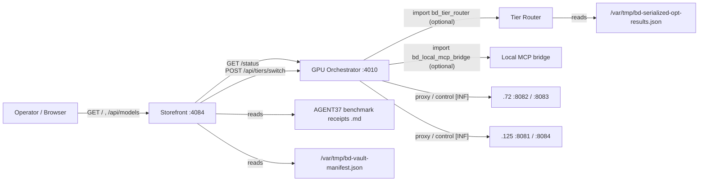
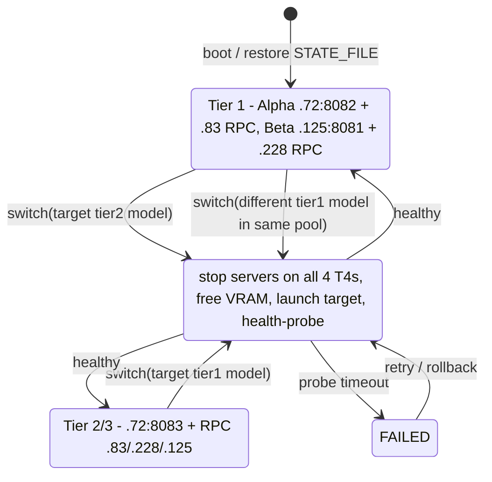

# BD-KB Volume 17: Deep Architecture Bible — Sovereign GPU Orchestrator (:4010), Tier Router & Model Storefront (:4084)
> **Author**: `Spec-217` (`AGY claude+gpt (claude-opus-5-5-high)`)
> **Generated At**: `2026-10-19T22:59:35Z`
> **Scope**: Strictly Read-Only Infrastructure, Tools, Services, LLMs & PM Catch-Up Documentation (`O3416` Compliant)

---

# BD-KB Volume 17: Deep Architecture Bible: Sovereign GPU Orchestrator (:4010), Tier Router & Model Storefront (:4084)

**Author seat:** Spec-217 · **Mode:** read-only reference · **Basis:** the truncated `<SOURCE_CONTEXT>` excerpts only (orchestrator: first 18,000 bytes; tier router: first 10,000 bytes; storefront: first 10,000 bytes)

> [!IMPORTANT]
> **How to read this volume.** Every statement is tagged with how solid it is:
> - **[SRC]**: read directly from the excerpt (constants, dicts, function bodies, docstrings).
> - **[DOC]**: stated in a module docstring, not backed by code visible in the excerpt.
> - **[INF]**: inferred from the topology or imports. It is **not** proven and must be checked against the full file before anyone relies on it.
> - **[GAP]**: requested by the brief but **not present** in the excerpt. Nothing is made up to fill these gaps.
>
> The brief asks for "all API routes", "Tier-1/2/3/4 routing", a "VRAM hot-swap state machine", and "lockfiles". The excerpt cuts the orchestrator off **inside `MODEL_CATALOG`**, before any HTTP handler, switch logic, or lock code. Those sections are therefore documented only as far as the evidence goes, and the gaps are marked.

---

## 1. System Overview

### 1.1 The three components

| Component | Path | Host / Port | Role |
|---|---|---|---|
| GPU Orchestrator | `/home/mboyle/bin/bd-gpu-orchestrator.py` | `10.0.70.164` (hub-mesh01), `0.0.0.0:4010` [SRC] | "Dynamic Tier 1/2/3 GPU Mode Orchestrator & Smart OpenAI Auto-Router" [DOC] |
| Tier Router | `/home/mboyle/bin/bd-tier-router.py` | Library + CLI (imports `argparse`) [SRC]. No listener visible. | "Stage-5 Proven Engine, NUMA Socket, Tiered -ub & Single-Node Routing Table" [DOC] |
| Model Storefront | `/home/mboyle/bin/bd-model-storefront.py` | `10.0.70.164`, `0.0.0.0:4084` (env `BD_STOREFRONT_PORT`), ingress `http://models.boylenet.themfboyles.org` [SRC/DOC] | "86-Model AI Vault Storefront", Pillar 5 (#UX-26) [DOC] |

### 1.2 Dependency graph



The storefront reaches the orchestrator at `http://127.0.0.1:4010` [SRC], which means **both services must share a host** (.164). If you move one without the other, every Activate call and every live-status read in the storefront will fail.

---

## 2. Physical Cluster Model (`CLUSTER_NODES`) [SRC]

All four nodes have exactly **one Tesla T4 (16 GB)**. Nodes have a management IP on `10.0.70.0/24` and an RPC IP on `10.0.75.0/24`. Every RPC worker listens on port **50052**.

| Node | Mgmt IP | RPC IP | vCPU / CPU | GGML CPU backend | RAM (GiB) | Tier role |
|---|---|---|---|---|---|---|
| aidev | 10.0.70.83 | 10.0.75.11 | 52 (2×26C Skylake-SP, AVX-512) | `libggml-cpu-skylakex.so` | 386 | Pool Alpha RPC worker (T1) / 4-GPU worker (T2/3) + `/opt/models` 5.0 TB **Vault B** |
| ai-srv01 | 10.0.70.72 | 10.0.75.12 | 52 (2×26C Skylake-SP, AVX-512) | `libggml-cpu-skylakex.so` | 320 | **Pool Alpha master :8082** (T1) / **T2&3 master :8083** + **Vault A** |
| ai-ollama01 | 10.0.70.228 | 10.0.75.13 | 64 (2×32C Broadwell-EP, AVX2) | `libggml-cpu-haswell.so` | 448 | Pool Beta RPC worker (T1) / 4-GPU worker (T2/3) + LiteLLM :4000 |
| ai-infer01 | 10.0.70.125 | 10.0.75.14 | 48 (2×24C Broadwell-EP, AVX2) | `libggml-cpu-haswell.so` | 576 | **Pool Beta master :8081** (T1) / 4-GPU worker (T2/3) |

All nodes declare `numa_nodes: 2`.

### 1.3 Pool topology derived from the catalog [SRC]

| Pool | Master endpoint | RPC backends | GPUs | Aggregate VRAM |
|---|---|---|---|---|
| Tier 1 Alpha | `http://10.0.70.72:8082` | `10.0.75.11:50052` (.83) | .72 + .83 | 32 GB |
| Tier 1 Beta | `http://10.0.70.125:8081` (also `:8084` for one entry) | `10.0.75.13:50052` (.228) | .125 + .228 | 32 GB |
| Tier 2 `unified_4gpu` | `http://10.0.70.72:8083` | `10.0.75.11`, `10.0.75.13`, `10.0.75.14` :50052 | all four | 64 GB |

> [!NOTE]
> **[INF] Why this needs a hot-swap at all.** The Tier 2 pool uses **the same four T4s** as Pool Alpha and Pool Beta together. The roles say this outright: aidev is "Pool Alpha RPC Worker (Tier 1) / 4-GPU Worker (Tier 2/3)". Tier 1 (two 32 GB pools) and Tier 2 (one 64 GB pool) therefore cannot both hold their weights in VRAM at once. That mutual exclusion is the job of the orchestrator's tier switch (§5).

---

## 3. Orchestrator Model Catalog (`MODEL_CATALOG`) [SRC]

Each entry has this schema: `id, tier, pool, name, architecture, aliases[], storage_node, server_endpoint, rpc_backends[], path, expected_bytes, measured_tok_s, measured_prompt_tok_s, ctx_size`.

`expected_bytes` very likely serves as a size or integrity check on the GGUF file [INF]. The code that consumes it is not visible.

### 3.1 Tier 1 entries (ctx 32768)

| id | Pool | Endpoint | GiB | gen tok/s | prompt tok/s |
|---|---|---|---|---|---|
| `qwen3-coder-30b-a3b` | alpha | .72:8082 | 17.28 | 77.62 | 848.90 |
| `qwen3-coder-30b-a3b-q6_k` | alpha | .72:8082 | 23.37 | 64.20 | 710.50 |
| `qwen2.5-coder-32b` | beta | .125:8081 | 18.48 | 11.27 | 266.51 |
| `dspark-deepseek-v4-flash-bf16` | alpha | .72:8082 | 10.54 | 54.20 | 612.40 |
| `dspark-deepseek-v4-flash-q8_0` | alpha | .72:8082 | 10.15 | 61.50 | 680.20 |
| `qwythos-9b-mtp-q8_0` | alpha | .72:8082 | 9.11 | 21.39 | 1005.86 |
| `qwythos-9b-mtp-bf16` | alpha | .72:8082 | 17.14 | 16.28 | 224.00 |
| `cyberstrike-offsec-35b-q4_k_m` | alpha | .72:8082 | 20.22 | 66.47 | 799.00 |
| `tier1-beta-cyberstrike-35b` | beta | **.125:8084** | 20.22 | 66.47 | 799.00 |
| `qwythos-27b-mtp-q4_k_m` | alpha | .72:8082 | 16.39 | 12.30 | 289.31 |

### 3.2 Tier 2 entries (ctx 16384, endpoint .72:8083, three RPC backends)

| id | GiB | gen tok/s | prompt tok/s | Notes |
|---|---|---|---|---|
| `qwythos-27b-mtp-q8_0` | 27.05 | 8.13 | 316.53 | Listed in the code under the "TIER 1" comment block but tagged `tier: tier2` |
| `deepseek-r1-distill-llama-70b` | 35.30 | 3.90 | 121.83 | IQ4_XS, holds the `tier2` default alias |
| `deepseek-r1-distill-llama-70b-q4_k_m` | 39.60 | 3.63 | 108.89 | |
| `llama-3.3-70b-instruct` | 39.60 | 3.59 | 108.22 | |
| `qwythos-27b-mtp-bf16` | 50.89 | 4.48 | 94.50 | |
| `cyberstrike-offsec-35b-bf16` | 66.18 | 19.72 | 184.00 | Bigger than 64 GB of VRAM, so the architecture string says "+ Skylake AVX-512" (partial CPU) |
| `swift-qwen3.8-flash-next-iq2_xs` | 63.47 | (truncated) | (truncated) | The architecture string says "1xT4 + Skylake-SP AVX-512 NUMA0", yet it sits in the `unified_4gpu` pool |

### 3.3 Generic tier aliases [SRC]

| Alias | Resolves to (by catalog membership) |
|---|---|
| `tier1`, `tier1-fast` | `qwen3-coder-30b-a3b` |
| `tier2`, `tier2-70b` | `deepseek-r1-distill-llama-70b` |

**[GAP]** The alias-resolution function itself (exact match, case-folding, first-match order) is outside the excerpt.

### 3.4 Tier 3 and Tier 4

- **Tier 3 [GAP/DOC]:** The docstring and node roles mention "Tier 2/3" and "Tier 2&3 Master :8083", so Tier 3 shares the :8083 master. No catalog entry tagged `tier3` appears in the visible bytes. It may come later in the truncated catalog.
- **Tier 4 [GAP]:** "Tier 4" does not appear anywhere in the three excerpts. The orchestrator calls itself a "Tier 1/2/3" orchestrator. The nearest candidate class is the tier router's **single-node, no-RPC, CPU-RAM-resident 150–350 GiB MoE table** (§4.6). Treat that as a *hypothesis* about what operators call "Tier 4", not as a documented fact.

---

## 4. Tier Router (`bd-tier-router.py`): Placement Policy Engine

The tier router decides **how** a model is launched: engine binary, environment, NUMA pinning, microbatch, and tensor offload. The orchestrator decides **where and when**. The orchestrator imports the router optionally, using `try: import bd_tier_router except: None` [SRC].

> [!WARNING]
> **[INF] Import-name mismatch.** The file is named `bd-tier-router.py` (hyphens), but the orchestrator runs `import bd_tier_router` (underscore). A plain `import` cannot load a hyphenated filename. Unless `/home/mboyle/bin/bd_tier_router.py` exists as a symlink or copy, the import fails **silently** (bare `except Exception`) and `bd_tier_router` becomes `None`. The same risk applies to `bd_local_mcp_bridge`. Check for the underscore twin before assuming router policy is live in the orchestrator.

### 4.1 Inputs

| Constant | Value | Purpose |
|---|---|---|
| `OPT_RESULTS_JSON` | `/var/tmp/bd-serialized-opt-results.json` | Live Stage-3 A/B results, read through `load_live_opt_results()` |
| `VRAM_TIGHT_MOE_MODELS` | 7 ids (nemotron-3.5-lightning-30b-heretic, glm-5.3-flash-uncensored, command-a-plus-111b, minimax-m2.7-ultra-uncensored-heretic, glm-5.3-flash-abliterated, mimo-v2.6-flash-rl-heretic-311b, ling-3.1-flash-564b) | Force `-ub 512 --mlock` |
| `UPPER_ATTN_OFFLOAD_MODELS` | command-a-plus-111b, glm-5.3-flash-abliterated, ling-3.1-flash-564b | Allow `-ot "blk\.(3[0-9])\.attn.*=CPU"` |
| `SINGLE_NODE_NO_RPC_MOE_TABLE` | 13 entries | Single-node placement for very large MoE models |

`load_live_opt_results()` fails open. If the file is missing, cannot be parsed, or is not a dict, it returns `{}` and the router falls back to static rules [SRC].

### 4.2 Engine selection: `resolve_engine(model_id, path, size_gib)` [SRC, partially truncated]

Order of precedence:

1. **Stage-3 live winner** (`live["stage3_engine_winners"][model_id.lower()]`) overrides everything else.
2. Static architecture or quant heuristics follow (in the truncated part; the docstring gives the intent).

| Engine | Binary | Env | Extra flags |
|---|---|---|---|
| `ik_llama` | `/opt/ik-llama/bin/llama-server` (+ `llama-bench`) | `LD_LIBRARY_PATH=/opt/ik-llama/lib:/opt/llama-rpc:/usr/local/lib/ollama/cuda_v12`, `GGML_OP_OFFLOAD_MIN_BATCH=2048` | `-fmoe -mla 3 -amb 512 -ser 6,1`; `use_no_mmap: False` |
| `gamozo` | `/opt/gamozo-llama/bin/llama-server` | Same lib pattern, plus `GGML_EXPERT_SHARD=1 GGML_EXPERT_PIN=1 GGML_CUDA_REGISTER_HOST=1`, plus `GGML_EXPERT_REPLICAS=1` **only if size ≤ 200 GiB** | (truncated). The docstring says `--no-mmap --numa distribute -t 48` |
| `mainline` | `/opt/llama-mainline/bin/llama-server` or `/opt/llama-rpc/llama-server` | (truncated) | The docstring says `-fa on -ctk q8_0 -ctv q8_0`, plus `--moe-cache-mib 8000` where supported |

Intended use according to the docstring: gamozo for native MXFP4/Q8_0 MoE on dual-socket Skylake; ik_llama for DeepSeek2/4 MLA and IQ2/3/4 MoE; mainline for standard GGUF.

### 4.3 NUMA policy: `resolve_numa_policy(size_gib, host_ip="10.0.70.83")` [SRC]

```text
socket_cap = 165.0 if host_ip == "10.0.70.83" else 140.0
size <= socket_cap → single_socket_node0: prefix "/usr/bin/numactl -N 0 -m 0", threads 26
size >  socket_cap → dual_socket_distribute: flag "--numa distribute", threads 48
```

> [!NOTE]
> The docstring says "≤ 140 GiB → single socket" across the board. The code uses **165 GiB on .83** (194 GiB/socket) and 140 GiB everywhere else (.72 has 161 GiB/socket). The code is what actually runs. Also note that the single-socket branch puts `-t 26` in the returned `threads` field, not in the `numactl` prefix.

### 4.4 Microbatch: `resolve_ubatch_size(model_id, size_gib, vram_tight=False)` [SRC]

| Condition (evaluated in order) | `-ub` |
|---|---|
| `vram_tight` **or** id in `VRAM_TIGHT_MOE_MODELS` **or** size > 240 GiB | 512 (docstring adds `--mlock`) |
| size ≤ 120 GiB | 2048 |
| otherwise (120–240 GiB) | 1024 |

`-b 2048` and `GGML_OP_OFFLOAD_MIN_BATCH=2048` stay constant [DOC].

### 4.5 GPU residency invariant (Step 1E / Agent-163) [DOC]

- Always use `-ngl 999 -ot ".ffn_.*_exps.=CPU"`, which moves only the routed experts to CPU.
- **Never** offload `.ffn_.*_shexp.` (shared experts) or `output.weight`.
- If the T4 still uses more than 14.9 GiB after `-ub 512 -ctk q8_0 -ctv q8_0`, then for models in `UPPER_ATTN_OFFLOAD_MODELS` add `-ot "blk\.(3[0-9])\.attn.*=CPU"`.

### 4.6 Single-node no-RPC MoE table (Stage 4 / Agent-162) [SRC]

Every row has `rpc_backends: []` and `numa_policy: dual_socket_distribute`. The preferred node is always `.83`, the 386 GiB host.

| Model key | Row | GiB | Fallback | ub |
|---|---|---|---|---|
| deepseek-v4-flash-q4k | 19 | 153.33 | .72 | 1024 |
| qwen3-coder-480b-a35b | 20 | 167.91 | .83 | 1024 |
| glm-5.2-iq2xxs | 21 | 196.57 | .83 | 1024 |
| glm-5.2-q3km | **21** | 319.21 | .83 | 512 |
| qwen3.8-flash-next-bf16 | 17 | 329.73 | **.72** | 512 |
| beam-1.0-501b-a23b | 60 | 174.04 | .72 | 1024 |
| nemotron-3-ultra-550b-a55b | 61 | 188.30 | .72 | 1024 |
| minimax-m3-426b-uncensored | 62 | 189.13 | .72 | 1024 |
| ling-3.1-flash-564b | 63 | 203.10 | .83 | 512 |
| muse-spark-816b-a42b | 64 | 210.08 | .83 | 1024 |
| deepseek-v3.2-685b | 65 | 229.67 | .72 | 1024 |
| glm-5.3-753b | 66 | 236.44 | .83 | 1024 |
| mimo-v2.6-pro-1024b | 67 | 238.22 | .83 | 1024 |

The `ubatch` values in the table agree with `resolve_ubatch_size()` for every row.

### 4.7 Context preservation (Agent-151) [DOC]

- Coding and reasoning routes: `-c 262144 -np 4 -kvu --reasoning-preserve`
- Qwythos-9B on `:18081`: `-c 1048576 -np 4 -kvu --reasoning-preserve`, with `enable_thinking=True`

The orchestrator catalog uses `ctx_size: 32768` (T1) and `16384` (T2). **[INF]** These are probably the default orchestrator launch contexts and differ from the router's preserved-context policy. Check which one wins when a server is actually launched.

---

## 5. VRAM Hot-Swap State Machine

**[GAP]** The switch implementation, its handler, and its state transitions are all outside the 18 KB excerpt. Here is what the evidence does establish:

- A persisted state file exists: `STATE_FILE = "/var/tmp/bd-gpu-orchestrator-state.json"` [SRC].
- A switch endpoint exists: `POST :4010/api/tiers/switch`. The storefront's Activate action calls it [DOC, storefront docstring].
- The imports include `subprocess`, `threading`, `concurrent.futures`, `http.client`, and `base64` [SRC]. **[INF]** That fits remote process control (SSH or systemd), parallel fan-out to the four nodes, health probing, and possibly HTTP basic auth.

### 5.1 Inferred model (not code-verified) [INF]



The model is built on the physical constraint from §1.3 (four single-T4 nodes shared between the T1 pools and the T2 pool). Before any operational decision, the transition guards, rollback behavior, and persisted fields must be read from the full file.

---

## 6. Lockfiles and Persistent State

| Path | Owner | Status |
|---|---|---|
| `/var/tmp/bd-gpu-orchestrator-state.json` | Orchestrator | [SRC] State persistence. Schema not visible. |
| `/var/tmp/bd-serialized-opt-results.json` | Tier router (read) | [SRC] Stage-3 engine winners, under key `stage3_engine_winners` |
| `/var/tmp/bd-vault-manifest.json` | Storefront (read) | [SRC] Vault capacity / inventory |
| `.../O1789/infra-upgrade/AGENT37-NEW-FRONTIER-MODELS-BENCHMARK-RECEIPTS.md` | Storefront (read) | [SRC] Benchmark receipts |
| Lock file (switch mutex) | — | **[GAP]** No lock file, `fcntl`, or `flock` appears in the excerpts. `threading` is imported, so an **in-process** lock is plausible [INF]. Nothing visible protects against concurrent switches coming from *two processes*. |

All state lives in `/var/tmp`. It survives a reboot on most distros but is local to the host. A second orchestrator instance on another host would not share it.

---

## 7. API Route Reference

### 7.1 Model Storefront (:4084) [DOC, from the module docstring]

| Method | Route | Behavior |
|---|---|---|
| GET | `/` | Visual "86-Model AI Vault Storefront" UI (#UX-26) |
| GET | `/health` | Service health and inventory summary JSON |
| GET | `/api/models` | 86-directory catalog, 22 llama-bench configs, 3 synthetic hybrid profiles, and live vault capacity |
| POST | `/api/activate` | One-click activate through `:4010/api/tiers/switch`, plus a generator for the exact `llama-server` command |
| POST | `/api/benchmark` | One-click quick benchmark plus a live GGUF magic/shard verifier across Vault A (.72) and Vault B (.83) |

`BENCHMARKED_22` entry schema [SRC]: `rank, id, name, gguf_file, vault_dir, node, nodes_available[], arch, size_gib, quant_shards, tier, orchestrator_model, hardware_pool, pp512, tg128, status, categories[], draft_pair, draft_flags`. The `orchestrator_model` field links each storefront card to an orchestrator catalog alias.

### 7.2 GPU Orchestrator (:4010)

| Method | Route | Evidence |
|---|---|---|
| GET | `/status` | [DOC] Referenced by the storefront ("Live GPU Orchestrator (:4010/status)") |
| POST | `/api/tiers/switch` | [DOC] Referenced by the storefront's activate route |
| OpenAI-compatible routes (e.g. `/v1/models`, `/v1/chat/completions`) | **[INF]** The orchestrator calls itself a "Smart OpenAI Auto-Router", but no handler is visible |

**[GAP]** Request and response schemas are not visible for any route.

---

## 8. Usage Examples

> [!CAUTION]
> The request bodies below are **illustrative placeholders**, because no schemas are visible. The GETs are safe. The POSTs change the state of the whole cluster (they unload GPUs on four nodes), so do not run them casually.

```bash
# Read-only probes
curl -s http://10.0.70.164:4084/health | jq .
curl -s http://10.0.70.164:4084/api/models | jq '.' | head -50
curl -s http://10.0.70.164:4010/status | jq .

# State-changing (body field names UNVERIFIED; check the handler first)
curl -s -X POST http://10.0.70.164:4010/api/tiers/switch \
  -H 'Content-Type: application/json' -d '{"model":"deepseek-r1-distill-llama-70b"}'
```

The tier router's pure functions are safe to run offline. Because the filename has hyphens, load it with `importlib`:

```python
import importlib.util
spec = importlib.util.spec_from_file_location("tr", "/home/mboyle/bin/bd-tier-router.py")
tr = importlib.util.module_from_spec(spec); spec.loader.exec_module(tr)

tr.resolve_ubatch_size("deepseek-v3.2-685b", 229.67)   # -> 1024
tr.resolve_ubatch_size("ling-3.1-flash-564b", 203.10)  # -> 512 (VRAM-tight set)
tr.resolve_ubatch_size("qwen3-coder-30b-a3b", 17.28)   # -> 2048
tr.resolve_numa_policy(150.0, "10.0.70.83")["policy"]  # -> single_socket_node0 (cap 165)
tr.resolve_numa_policy(150.0, "10.0.70.72")["policy"]  # -> dual_socket_distribute (cap 140)
```

These return values follow directly from the function bodies shown in §4.3 and §4.4.

---

## 9. Defects and Inconsistencies Visible in the Source

| # | Location | Finding | Risk |
|---|---|---|---|
| D1 | Orchestrator catalog | The aliases `cyberstrike-offsec-35b-bf16` and `tier2-cyberstrike-35b-bf16` appear on the **Tier 1 Q4_K_M** entry *and* on the **Tier 2 BF16** entry (one of them is the BF16 entry's own `id`). | If the resolver uses first match, a request for BF16 lands on the T1 Q4 model. |
| D2 | Storefront rank 4 | `orchestrator_model: "qwen3-coder-30b-a3b-q6"` is neither an id nor an alias. The catalog has `...-q6_k` and `tier1-qwen3-coder-30b-a3b-q6k`. | Activate may fail to resolve, or silently fall back. |
| D3 | Storefront rank 2 | The BF16 card maps to `orchestrator_model: "qwythos-9b"`, which is an alias of the **Q8_0** entry. | Activating BF16 loads Q8_0. |
| D4 | Storefront rank 7 | `gguf_file` is `Qwythos-27B-Claude-Mythos-5-MTP-Q4_K_M.gguf`, but the catalog path is `Qwythos-27B-MTP-Q4_K_M.gguf`. | The benchmark or shard verifier may report the file as missing. |
| D5 | Tier router table | `qwen3.8-flash-next-bf16` (329.73 GiB) has fallback `.72`. The docstring caps .72 at about 280 GiB, and .72 has 320 GiB of RAM in total. | The fallback launch cannot fit. |
| D6 | Tier router table | Row 21 is used twice (`glm-5.2-iq2xxs`, `glm-5.2-q3km`). | Row-keyed reporting collides. |
| D7 | Tier router | The NUMA docstring (140 GiB) does not match the code (165 GiB on .83). | Docs mislead operators. |
| D8 | Orchestrator | `import bd_tier_router` cannot load a hyphenated file, and the failure is swallowed (§4). | Router policy may never be applied. |
| D9 | Catalog | `dspark…BF16` (10.54 GiB) is only about 4% larger than `…Q8_0` (10.15 GiB). Real BF16 weights are roughly twice the size of Q8_0. | The label or `expected_bytes` is probably wrong. |
| D10 | Catalog | `swift-qwen3.8-flash-next-iq2_xs` says "1xT4 + NUMA0" but is placed in `unified_4gpu` :8083. | The placement intent is unclear. |
| D11 | Naming | `tier1-fast` is an orchestrator alias for Qwen3-Coder-30B, but the storefront uses it as the `vault_dir` for Qwen2.5-Coder-32B. | Operators may confuse the two. |

---

## 10. Verification Checklist (before acting on this volume)

1. Read the rest of `bd-gpu-orchestrator.py` past byte 18,000: the `BaseHTTPRequestHandler` subclass, the switch function, and the `STATE_FILE` writer. Confirm the routes and the state machine from §5 and §7.2.
2. `ls -l /home/mboyle/bin/bd_tier_router.py /home/mboyle/bin/bd_local_mcp_bridge.py` to settle D8.
3. `jq . /var/tmp/bd-gpu-orchestrator-state.json` (read-only) to see the persisted schema.
4. `jq '.stage3_engine_winners' /var/tmp/bd-serialized-opt-results.json` to see which engine overrides are live.
5. Grep the orchestrator for `flock|fcntl|Lock\(` to settle the lockfile gap in §6.
6. Check the storefront's `orchestrator_model` values against the catalog aliases (D2, D3).

---

*End of BD-KB Volume 17. Based only on the `<SOURCE_CONTEXT>` excerpts. No live systems, files, or tools were accessed.*
