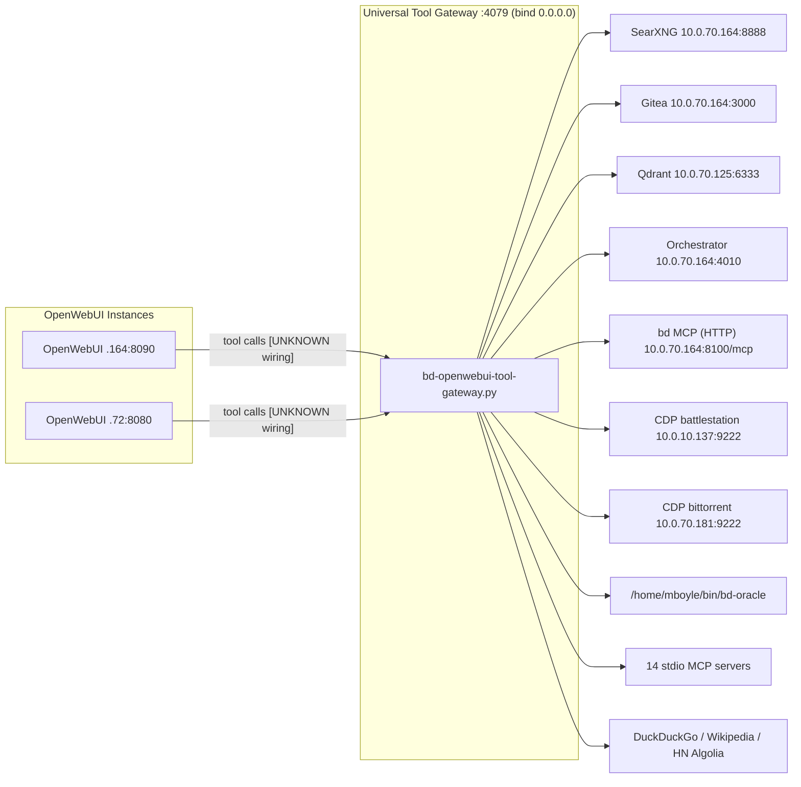
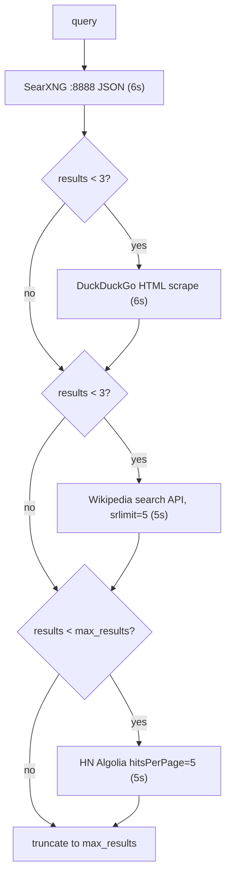

# BD-KB Volume 18: Deep Architecture Bible — OpenWebUI Super-Suite (.164:8090 & .72:8080) & Universal Tool Gateway (:4079)
> **Author**: `Spec-218` (`AGY claude+gpt (claude-opus-5-5-high)`)
> **Generated At**: `2026-10-19T22:59:33Z`
> **Scope**: Strictly Read-Only Infrastructure, Tools, Services, LLMs & PM Catch-Up Documentation (`O3416` Compliant)

---

# BD-KB Volume 18: Deep Architecture Bible: OpenWebUI Super-Suite (`.164:8090` & `.72:8080`) & Universal Tool Gateway (`:4079`)

**Author seat:** Spec-218
**Mode:** Read-only documentation. No commands were run and nothing was checked against live systems.
**Date:** 2026-10-19
**Primary source:** `/home/mboyle/bin/bd-openwebui-tool-gateway.py`, first 20,000 bytes only
**Missing source:** `/home/mboyle/bd-persist/harness-work/O1789/infra-upgrade/MASTER-OPENWEBUI-TOTAL-INTEGRATION-LEDGER.md` (**FILE ABSENT**)

---

## 0. Evidence Status (read this first)

The brief asks this volume to cover the OpenWebUI SQLite schema, 15 autonomous agents, 50 toolkits, 128 skills, 8 pipelines, the readable model-first display names, and the `620px` dropdown CSS injection. **None of these appear in the source I was given.** The master integration ledger, which probably recorded them, is absent. The gateway source stops partway through `tool_browse_live_page_cdp`.

To avoid inventing facts, every claim in this volume carries one of these tags:

| Tag | Meaning |
|---|---|
| **[SRC]** | Read directly from the gateway source in `<SOURCE_CONTEXT>` |
| **[BRIEF]** | Stated in the task brief, with no supporting evidence in the source |
| **[UPSTREAM]** | General knowledge of upstream OpenWebUI behaviour. Varies by version and was not checked on `.164` or `.72` |
| **[UNKNOWN]** | Cannot be determined from what was provided |

| Topic | Status |
|---|---|
| Gateway port, host, upstream endpoints | **[SRC]** |
| MCP server registry (15 entries) | **[SRC]** |
| Skill / plugin discovery algorithm | **[SRC]** |
| MCP schema inventory algorithm | **[SRC]** |
| `search_web`, `read_url_content`, HTML→Markdown, CDP/oracle tools | **[SRC]** (CDP is truncated) |
| HTTP routing, auth, OpenAPI surface of `:4079` | **[UNKNOWN]** (after the cut) |
| OpenWebUI SQLite schema | **[UPSTREAM]** only |
| 15 agents / 50 toolkits / 128 skills / 8 pipelines | **[BRIEF]** counts only. No names or IDs given |
| Model-first display names | **[BRIEF]** concept. Format **[UNKNOWN]** |
| `620px` dropdown CSS | **[BRIEF]** width. Injection mechanism **[UNKNOWN]**, with likely options **[UPSTREAM]** |

> [!IMPORTANT]
> Treat the four counts (15/50/128/8) as a snapshot claimed by the brief, not as invariants. Section 4 shows the 128-skill figure in particular is **computed from the filesystem every time** and will drift whenever skill directories change.

---

## 1. Topology



**[SRC]** Host roles visible in the gateway:

| Host | Port | Service | Constant |
|---|---|---|---|
| `10.0.70.164` | 8888 | SearXNG JSON search | `SEARXNG_URL` |
| `10.0.70.164` | 3000 | Gitea | `GITEA_BASE_URL` |
| `10.0.70.164` | 4010 | Orchestrator | `ORCHESTRATOR_URL` |
| `10.0.70.164` | 8100 | `bd` MCP over HTTP | `MCP_SERVER_COMMANDS["bd"]` |
| `10.0.70.125` | 6333 | Qdrant vector DB | `QDRANT_BASE_URL` |
| `10.0.10.137` | 9222 | Chrome CDP ("battlestation", "137") | `CDP_NODES` |
| `10.0.70.181` | 9222 | Chrome CDP ("bittorrent", "181") | `CDP_NODES` |
| `10.0.20.70` | — | vCenter (via `vmware-clones` MCP) | `MCP_SERVER_COMMANDS` |
| `127.0.0.1` | 5432 | PostgreSQL `ai_mesh` (via `pg-local`) | `MCP_SERVER_COMMANDS` |

**[UNKNOWN]** `.164:8090` and `.72:8080` never appear in the first 20 KB. The gateway does not name OpenWebUI as a client in that range. How OpenWebUI reaches it (an OpenAPI tool server URL, a Python Tool that proxies to it, or an MCP bridge) is not shown. The full octets of `.72` are also not given. Inferring `10.0.70.72` would be a guess.

---

## 2. Universal Tool Gateway: Process & Configuration

### 2.1 Runtime constants **[SRC]**

| Constant | Value | Override |
|---|---|---|
| `PORT` | `4079` | env `BD_OPENWEBUI_TOOL_GATEWAY_PORT` |
| `HOST` | `0.0.0.0` | env `BD_OPENWEBUI_TOOL_GATEWAY_HOST` |
| `MCP_SCHEMA_ROOT` | `/home/mboyle/.gemini/antigravity-cli/mcp` | none |
| `SANDBOX_REPOS_DIR` | `/var/tmp/openwebui-repos` | none |
| `SANDBOX_WORKSPACE_DIR` | `/var/tmp/openwebui-workspace` | none |

### 2.2 Import-time side effects **[SRC]**

Both sandbox directories are created with `mkdir(parents=True, exist_ok=True)` **at module import**, before any server starts. Consequences:

- Importing the module (for example, a test harness doing `import`) writes to `/var/tmp`.
- If `/var/tmp` cannot be written, the process fails at import and no HTTP server comes up.
- The names suggest repo clones and scratch workspaces for OpenWebUI-initiated actions. The tools that use them are past the cut **[UNKNOWN]**.

### 2.3 Standard-library-only design **[SRC]**

The imports are standard library only: `http.server`, `socketserver`, `urllib.request`, `subprocess`, `glob`, `re`, `html`, `json`. There is no `requests`, FastAPI, or Pydantic. The gateway therefore runs on any system `python3` without a venv. The cost is that HTML parsing is regex-based (§6.3) and there is no async I/O. `socketserver` is imported, which suggests a `ThreadingMixIn` server, but that code is past the cut **[UNKNOWN]**.

---

## 3. MCP Server Registry (`MCP_SERVER_COMMANDS`) **[SRC]**

There are 15 keys, which map to **14 distinct server processes**: `bd-fleet` and `bd-fleet-mcp_bd-fleet` are byte-identical aliases.

| # | Key | Transport | Launch / URL | Notes |
|---|---|---|---|---|
| 1 | `bd` | **http** | `http://10.0.70.164:8100/mcp` | Only HTTP-transport server |
| 2 | `bd-bus` | stdio | `python3 -m bd_bus_mcp` | |
| 3 | `bd-fleet` | stdio | `bd-mcp/venv/bin/python …/bd-fleet-mcp/server.py` | |
| 4 | `bd-fleet-mcp_bd-fleet` | stdio | same as #3 | Alias, so the same tools are exposed twice |
| 5 | `boylenet-infra` | stdio | `/usr/bin/python3 /home/mboyle/bin/bd-boylenet-infra-mcp.py` | |
| 6 | `caveman` | stdio | `/home/mboyle/.caveman/bin/caveman-mcp` | |
| 7 | `context-mode` | stdio | `npx -y context-mode` | Needs network on first run |
| 8 | `fleet-sync` | stdio | `python3 …/fleet_sync_tool/fleet_sync_mcp.py` | |
| 9 | `hivemind-memory` | stdio | `python3 …/plugins/hivemind-memory/server.py` | |
| 10 | `pg-local` | stdio | `npx -y @modelcontextprotocol/server-postgres postgresql://postgres@127.0.0.1:5432/ai_mesh` | Superuser `postgres`, no password in the DSN |
| 11 | `python-linter` | stdio | `python3 -m mcp_server_ruff` | |
| 12 | `ratf` | stdio | `python3 -m mcp_server_ratf` | |
| 13 | `serena` | stdio | `uvx --from git+https://github.com/oraios/serena serena start-mcp-server --context ide-assistant --transport stdio` | Pulls from GitHub HEAD on cold start |
| 14 | `type-enforcer` | stdio | `python3 -m mcp_server_mypy` | |
| 15 | `vmware-clones` | stdio | `python3 -m mcp_server_vmware --host 10.0.20.70` | env `BD_VC_CRED_FILE=/home/mboyle/.bd-import/vc-cred.env` |

**Design notes:**

- `env` is set only for `vmware-clones`. Whether the spawn code merges this with `os.environ` or replaces it is past the cut **[UNKNOWN]**.
- Three entries (`context-mode`, `pg-local`, `serena`) resolve packages from the network at launch. They are not reproducible and will fail when air-gapped.
- The registry is only consulted for **transport type** in the inventory code that is visible (§5). If a schema directory has no registry entry, it is reported as `stdio` by default.

---

## 4. Skill & Plugin Discovery (`discover_all_skills_and_plugins`) **[SRC]**

This function produces what the brief calls the **"128 skills"**. The number is not stored anywhere. It is recomputed from globs on every call.

### 4.1 Source priority (first match wins)

| Order | Glob | `source` label |
|---|---|---|
| 1 | `~/.kimi/skills/*/SKILL.md` | `kimi-k2.8-skill` |
| 2 | `~/.agents/skills/*/SKILL.md` | `claude-codex-agy-skill` |
| 3 | `~/.agents/skills/synced/*/*/SKILL.md` | `claude-synced-skill` |
| 4 | `~/.gemini/antigravity-cli/builtin/skills/*/SKILL.md` | `gemini-agy-builtin-skill` |
| 5 | `~/.agents/plugins/*/skills/*/SKILL.md` | `fleet-plugin-skill` |
| 6 | `~/.agents/plugins/*/*/SKILL.md` | `fleet-plugin-skill` |
| 7 | `~/.claude/commands/*.md` | `claude-code-command` (id prefix `claude-cmd-`) |
| 8 | `~/.codex/agents/*.toml` (excluding `*.config.toml`) | `codex-agent-profile` (id prefix `codex-agent-`) |

Each glob's results are `sorted()`, so the order is deterministic for a given filesystem.

### 4.2 Identity and de-duplication

- **Slug** = parent directory name, lowercased, with every char outside `[a-z0-9_-]` replaced by `-`, then stripped of leading and trailing `-`.
- `seen_ids` is shared across all sources. **A later skill with the same directory name is silently dropped.** A `~/.kimi/skills/foo` therefore shadows `~/.agents/skills/foo`, and neither shows any sign of the collision.
- Claude commands and Codex agents get prefixes, so they cannot collide with SKILL.md slugs.

### 4.3 Record shape

```json
{
  "id": "<slug>",
  "name": "<frontmatter name | slug>",
  "source": "<label>",
  "path": "/abs/path/SKILL.md",
  "description": "<frontmatter description | first prose line[:220] | fallback>",
  "helper_files": ["scripts/x.sh", "..."],
  "content": "<full SKILL.md text>"
}
```

- `helper_files`: every non-`SKILL.md` file under the skill directory, found recursively, as relative paths, **capped at 25**.
- `content` holds the **entire file**. Returning the full catalogue therefore returns every skill body, which can be several MB in one payload.
- Codex agents wrap their TOML in a Markdown fenced block. Their description comes from a regex on `description = "…"` and falls back to `Codex specialized agent profile <stem>`.

### 4.4 Frontmatter parser limits

`_parse_frontmatter` is a line-based `key: value` splitter, not a YAML parser:

- A folded or literal description (`description: >` or `|`) produces the literal string `">"` or `"|"` as the description, which suppresses the prose fallback.
- Indented or nested keys are read as top-level if they contain `:`.
- A `---` that appears inside the body after the frontmatter is not an issue, because `split("---", 2)` limits the split. But a file that starts with `---` and has no closing marker is treated as having no frontmatter.

### 4.5 Edge case in glob 6

`~/.agents/plugins/*/*/SKILL.md` also matches `~/.agents/plugins/<p>/skills/SKILL.md`, giving the slug **`skills`**. Only the first such plugin is kept and the others are dropped.

> [!NOTE]
> To reconcile the **128** count, you would need to enumerate the eight globs on the host where the gateway runs. Expect drift whenever skills are added, synced, or renamed. A different count from 128 is not, by itself, a regression.

---

## 5. MCP Tool Inventory (`discover_mcp_Inventory`) **[SRC]**

(The mixed-case function name is how it appears in the source.)

- Walks every subdirectory of `MCP_SCHEMA_ROOT`, sorted.
- For each `*.json`, reads `name`, `description`, and parameters from **`parameters` or `inputSchema`**, which accepts both Gemini-style and MCP-native schemas.
- If the JSON is malformed, the tool is still listed as `{"name": <file stem>}`, so a broken schema shows up as an entry with no description rather than being hidden.
- Returns `{server_count, total_tools, servers{<name>: {server, transport, tool_count, tools[]}}}`.

**Important:** this is a **static schema inventory**. It reads JSON files on disk and does not start or probe any MCP server. A server can be listed with all its tools and still fail at call time, for example when `npx` is offline or the vCenter credentials have expired.

The brief's **"50 toolkits"** might correspond to MCP servers, OpenWebUI `tool` rows, or a mix of both. The source does not say which **[UNKNOWN]**.

---

## 6. Native Tool Implementations **[SRC]**

### 6.1 `tool_search_web`, a multi-engine cascade

Inputs: `query` (alias `q`), `max_results` (alias `limit`, default **8**).



Behaviour notes:

- `engines_tried` records SearXNG and DDG failures (`searxng_err:<Exc>`, `ddg_err:<Exc>`). **Wikipedia and HN failures are swallowed** with `pass` and leave no error marker, only the attempt label.
- DDG redirect links are unwrapped through the `uddg=` query parameter.
- Results are appended in engine order and then cut to `max_results`. HN hits usually come last and are cut first.
- An empty query returns `{"ok": false, "error": "Missing required parameter: query"}`. Otherwise `ok` is **always `true`**, even when there are zero results.
- `max_results` goes through `int()` with no guard. A non-numeric value raises an exception that escapes the function.

### 6.2 `tool_read_url_content`

- Accepts only `http://` or `https://` URLs. Inputs: `url`, `max_chars` (default **16000**).
- Timeout 12 s. Reads at most **512,000 bytes** of the body.
- JSON content types are passed through raw (truncated, no link extraction, **no `truncated` flag**).
- HTML goes through `_html_to_markdown` and returns `title`, `markdown`, `truncated`, and `links`.
- **No SSRF guard**: any internal `10.0.x.x` URL can be fetched by any caller who can reach `:4079`.

### 6.3 `_html_to_markdown`

A regex pipeline, in this order:

1. Extract `<title>`.
2. Remove `script|style|noscript|svg|iframe` blocks and HTML comments.
3. Collect up to **40** links, skipping `javascript:`, `#`, and `mailto:`, and resolving relative links against the base URL.
4. Convert `h1`–`h6` to `#`-prefixed headings.
5. Convert `<li>` to `- `.
6. Turn `p|div|br|tr|section|article` openings into newlines.
7. Strip remaining tags, unescape entities, collapse whitespace, and drop blank lines.

Limits: tables lose their structure, `<pre>`/code formatting is lost, and nested lists flatten.

### 6.4 `tool_browse_live_page_cdp` (truncated)

- `node` defaults to `battlestation`. **Unknown node keys silently fall back to `.137`**.
- `action` defaults to `list_tabs`.
- `action=oracle` with `oracle_prompt` runs `/home/mboyle/bin/bd-oracle --oracle all --json <prompt>` with a **45 s** timeout. It returns the last 8000 chars of stdout and the last 2000 of stderr, and `ok` is set from `returncode == 0`. The prompt is passed as an argv element, not through a shell, so shell injection is not possible.
- Every other action first probes `GET {cdp}/json/version` with a 5 s timeout. The source **stops here**, so the remaining actions (navigate, screenshot, evaluate, and so on) are **[UNKNOWN]**.

### 6.5 Constants used only after the cut

`GITEA_BASE_URL`, `QDRANT_BASE_URL`, and `ORCHESTRATOR_URL` are declared but not used in the visible portion. Gitea, Qdrant, and orchestrator tools probably exist further down the file **[UNKNOWN]**.

---

## 7. OpenWebUI Instances (`.164:8090`, `.72:8080`)

### 7.1 SQLite schema **[UPSTREAM]**

Upstream OpenWebUI keeps its state in `webui.db` (usually `/app/backend/data/webui.db` in the container) unless `DATABASE_URL` points at Postgres. The main tables for this suite are below. Column sets differ between releases. **Not checked on either host.**

| Table | Role in this suite | Key columns (upstream) |
|---|---|---|
| `model` | **Agents / custom models** (the brief's 15 agents would most naturally be rows here) | `id`, `user_id`, `base_model_id`, `name`, `params` (JSON: system prompt, etc.), `meta` (JSON: description, toolIds, profile image), `access_control`, `is_active`, `created_at`, `updated_at` |
| `tool` | **Toolkits** (Python Tool classes, the brief's 50) | `id`, `user_id`, `name`, `content` (Python source), `specs` (JSON function specs), `meta`, `valves`, `access_control`, timestamps |
| `function` | **Pipes / filters / actions** (in-process "pipelines") | `id`, `user_id`, `name`, `type` (`pipe`/`filter`/`action`), `content`, `meta`, `valves`, `is_active`, `is_global`, timestamps |
| `prompt` | Slash-prompts (one way the 128 skills could be surfaced) | `command`, `user_id`, `title`, `content`, `timestamp`, `access_control` |
| `knowledge`, `file` | RAG collections and uploads | `id`, `name`, `data`, `meta` |
| `config` | Persisted admin settings (JSON blob) | `id`, `data`, `version` |
| `user`, `auth`, `group` | Identity and RBAC | — |
| `chat`, `tag`, `folder`, `memory`, `feedback` | User data | — |
| `alembic_version` / `migratehistory` | Schema migrations | — |

> [!WARNING]
> Upstream OpenWebUI runs migrations at startup. Hand edits to `webui.db` (for example, bulk renames of `model.name`) should only be made with the container stopped, against a backup, and must match the live release's schema. This volume cannot confirm that release.

### 7.2 The four counts, mapped to OpenWebUI concepts

| Brief claim | Most likely storage | Status |
|---|---|---|
| 15 autonomous agents | `model` rows with `base_model_id` set, plus system prompt in `params` and bound `toolIds` in `meta` | **[BRIEF]**, names **[UNKNOWN]** |
| 50 toolkits | `tool` rows, possibly including stubs that proxy to `:4079` | **[BRIEF]**, mapping **[UNKNOWN]** |
| 128 skills | Gateway `discover_all_skills_and_plugins()` output (§4), possibly also mirrored into `prompt` or `knowledge` | Algorithm **[SRC]**, count **[BRIEF]** |
| 8 pipelines | Either `function` rows of type `pipe`/`filter`, **or** a separate upstream Pipelines server (normally `:9099`) | **[BRIEF]**, which one **[UNKNOWN]** |

The two instances may share one gateway but keep separate `webui.db` files. Whether the counts are identical on `.164` and `.72` is **[UNKNOWN]**. Drift between the two instances should be checked rather than assumed away.

### 7.3 Model-first display names **[BRIEF]**

The concept: the model selector shows a readable name that starts with the underlying model, instead of an opaque ID. In upstream terms **[UPSTREAM]**:

- The **display string is `model.name`**. **`model.id` is the stable key** referenced by chats, `meta.toolIds` bindings, and API callers.
- So a model-first rename should **only change `name`** (and optionally `meta.description`). Changing `id` would orphan chat history and bindings.
- The exact naming format (separator, ordering of model, agent role, and pool) is **[UNKNOWN]**. No examples appear in the source. This volume deliberately does not invent a pattern.

### 7.4 `620px` wide dropdown CSS injection **[BRIEF]**

Purpose: model-first names are long, and the default selector width truncates them. The brief records a widened dropdown at **620px**.

Injection mechanism is **[UNKNOWN]**. Upstream-plausible options **[UPSTREAM]**:

1. A `custom.css` placed in the frontend static directory (upstream's HTML shell loads `/static/custom.css` in many releases), usually bind-mounted into the container.
2. A reverse-proxy `sub_filter`-style injection of a `<style>` block.
3. A patched build.

Illustrative shape only. **The selector is a placeholder and not taken from either instance:**

```css
/* ILLUSTRATIVE — the real selector on .164/.72 is UNKNOWN */
<model-selector-dropdown> {
  min-width: 620px;
  max-width: min(620px, 95vw);
}
```

Operational caveats:

- Static-file and proxy injections both depend on OpenWebUI's DOM and class names, which change between releases. Re-check after every image upgrade.
- If option 1 is used on a bind mount, a container recreate without the mount silently drops the CSS.

---

## 8. Architectural Observations & Risk Register

| # | Finding | Evidence | Severity |
|---|---|---|---|
| R1 | Gateway binds `0.0.0.0:4079`. No auth appears in the first 20 KB | **[SRC]** (auth may exist later) | High if confirmed |
| R2 | `read_url_content` has no SSRF guard and can reach every internal service | **[SRC]** | High combined with R1 |
| R3 | `pg-local` DSN uses the `postgres` superuser with no password | **[SRC]** | Medium |
| R4 | `serena`, `context-mode`, and `pg-local` resolve packages from the network at launch | **[SRC]** | Medium (reproducibility, air-gap) |
| R5 | Skill slug collisions are dropped silently, first source wins | **[SRC]** | Low/Medium |
| R6 | Frontmatter parser mishandles folded YAML descriptions | **[SRC]** | Low |
| R7 | The skill catalogue includes the full `content`, so payloads are large | **[SRC]** | Low/Medium (OpenWebUI context bloat) |
| R8 | `bd-fleet` is registered twice, so tools are duplicated in the inventory | **[SRC]** | Low |
| R9 | Unknown CDP node names fall back to `.137` without an error | **[SRC]** | Low |
| R10 | Wikipedia and HN errors are swallowed without a marker in `engines_tried` | **[SRC]** | Low |
| R11 | Import-time `mkdir` in `/var/tmp` | **[SRC]** | Low |
| R12 | MCP inventory reads schemas only, so being listed does not mean being callable | **[SRC]** | Medium (false-green risk) |
| R13 | The master integration ledger is absent, so the 15/50/128/8 counts are unbacked | **[SRC]** (absence) | Documentation gap |

---

## 9. Read-Only Verification Checklist (for a future seat)

These were **not executed** for this volume. They are listed so a later seat can turn **[BRIEF]** and **[UNKNOWN]** tags into **[SRC]**:

1. Read the gateway source beyond byte 20,000 to find the HTTP routes, auth, OpenAPI spec, the rest of the CDP actions, and the Gitea, Qdrant, and orchestrator tools.
2. On each OpenWebUI host, open a **read-only** connection to `webui.db` and run `.schema`, then `SELECT COUNT(*)` on `model`, `tool`, and `function` grouped by `type`, to compare against 15/50/8.
3. `SELECT id, name FROM model` to capture the actual model-first display-name format.
4. Search the container's static assets or proxy config for `620px` to find the injection point and the real selector.
5. Run the eight skill globs (§4.1) on the gateway host, apply the slug and de-dup rules, and compare against 128.
6. Recover or rebuild `MASTER-OPENWEBUI-TOTAL-INTEGRATION-LEDGER.md`.

---

## Appendix A: Timeouts & Caps **[SRC]**

| Operation | Timeout | Cap |
|---|---|---|
| SearXNG | 6 s | `max_results` (default 8) |
| DuckDuckGo HTML | 6 s | `max_results` |
| Wikipedia API | 5 s | 5 hits |
| HN Algolia | 5 s | 5 hits |
| `read_url_content` fetch | 12 s | 512,000 bytes read, 16,000 chars returned, 40 links |
| CDP `/json/version` probe | 5 s | — |
| `bd-oracle --oracle all` | 45 s | stdout tail 8000, stderr tail 2000 |
| Skill `helper_files` | — | 25 per skill |
| Description fallback | — | 220 chars |

## Appendix B: User-Agent Strings **[SRC]**

| Context | User-Agent |
|---|---|
| SearXNG, Wikipedia, HN | `Boylenet-OpenWebUI-Gateway/1.0` |
| DuckDuckGo | `Mozilla/5.0 (X11; Linux x86_64) AppleWebKit/537.36 Chrome/126.0.0.0 Safari/537.36` |
| `read_url_content` | `Mozilla/5.0 (X11; Linux x86_64) Boylenet-OpenWebUI-Reader/1.0` |

---

*End of Volume 18. Everything tagged [SRC] comes from the first 20 KB of the gateway source. Everything else is labelled as brief-asserted, upstream-general, or unknown, and should be checked using §9 before anyone relies on it.*
