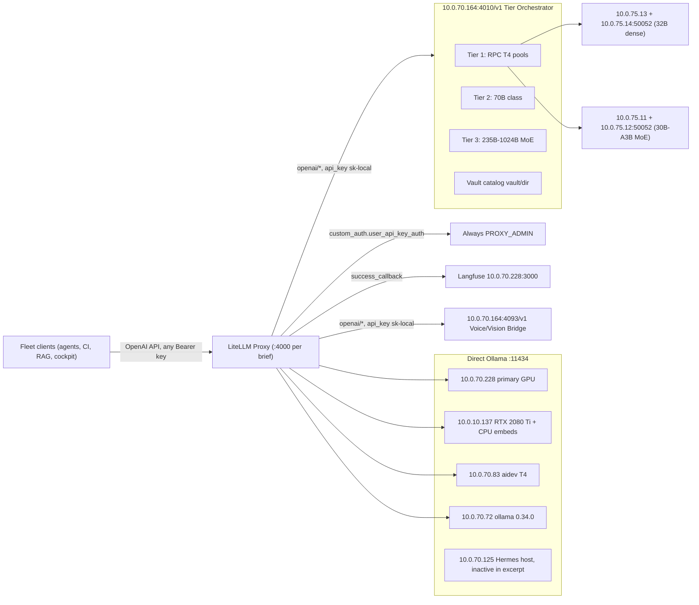
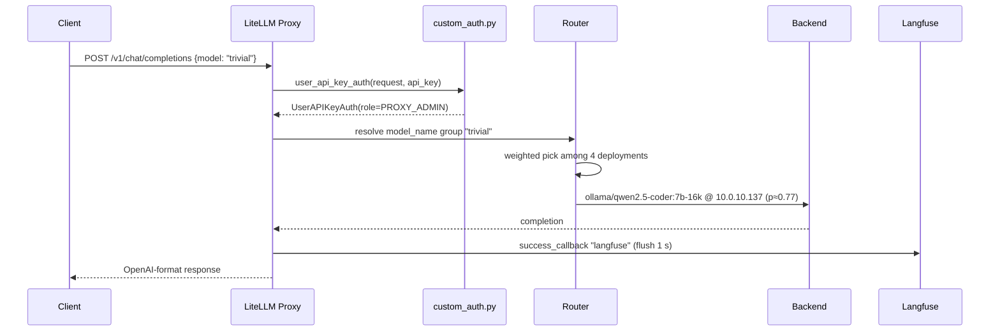

# BD-KB Volume 19: Deep Architecture Bible — LiteLLM Unified Gateway (:4000), 300-Model Routing & Custom Auth
> **Author**: `Spec-219` (`AGY claude+gpt (claude-opus-5-5-high)`)
> **Generated At**: `2026-10-19T22:59:49Z`
> **Scope**: Strictly Read-Only Infrastructure, Tools, Services, LLMs & PM Catch-Up Documentation (`O3416` Compliant)

---

# BD-KB Volume 19: Deep Architecture Bible: LiteLLM Unified Gateway (:4000), 300-Model Routing & Custom Auth

> **Author seat:** Spec-219 · **Mode:** Read-only documentation · **Snapshot:** 2026-10-19
> **Primary sources:** `/home/mboyle/infra/support-layer/litellm/config.yaml` (first 22,000 bytes only) and `/home/mboyle/infra/support-layer/litellm/custom_auth.py` (all 859 bytes)

---

## 0. Provenance and Limits (Read First)

This volume uses only the source excerpts listed above. Before relying on it, note four places where the brief and the source disagree or can't be checked:

| Claim in brief | Status against source | Notes |
|---|---|---|
| Gateway at `10.0.70.164:4000` | **Not confirmed by config** | The config never states the proxy's own bind address. `10.0.70.164` shows up only as the host of the **upstream** services on `:4010` and `:4093`. The `:4000` address comes from the brief and from `run.sh`, which was not provided. |
| "All 300 models" | **Can't check from the excerpt** | The excerpt has about **119 `model_list` entries**. It cuts off partway through the `captcha-agent` entry. The rest may be in the remaining bytes. See §12. |
| "Local and cloud models" | **No cloud models in the excerpt** | Every `api_base` in the excerpt is a private RFC1918 address. The file header says *"fleet-local models only."* Any cloud entries would be after the cutoff. |
| "Authenticated (`sk-local`)" | **Misleading** | `sk-local` is the key **LiteLLM sends to upstreams** (`:4010` and `:4093`). Client authentication is done by `custom_auth.py`, which **accepts any key**. See §3. |

Statements marked **[inferred]** come from standard LiteLLM behavior, not from text in the excerpt.

---

## 1. Executive Summary

The LiteLLM proxy is the fleet's single OpenAI-compatible front door. It sits on top of three different kinds of backend:

1. **Direct Ollama deployments** on five LAN hosts: `10.0.70.228`, `10.0.10.137`, `10.0.70.83`, `10.0.70.72`, and `10.0.70.125` (referenced in comments but not active in the excerpt). These serve small coder models, Hermes-3, and embedding models. Requests are spread across hosts with weights.
2. **The Tier 1/2/3 GPU Mode Orchestrator and Smart Auto-Router** at `10.0.70.164:4010/v1`. LiteLLM reaches it through the `openai/` provider prefix. Behind it are distributed llama.cpp RPC pools (2× Tesla T4 over 25GbE), 70B-class models, frontier MoE models of 235B to 1024B, and the "Agent-95 86-Model Vault Catalog."
3. **The Swarm #13 Voice, Vision & Multimodal Cockpit Bridge** at `10.0.70.164:4093/v1`, which handles TTS, STT, and vision.

Authentication is effectively **open**. `custom_auth.py` treats every request, including one with no key, as `PROXY_ADMIN`. Loading that module also turns on **Langfuse tracing** of every successful call to `10.0.70.228:3000`.

---

## 2. Topology



### 2.1 Request Lifecycle



---

## 3. Authentication: `custom_auth.py` Deep Dive

### 3.1 Full Behavior, Line by Line

| Stage | Code | Effect |
|---|---|---|
| Import-time env injection | `os.environ["LANGFUSE_PUBLIC_KEY"] = "pk-lf-boylenet-local"` (plus the secret key, `LANGFUSE_HOST`, and `LANGFUSE_FLUSH_INTERVAL=1`) | Langfuse credentials are **hardcoded in source**. Host is `http://10.0.70.228:3000`. Flush interval is 1 second. |
| Callback registration | `if "langfuse" not in (litellm.success_callback or []): ... + ["langfuse"]` | Adds `langfuse` to the global success callbacks. The check prevents double registration if the module is imported more than once. |
| Imports | `UserAPIKeyAuth`, `LitellmUserRoles`, `LITELLM_PROXY_ADMIN_NAME`, `fastapi.Request` | Standard LiteLLM custom-auth hook signature. |
| Key normalization | `raw = (api_key or "sk-boylenet-local").strip()` | A missing or empty key becomes the placeholder `sk-boylenet-local`. |
| Bearer strip | `if raw.lower().startswith("bearer "): raw = raw[7:].strip()` | Removes a leftover `Bearer ` prefix, case-insensitively. |
| Verdict | `return UserAPIKeyAuth(api_key=raw, token=raw, user_id=LITELLM_PROXY_ADMIN_NAME, user_role=LitellmUserRoles.PROXY_ADMIN)` | **Every caller is proxy admin.** The function never raises and never checks the key against anything. |

### 3.2 What `sk-local` Actually Is

- **Client to gateway:** any string works, including `sk-local`, `sk-anything`, or no key at all. Clients send `sk-local` by convention only.
- **Gateway to upstream:** `api_key: sk-local` is set in `litellm_params` for every `openai/` deployment on `:4010` and `:4093`. It is sent as a Bearer token to those services. The source doesn't show whether `:4010` or `:4093` validate it.
- **Gateway to Ollama:** no `api_key` is configured. Ollama on `:11434` is unauthenticated.

### 3.3 Wiring [inferred]

For LiteLLM to call this hook, `general_settings.custom_auth: custom_auth.user_api_key_auth` must be set, and the file must be mounted into the container (per `run.sh`). That block is not in the excerpt.

### 3.4 Security Posture

> [!WARNING]
> Anyone who can reach the gateway's port has **PROXY_ADMIN** rights. That covers admin and management endpoints, any key or team operations exposed by the proxy, and every model, including the "abliterated," "uncensored," "heretic," and offsec models (`cyberstrike-*`, `captcha-agent`). Network segmentation is the only access control.

Other observations:

- The Langfuse secret key is a plaintext literal in source. It looks like a local-only credential, but it is still committed text.
- Because every request runs as `LITELLM_PROXY_ADMIN_NAME`, **per-caller attribution in Langfuse is lost** unless clients set `user` or metadata fields themselves.
- The placeholder `sk-boylenet-local` becomes the `token` for keyless requests. Any spend or rate-limit tracking keyed on `token` lumps all keyless callers into one bucket.

---

## 4. Backend Classes at a Glance

| Class | Provider prefix | Endpoint(s) | Auth to upstream | Entries in excerpt |
|---|---|---|---|---|
| Local Ollama: chat and coder | `ollama/` | `:11434` on .228, .137, .83, .72 | none | 22 (21 qwen/hermes + 1 cyberstrike) |
| Local Ollama: embeddings | `ollama/` + `model_info.mode: embedding` | .228, .137 | none | 7 |
| Tier Orchestrator | `openai/` | `10.0.70.164:4010/v1` | `sk-local` | 84 |
| Multimodal Bridge | `openai/` | `10.0.70.164:4093/v1` | `sk-local` | 6 |
| **Total visible** | | | | **≈119** |

---

## 5. Local Ollama Layer

### 5.1 Host Inventory

| Host | Hardware / role (from comments) | Effective ctx | Models served via LiteLLM |
|---|---|---|---|
| `10.0.70.228` | Primary GPU host. Langfuse also runs here on `:3000`. | 32768 | `qwen2.5-coder:7b`, `qwen2.5-coder:14b` (pinned `num_ctx 8192`), `bge-m3:latest`, `nomic-embed-text` |
| `10.0.10.137` | RTX 2080 Ti, kept for qwen2.5-coder. Embeddings run as CPU-only variants (`num_gpu 0` Modelfiles, O1510b). | 16384 (`7b-16k`) | `qwen2.5-coder:7b-16k`, `bge-m3-cpu:latest`, `nomic-embed-text-cpu:latest`, `cyberstrike:35b-a3b-q4_K_M` |
| `10.0.70.83` | "aidev" Tesla T4, the 5th Turing GPU (O1578). Hermes-3 resident at 32k (O1789). | 32768 | `qwen2.5-coder:7b`, `hermes3:8b` |
| `10.0.70.72` | Ollama 0.34.0 with .228's environment (O1592 r2). Skylake-SP AVX-512 per the O1789 comment. | 32768 | `qwen2.5-coder:7b` (`nomic-embed-text` is not pulled there) |
| `10.0.70.125` | Hermes-only host (O1505). `MAX_LOADED_MODELS=1`, ctx 16384. | 16384 | **None in excerpt.** Removed from `ci-summary`, `qwen2.5-coder-14b`, and `trivial`. Comments say it may rejoin *only* with `MAX_LOADED_MODELS=3 CONTEXT_LENGTH=16384 NUM_PARALLEL=2`. |

> [!NOTE]
> The file header still says *"Ollama on 10.0.70.228, 10.0.70.125, 10.0.70.72."* That is out of date. Active Ollama deployments are on .228, .137, .83, and .72.

### 5.2 Model Groups and Weighted Distribution

A **model group** is all `model_list` entries that share a `model_name`. LiteLLM's Router load-balances across the deployments in a group. Probabilities below assume `weight`-aware `simple-shuffle` routing (LiteLLM's default). The `router_settings` block is not in the excerpt.

| Group | Deployments (host → model, weight) | Share per host | Ceiling |
|---|---|---|---|
| `ci-summary` | .228 7b w1 · .137 7b-16k w10 · .83 7b w1 · .72 7b w1 | .137 **76.9%**, others 7.7% each | **16384** (because of .137) |
| `qwen2.5-coder-7b` | .228 w1 · .83 w1 · .137 7b-16k w10 · .72 w1 | same as above | 16384 |
| `trivial` | .228 w1 · .83 w1 · .137 7b-16k w10 · .72 w1 | same as above | 16384 (stated explicitly in comment) |
| `qwen2.5-coder-14b` | .228 `14b`, `num_ctx: 8192` | 100% | **8192, silent truncation** |
| `qwen2.5-coder-7b-16k` | .137 | 100% | 16384 |
| `qwen2.5-coder` | .228 7b w1 | 100% | 32768 |
| `distill` | .228 7b | 100% | 32768 |
| `intake` | .228 7b | 100% | 32768 |
| `local-coder` (O1720 G1) | .137 7b-16k | 100% | 16384 |
| `hermes-3`, `hermes-fast`, `hermes-ultracode` | .83 `hermes3:8b` (three names, one backend) | 100% | 32k resident |
| `tier1-cyberstrike-35b-q4km` | .137 `cyberstrike:35b-a3b-q4_K_M` | 100% | n/a |

**Embedding groups** (`model_info.mode: embedding`):

| Group | Deployments | Share |
|---|---|---|
| `rag-embed` | .228 `bge-m3:latest` (GPU) · .137 `bge-m3-cpu:latest` | 50/50 (unweighted) |
| `bge-m3` | same pair as `rag-embed` | 50/50 |
| `nomic-embed-text` | .228 `nomic-embed-text` w1 · .137 `nomic-embed-text-cpu:latest` w1 | 50/50 |
| `local-embed` | .137 `bge-m3-cpu:latest` only | 100%. Comment: "single model (no mixed embedding spaces)." |

> [!TIP]
> `local-embed` is pinned to one deployment so every vector comes from the same backend. The mixed GPU/CPU groups use the same base weights (the CPU variants are `num_gpu 0` Modelfiles), so they should share an embedding space. Small numeric drift between GPU and CPU is possible [inferred]. Use `local-embed` when an index needs bit-stable vectors.

### 5.3 Context-Window Safety Matrix

This is the most important operational knowledge in the config. The comments record measured failures:

| Prompt size | Safe groups | Unsafe and why |
|---|---|---|
| ≤ 8192 tokens | All of them | none |
| 8193 – 16384 | `ci-summary`, `qwen2.5-coder-7b`, `trivial`, `qwen2.5-coder-7b-16k`, `local-coder`, plus the .228-only groups | `qwen2.5-coder-14b` silently keeps the **tail** with `done_reason` set to stop. The 14b→7b fallback **does not fire**. |
| > 16384 | Only single-host .228 groups (`qwen2.5-coder`, `distill`, `intake`) and Hermes on .83 [inferred from their ctx] | The config says: *"Prompts > 16384 tokens have NO safe group today (any group with .137 truncates)."* Any weighted group has about a 77% chance of landing on .137 and being truncated. |

Evidence cited in comments:

- On .72 under ollama 0.30.11 (ctx 4096), a 16,571-token prompt was truncated to 2,050 tokens and the answer was wrong (TURING R3). After the upgrade to 0.34.0 and ctx 32768, a 19,360-token prompt kept its head (O1592 r2).
- On .137, a 16,476-token prompt kept 8,194 tokens and the answer was wrong.
- `ci-summary` sees 4 prompts over 16384 tokens per 12 hours, with a maximum of 28,540. That is why .125 (ctx 16384) is excluded. The same reasoning would apply to .137, which is still in the group with weight 10.

### 5.4 The `num_ctx` Invariant (O1503 F3 / F2)

- **Clients must not send `num_ctx`.** If a request's `num_ctx` differs from the loaded context, Ollama reloads the model and may evict others.
- `qwen2.5-coder-14b` pins `num_ctx: 8192` in `litellm_params`, so every request carries the same value and never triggers a reload. Measured on T4: 12.15 GB all-VRAM, 15.0 tok/s, 9.1 s load. At the default 32768 × 4 slots it was 23.64 GB, only 14.14 GB on GPU, 8.4 tok/s, and a 20.1 s load.
- On a host with `MAX_LOADED_MODELS=1`, every model switch is a reload costing 7.5 to 10.4 s (F2). That is why .125 was pulled from the multi-model groups.

> [!WARNING]
> **[inferred]** `tier1-cyberstrike-35b-q4km` runs on .137, whose 2080 Ti is "reserved for qwen2.5-coder." A comment warns that loading another model there "would evict" the resident coder. Calls to this alias may evict `qwen2.5-coder:7b-16k`, which carries about 77% of `ci-summary`, `trivial`, and `qwen2.5-coder-7b` traffic.

---

## 6. Load-Balancing Semantics

1. **Group resolution.** The client's `model` must exactly match a `model_name`. Aliases are separate groups, so `hermes-fast` and `hermes-3` are never balanced against each other, even though they hit the same backend.
2. **Weighted selection.** `weight` in `litellm_params` sets the relative probability. The 10:1:1:1 pattern deliberately makes .137's 2080 Ti the main coder host, with .228, .83, and .72 as overflow.
3. **No fallbacks on workload aliases.** O1503 and O1505 say explicitly: "dedicated aliases, one deployment each, no fallbacks." A comment mentions a `14b→7b` fallback, so a `fallbacks` block exists outside the excerpt.
4. **Cooldown [inferred].** By default, LiteLLM's Router temporarily removes a deployment from rotation after repeated failures, and the remaining deployments in the group absorb its share. Single-deployment groups (most `:4010` entries) have nowhere to fail over to.
5. **Orchestrator-side routing.** For every `openai/…@:4010` entry, LiteLLM does no load balancing. The real placement and tier decisions (GPU mode, RPC pool) happen inside the `:4010` orchestrator. `auto-local` hands the whole routing decision to its "Smart Auto-Router."

---

## 7. Tier Orchestrator Layer (`10.0.70.164:4010/v1`)

All entries use `model: openai/<upstream-id>` with `api_key: sk-local`.

### 7.1 Tier 1: Distributed T4 RPC Pools

| Gateway names | Upstream id | Physical backing |
|---|---|---|
| `qwen2.5-coder-32b-distributed`, `qwen2.5-coder-32b`, `tier1-qwen2.5-coder-32b` | `qwen2.5-coder-32b-distributed` | 2× Tesla T4 (32 GB VRAM pool), llama.cpp `GGML_RPC` over 25GbE: `10.0.75.14` + `10.0.75.13:50052` |
| `tier1-fast`, `tier1-qwen3-coder-30b-a3b`, `qwen3-coder-30b-a3b` | `tier1-qwen3-coder-30b-a3b` | 2× T4 Pool Alpha: `10.0.75.12` + `10.0.75.11:50052` at **77.62 tok/s** |
| `tier1-deepseek-v4-flash-bf16`, `tier1-qwythos-9b-bf16` | same-name ids | orchestrator-managed |

### 7.2 Tier 2: 70B Class

`tier2-70b`, `tier2-deepseek-r1-70b`, `tier2-llama3.3-70b`, `tier2-qwythos-27b-bf16`, `tier2-cyberstrike-35b-bf16`.

### 7.3 Tier 3: Frontier and Hybrid

`tier3-hybrid`, `tier3-deepseek-v4-flash`, `tier3-qwen3-235b-a22b`, `tier3-qwen3-coder-480b`, `tier3-glm-5.2`, `tier3-qwen3.8-flash-bf16`, `tier3-deepseek-v3-671b`.

### 7.4 Router Entry Point

`auto-local` maps to `openai/auto-local`. The orchestrator picks the tier and model.

### 7.5 Frontier Models and Short Aliases (O1789, ".72 & .83 Skylake-SP AVX-512")

`mimo-v2.6-pro-1024b`, `muse-spark-816b-a42b`, `glm-5.3-753b`, `kimi-k3-q2k-abliterated`, `deepseek-r1-distill-llama-70b-q4_k_m`, `swift-qwen3.8-flash-next`, `swift-qwen3.8-flash-next-iq2_xs`, `qwen3.8-flash-next-ud-iq4_xs`, `deepseek-v4-flash`, `deepseek-v4-flash-q2`, `deepseek-v4-flash-q4k`, `glm-5.2-abliterated`, `qwen3-235b-a22b`, `cyberstrike-offsec-35b`, `qwythos-27b`, `qwythos-9b`, `deepseek-r1-70b`, `llama-3.3-70b`, `qwen3-coder-480b-a35b`, `deepseek-v3-0324-671b`.

The comment suggests these run CPU inference on the AVX-512 hosts behind the orchestrator. LiteLLM still reaches them only through `:4010`, not through the hosts' Ollama.

### 7.6 Agent-95 Vault Catalog (`vault/<dir>`)

The header describes it as a "Complete 86-Model Vault Catalog." It uses a **dual-name convention**:

- A bare name, e.g. `nemotron-3-ultra-550b-a55b` → `openai/nemotron-3-ultra-550b-a55b`
- A vault path name, e.g. `vault/nemotron-3-ultra-550b-a55b` → `openai/vault/nemotron-3-ultra-550b-a55b`

The upstream id keeps the `vault/` prefix, so `:4010` must accept both forms. Some models appear **only** under `vault/` here because their bare name was registered earlier: `vault/deepseek-v4-flash`, `vault/qwythos-27b`, `vault/tier2-70b`, `vault/tier1-qwen3-coder-30b-a3b`.

Vault entries visible in the excerpt: kimi-k3 abliterated (q2k and iq1s GGUF), qwen3.8-flash-next, deepseek-v4.1-flash-abliterated-755b, deepseek-v3.2-685b, minimax-m3-426b-uncensored, nemotron-3-ultra-550b-a55b, beam-1.0-501b-a23b, minimax-m2.7-ultra-uncensored-heretic, command-a-plus-111b, glm-5.3-flash-uncensored, hy3-295b-heretic, cyberstrike-35b, laguna-s-2.1-118b-uncensored, gpt-oss-120b-heretic-v2, tier3a-qwen3-235b-a22b, hermes-4-70b-heretic, llama-3.3-70b-abliterated, deepseek-r1-70b-abliterated, and `captcha-agent`, where the excerpt cuts off.

---

## 8. Multimodal Bridge (`10.0.70.164:4093/v1`, Swarm #13)

| Gateway name | Function [inferred from name] |
|---|---|
| `tts-1` | OpenAI-compatible TTS |
| `kokoro` | Kokoro TTS voice |
| `piper` | Piper TTS voice |
| `whisper-1` | Speech-to-text |
| `boylenet-vision` | Vision and image understanding |
| `multimodal-cockpit` | Combined cockpit endpoint |

None of these entries set `model_info.mode`. **[inferred]** LiteLLM may default to `chat` mode for health checks on these, so `/health` results for TTS and STT entries may be misleading.

---

## 9. Naming Conventions and Alias Strategy

| Pattern | Meaning | Example |
|---|---|---|
| Workload alias | A stable name for a job type. Its backend can change without client edits. | `ci-summary`, `distill`, `intake`, `trivial` |
| Fleet-stable alias (O1720 G1) | Generic names for fleet callers, placed on .137 under Rule 84 | `local-coder`, `local-embed` |
| `tierN-` prefix | Orchestrator tier membership | `tier2-llama3.3-70b` |
| `-distributed` | RPC-pooled across multiple GPUs | `qwen2.5-coder-32b-distributed` |
| Quant suffix | GGUF quantization level | `-q2k`, `-iq1s`, `-iq2_xs`, `-q4_K_M`, `-bf16` |
| `vault/` | Vault catalog directory path | `vault/beam-1.0-501b-a23b` |
| Synonym fan-in | Several names for one upstream | 3 names for `qwen2.5-coder-32b-distributed`, 3 names for `hermes3:8b` |

---

## 10. Observability

- **Langfuse:** every successful completion is traced to `http://10.0.70.228:3000` with a 1-second flush. Failures are **not** traced, because only `success_callback` is registered.
- **Health endpoints** (from the header comment): `GET /health` (checks each model, which can be expensive with about 119 or more deployments), `GET /health/liveliness`, and `GET /v1/models`.
- **Single point of coupling:** .228 hosts both Langfuse and the main Ollama models. Heavy load on .228 affects inference and tracing together.

---

## 11. Read-Only Verification Recipes

Run these only on the operator's own terminal. The gateway address comes from the brief.

```bash
# Liveness (no model calls)
curl -s http://10.0.70.164:4000/health/liveliness

# Enumerate the full registered catalog -> reconcile the "300" claim
curl -s http://10.0.70.164:4000/v1/models -H 'Authorization: Bearer sk-local' | jq '.data | length'

# Count deployments vs unique groups straight from config (read-only)
grep -c '^  - model_name:' /home/mboyle/infra/support-layer/litellm/config.yaml
grep '^  - model_name:' /home/mboyle/infra/support-layer/litellm/config.yaml | sort -u | wc -l

# Confirm custom_auth + router strategy wiring (sections beyond excerpt)
grep -nE 'custom_auth|routing_strategy|fallbacks|router_settings' /home/mboyle/infra/support-layer/litellm/config.yaml
```

---

## 12. Model Count Reconciliation

| Segment | Deployment entries | Unique names |
|---|---|---|
| Local Ollama (chat, coder, Hermes, embeddings) | 28 | 16 |
| `:4010` Tier 1/2/3 and router | 22 | 22 |
| `:11434` cyberstrike on .137 | 1 | 1 |
| `:4010` frontier short aliases | 20 | 20 |
| `:4093` multimodal | 6 | 6 |
| `:4010` vault catalog (to the cutoff) | 43 | 43 |
| **Excerpt total** | **≈120** | **≈108** |

The "300-model" figure probably counts the full file past 22,000 bytes, possibly including cloud providers, plus every `vault/` duplicate. Check it with the `grep` and `/v1/models` recipes in §11 before treating it as fact.

---

## 13. Invariants and Known Risks Register

| # | Invariant / risk | Source |
|---|---|---|
| I-1 | Clients never send `num_ctx`. | O1503 F3 |
| I-2 | Workload aliases have one deployment and no fallbacks. | O1503, O1505 |
| I-3 | .137's 2080 Ti is for qwen2.5-coder. Embeddings there run on CPU. | O1510b |
| I-4 | .125 rejoins only with `MAX_LOADED_MODELS=3 CONTEXT_LENGTH=16384 NUM_PARALLEL=2`. | O1592 r2 |
| I-5 | .72 stays in `trivial` only while its ctx is ≥ 16384. | TURING R3 / O1592 |
| R-1 | Prompts over 16384 tokens have no safe weighted group. Truncation is silent. | config comment |
| R-2 | `qwen2.5-coder-14b` truncates over 8192 tokens and does not fall back. | TURING T2 |
| R-3 | Auth is wide open: every caller is PROXY_ADMIN. | `custom_auth.py` |
| R-4 | Langfuse secret is hardcoded. Failures are not traced. Callers can't be told apart. | `custom_auth.py` |
| R-5 | `tier1-cyberstrike-35b-q4km` on .137 may evict the main coder. | [inferred] |
| R-6 | The header comment's host list is out of date. | config header |
| R-7 | Most `:4010` and `:4093` names are single-deployment groups that depend on one orchestrator process. If `10.0.70.164:4010` goes down, about 84 or more names fail together. | structural |
| R-8 | Multimodal entries have no `model_info.mode`, so health probes may be wrong. | [inferred] |

---

## 14. Change-Order Glossary

| Tag | Subject |
|---|---|
| **O1503 P0** | GPU workload readiness: dedicated aliases, the `num_ctx` rule, .125 removed from 14b and `trivial` |
| **O1505 (G2)** | .125 serves Hermes only. qwen3:8b and llama-guard3:8b removed. `bd-prewarm-kv` now warms `distill`. |
| **O1510b** | ORDER-OPTIMIZE-2080TI-CDP: embeddings split between .228 and .137 (CPU variants) |
| **O1578** | aidev T4 (.83, 5th Turing GPU) joins the coder groups |
| **O1592 r2** | Proxy-routing round 2: .72 upgraded to ollama 0.34.0 at ctx 32768; .125 re-entry conditions |
| **O1720 G1** | `local-coder` / `local-embed` stable aliases, Rule 84 placement |
| **O1789** | Hermes-3 integration, Tier 1/2/3 orchestrator, frontier models, Swarm #13 multimodal bridge, Agent-95 vault catalog |
| **TURING T2 / R3** | 14b ctx pinning on T4; .72 removed from `trivial` after truncation, later re-added |

---

*End of BD-KB Volume 19. The excerpt cuts off at the `captcha-agent` entry. Extend §7.6 and §12 once the full config is read.*
