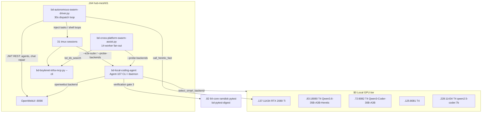
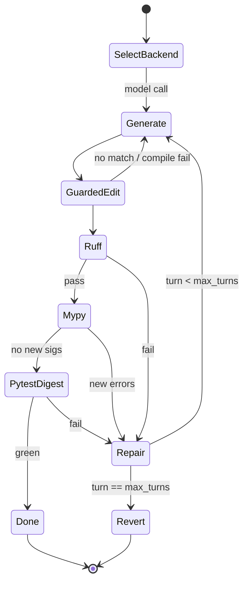

# BD-KB Volume 20: Deep Architecture Bible — Autonomous Swarm Driver, Relief Puppeteer & Local Coding Agent
> **Author**: `Spec-220` (`AGY claude+gpt (claude-opus-5-5-high)`)
> **Generated At**: `2026-10-19T22:59:22Z`
> **Scope**: Strictly Read-Only Infrastructure, Tools, Services, LLMs & PM Catch-Up Documentation (`O3416` Compliant)

---

# BD-KB Volume 20: Deep Architecture Bible: Autonomous Swarm Driver, Relief Puppeteer & Local Coding Agent

> [!NOTE]
> **Scope and provenance.** This is a read-only reference built only from the source excerpts provided: the first 16,000 bytes of the swarm driver, the first 12,000 bytes of the local coding agent, and the first 10,000 bytes of the cross-platform assist dispatcher. Each claim below is tagged:
> - **[SRC]**: read directly from the source excerpt.
> - **[DOC]**: stated in a module docstring or comment but not backed by code in the excerpt.
> - **[INF]**: inferred from names or structure because the code was truncated.
>
> Nothing in this volume was checked against a running system.

---

## 0. Component Map

| Component | Path | Self-identity | Primary log |
|---|---|---|---|
| Autonomous Swarm Driver (the "Relief Puppeteer") | [bd-autonomous-swarm-driver.py](file:///home/mboyle/bin/bd-autonomous-swarm-driver.py) | `[Autonomous-Swarm-Driver]` | `/var/tmp/bd-headless-streams/autonomous-swarm-driver.log` |
| Local Coding Agent | [bd-local-coding-agent](file:///home/mboyle/bin/bd-local-coding-agent) | `[Agent-107]` (Agent-103 + Agent-107 lineage) | `/var/tmp/bd-headless-streams/agent107-local-coding-agent-pool.log` |
| Cross-Platform Swarm Assist | [bd-cross-platform-swarm-assist.py](file:///home/mboyle/bin/bd-cross-platform-swarm-assist.py) | `[Agent-117]` (Agent-117 + Agent-123 lineage) | `/var/tmp/bd-headless-streams/agent117-cross-platform-swarm-assist.log` |

All three write timestamped UTC lines (`%Y-%m-%dT%H:%M:%SZ`) to the shared headless-stream directory `/var/tmp/bd-headless-streams/`. That directory is what the terminal/session portals read from **[SRC/INF]**.



---

## 1. Autonomous Swarm Driver: `bd-autonomous-swarm-driver.py`

### 1.1 Purpose

According to its docstring, the driver is a **24/7 continuous multi-platform driver** for all 31 tmux sessions on `.164` (`hub-mesh01`) **[DOC]**. The sessions span:

- Claude Pools A–D
- Codex ("Fable 5.1")
- Kimi K2.8
- Local GPU seats
- Hermes (`bd-hm-ux-local`)
- Gemini CLI (`agy1`)
- OpenWebUI agents

It has two jobs:

1. **OpenWebUI agent configuration and chat repair.**
2. **A 30-second idle-seat dispatch loop.** Each tmux seat is classified by its prompt glyph. Idle seats get a new task.

### 1.2 Core primitives [SRC]

| Function | Behavior |
|---|---|
| `log(msg)` | Prints to stdout and appends to `STREAM_LOG`, creating parent directories if needed. |
| `sh(cmd, timeout=12)` | Thin `subprocess.run` wrapper with `check=False`. Returns `(rc, stdout or stderr)`. Any exception becomes `(1, str(e))`, so it **never raises**. |
| `make_jwt()` | Builds an HS256 JWT by hand (base64url header, payload, HMAC-SHA256 signature, padding stripped). The payload `{"id": OWUI_ADMIN_ID, "exp": now + 7 days}` impersonates the OpenWebUI admin user. |
| `owui_req(method, path, body, timeout=30)` | Calls `http://127.0.0.1:8090{path}` with a new JWT on every call. JSON is decoded when possible, otherwise raw text is returned. HTTP errors return `(code, body)`. Transport errors return the synthetic status **599**. |
| `call_heretic_fast(prompt, system_prompt)` | Sends an OpenAI-compatible chat completion to `http://10.0.10.137:11434/v1/chat/completions` with model `qwen2.5-coder:7b-16k`, `max_tokens=1024`, `temperature=0.1`, and a 30 s timeout. |

> [!CAUTION]
> **Credentials are embedded in the source.** `OWUI_ADMIN_ID` and the HMAC signing secret `OWUI_SECRET` are hardcoded module constants. The same pair appears again as default arguments of `make_owui_jwt()` in `bd-local-coding-agent`. Anyone who can read either file can mint 7-day admin tokens for OpenWebUI. This volume deliberately does not copy the values. Move them to an environment file or secret store readable only by the owner, then rotate the OpenWebUI `WEBUI_SECRET_KEY`.

### 1.3 Naming caveat: `call_heretic_fast` does not call Heretic [SRC]

Despite the name, `call_heretic_fast` calls the **BattleStation RTX 2080 Ti (`.137:11434`)** running `qwen2.5-coder:7b-16k`. It does **not** call the Qwen3.6-35B-A3B-Heretic model on `.83:18080`.

It does preserve reasoning. If the response has a `reasoning_content` field and `content` does not already contain `<think>`, the function returns:

```
<think>
{reasoning}
</think>

{content}
```

On failure it returns an error string, `"Local 2080Ti (.137:11434) status check: <exception>"`, rather than raising. **Consequence:** if `.137` is down, the chat-repair path in §1.5 writes that error text into the repaired OpenWebUI bubble.

### 1.4 OpenWebUI agent upsert [SRC]

`optimize_openwebui_agents_and_repair_chats()` first upserts two agent models:

| Agent ID | Role | Base model |
|---|---|---|
| `agent-council-relief-commander` | Fleet and Council Relief Commander; gives swarm status and train telemetry | `qwen3.6-35b-claude-opus-abliterated` |
| `agent-master-coder` | Flagship coding agent (27-VM terminal, Git/Gitea `:3000`, `.82` ramdisk pytest) | same |

Shared payload traits:

- `temperature: 0.1`
- Capabilities: `vision`, `usage`, `citations`
- `actionIds`: `bd_1click_pytest_ramdisk_action`, `bd_1click_swarm_dispatch_action`. These are the OpenWebUI one-click buttons that reach the `.82` ramdisk and the swarm dispatcher.
- `filterIds`: `bd_autonomous_bdkb_inlet_filter`. This inlet filter injects BD-KB context into prompts **[INF]**.
- Tags: `🤖 BOYLENET AGENT`, `🟢 LOCAL`, `👑 Council Relief`, `⚡ Airgap-Ready`.

**Upsert logic:** POST to `/api/v1/models/model/update?id=…`. If the status is not 200 or 201, fall back to `/api/v1/models/create`. This makes the step idempotent across loop iterations.

The docstring says this base model is routed through `:4010` to `.83:18080` (65.8 tok/s, 256K context, `-c 262144 -kvu`) **[DOC]**. The routing table itself is not in the excerpt.

### 1.5 Ollama URL hygiene [SRC]

Next, the function reads `/ollama/config`. It removes any `OLLAMA_BASE_URLS` entry containing `10.0.70.72:11434` or `10.0.70.83:11434`, because those nodes serve llama.cpp on other ports. If nothing is left, it falls back to:

- `http://10.0.10.137:11434`
- `http://10.0.70.228:11434`

It only POSTs `/ollama/config/update` **when the list actually changed**, so repeated runs don't churn the config.

### 1.6 Chat repair with a no-overwrite guarantee [SRC]

`needs_assistant_repair(mobj)` is the safety predicate. It returns `True` **only** when either:

- the assistant `content` is empty or whitespace, or
- `content` or the serialized `error` contains one of `REPAIRABLE_ERR_SUBSTRINGS`:
  - `"Model not found"`
  - `"APIConnectionError"`
  - `"Context size has been exceeded"`

The repair walk:

1. GET `/api/v1/chats/?page=1` and take the **first 6** chat summaries.
2. For each chat, load `chat.history.messages`, a map from message ID to message.
3. For each assistant message that needs repair:
   - Find the parent user prompt. The default is `"How is everything running?"`.
   - Call `call_heretic_fast` with a status-report prompt under the Council Relief Commander persona.
   - Pop `error`, set `content`, and set `done = True`.
4. If anything changed, rebuild the flat `chat.messages` array by sorting the history map by `timestamp`, then POST `/api/v1/chats/{cid}`.
5. Log and return `{"repaired_chats": [...]}`.

> [!WARNING]
> **Repaired replies come from the prompt, not from measurement.** The repair prompt *hardcodes* claims: "87 / 87 models completed (100.0%)", 31 active tmux sessions, and 256K–512K context on `.83/.72/:4010/:4000`. A 7B model at temperature 0.1 will mostly repeat those claims back. So a repaired bubble reflects what the driver *asserts*, not what it measured. Don't treat repaired OpenWebUI threads as evidence of fleet state.

The sort fallback (`timestamp` defaults to `0`) also means a message without a timestamp sorts first in the flattened list.

### 1.7 Seat taxonomy and dispatch tables [SRC + DOC]

The driver puts seats into two dispatch classes.

**A. Interactive seats (`CLAUDE_INTERACTIVE_TASKS`).** Each seat maps to a list of natural-language task prompts that are injected when the seat is idle at its prompt:

| Seat | Task theme | Receipt target |
|---|---|---|
| `bd-claude-swarm-C` | Two prompts: (1) serialized optimization pipeline ledger, Agent-170 ESXi receipts, and `.72/.83` `.bench.lock` progress; (2) `POOL_STATE.tsv` plus port-22 reachability of 16 cold spares | `OPUS55-POOL-C-RELIEF-TAKEOVER.md` |
| `bd-ux-claude-A` | `:4083` terminal sessions API (116+ streams) and `:8090` `<think>` preservation | `ux-claude-A.log` |
| `bd-ux-claude-C` | LobeChat `:4095`, Multi-AI Hub `:4082`, OpenCode `:4091` | `ux-claude-C.log` |
| `bd-ux-claude-D` | Boylenet OS `:4080`, Portal `:4081`, Swarm 3D `:4088` | `ux-claude-D.log` |

**B. Shell-loop seats (`BASH_SEAT_COMMANDS`).** Each seat maps to one shell command string. Every entry follows the same pattern:

```bash
while true; do <probe-or-agent> 2>&1 | tee -a /var/tmp/bd-headless-streams/<seat>.log; sleep N; done
```

| Seat | Loop body | Sleep |
|---|---|---|
| `bd-claude-swarm-A` | `bd-local-coding-agent --backend 2080ti --e2e-suite` | 10 s |
| `bd-claude-swarm-B` | MCP `vsan_esxi_cluster_status`, then `bd-local-coding-agent --backend 2080ti --probe-backends` | 10 s |
| `bd-claude-swarm-D` | `bd-local-coding-agent --backend 2080ti --e2e-suite` | 10 s |
| `bd-ux-claude-B` | MCP `queue_backlog_status`, then `sentinel_doctor_autoheal` | 10 s |
| `AGY-Council` | MCP `model_vault_catalog_and_switch {"action":"list"}`, then `pool_quota_router {"role_tier":"command_squad"}` | 10 s |
| `AGY-council` | MCP `unifi_dns_traefik_status`, then `vsan_esxi_cluster_status` | 12 s |
| `cx-swarm-sol-1` | `head -n 45 SERIALIZED-OPT-PIPELINE-LEDGER.md` | 20 s |
| `cx-swarm-sol-2` | MCP `queue_backlog_status` … (truncated) | — |

Notes on the shell loops:

- **Paid seats repurposed as $0 runners.** `bd-claude-swarm-A/B/D` are nominally *Claude* seats, but their loops run the **local GPU coding agent**. Those seats now cost no paid-pool tokens.
- **Two sessions differ only by case.** `AGY-Council` and `AGY-council` are both keys, and tmux names are case-sensitive, so these are two separate sessions. That is easy to misread as a duplicate or typo.
- **`&&` stops the loop body early.** In entries like `A && B 2>&1 | tee …`, the redirection and `tee` apply only to `B`. If `A` exits non-zero, `B` doesn't run, `A`'s output goes to the terminal rather than the log, and the loop sleeps and retries.

**C. Idle detection [DOC/INF].** The docstring lists the idle glyphs:

| Glyph | Client |
|---|---|
| `❯` | Claude |
| `✨` | Gemini / AGY |
| `⚕ ❯` | Hermes |
| `>` | Kimi / Codex |
| `mboyle@hub-mesh01:~$` | bare shell |

The cadence is 30 s. The capture and injection code is past the truncation point. The usual pattern would be `tmux capture-pane -p` to detect the glyph, then `tmux send-keys` to inject either an interactive prompt or a `BASH_SEAT_COMMANDS` loop, through the `sh()` wrapper **[INF]**. `STATUS_MD` (`RELIEF-PUPPETEER-STATUS.md`) is the likely status output of that loop **[INF]**.

---

## 2. Local Coding Agent: `bd-local-coding-agent`

### 2.1 Purpose

A "production $0 local coding agent CLI and worker daemon" **[DOC]**. It imports `ThreadingHTTPServer`, so it can run as an HTTP worker **[SRC import / INF usage]**. It depends on `bd_local_mcp_bridge`, imported from `/home/mboyle/bin`, which it adds to `sys.path`.

Paths:

| Item | Path |
|---|---|
| Default sandbox | `/home/mboyle/bd-local-wt/sb-local-agent-e2e` |
| E2E receipt | `…/O1789/infra-upgrade/agent107_local_coding_agent_e2e.json` |

### 2.2 The GPU backend registry [SRC]

| Key | Node | Endpoint | Model ID sent | Extra payload |
|---|---|---|---|---|
| `2080ti` | `.137` BattleStation RTX 2080 Ti 11 GB | `:11434/v1/chat/completions` | `cyberstrike-35b:q4_k_m` | — |
| `t4-heretic` | `.83` Tesla T4 16 GB | `:18080` (fallbacks: `.83:18080`, `.72:8082`) | `qwen3.6-35b-a3b-heretic` | `enable_thinking: False` |
| `t4-72` | `.72` Tesla T4 16 GB | `:8082` | `qwen3-coder-30b-a3b` | `enable_thinking: False` |
| `t4-125` | `.125` Tesla T4 16 GB | `:8081` | `qwen2.5-coder-32b-distributed` | — |
| `t4-228` | `.228` Tesla T4 16 GB | `:11434` | `qwen2.5-coder:7b` | — |
| `openwebui` | `.164:8090` | `127.0.0.1:8090/api/chat/completions` | `agent-master-coder` | — |

> [!IMPORTANT]
> **The docstrings and the registry disagree.** Use the registry (§2.2) as the source of truth:
> - **2080ti model:** The docstring says `qwen2.5-coder:7b-16k` at about 95 tok/s. The registry sends `cyberstrike-35b:q4_k_m`. A 35B Q4_K_M model is about 20 GB of weights, so on an 11 GB card Ollama would split it with CPU, and throughput would be far below 95 tok/s.
> - **`.83` context:** The docstring and swarm driver say 256K. The registry node string says "Q4_K_M 64K".
> - **`.125` model:** The node string says Qwen2.5-Coder-14B. The model ID says `qwen2.5-coder-32b-distributed`.
> - **Thinking:** For coding turns, `t4-heretic` and `t4-72` turn thinking **off** (`enable_thinking: False`). OpenWebUI chat keeps `<think>`. The two paths deliberately behave differently.

### 2.3 Smart backend selector [SRC]

`select_smart_backend(requested="auto")` has three paths:

1. **Explicit key.** If `requested` is in `BACKENDS`, return a copy of that config annotated with `routing_reason`. No health check is done.
2. **`auto`.** Rotate the order `["t4-72", "t4-125", "2080ti", "t4-228", "t4-heretic"]`, starting at index `int(time.time()) % 5`. Return the first candidate that passes `check_http_endpoint_alive()`. That check rewrites `/v1/chat/completions` to `/v1/models` and expects HTTP 200 within 1.5 s. Seeding by wall-clock second spreads parallel workers across GPUs with no shared state.
3. **Fallback.** If nothing answers, return `2080ti`.

**The benchmark guard is weaker than documented.** The docstring describes SSH-probing `.72/.83` for `bench_worker.py` or `llama-bench` and routing everything to `.137` while a benchmark runs **[DOC]**. The helper exists: `check_node_benchmark_active(host)` runs `ps -ef | grep -E 'bench_worker\.py|llama-bench'` over SSH with `BatchMode=yes`, a 2 s connect timeout, and a 4 s overall timeout. It also **fails closed**: an SSH error reports `benchmark_active: True`.

But in the excerpt, `select_smart_backend` **never calls it**. The returned `benchmark_guard: {"zero_contention_enforced": True}` is a hardcoded literal, not a measurement. In `auto` mode, a healthy `.72` or `.83` can be picked mid-benchmark and skew benchmark numbers. The callers seen in this volume avoid the issue by pinning `--backend 2080ti`, which is the safe choice whenever a `.bench.lock` is held.

### 2.4 Indentation-normalized `guarded_edit` [SRC wrapper / DOC internals]

`apply_guarded_edit(file_path, old_string, new_string, cwd, allow_multiple, create_if_missing)` is a thin pass-through to `bd_local_mcp_bridge.apply_guarded_edit({...})`. The documented bridge semantics are:

1. **Exact match first.** The result is checked with Python `compile()` so a syntactically broken edit is rejected.
2. **Indentation-drift recovery.** 7B and 14B models often emit 4-space, 8-space, or 20-space shifted blocks. On exact-match failure, the bridge matches **line-stripped** blocks, works out the indentation offset per section in the target file, and rebases `new_string` to the file's real indentation.
3. **Policy gates.**
   - Rule 22: the `shield.py` sandbox boundary, so edits can't escape the worktree.
   - Rule 80: `bd-blob-ptr` handling.

This is the main reason small local models can produce *applicable* patches. Without it, most of their edits fail on whitespace alone.

### 2.5 The multi-turn self-healing verification gate [SRC + DOC]

`run_verification_gates(sb_path, target_file, target_test, baseline_mypy_sigs)` runs three gates **inside the sandbox** (`cwd=sb_path`, paths made relative):

| Gate | Command | Timeout | Pass condition |
|---|---|---|---|
| 1. Ruff | `ruff check --select E9,F63,F7,F82,F401,F841 <file> <test>` | 30 s | rc 0 (syntax errors, comparison misuse, statement errors, undefined names, unused imports, unused variables) |
| 2. Mypy | `BulkDownloader/venv/bin/mypy --follow-imports=silent` on the **test**, and separately on the **file** | 60 s each | The test passes outright, **and** the file has no *new* error signatures beyond the baseline |
| 3. Pytest | `bd-pytest-digest` (environment setup starts at `pytest_env…`, then truncated) | — | rc 0 |

**How baseline subtraction works [SRC].** `_extract_mypy_signatures()` keeps lines containing `: error:` and removes `:LINE:` / `:LINE:COL:` with a regex. This makes signatures independent of line numbers, so an edit that shifts lines doesn't make old errors look new.

New errors are found by **multiset subtraction**. Each current signature cancels one matching baseline entry, and anything left over is new. Pre-existing type debt in a legacy file therefore doesn't fail the gate, but a *second* copy of an existing error does. `mypy_out` reports only the new errors when there are any. Otherwise it reports the test's mypy output.

**The self-healing loop [DOC].** If any gate fails, the agent feeds the error digest (ruff, mypy-new-errors, or pytest) back to the same local model as Turn 2, then Turn 3. If the gates are still red after `max_turns`, it **reverts the edit cleanly**. The loop is: generate, then `guarded_edit`, then gates, then repair or revert.



### 2.6 Where the `.82` 64-core ramdisk fits

The source references the `.82` ramdisk pytest node in three places:

- the `agent-master-coder` description ("`.82` 64-core Ramdisk Pytest")
- the OpenWebUI action `bd_1click_pytest_ramdisk_action`
- gate 3, `bd-pytest-digest`; the infra MCP also exposes a matching `ramdisk_pytest_digest` tool

**[INF]** Putting these together: gate 3 sends the sandbox's test target to `.82`, where the tree sits on tmpfs and pytest runs across up to 64 cores (likely xdist-style). It returns a short **digest** (failures, tracebacks, counts) instead of the full log. That digest is what keeps the self-healing loop workable on 7B–35B models: a compact error summary fits easily in a 16K–64K window, and fast parallel test runs make three repair turns cheap. The exact transport (rsync/ssh vs. MCP), worker count, and digest format are past the truncation point and are **not documented here**.

### 2.7 CLI surface observed from callers [SRC callers]

| Flag | Observed use |
|---|---|
| `--backend 2080ti` | Swarm driver seats A, B, D |
| `--e2e-suite` | Swarm driver seats A and D, every 10 s; results go to the E2E receipt JSON **[INF]** |
| `--probe-backends` | Swarm driver seat B, and `probe_platform("local")` in xplat assist, which parses its stdout as **JSON** |

---

## 3. Cross-Platform Swarm Assist: `bd-cross-platform-swarm-assist.py`

### 3.1 Purpose and modes [DOC]

A unified dispatcher across Claude, Codex, Kimi, AGY, and local GPUs. Flags: `--probe`, `--task`, `--platforms`, `--dispatch`, `--pool`, `--json`, `--run-14-workers`. The last is the default when run with no flags.

The 14 workers:

| Group | Count | Worker IDs | Seats notified via `bd-say.sh` |
|---|---|---|---|
| Claude Pools | 4 | `xplat-claude-A..D` | `bd-claude-swarm-A..D`, `bd-pm-B` |
| Codex Sol | 4 | `xplat-codex-1..4` | `cx-swarm-sol-1..4` |
| Kimi K2.8 | 3 | `xplat-kimi-1..3` | `bd-kimi-swarm-1..3` |
| Local GPU | 3 | `xplat-local-2080ti-1..2` on `.137:11434`, `xplat-local-sat-3` on `.228:4000` | — |

The docstring also lists Remote Command Squad nodes: `bd-pm-B` (`.164`), `bd-dispatch-B5-B` (`.51`), `bd-dispatch-build-D2-D` (`.194`), `bd-lensrouter-B1-B` (`.85`), `bd-integrator-D3-D` (`.52`). These are coordination targets on top of the 14 workers, not part of the count.

`concurrent.futures` is imported, which points to a thread-pool fan-out **[INF]**.

### 3.2 Key paths [SRC]

| Item | Path |
|---|---|
| Pool state | `bd-persist/POOL_STATE.tsv` |
| Receipts | `AGENT117-…-RECEIPTS.md` and `agent117_cross_platform_swarm_results.json` |
| Coordination packets | `infra-upgrade/xplat-packets/` |
| Queues | `bd-persist/queues/` |
| Binaries | `~/.local/bin/{claude,codex,kimi}`, `bd-local-coding-agent`, `bd-say.sh` |
| MCP config | `~/.claude/boylenet-infra-mcp.json` |

### 3.3 Functions [SRC]

- **`read_pool_state()`**: parses the TSV using its header row and keys rows by `pool` (falling back to the first column). Returns `{}` if the file is missing or empty. It only reads; quota decisions are made elsewhere.
- **`probe_platform(p)`**: a capability inventory for each platform:
  - claude: `~/.claude/commands/boylenet-*.md`
  - codex: `~/.codex/agents/boylenet-*.toml`
  - kimi: `~/.kimi/skills/boylenet-*/SKILL.md`
  - agy: `~/.agents/skills/boylenet-*/SKILL.md`, always reports `installed: True`
  - local: runs `--probe-backends` with a 10 s timeout and parses the output as JSON. Errors are cut to 160 characters.
- **`run_local_assist(task)`**: calls MCP `bd_kb_search` with `{"query": task, "top_k": 3}` (15 s timeout) and reports `elapsed_ms`. It is a $0 retrieval step that gives each task BD-KB context *before* any paid seat sees it.
- **`read_tsv_lines(path, max_lines=200)`**: bounded read.
- **`gather_f_row_evidence(f_ids, p2_slice)`**: builds an evidence packet. For each feature or fix ID it pulls:
  - the matching `APP-FEATURE-QUEUE.tsv` row (prefix `fid\t`)
  - the count of `P2-FIX-QUEUE.tsv` matches (substring)
  - the first line of the newest `UIUX-20260928/results/{fid}*.md`
  - up to 3 matching `bd-local-wt/cplus/*{fid}*` worktrees

  Then for the pool's P2 slice it records the cut ID, path, whether `DONE.md` exists, and the first 140 characters of the verdict.
- **`gather_o1670_evidence(...)`**: truncated.

> [!NOTE]
> The P2 lookup uses a substring test (`fid in ln`), so a short ID like `F1` also matches `F10` and `F12`. The `P2-match` count can be inflated. The APP-FEATURE lookup uses an exact prefix with a tab and doesn't have this problem.

---

## 4. Cross-Cutting Economics: Why It Costs $0

1. **Paid seats run free work.** Claude seats A, B, D and the AGY council seats run shell loops that call local GPUs and the MCP CLI. No paid tokens are spent in steady state.
2. **Retrieval comes first.** `run_local_assist` and the BD-KB inlet filter add knowledge context locally before any paid model sees the task.
3. **Small models become usable.** Indentation-normalized edits, compile-checked application, and baseline-aware mypy make the 7B–35B Q4 models on T4 and 2080 Ti hardware produce patches that apply and pass gates.
4. **Fast tests make retries affordable.** Short ramdisk pytest digests make up to three repair turns practical where a full suite on a single core would not be.
5. **Benchmarks are protected by pinning, not the selector.** Pinning `--backend 2080ti` keeps `.72/.83` free while they benchmark. The `auto` selector's guard is not wired up (§2.3).

---

## 5. Known Risks and Recommended Follow-ups

| # | Finding | Severity |
|---|---|---|
| R1 | OpenWebUI admin ID and HMAC secret are hardcoded in two files | **High**: rotate and move to a secret store |
| R2 | `auto` backend selection doesn't call `check_node_benchmark_active`; `zero_contention_enforced` is a constant | Medium |
| R3 | Chat-repair prompt hardcodes telemetry ("87/87", "31 sessions"), so repaired bubbles are not evidence | Medium |
| R4 | `call_heretic_fast` failure text is written into chats as if it were a reply | Low |
| R5 | Model and context mismatches between docstrings and the registry (2080ti, `.83`, `.125`) | Low; confusing for operators |
| R6 | `&&` / `tee` precedence in shell loops sends the first command's output to the terminal only | Low |
| R7 | `AGY-Council` and `AGY-council` session keys differ only by case | Low |
| R8 | Substring P2 matching inflates evidence counts | Low |

---

## 6. Unknowns (past truncation)

- The rest of `BASH_SEAT_COMMANDS` and the Codex, Kimi, local, Hermes, and probe seat mappings.
- The tmux capture and inject implementation, plus the main loop and its 30 s cadence logic.
- The `bd-pytest-digest` invocation, the `.82` transport, and the digest schema.
- The `max_turns` default, revert mechanics, the `--e2e-suite` contents, and the HTTP daemon routes.
- The `--run-14-workers` fan-out body, the `bd-say.sh` message formats, and the receipt schemas.

Treat everything listed here as unverified until someone reads the full files.
