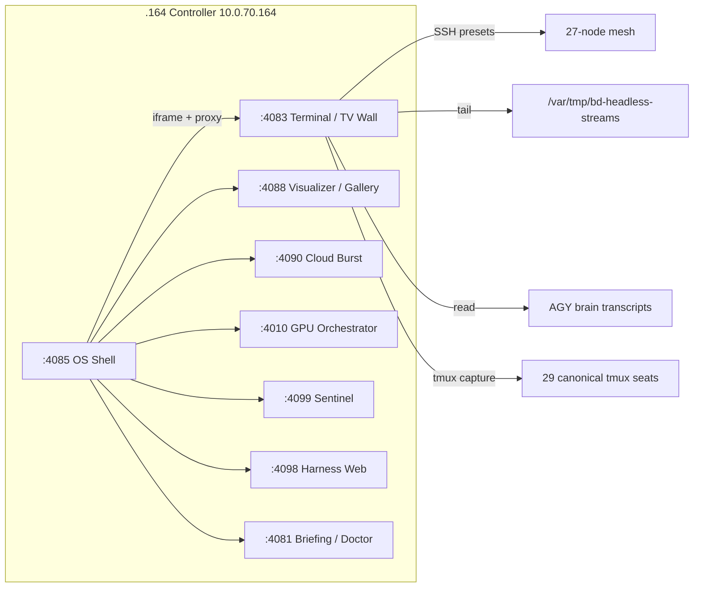

# BD-KB Volume 21: Deep Architecture Bible — Boylenet OS (:4085), 165-View Visualizer (:4088), Terminal TV Wall (:4083) & Jarvis (:4090)
> **Author**: `Spec-221` (`AGY claude+gpt (claude-sonnet-5-5-high)`)
> **Generated At**: `2026-10-19T22:58:41Z`
> **Scope**: Strictly Read-Only Infrastructure, Tools, Services, LLMs & PM Catch-Up Documentation (`O3416` Compliant)

---

# BD-KB Volume 21: Deep Architecture Bible
## Boylenet OS (:4085), 165-View Visualizer (:4088), Terminal TV Wall (:4083) & Jarvis (:4090)

**Author:** Spec-221 | **Status:** Read-only reference | **Generated:** 2026-10-19

---

## 0. Source Provenance and Caveats

This volume is derived only from two excerpts of source. Each was truncated at 12,000 bytes, and one file was missing.

| Source | State | Consequence |
|---|---|---|
| `/home/mboyle/bin/bd-os-shell.py` | Present, truncated | The HTTP handlers, HTML/JS shell, and the rest of `EXTRA_APPS` are not visible. |
| `/home/mboyle/bin/bd-web-terminal-drawer.py` | Present, truncated | The HTTP handlers and the end of `OPENWEBUI_CANONICAL_AGENTS` are not visible. |
| `/home/mboyle/bin/bd-hivemind-visualizer.py` | **ABSENT** | The :4088 internals cannot be documented from source. Only the shell's references to :4088 are covered. |

> [!WARNING]
> **Port-label discrepancies against the request title.** The source assigns these ports differently from the volume title:
> - **:4090** is `CLOUD_BURST_URL`, the **$1,000 Cloud Burst Orchestrator**. The dock entry `jarvis` ("Jarvis Cockpit") sits on **:3002**.
> - **:4092** is the dock entry `prereview` (**Gitea Pre-Review & Red-Team**). The entry `chat` ("Swarm Chat") sits on **:3003**.
> - **:4093** is the dock entry `voice` (**Voice & Vision Studio**).
>
> Wherever this guide says "Jarvis (:4090)", "Fleet Chat (:4092)" or "Multimodal Bridge (:4093)", it means what the source shows on that port, and it flags the mismatch. Do not assume the names are interchangeable. Confirm against live `/status` endpoints before relying on them.

---

## 1. System Topology at a Glance

The OS Shell (:4085) is the single front door. It aggregates the other web surfaces as iframes in a dock. The Terminal/TV Wall (:4083) is the observation and command plane. The visualizer (:4088) is the 60fps rendering plane. Telemetry comes from the upstream services at :4010, :4081, :4090, :4098 and :4099.

---

## 2. Boylenet OS Shell — `bd-os-shell.py` (:4085)

**Public ingress:** `https://os.boylenet.themfboyles.org`. **Direct:** `http://10.0.70.164:4085`.

### 2.1 Configuration Constants

| Constant | Value | Role |
|---|---|---|
| `PORT` | env `BD_OS_SHELL_PORT`, default `4085` | Listen port |
| `HOST_IP` | env `BD_CONTROLLER_IP`, default `10.0.70.164` | Builds absolute app URLs |
| `POOL_STATE_TSV` | `/home/mboyle/bd-persist/POOL_STATE.tsv` | Claude pool quota state (feeds the quota pills) |
| `AUTOBALANCER_JSON` | `/var/tmp/bd-pool-autobalancer.json` | Pool autobalancer output |
| `VAULT_MANIFEST_JSON` | `/var/tmp/bd-vault-manifest.json` | The 86-model vault catalog |
| `SNAPSHOT_DIR` | `/var/tmp/bd-os-snapshots` | Snapshot Exporter output |
| `ORCHESTRATOR_URL` | `http://127.0.0.1:4010` | GPU orchestrator |
| `SENTINEL_URL` | `http://127.0.0.1:4099` | Infra Sentinel |
| `CLOUD_BURST_URL` | `http://127.0.0.1:4090` | $1,000 Cloud Burst |
| `HARNESS_WEB_URL` | `http://127.0.0.1:4098` | Multi-Harness Studio |
| `DOCTOR_URL` | `http://127.0.0.1:4081` | Briefing & Doctor |

The upstream URLs are loopback addresses. That implies server-side aggregation (see the telemetry pill bar below), not browser-to-service calls. The server fetches them and re-serves the data.

### 2.2 Feature Pillars (Pillars 1 & 7)

| ID | Capability | Detail |
|---|---|---|
| **#UX-1** | Left App Dock | macOS/Linear style. Live status dots, **Alt+1..9** shortcuts, "0ms" switching by keeping iframes in the DOM instead of reloading. |
| **#UX-2** | Command Palette | Cmd+K / Ctrl+K, Raycast-style. Searches apps, **86 Vault Models**, **40 Fleet Roles** and quick actions. |
| **#UX-3** | Top Telemetry Bar | Persistent 36px bar. Claude A/B/C/D 5h%, $1,000 cloud credit, 4xT4 tok/s, 86 models, Sentinel state. |
| **#UX-4** | Split-Screen Workspace | 1-pane, 2-pane split, 3-pane tactical grid, TV Wallboard auto-cycle (**#UX-21**), plus a backtick (`` ` ``) terminal drawer. |
| **#UX-5** | PiP Mini-Monitor | Document PiP, Canvas Stream PiP, or a floating HUD. |
| **#UX-32..35** | Shared Assets | `/static/boylenet-nav.js`, `/static/boylenet-ui.css`, a 4-theme engine, and the Snapshot Exporter. |

> [!NOTE]
> The header says "52+ Apps" in the palette. A code comment says "bringing total searchable apps in Cmd+K to 59". The visible `DOCK_APPS` list alone has 26 entries and `EXTRA_APPS` is truncated. Treat the 52/59 figures as design targets, and count the live registry to get the real number.

### 2.3 The Dock Registry (`DOCK_APPS`)

Each dock record has `id`, `icon`, `title`, `short`, `port`, `sub` (the sub-route or subdomain slug), `shortcut`, `cat`, and an optional absolute `url`. When `url` is absent the app is addressed by `port` and `sub`. When `url` is present it overrides that, which is how deep links such as `/gallery` or `/?mode=eightpack` work.

**Flagship 18 (Alt+1..9 on the first nine):**

| # | id | Port | Category | Shortcut |
|---|---|---|---|---|
| 1 | briefing | 4081 | Core OS | Alt+1 |
| 2 | topology (3D Swarm & Rack) | **4088** | Observability | Alt+2 |
| 3 | harnesses | 4098 | AI Studio | Alt+3 |
| 4 | cloud ($1k Burst) | **4090** | AI Studio | Alt+4 |
| 5 | models (86-Model Vault) | 4084 | AI Studio | Alt+5 |
| 6 | terminal | **4083** | Core OS | Alt+6 |
| 7 | research | 4094 | AI Studio | Alt+7 |
| 8 | voice (Voice & Vision) | **4093** | AI Studio | Alt+8 |
| 9 | prereview | **4092** | Security & CI | Alt+9 |
| 10 | hardware (Rack & iLO4) | 4091 | Hardware | none |
| 11 | sentinel | 4099 | Infra & Ops | none |
| 12 | vault (SSH & Key Vault) | 4087 | Security & CI | none |
| 13 | ops (NL Ops Shell) | 4089 | Infra & Ops | none |
| 14 | mobile (PWA) | 4086 | Core OS | none |
| 15 | jarvis | **3002** | Core OS | none |
| 16 | chat (Swarm Chat) | **3003** | AI Studio | none |
| 17 | grafana | 3001 | Observability | none |
| 18 | dashy | 4080 | Core OS | none |

**Appended entries (visible):** `visual-gallery-179`, `wallboard-eight-4x2`, `gpu-orchestrator` (:4010 `/status`), `litellm` (:4000 `/ui`), `openwebui` (:8090), `lobechat` (:4095), `opencode` (:4096) and `gitea` (:3000).

**Port-collision note:** :3000 is Gitea on the controller (`HOST_IP`). The terminal's node table also lists **Langfuse :3000 on .228**. These are different hosts, so there is no conflict, but the port alone does not identify the service.

### 2.4 `EXTRA_APPS` (Palette-Only Additions)

Entries visible before truncation:

- **Visualizer deep links on :4088:** `?wb=quad` (2x2), `?wb=six` (3x2), `?wb=eight` (4x2), `?cinema=1` (165-View Auto-Cycle Cinema, 15s), and `/gallery`.
- **Platform services:** `os-shell` (:4085), `sso-ca` (:4082, Root CA & Zero-Prompt SSO Hub), `gpu-orchestrator`, `litellm`, and `litellm-228` (a satellite gateway on `10.0.70.228:4000`).
- **Studio apps:** `lobechat`, `opencode`, `openclaw` (:4097, multi-agent control UI), and `openwebui` (cut off in the source).

**Duplicate IDs:** `visual-gallery-179`, `gpu-orchestrator`, `litellm`, `lobechat`, `opencode` and `openwebui` appear in both lists. The merge or dedupe rule is not visible. Implementers should assume the merge keys on `id`. Titles also differ between lists. For example, the eight-pack entry uses `?mode=eightpack` in `DOCK_APPS` but `?wb=eight` in `EXTRA_APPS`. These are two distinct query parameters on the same visualizer, so both URL grammars should be treated as accepted.

### 2.5 Design Characteristics

1. **iframe-kept switching.** Each app is mounted once and toggled by visibility. This gives instant switching but leaves every embedded app running in the background.
2. **Server-side pool and vault reads.** TSV and JSON files under `/home/mboyle/bd-persist` and `/var/tmp` act as a file-based message bus. The pills read from these instead of calling the Claude pools directly.
3. **Shared UI package.** `boylenet-nav.js` and `boylenet-ui.css` are served from `/static/` so child apps can embed the same navigation and the same four themes.
4. **Snapshot exporter.** Writes to `/var/tmp/bd-os-snapshots`, which is volatile `/var/tmp` storage. Snapshots should be copied elsewhere if they need to persist.

---

## 3. 165-View 60fps Visualizer (:4088)

> [!WARNING]
> `bd-hivemind-visualizer.py` was **absent** from the source context. This section describes only what the OS Shell reveals about :4088. It does not describe the renderer, the view registry, or the frame loop.

### 3.1 Observable Contract (From the Shell)

| Surface | URL | Meaning |
|---|---|---|
| Default / 3D Topology | `http://10.0.70.164:4088/` | "3D Swarm & Rack Topology", dock slot Alt+2 |
| Gallery | `/gallery` | "179-Image Visual Gallery & 165-View Launcher" |
| Eight-pack | `/?mode=eightpack` | 4x2 Mega-NOC wallboard |
| Quad | `/?wb=quad` | 2x2 HiveMind & CoT wallboard |
| Six | `/?wb=six` | 3x2 six-view wallboard |
| Eight | `/?wb=eight` | 4x2 eight-view wallboard |
| Cinema | `/?cinema=1` | Auto-cycle through all 165 views, 15 seconds each |

**Arithmetic implications:**
- Cinema mode at 15s per view takes 165 × 15 = **2,475 s (about 41 min 15 s)** per full loop.
- The gallery counts **179** images against **165** views. The 14-item difference is not explained in the source. The most likely reading is that the gallery includes static or non-launchable assets, but that is an inference.
- Wallboard layouts are 2x2 (4 tiles), 3x2 (6 tiles) and 4x2 (8 tiles). All are labelled 60fps.

### 3.2 Integration With the OS Shell

- The shell's #UX-4 TV Wallboard auto-cycle (#UX-21) is the shell-side counterpart of Cinema mode.
- `visual-gallery-179` and `wallboard-eight-4x2` use `url` overrides. Selecting them navigates the Topology slot's iframe to a deep link instead of the root.
- #UX-5 Canvas Stream PiP is the plausible route for popping a visualizer canvas into a floating window. The source does not show the mechanism.

---

## 4. All-Agents Terminal TV Wall — `bd-web-terminal-drawer.py` (:4083)

**Host:** `10.0.70.164`, bound to `0.0.0.0:4083`. **Ingress:** `http://terminal.boylenet.themfboyles.org`. Configurable by `BD_TERMINAL_PORT`.

### 4.1 Three Integrated Tools

| Tool | ID | Function |
|---|---|---|
| Live Agent TV Wall | **#UX-23** | 2x2 / 3x3 grid streaming agent output. |
| Multi-Node Command Console | **#UX-22** | Preset commands against the cluster nodes. |
| Receipt & Markdown Explorer | **#UX-24** | Browses receipts, the watchdog status file, and blob logs. |

### 4.2 The Four TV Wall Sources

| Source | Origin | Content |
|---|---|---|
| **A** | `AGY_BRAIN_DIR` = `/home/mboyle/.gemini/antigravity-cli/brain`, specifically `*/.system_generated/logs/transcript.jsonl` and `tasks/*.log` | Active Antigravity subagents (zero-token tail of existing logs) |
| **B** | `/var/tmp/bd-headless-streams/*.log` plus `ps` on .164 | Headless CLI runs |
| **C** | GPU benchmarks and inference on Vault A (.72), Vault B (.83), plus the :4010 orchestrator | Model-serving telemetry |
| **D** | Interactive tmux sessions | The canonical seat list (Section 4.3) |

"Zero-token" means the wall only reads files and process tables. It never calls an LLM, so watching costs no model quota.

### 4.3 Canonical tmux Seats (`CANONICAL_TMUX_SEATS`, 29 entries)

| Pool | Seats |
|---|---|
| **Claude Pool A** | `bd-claude-swarm-A`, `bd-ux-claude-A`, `bd-usage-a-A` |
| **Claude Pool B** | `bd-claude-swarm-B`, `bd-pm-B` (PM Integrator), `bd-ux-claude-B` (Verifier), `bd-usage-b-B` |
| **Claude Pool C** | `bd-claude-swarm-C` (Relief Commander), `bd-ux-claude-C` (Review Lens), `bd-usage-c-C` |
| **Claude Pool D** | `bd-claude-swarm-D`, `bd-ux-claude-D` (Fast Worker), `bd-usage-d-D` |
| **Codex Fable 5.1 / Sol** | `cx-swarm-sol-1..4`, `cx-ux-codex-sol` |
| **Kimi K2.8 Cloud** | `bd-kimi-swarm-1..4`, `bd-kimi-ux-builder`, `kimi-quota-probe` |
| **Local GPU 4xT4 + 2080Ti** | `bd-local-t4-swarm-1`, `bd-local-t4-swarm-2`, `bd-hm-ux-local` |
| **AGY Pool** | `AGY-Council` (Super-Swarm Commander), `AGY-council` (Workspace) |

The seat list contains both `AGY-Council` and `AGY-council`. tmux session names are case-sensitive, so these are two separate sessions.

**Idle probe sessions (`IDLE_PROBE_SESSIONS`):** `bd-usage-a-A`, `bd-usage-b-B`, `bd-usage-c-C`, `bd-usage-d-D`, `kimi-quota-probe`, `agy`, `agy1`, `claude-rc` and `pm`. These are quota probes or utility shells. A reasonable reading is that the wall deprioritizes them or marks them idle so they do not take wall tiles. The filtering logic itself is not visible.

### 4.4 Multi-Node Command Console

The `CLUSTER_NODES` table has **27 nodes**, keyed by IP suffix.

| Group | Nodes |
|---|---|
| Control and routing | **.164** Controller (Orchestrator, Traefik, GPU Router :4010) |
| AI vaults | **.72** Vault A (5.0 TB, 44 models, T4, AVX-512), **.83** Vault B (5.0 TB, 42 models, T4, AVX-512) |
| Inference | **.125** ai-infer01 (Pool Beta master, T4, Qdrant :6333, 576 GiB DDR4), **.228** ai-ollama01 (LiteLLM :4000, Langfuse :3000, T4, 448 GiB DDR4) |
| CI and test | **.82** (64-vCPU `/dev/shm` ramdisk CI and RAG indexer), **.25** (Gitea Runner 1), **.162** `wrk-ci01`, **.107** `wrk-ci02`, **.182** `wrk-ci03`, **.80** / **.85** / **.249** `wrk-test01..03`, **.84** `wrk-aux01` |
| Sandbox pool | **.120**, **.183**, **.149**, **.185** (`spr-pool01..04`) |
| Hypervisors | **.50..53** ESXi 8.0 blades (vSAN 25GbE), **.54** vCenter (VCSA) |
| Storage and monitoring | **.194** TrueNAS (NFS/ZFS), **.95** (Prometheus, Grafana, Netdata) |
| Windows and workstation | **.137** BattleStation (RTX 2080 Ti 11GB, Ryzen 9, Chrome CDP :9222), **.181** (secondary Chrome CDP :9222) |

**Subnet anomaly:** `.137` is the only node on `10.0.10.x` (`10.0.10.137`). All the others are `10.0.70.x`. Vault totals reconcile: 44 + 42 = **86 models**.

**Safe presets (`SAFE_PRESETS`, 6):**

| Key | Command purpose |
|---|---|
| `gpu_vram` | `nvidia-smi` name, memory, utilization and temperature as CSV, with a fallback message |
| `disk_space` | `df -h / /opt/models /dev/shm` |
| `uptime_memory` | `uptime && free -h` |
| `top_procs` | Top 12 processes by CPU |
| `network_25gbe` | `ip -br addr` and routes |
| `ai_services` | `systemctl list-units` for `bd-*`, `llama-*` and `ollama*` |

### 4.5 Command Safety Model

`FORBIDDEN_PATTERNS` is a regex denylist of **9 patterns**:

`rm -rf`, `mkfs`, `shutdown`, `reboot`, `git reset --hard`, `git checkout`, `git clean`, `dd if=`, and redirects to `/dev/sd*`.

- The patterns use `\b` word boundaries, so they match the commands as whole words.
- A denylist is a weak control. Variants such as `rm -fr`, `rm -r -f`, `/bin/rm`, `poweroff`, `halt` and `git restore` are not covered by the visible list.
- The presets are the safer path because they are fixed strings. Free-form input depends on the denylist, so the whole console should be treated as privileged and restricted to the trusted LAN.
- The git patterns (`checkout`, `clean`, `reset --hard`) are consistent with fleet rules that protect working trees.

### 4.6 Receipt & Markdown Explorer (#UX-24)

| Path | Content |
|---|---|
| `/home/mboyle/bd-persist/harness-work/O1789/infra-upgrade` | `AGENT*.md` receipts, such as `AGENT37-NEW-FRONTIER-MODELS-BENCHMARK-RECEIPTS.md` |
| `/home/mboyle/bd-persist/WATCHDOG-STATUS.md` | Watchdog status |
| `/var/tmp/bd-blobs/*.log` | Blob logs |

The receipts and watchdog file live under `bd-persist`, which is a persistent location. The blobs live under `/var/tmp`, which is volatile.

### 4.7 OpenWebUI Canonical Agents

The terminal module also carries `OPENWEBUI_CANONICAL_AGENTS`. The visible entries:

| id | Model / pool | Notes |
|---|---|---|
| `agent-council-relief-commander` | `qwen3.6-35b-claude-opus-abliterated` on `.83:18080` at 65.8 tok/s, OpenWebUI :8090 Local Heretic | Autonomous $0 relief commander, wired to the 6-volume BD-KB |
| `agent-master-coder` | Same model, same endpoint | Master Coder with 27-VM terminal, Git/Gitea :3000 and .82 ramdisk pytest |
| `agent-claude-opus-integrator` | `claude-opus-5-5[1m]`, Anthropic Pool C/B, 1M context | Cloud integrator on the $1,000 credit pool (truncated) |

Each entry has tags (such as `all`, `openwebui`, `gpu`, `headless`, `claude`) for filtering. Local agents cost $0 per token. Cloud agents draw on the credit pool.

---

## 5. Jarvis, Fleet Chat and Multimodal Bridge

The source holds no implementation of these three services. It holds only their dock registrations in the OS Shell.

| Requested name | What the source shows | Port |
|---|---|---|
| **Jarvis (:4090)** | `CLOUD_BURST_URL = http://127.0.0.1:4090` and dock app `cloud`, "$1,000 Cloud Burst Orchestrator" (Alt+4) | **4090** |
| **Jarvis Cockpit** | Dock app `jarvis`, category Core OS, no shortcut | **3002** |
| **Fleet Chat (:4092)** | Dock app `prereview`, "Gitea Pre-Review & Red-Team", Security & CI (Alt+9). "Swarm Chat" (`chat`) is on :3003 | **4092** / **3003** |
| **Multimodal Bridge (:4093)** | Dock app `voice`, "Voice & Vision Studio", AI Studio (Alt+8) | **4093** |

**What can be said with confidence:**
- The shell polls :4090 for credit status, which feeds the "$1,000 Cloud Credit" pill in the telemetry bar.
- :4093 is the voice and vision (multimodal) studio, so "Multimodal Bridge" is a reasonable description.
- Jarvis as a cockpit and Swarm Chat as a fleet chat live on **3002** and **3003** in the dock, not on :4090 or :4092.

> [!IMPORTANT]
> Either the volume title is using a different naming scheme, or the registry has drifted. Before any automation depends on these ports, probe each port and compare the response to the expected service.

---

## 6. Cross-Cutting Observations

**Dependency graph.** The Shell (:4085) depends on :4010, :4081, :4090, :4098 and :4099 for telemetry. The TV Wall (:4083) depends on filesystem state and SSH or tmux, and does not depend on those services. A Shell outage therefore does not stop the TV Wall.

**State locations.**

| Persistence | Locations |
|---|---|
| Persistent | `/home/mboyle/bd-persist/*` (pool state, receipts, watchdog) and the AGY `brain/` directory |
| Volatile | `/var/tmp/bd-pool-autobalancer.json`, `bd-vault-manifest.json`, `bd-os-snapshots`, `bd-headless-streams` and `bd-blobs` |

**Known risks.**
1. Duplicate app IDs across the two registries can cause conflicting entries unless they are deduplicated.
2. Keeping all iframes alive costs memory and CPU in the browser.
3. The command denylist (Section 4.5) is incomplete.
4. The 179-versus-165 count mismatch and the 52-versus-59 app-count mismatch are documentation drift.
5. The visualizer cannot be audited until `bd-hivemind-visualizer.py` is supplied.

**Recommended verification, run by a human or other tooling since this volume is read-only:**
- Probe ports 4080–4099 and 3000–3003, and compare responses to the registries above.
- Count live dock and palette entries, and the model and role totals.
- Locate the actual visualizer source (the file name may differ from `bd-hivemind-visualizer.py`).

---

## 7. Quick Reference Card

| Port | Service | Source evidence |
|---|---|---|
| 4083 | Terminal / TV Wall / Receipts | Full header and constants |
| 4085 | OS Shell | Full header and constants |
| 4088 | Visualizer (topology, gallery, wallboards, cinema) | Deep-link URLs only; source file absent |
| 4090 | $1,000 Cloud Burst | `CLOUD_BURST_URL`, dock `cloud` |
| 4092 | Gitea Pre-Review & Red-Team | Dock `prereview` |
| 4093 | Voice & Vision Studio | Dock `voice` |
| 3002 | Jarvis Cockpit | Dock `jarvis` |
| 3003 | Swarm Chat | Dock `chat` |
| 4010 | GPU Orchestrator | `ORCHESTRATOR_URL` |
| 4081 | Briefing & Doctor | `DOCTOR_URL` |
| 4098 | Harness Studio | `HARNESS_WEB_URL` |
| 4099 | Infra Sentinel | `SENTINEL_URL` |

**End of BD-KB Volume 21.** Scope is limited to the two truncated files supplied, and the missing visualizer source means Section 3 is incomplete.
