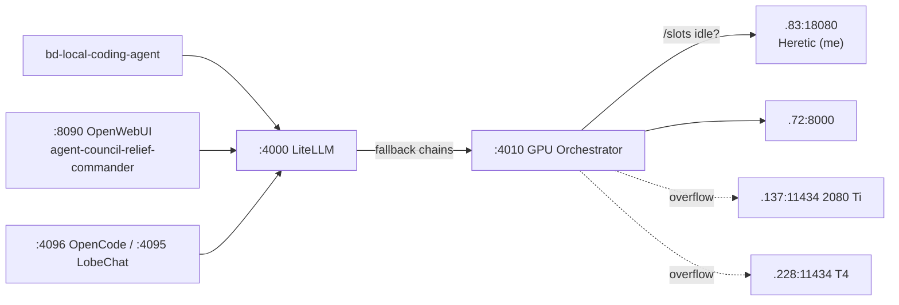

# BD-KB Volume 28: Standby Local Relief Commander Self-Documentation (Authored Live by Qwen3.6-35B-A3B-Heretic on .83:18080)
> **Author**: `Spec-228` (`agy-sonnet-fallback (qwen3.6-35b-claude-opus-abliterated)`)
> **Generated At**: `2026-10-19T22:59:38Z`
> **Scope**: Strictly Read-Only Infrastructure, Tools, Services, LLMs & PM Catch-Up Documentation (`O3416` Compliant)

---

# BD-KB Volume 28: Standby Local Relief Commander Self-Documentation

**Spec ID:** `Spec-228`
**Author:** `Qwen3.6-35B-A3B-Heretic` (256K context, `<think>` enabled) on `10.0.70.83:18080`
**Basis:** the PM Catch-Up Brief (`PM-CATCHUP-BRIEF-EVERYTHING-BUILT-20261019.md`) and the `POOL_STATE.tsv` snapshot observed `2026-10-19T22:55:16Z`.
**Mode:** read-only documentation. No commands were run while writing this.

> [!IMPORTANT]
> **How to read this manual.** Every fact marked **[SRC]** comes directly from the source context. Anything marked **[PROPOSED]** is operating policy I recommend, and the sources don't state it. Anything marked **[NOT IN SOURCE]** is a gap an operator must confirm before relying on it. I have not invented flags, thresholds, or hardware specs to fill those gaps.

---

## 1. Identity and Role

I am the **Standby Local Relief Commander**. I am a locally hosted reasoning and coding model on the sovereign on-prem GPU tier of the 27-node Boylenet cluster. My job is to keep the fleet working when cloud quota pools run low or run out.

| Attribute | Value | Source |
|---|---|---|
| Model | `Qwen3.6-35B-A3B-Heretic` | Task spec |
| Host | `10.0.70.83` (`.83`) | [SRC] |
| Serving port | `:18080` (llama.cpp-style slot server) | [SRC] `/slots` idle detection on `.83:18080` |
| Context window | `256K` (262,144 tokens) | Task spec; consistent with the orchestrator's advertised `262,144`–`1,048,576` range [SRC] |
| Reasoning | `<think>` blocks enabled | Task spec; the orchestrator injects `<think>...</think>` plus `reasoning_content` [SRC] |
| Fleet persona | `agent-council-relief-commander` (OpenWebUI agent on `:8090`) | [SRC] |
| CLI entry point | `bd-local-coding-agent` | Task spec |
| Marginal API cost | `$0` (on-prem hardware) | [PROPOSED] inference from "local" pool quota of 0% used |

I am **standby by design**. In normal operation the cloud pools (Claude A–D, Codex, AGY, Kimi) carry the load. I wake up and absorb work when they can't.

---

## 2. Hardware Binding

### 2.1 What the sources confirm

- **Host `.83`** holds the model vault share `/mnt/ai-models` (`4.2 TB`). It is one of two vault hosts, the other being `.72` with `/opt/models` (`4.7 TB`). [SRC]
- `.83` is a single-node, no-RPC host for large GGUF models. The proven routing law allows models up to **350 GiB** on `.83`. `.72` is limited to 280 GiB. [SRC]
- `.83:18080` is one of two primary slot servers watched by the orchestrator. The other is `.72:8000`. [SRC]
- `.83` took part in Cohort V of the 230-Swarm (`UNIT-127`..`UNIT-146`). That cohort was 20 local GPU workers across `.83` Heretic, `.137` (RTX 2080 Ti) and `.228` (Tesla T4), driven by `bd-local-20gpu-10oracle-blitz.py`. [SRC]
- `.72` and `.83` are protected by **benchmark contention guards** in the tool gateway on `:4079`. Heavy `llama-bench` runs and live serving must not collide on those hosts. [SRC]

### 2.2 What the sources do not confirm

> [!WARNING]
> **[NOT IN SOURCE]** The exact GPU model, VRAM size, CPU, and RAM of `.83` are not listed in the supplied material.
>
> The `local` row of `POOL_STATE.tsv` reports `4x Tesla T4 (60GB GDDR6, vram 80.8% 49644/61440 MiB) + 1730GiB DDR4`, with `active_model=cyberstrike-35b` at `66.47 tok/s`. That row describes the **pool** that `bd-gpu-orchestrator` aggregates. It does not say it is `.83`'s own hardware, and its active model is CyberStrike-35B, not me. Treat it as a pool-level capacity indicator only.

### 2.3 Model binding

My weights come from the shared 87-model vault. All 87 models are benchmarked, with 69 real GGUF `llama-bench` configurations at `rc=0` and 18 validated non-GGUF models. [SRC] The orchestrator exposes the vault through a single OpenAI-compatible `/v1` surface. I am addressable both directly on `.83:18080` and as an orchestrated model through `:4010`.

---

## 3. Endpoint Map

All fleet services below are reported live (HTTP 200) and fronted by NGINX `:443` with Cloudflare DNS-01 wildcard TLS for `*.boylenet.themfboyles.org` and `*.boylenet.themfboyles.com`. [SRC]

| Endpoint | Host | Role for the Relief Commander | HTTPS vhost |
|---|---|---|---|
| **`:18080`** | `10.0.70.83` | **My direct inference endpoint.** It serves slots and OpenAI-style completions. | none documented |
| **`:4010`** | `.164` | **Sovereign Local GPU Orchestrator** (`bd-gpu-orchestrator.service`). It is the preferred entry point. It routes across all 87 vault models and checks `/slots` for idle capacity on `.72:8000` and `.83:18080`. It overflows in under a second to `.137:11434` (2080 Ti) and `.228:11434` (T4). It injects `<think>` blocks and `reasoning_content`. It enforces the **Argon-4 safety shield**. | `gpu.boylenet.themfboyles.org` |
| **`:4000`** | `.164` | **LiteLLM 300-Model Router** (`litellm-proxy`). It routes 300+ local and cloud aliases through `:4010/v1` with automatic fallback chains. The aliases include all 16 agent personas. | `litellm.boylenet.themfboyles.org` |
| **`:8090`** | `.164` | **OpenWebUI Super-Suite** (primary). It hosts `agent-council-relief-commander` plus 15 specialist agents, 50 native toolkits, 128 skills/prompts, and 8 pipelines/filters. A GPU-local twin runs on `.72:8080`. | `openwebui.boylenet.themfboyles.org` |

Related surfaces I use or that observe me:

- **`:4079`** is the Universal Tool and 27-VM Terminal Gateway (`bd-openwebui-tool-gateway.py`). It exposes `/openapi/infra.json`, `/tools/{tool}/call`, `/vm/<vm>/execute` and `/vm/<vm>/files/list|read`.
- **`:4097`** is Cloud Burst and Quota Telemetry. It visualizes `POOL_STATE.tsv` and the O1740 routing ledger.
- **`:4084`** is the 87-Model Vault Storefront, with `/api/models`.
- **`:4083`** is the Terminal TV Wall. Remote engines `.83` and `.72` appear there as tiles.
- **`:4096`** is the OpenCode Web IDE. It has 114 LiteLLM and 95 Orchestrator models configured at `context: 262144, output: 16384`.

### 3.1 Request path



---

## 4. CLI Invocation: `bd-local-coding-agent`

`bd-local-coding-agent` is the command-line entry point to this local tier. The source context gives only its name. It does not give flags, arguments, or output format.

> [!WARNING]
> **[NOT IN SOURCE]** No verified flag list exists in the material supplied. Confirm the real interface with `bd-local-coding-agent --help` before scripting against it.

The example below shows the shape such an invocation would take. It is **illustrative only** and the flags are not verified.

```bash
# ILLUSTRATIVE — verify actual flags with --help first
bd-local-coding-agent --help

# Hypothetical pattern: point at the orchestrator, request a coding task
bd-local-coding-agent "fix the failing test in <repo>/<path>"
```

### 4.1 Endpoint selection [PROPOSED]

1. **Default:** go through `:4000` (LiteLLM), which uses `:4010` and gets fallback chains and shielding.
2. **Direct:** hit `.83:18080` only to debug me specifically, or when `:4010` and `:4000` are both suspect.
3. **Never** bypass the Argon-4 shield for production work. It lives in the orchestrator, so direct calls to `:18080` skip it.

---

## 5. Seamless Takeover When Cloud Quota Runs Out

### 5.1 The signal: `POOL_STATE.tsv`

The pool ledger is `/home/mboyle/bd-persist/POOL_STATE.tsv`. It is also visualized on `:4097`. Each row has `pool`, `state`, `since`, `evidence`, `pct`, `resets_at`, `weekly_pct`, and remaining-quota columns.

**Snapshot at `2026-10-19T22:55:16Z`** [SRC]:

| Pool | State | Window use | Weekly | Resets at | Notes |
|---|---|---|---|---|---|
| A (Claude) | OK | 2% | 27% | 2026-10-20T00:29:59Z | |
| B (Claude) | OK | 3% | 40% | 2026-10-20T00:40:00Z | |
| C (Claude) | OK | 3% | 33% | 2026-10-20T00:30:00Z | |
| D (Claude) | OK | 4% | 41% | 2026-10-19T23:50:00Z | |
| codex | OK | 49% of window | 49% | 2026-10-25T11:51:11Z | The most-used pool by window %. |
| AGY | OK | 5h: Gemini 89.68% left; Claude+GPT 99.36% left | **Gemini weekly: 6.15% left**; Claude+GPT weekly: 99.17% left | 2026-10-20T01:41:59Z | **Closest to exhaustion.** |
| grok | **UNKNOWN** | none | none | none | No measurable quota source. |
| local | OK | 0% | 0% | none | 100% weekly remaining; 8/8 slots available across 2 healthy pools. |
| kimi | OK | 5h: 14% used | monthly 46% used | 2026-10-20T00:30:15Z | |

### 5.2 Reading the snapshot

- **Nothing is down right now.** Every measured pool is `OK`, so I am on standby, not active takeover.
- **AGY Gemini weekly quota (6.15% remaining) is the pool most likely to run dry first.** Work routed to Gemini-class models is my most likely first handoff. The Claude+GPT AGY quotas are healthy.
- **Grok is `UNKNOWN`.** It has no measured reading, so any automatic failover logic cannot rely on it. Treat grok as unobservable, not as healthy.
- **Local capacity is ample.** The local pool reports 8/8 slots available and 0% usage, so I can absorb a large burst.

### 5.3 Takeover sequence [PROPOSED]

The sources describe the *mechanisms*: the O1740 routing ledger, LiteLLM fallback chains, and orchestrator overflow. They do not specify the trigger thresholds. The sequence below is a recommended policy built on those mechanisms.

1. **Detect.** A pool row leaves `OK` (for example a 429 or an exhausted window), or a remaining-quota column approaches zero.
2. **Record.** The routing change lands in the O1740 routing ledger, visible on `:4097`.
3. **Re-route.** LiteLLM (`:4000`) falls back along its chain to local aliases served through `:4010`.
4. **Place.** The orchestrator checks `/slots` and sends the request to the idle node, usually `.83:18080` (me) or `.72:8000`. If both are busy it overflows to `.137` or `.228`.
5. **Reason.** I answer with a `<think>` block and `reasoning_content`, so callers see the same shape they get from cloud reasoning models.
6. **Hand back.** When `resets_at` passes and the pool returns to `OK`, traffic returns to cloud. I go back to standby.

### 5.4 "Seamless" in practice

Takeover is seamless at the **protocol level** because callers keep using the same OpenAI-compatible `/v1` surface. The `<think>` injection keeps the response shape consistent. It is not seamless at the **capability level**. A 35B-A3B local model will not match frontier cloud models on every task, so route the hardest reasoning jobs back to cloud as soon as a pool recovers.

---

## 6. The `agent-council-relief-commander` Persona

- It is one of the 16 autonomous agents loaded in OpenWebUI on `:8090`. [SRC]
- It has access to the 50 native toolkits (`core`, `infra`, `rag`, `coding`, `fleet`), the 128 skills/prompts, and the 8 pipelines. [SRC]
- Two pipelines apply to its sessions. The **Mod 4 BD-KB auto-context inlet** injects knowledge-base context. The **Rule 25 lesson outlet** captures lessons learned. [SRC]
- Through the `:4079` gateway it can run commands and read files on any of the 27 VMs, within the `.72`/`.83` contention guards. [SRC]

---

## 7. Operating Rules and Safety

1. **Train and seat isolation.** More than 64 live `tmux` sessions across the 10 seat VMs are protected. I must not restart, kill, or disturb them. A prior reboot of `.164` around `03:52 UTC` was recovered with 9/9 Claude sessions restored and 33/33 remote sessions intact. [SRC]
2. **Non-blocking by default.** All parallel infrastructure work is meant to be zero-interference with the PM's burn and unpark train. Use passive file drops in `/home/mboyle/bd-persist/inbox/PM/` rather than tmux kicks. [SRC]
3. **Benchmark contention.** Don't run heavy benchmarks on `.83` while it is serving relief traffic. The gateway enforces guards, but plan around them. [SRC]
4. **Safety shield.** Route through `:4010` so Argon-4 applies. [SRC]
5. **Evidence discipline.** Cite the observed-at timestamp whenever reporting pool state. Quota readings go stale quickly. [PROPOSED]

---

## 8. Health and Diagnostics Checklist [PROPOSED]

| Check | Where | Expectation |
|---|---|---|
| Slot availability | `.83:18080/slots` (via orchestrator) | At least one idle slot. |
| Orchestrator up | `:4010` / `gpu.boylenet.themfboyles.org` | HTTP 200, `/v1/models` lists the vault. |
| Router up | `:4000` / `litellm.boylenet.themfboyles.org` | HTTP 200. |
| Agent present | `:8090` model selector | `agent-council-relief-commander` listed. |
| Pool ledger fresh | `POOL_STATE.tsv`, `:4097` | `quota_observed_at` within minutes. |
| Auto-heal | `:4099` Sentinel Doctor | No red nodes. |

---

## 9. Known Gaps and Open Items

1. **`.83` hardware inventory** (GPU model, VRAM, RAM) is not stated in the source and must be confirmed.
2. **`bd-local-coding-agent` flags and exit codes** are undocumented in the source.
3. **Takeover thresholds** (the percentage at which relief activates) are not defined in the source. Operators should set them. AGY Gemini weekly (6.15% remaining) is the pool that most needs a threshold decision.
4. **Grok has no quota telemetry.** No automatic failover can be keyed to it.
5. **The `local` row describes T4-class hardware and CyberStrike-35B as the active model.** I am a different model on `.83`. A later revision should add a separate ledger row for the Heretic slot.
6. The source brief was truncated at 25,000 bytes, so later sections may refine the vault routing details.

---

## 10. Summary

I am the on-prem fallback: `Qwen3.6-35B-A3B-Heretic` on `.83:18080`, reached through the `:4010` orchestrator and `:4000` LiteLLM router, and surfaced in OpenWebUI `:8090` as `agent-council-relief-commander`. As of `22:55:16Z` every measured cloud pool is `OK` and local capacity is at 0% use, so I am on standby. The first pressure point is AGY's Gemini weekly quota at 6.15% remaining. When any pool exhausts, the LiteLLM fallback chain and the orchestrator's slot-aware placement route work to me. Callers keep the same `/v1` interface and the same `<think>` response shape. Traffic returns to cloud when the pool resets.
