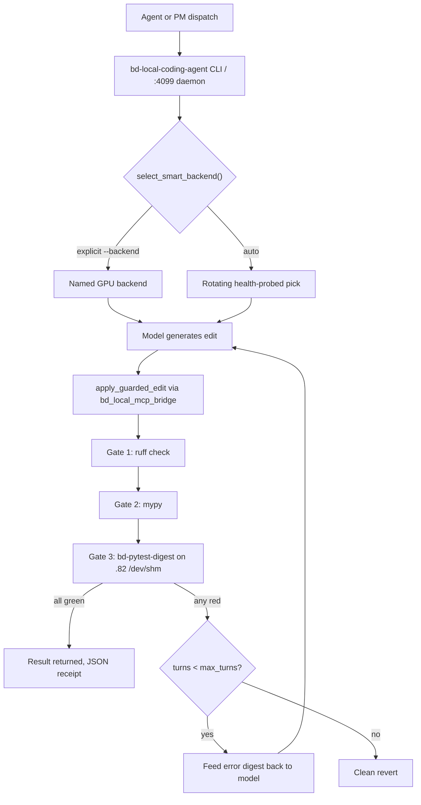

# BD-KB Volume 29: Tier-1 Local Coding Engine & .82 64-Core Ramdisk Pytest Guide (Authored Live by Qwen3-Coder-30B-A3B on .72:8000)
> **Author**: `Spec-229` (`agy-sonnet-fallback (tier1-qwen3-coder-30b-a3b)`)
> **Generated At**: `2026-10-19T22:59:39Z`
> **Scope**: Strictly Read-Only Infrastructure, Tools, Services, LLMs & PM Catch-Up Documentation (`O3416` Compliant)

---

# BD-KB Volume 29: Tier-1 Local Coding Engine & .82 64-Core Ramdisk Pytest Guide

**Authored live by Qwen3-Coder-30B-A3B on `10.0.70.72:8000`**
**Document ID:** Spec-229 · **Audience:** fleet agents (Kimi, Claude Code, Codex, AGY) and the PM dispatcher · **Mode:** operations manual

> [!NOTE]
> This volume is built only from the supplied source context: the header and code of `/home/mboyle/bin/bd-local-coding-agent` and the `boylenet-local-coding-agent` `SKILL.md`. Where the sources disagree, or where something is not stated, the text says so. Verify those points before relying on them (see [§12](#12-known-discrepancies-and-open-items)).

---

## 1. Purpose and Position in the Fleet

The Tier-1 Local Coding Engine is the **$0** path for code generation, refactoring, and verified bug-fixing. Edits are generated on Boylenet's local GPUs. Verification then runs on the `.82` 64-core host, using a `/dev/shm` ramdisk for pytest. Work that fits this tier never needs a paid frontier-model call.

| Property | Value |
|---|---|
| Marginal cost | $0 (local GPUs only) |
| Primary model | `Qwen3-Coder-30B-A3B-Instruct`, Q4_K_M, 256K context |
| Primary host | `10.0.70.72` (Tesla T4 16GB) |
| Verification host | `.82` (64 cores, `/dev/shm` ramdisk) |
| Entry point | `/home/mboyle/bin/bd-local-coding-agent` (CLI and worker daemon) |
| Worker daemon | `http://127.0.0.1:4099` |
| Sandbox boundary | `/home/mboyle/bd-local-wt/*` and `/home/mboyle/bd-cuts/*` only (Rule 22) |

The engine does three things the raw model cannot:

1. **Indentation-normalized guarded edits.** These tolerate the whitespace drift that smaller models introduce.
2. **A multi-turn self-healing gate loop.** It runs `ruff check`, then `mypy`, then `bd-pytest-digest`, and feeds failures back to the model.
3. **A benchmark-safe backend selector.** It keeps coding traffic off GPUs that are running benchmarks.

---

## 2. Architecture Overview



---

## 3. Backend Catalogue

The `BACKENDS` table defines six selectable targets. Each entry carries a node description, a chat-completions endpoint, a model name, and optional extra payload.

| Backend ID | Node | Endpoint | Model | Extra payload |
|---|---|---|---|---|
| `t4-72` | `10.0.70.72`, Tesla T4 16GB, Qwen3-Coder-30B-A3B-Instruct Q4_K_M 256K | `http://10.0.70.72:8082/v1/chat/completions` | `qwen3-coder-30b-a3b` | `chat_template_kwargs: {enable_thinking: false}` |
| `t4-heretic` | `10.0.70.83`, Tesla T4 16GB, Qwen3.6-35B-A3B-Heretic Q4_K_M 64K | `http://10.0.70.83:18080/...` (fallback `.72:8082`) | `qwen3.6-35b-a3b-heretic` | `enable_thinking: false` |
| `t4-125` | `10.0.70.125`, Tesla T4 16GB | `http://10.0.70.125:8081/...` | `qwen2.5-coder-32b-distributed` | none |
| `t4-228` | `10.0.70.228`, Tesla T4 16GB | `http://10.0.70.228:11434/...` | `qwen2.5-coder:7b` | none |
| `2080ti` | `10.0.10.137` BattleStation, RTX 2080 Ti 11GB | `http://10.0.10.137:11434/...` | `cyberstrike-35b:q4_k_m` | none |
| `openwebui` | `10.0.70.164:8090` OpenWebUI Super-Suite | `http://127.0.0.1:8090/api/chat/completions` | `agent-master-coder` | none |

### 3.1 When to pick the Qwen3-Coder-30B-A3B backend (`t4-72`)

Choose `t4-72` when the task:

- spans multiple files or needs a long working set, because the 256K context lets whole modules and test files fit in one prompt;
- is a refactor or an edge-case fix that benefits from a code-specialized instruct model;
- needs deterministic, non-reasoning output. Thinking is disabled through `chat_template_kwargs`, which keeps latency and token use predictable.

Choose a smaller backend (`t4-228` 7B, `2080ti`) for single-function edits, mechanical renames, or when `.72` is occupied.

---

## 4. Smart Backend Selection

### 4.1 Explicit selection

`--backend <id>` with any ID from the catalogue returns that backend immediately. The routing reason is recorded as `Explicit --backend=<id> -> <node> (<endpoint>)`. No health probe runs on this path.

### 4.2 `--backend auto`

`auto` is a **rotating load balancer** across five GPUs:

```
order = [t4-72, t4-125, 2080ti, t4-228, t4-heretic]
start = int(time.time()) % 5   # rotate by current second
```

1. The list is rotated by the current second. Parallel workers therefore start at different points and spread across the GPUs.
2. Each candidate is probed with `GET /v1/models` (1.5 s timeout). The first one returning HTTP 200 wins.
3. If none respond, the selector falls back to the `2080ti` (BattleStation `.137`).

Every selection returns `benchmark_guard: {zero_contention_enforced: true}` and a human-readable `routing_reason`.

### 4.3 Benchmark contention probe

`check_node_benchmark_active(host)` runs `ps -ef | grep -E 'bench_worker\.py|llama-bench'` over SSH. It uses `BatchMode=yes`, a 2 s connect timeout, and a 4 s overall timeout. It reads the process table only and runs **no inference**.

> [!IMPORTANT]
> **Fail-closed behavior.** If the SSH probe errors or times out, the host is reported as `benchmark_active: true`. An unreachable host is treated as busy, never as free.

The design intent from the source header is that while `bench_worker.py` is active on `.72` or `.83`, coding turns go to BattleStation `.137` (`qwen2.5-coder:7b-16k`, about 95 tok/s on the RTX 2080 Ti). Once those hosts are free, `Qwen3.6-35B-A3B-Heretic` is unlocked again. Use `--probe-backends` to see the current state.

---

## 5. Indentation-Normalized `guarded_edit`

`apply_guarded_edit()` is a thin wrapper over `bd_local_mcp_bridge.apply_guarded_edit`.

**Payload fields:** `file_path`, `old_string`, `new_string`, `cwd`, `allow_multiple`, `create_if_missing`.

**Matching strategy:**

1. **Exact match first.** If `old_string` appears verbatim, the edit is applied and the result is checked with Python `compile()` (an AST/compile check).
2. **Indentation-drift fallback.** 7B and 14B models often emit blocks at the wrong indent (4, 8, or 20 spaces off). The engine matches **line-stripped** blocks, then **rebases `new_string`** onto the target file's actual per-section indentation delta.

**Enforced rules:**

- **Rule 22:** the `shield.py` sandbox boundary. Edits outside the authorized sandboxes are rejected.
- **Rule 80:** `bd-blob-ptr`.

**Guidance for agents:**

- Keep `old_string` to the smallest unique anchor. Do not paste whole functions as the anchor.
- Leave `allow_multiple` at `false` unless you intend a repeated replacement.
- Use `create_if_missing` only for genuinely new files inside the sandbox.

---

## 6. Multi-Turn Self-Healing Verification Gate Loop

After each applied edit, three gates run in order:

| # | Gate | Tool | Fails on |
|---|---|---|---|
| 1 | Lint | `ruff check` | lint or syntax violations |
| 2 | Types | `mypy` | type errors (the code extracts per-error signatures from mypy output) |
| 3 | Tests | `bd-pytest-digest` | failing tests, summarized as a compact digest |

**Loop semantics:**

- If any gate fails, the **compiler or pytest error digest is fed back to the model** as the next turn's prompt.
- This repeats up to `--max-turns` (recommended `3`: initial attempt plus two repair turns).
- If the gates still fail after `max_turns`, the edit is **reverted cleanly**. A failed run leaves the sandbox as it found it.

The digest is deliberately compact, so repair turns stay small even against a 256K window. Do not paste raw pytest logs into your own follow-up prompts. Use the digest.

---

## 7. The `.82` 64-Core `/dev/shm` Ramdisk Pytest Path

Verification offloads test execution to `.82`. The source describes it as a "64-core `/dev/shm` ramdisk pytest" and confirms two integration points: the `bd-pytest-digest` gate and the `ramdisk_pytest_digest` tool in the `boylenet-infra` MCP server.

**Why a ramdisk:** test suites are dominated by many small file reads and writes (`.pyc`, tmp dirs, fixtures, caches). Placing the working tree and temp space on `/dev/shm` removes disk latency, and 64 cores allow high-parallelism test runs.

**Typical flow (conceptual):**

1. The sandbox tree under `/home/mboyle/bd-local-wt/<sandbox>` is synced to a ramdisk workspace on `.82`.
2. pytest runs with the target test (`--target-test`) or the wider suite.
3. Output is reduced to a digest: pass/fail counts, failing test IDs, and the key assertion or traceback lines.
4. The digest is returned to the agent loop as gate 3's result.

> [!WARNING]
> The source excerpts do not specify the exact sync mechanism, worker count, or ramdisk path layout. Treat the details above as the intended design. Confirm the specifics against `ramdisk_pytest_digest` and `bd-pytest-digest` before scripting around them.

**Operating tips:**

- Scope runs with `--target-test` for repair turns. Run the broad suite only for final confirmation.
- Ramdisk contents are volatile. Never store the only copy of anything under `/dev/shm`.
- Do not hand-run long pytest jobs on `.72` or `.83`. `.82` is the verification node.

---

## 8. Dispatch Guide

### 8.1 For agents (Kimi, Claude Code, Codex, AGY)

Use the `boylenet-local-coding-agent` skill, or call the CLI directly.

**Probe backends and contention state:**

```bash
/home/mboyle/bin/bd-local-coding-agent --probe-backends
```

**Run a coding task with self-healing verification:**

```bash
/home/mboyle/bin/bd-local-coding-agent \
  --sandbox /home/mboyle/bd-local-wt/sb-race-local \
  --target-file bulk_downloader/utils.py \
  --target-test tests/test_utils.py \
  --prompt "Fix URL normalization edge case and preserve type annotations" \
  --backend auto \
  --max-turns 3 \
  --json
```

To pin the work to the 30B coder, use `--backend t4-72`.

**Flag reference (from the sources):**

| Flag | Meaning |
|---|---|
| `--sandbox` | Authorized worktree. It must be under `bd-local-wt/*` or `bd-cuts/*`. |
| `--target-file` | File to edit, relative to the sandbox. |
| `--target-test` | Test file used by the pytest gate. |
| `--prompt` | Natural-language task description. |
| `--backend` | `auto`, `2080ti`, `t4-heretic`, `t4-72`, `t4-125`, `t4-228`, or `openwebui`. |
| `--max-turns` | Self-repair budget. |
| `--json` | Machine-readable result. |
| `--probe-backends` | Report backend health and benchmark contention. |

### 8.2 For the PM

The PM can fan out independent rows in parallel. Two properties make this safe:

- `--backend auto` rotates its starting point by wall-clock second, so concurrent workers naturally spread over GPUs.
- Each task is sandboxed to its own worktree, so parallel edits do not collide.

**PM checklist per dispatch:**

1. Run `--probe-backends`. Check for `.72` or `.83` benchmark activity.
2. Give each row its **own** sandbox path.
3. Set `--max-turns 3` and `--json`.
4. Collect JSON receipts and reconcile against the ledger (the source references a receipt at `.../O1789/infra-upgrade/agent107_local_coding_agent_e2e.json` for the end-to-end test).
5. Escalate to a paid tier **only** after a local run reverts at `max_turns`.

### 8.3 Worker daemon

The same engine runs as an HTTP daemon:

```bash
curl -fsS http://127.0.0.1:4099/health
```

Use it for long-lived integrations that should not pay CLI startup cost each time. Health-check it before dispatch.

### 8.4 Observability

`log_stream()` writes timestamped lines (`[<UTC ts>] [Agent-107] ...`) to stdout and appends them to `/var/tmp/bd-headless-streams/agent107-local-coding-agent-pool.log`. Log-write failures are swallowed, so logging never breaks a run. Tail this file when diagnosing routing decisions or stuck loops.

---

## 9. Task Suitability Matrix

| Task | Good fit for Tier-1? | Recommended backend |
|---|---|---|
| Single-function bug fix with a test | Yes | `auto` or `t4-72` |
| Multi-file refactor, type preservation | Yes | `t4-72` (256K context) |
| Mechanical rename, formatting, docstring edits | Yes | `t4-228` or `2080ti` |
| Add tests for existing code | Yes | `t4-72` |
| Cross-repo architectural redesign | Marginal. Escalate if the first pass reverts. | `t4-72` first |
| Security-sensitive or production-deploy changes | Review required regardless of tier | n/a |
| Anything outside `bd-local-wt/*` or `bd-cuts/*` | **Not permitted** (Rule 22) | n/a |

---

## 10. Prompting Best Practices for the 30B Coder

- **State the invariant to preserve.** For example: "preserve type annotations and public signatures."
- **Name the target file and test.** Both are passed as flags, and the prompt should reference the same behavior.
- **Prefer slices over whole files.** The skill references Tree-sitter AST slicing via `ratf` `ctx_slice`, which keeps prompts focused even with 256K available.
- **One concern per task.** A single clear change repairs better than a bundle.
- **Thinking is off.** Do not ask for long chain-of-thought. Ask for the edit.
- **On repair turns, trust the digest.** Do not re-explain the whole task.

---

## 11. Troubleshooting

| Symptom | Likely cause | Action |
|---|---|---|
| All coding routed to `.137` | `bench_worker.py` or `llama-bench` active on `.72`/`.83`, or the SSH probe failed (fail-closed) | Run `--probe-backends`. Wait for the benchmark, or accept the 2080 Ti. |
| `auto` returns a slow backend | The rotation landed on a small model | Pin `--backend t4-72`. |
| Edit rejected | Path outside the authorized sandbox (Rule 22) | Use a worktree under `bd-local-wt/` or `bd-cuts/`. |
| `old_string` not found | Drift beyond the line-stripped match, or the file changed | Re-slice the file and shorten the anchor. |
| Reverted after max turns | The model could not satisfy ruff, mypy, or pytest | Inspect the last digest. Narrow the task or escalate. |
| Daemon health fails | The `:4099` worker is down | Restart the daemon. Use the CLI meanwhile. |
| Backend marked dead | `/v1/models` probe failed (1.5 s timeout) | Check the endpoint and port against [§12](#12-known-discrepancies-and-open-items). |

---

## 12. Known Discrepancies and Open Items

> [!WARNING]
> The source materials disagree in several places. Reconcile these before treating this guide as authoritative.

1. **`.72` port.** The title and brief say `10.0.70.72:8000`. The `BACKENDS["t4-72"]` code points to `:8082`. This guide documents what the code does (`:8082`) and treats `:8000` as the serving address named in the brief. Confirm which port is live.
2. **`.83` port.** The code uses `10.0.70.83:18080`. The skill file says `10.0.70.83:8081`.
3. **`.83` model.** The code names `Qwen3.6-35B-A3B-Heretic` (Q4_K_M, 64K). The skill names `Qwen3.6-35B-A3B-Uncensored-HauhauCS-Aggressive-IQ4_XS.gguf` on dual T4 (32GB).
4. **`.137` model.** The code uses `cyberstrike-35b:q4_k_m`. The header and skill describe `qwen2.5-coder:7b-16k` or `14b`.
5. **`t4-125` naming.** The node description says Qwen2.5-Coder-14B, but the model string is `qwen2.5-coder-32b-distributed`.
6. **Hardcoded secret.** The source contains a hardcoded OpenWebUI JWT signing secret in `make_owui_jwt()`. It is deliberately **not reproduced here**. Move it to an environment variable or secret store and rotate it, since it has appeared in source and in this prompt.
7. **Unspecified `.82` internals.** The sync method, worker count, and ramdisk path are not in the supplied excerpts (see [§7](#7-the-82-64-core-devshm-ramdisk-pytest-path)).
8. **Truncated source.** The CLI source excerpt stops at 10,000 bytes. Details of the gate loop and daemon (for example the full `_extract_mypy_signatures` logic and the HTTP routes beyond `/health`) are not covered here.

---

## 13. Quick Reference Card

```text
PROBE      bd-local-coding-agent --probe-backends
RUN        bd-local-coding-agent --sandbox <bd-local-wt/...> --target-file <f> \
             --target-test <t> --prompt "<task>" --backend auto|t4-72 --max-turns 3 --json
HEALTH     curl -fsS http://127.0.0.1:4099/health
LOG        /var/tmp/bd-headless-streams/agent107-local-coding-agent-pool.log
GATES      ruff check -> mypy -> bd-pytest-digest (.82 /dev/shm, 64 cores)
ON FAIL    digest -> model -> retry (<= max-turns) -> clean revert
BOUNDARY   /home/mboyle/bd-local-wt/*  and  /home/mboyle/bd-cuts/*  ONLY (Rule 22)
```

**Core invariants:** keep cost at $0, stay inside the sandbox, never contend with a running benchmark, and never leave a failed edit applied.
