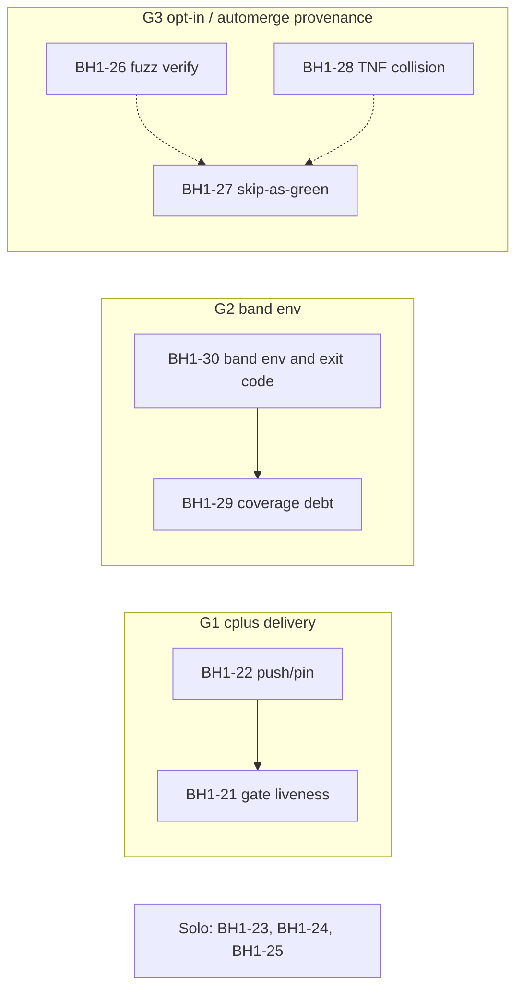

# BD-KB Volume 33: Read-Only Investigation Dossier — BH1-21 through BH1-30 (C+ Gate, Cost Accounting, AST-TIA, Automerge & Band Env)
> **Lead Investigator**: `Opus55-Investigator-1` (`AGY claude+gpt (claude-opus-5-5-high)`)
> **Subagent Squad**: 4x Parallel `AGY claude+gpt` (`claude-sonnet-5-5-high` & `claude-sonnet-5-5-low`) Read-Only Code Investigators
> **Generated At**: `2026-10-19T23:33:41Z`
> **Scope**: Strictly Read-Only Investigation Dossier for `bd-pm-B` (`Zero Code Changes`, `O3416` Compliant)

---

# BD-KB Volume 33: Read-Only Investigation Dossier: BH1-21 through BH1-30

**C+ Gate, Cost Accounting, AST-TIA, Automerge and Band Env**

| Field | Value |
|---|---|
| Author | `Opus55-Investigator-1` (Lead Principal Investigator) |
| Audience | `bd-pm-B` |
| Compiled | 2026-10-19T23:31Z |
| Mode | 100% read-only. I made no tool calls, ran no commands and changed no files. |
| Inputs | Four specialist reports: S1 (BH1-21..25), S2 (BH1-26..30), S3 (BH1-27/29 kit and skip), S4 (conflict matrix) |
| Rows covered | BH1-21, 22, 23, 24, 25, 26, 27, 28, 29, 30 |

---

## 0. Read this first: evidence limits

1. **There are no line numbers anywhere in this volume.** None of the four investigators had line-numbered source, and I have not made any up. Where a location is known, it is a **code-text anchor**: an exact string to `grep -n` for. Every other location is marked **COULD NOT LOOK**.
2. **Only two files had any source in view:**
   - [bd-auto-merge.sh](file:///home/mboyle/bd-persist/harness/bd-auto-merge.sh): the first 12,000 bytes only.
   - [bd-row-audit.py](file:///home/mboyle/bd-persist/harness/bd-row-audit.py): the first 10,000 bytes, which is mostly the docstring.

   Every other file is a **"Files (est.)"** value taken from BOARDED or LANDED evidence. Nobody has checked these against a brief.
3. **Some mechanisms are claimed and some are inferred.** Unless I say a mechanism was seen in code, it is the advisory's own claim. **[inferred]** marks reasoning that goes beyond the advisory text.
4. **The `BD_GATE_SCOPE` value syntax is unknown.** Every scope in this volume is a plain-language proposal. Check each one against `bd-dispatch-ops` before dispatch.
5. **The table is truncated.** Investigators saw rows BH1-17..53 only. They could not check BH1-01..16 or BH1-54+ for overlaps.

---

## 1. Executive summary

| Row | Slug | Sev | Size | Lane | Class | Conflict group | Main risk |
|---|---|---|---|---|---|---|---|
| BH1-21 | cplus-issued-gate-liveness | LOW | S | H (cplus rid) | Code: TOCTOU, FIFO hang, interim admit | **G1** | STEP0 relies on a landing with no git sha |
| BH1-22 | cplus-rid-and-runner-push-down-hosts | **MED** | S | H (ops) | Deploy drift, no code | **G1** | DOWN hosts reported as green |
| BH1-23 | worker-done-unknown-residuals | LOW | S | H | Mutant survivors, validation, allowlist | Solo (2-path mirror) | Harness and plugin copy drift apart |
| BH1-24 | t16-cost-accounting-coverage | LOW | S | H | Test gap, semantics | Solo | Scope split across two BOARDED headers |
| BH1-25 | ast-tia-rollback-coverage | LOW | S | H | Design fragility and test gap | Solo | Rename-based rollback can race |
| BH1-26 | fuzz-verify-residuals | LOW | S | H | Over-strict walk, crash on bad type, TOCTOU | **G3** | Relaxing the walk is security-sensitive |
| BH1-27 | kit-optin-tests-skip-as-green | **MED** | S | H | **Gate integrity** | **G3** | Tests that never ran count as proof |
| BH1-28 | automerge-tnf-collision | LOW | S | H | Non-injective filename key | **G3** (evidence only) | HOLD files collide across branches |
| BH1-29 | harness-coverage-debt-1019 | LOW | S | H | Test-only debt | **G2** | `BD_SEAT` leak makes h516 depend on who runs it |
| BH1-30 | bh-drain-band-env | LOW | S | H | Env and contract violation | **G2** | A missing file shows up as REFUSED (exit 1), not UNKNOWN (exit 2) |

Two rows are MED, and both are about **trust in green signals**. In BH1-22, hosts can look deployed when they are not. In BH1-27, gates can look green when tests never ran. I recommend prioritizing these two, even though the other eight rows are individually cheap.

---

## 2. Row-by-row findings

### BH1-21: cplus-issued-gate-liveness (LOW, S, lane H / cplus rid)

**Files (est.):** `rid patched/cplus_authorizer.py` and `rid patched/operations.py`. The tree root of `rid patched/` is **not given**.

**Locations:** COULD NOT LOOK. The evidence names call sites only by label:

| Label | Description |
|---|---|
| C4 journal read | Happens before the busy-append |
| C4 pending reader | Opens `authorizer-pending.tsv` |
| M1 interim | Admit-on-OBSERVE logic for gate G |

**Evidence:** BOARDED `cplus-m1-issued-gate` r4 and r5, and `LANDED-cplus-m1-grant-token-r2-0900Z.md`.

**Root-cause mechanisms (claimed):**
- **A1: narrow TOCTOU.** C4 reads the journal and only then performs the busy-append. A concurrent attempt can land in that gap, so the liveness decision uses a stale view.
- **IG4S-B ADV-1: FIFO hang.** C4 opens `authorizer-pending.tsv` without checking the file type. If someone plants a FIFO at that path, the blocking `open()` or `read()` never returns and C4 hangs. The fix is to `fstat` after open and require `S_ISREG`, and/or open with `O_NONBLOCK`.
- **ADV-2.** The security probes were run ad hoc and never adopted as regression tests.
- **r5 (1).** Any OBSERVEd attempt admits gate G. This is the deliberate M1 interim behaviour.

**STEP0 (mandatory):** The grant-token r2 landing may already close r5 (1), but it landed **with no git sha**. Check the **deployed content** (hash compare) to see whether r5 (1) is closed. Do not use commit ancestry. Only after that, decide whether r5 (1) stays OPEN.

**Verification scope (proposed):** The rid cplus authorizer and operations tests, plus new FIFO, TOCTOU and probe-adoption tests. The FIFO test **must carry a hard timeout**, so that a regression fails fast instead of hanging the gate. S4 notes that unit tests are probably enough for the code half, and any live confirmation depends on BH1-22.

---

### BH1-22: cplus-rid-and-runner-push-down-hosts (MED, S, lane H / ops)

**Files:** none in the repo. The work is `bd_cplus_release` push/pin plus crontab edits, so line numbers do not apply.

**Evidence:** `LANDED-cplus-l1-nofollow-r1-vm-push-0440Z.md`, `LANDED-cplus-worker-static-r1-0545Z.md`, `LANDED-cplus-m1-grant-token-r2-0900Z.md`, `LANDED-integrator-C-fleet-runner-disk-r2-0330Z.md` and `LANDED-integrator-C-rcl1-r2-1300Z.md`.

**Root cause:** This is not a code defect. The fixes landed in the repo, but the push stopped short because target hosts were DOWN or never reached.

| Fix | Deployment gap | Hosts named |
|---|---|---|
| `cplus-l1-nofollow` | Live on 12/17 hosts | 5 DOWN (not enumerated) |
| `cplus-worker-static` | Incomplete | 3 DOWN (not enumerated) |
| `grant-token r2` | Incomplete | 3 DOWN VMs (not enumerated) |
| `fleet-runner-disk` | Deploy still owed | .121, .86, **.35**, **.171** |
| rcl1 prune cron | Entry missing | **.171**, .197, **.35** |

Hosts **.35** and **.171** appear in two gaps each, so batch the work per host rather than per fix.

**Verification scope:** There is no repo test gate. Verification is a fleet pass after the push:
1. Re-probe the DOWN hosts first (`fleet_hosts`).
2. On each reachable host, check the pinned release hash, `crontab -l` for the rcl1 prune entry, and that the fleet-runner-disk artifact is present.
3. **Record any host that is still DOWN as COULD NOT LOOK, never as green.**

---

### BH1-23: worker-done-unknown-residuals (LOW, S, lane H)

**Files (est.):** `bd-worker-done.sh` and `bd-verdict-write-hook.sh` (harness), plus the byte copy `plugins/bd-cut-hygiene/scripts/bd-worker-done.sh`.

**Locations:** COULD NOT LOOK.

**Evidence:** BOARDED `worker-done-unknown` r1 and `LANDED-integrator-C-worker-done-unknown-r1-0715Z.md`.

**Root-cause mechanisms (claimed):**
- **A1.** Mutants **M3** and **M8** survive, so no current test pins those branches.
- **A2.** An UNKNOWN `WRITTEN-AT` value is accepted with no calendar check. Impossible dates such as month 13 or day 32 pass.
- **A3.** The `bd-verdict-write-hook.sh` allowlist does not include `VERDICT: UNKNOWN`. The worker-done path can emit that verdict, so the hook may reject a legitimate verdict or mishandle it.
- **OWED.** The plugin copy must stay **byte-identical** to the harness file.

**STEP0:** `cmp` or hash-compare the harness and plugin copies before editing. If they have already diverged, decide which side is canonical before cutting anything.

**Verification scope (proposed):**
- Worker-done UNKNOWN tests, with a mutation re-run that must kill M3 and M8.
- A calendar-validation test for A2.
- A hook allowlist test for A3.
- An assertion that the harness and plugin copies are byte-equal.

---

### BH1-24: t16-cost-accounting-coverage (LOW, S, lane H)

**Files (est.):** `bd_cost_accounting.py` and `tests/test_usage_collector_advisor.py`.

**Locations:** COULD NOT LOOK.

**Evidence:** BOARDED T16 r8, **plus** correction lines that BOARDED prints, by mistake, under the `deep-api-auth-csrf r2` header. Cite **both** locations. A reader who checks only T16 r8 will miss part of the scope.

**Root-cause mechanisms (claimed):**
- **A1.** Ten mutants survive, because none of the guards new in T16 r8 has a test that fails when the guard is removed.
- **A2.** Pre-existing fields default to `0`, so a missing value cannot be told apart from a real zero.
- **Lens-fix advisories:**
  - The P2 label says `PARTIAL` where it should say `COULD NOT LOOK`.
  - No test pins `synthetic_zero_skipped=0`.
  - Pre-window placeholders are counted in the totals.

**Verification scope (proposed):** `tests/test_usage_collector_advisor.py` plus a mutation re-run over the new guards. Add explicit tests for the relabel, the `synthetic_zero_skipped=0` pin and the exclusion of pre-window placeholders. S4 advises keeping production edits minimal (the label and the counting) and making this a test-heavy cut.

---

### BH1-25: ast-tia-rollback-coverage (LOW, S, lane H)

**Files (est.):** `bd-ast-tia`, `bd-speculative-patch` and their tests (paths not specified).

**Locations:** COULD NOT LOOK.

**Evidence:** BOARDED `ast-tia-tool-fixes` r2.

**Root-cause mechanisms (claimed):**
- **A1: design fragility.** Rollback works by `rename`, which needs write permission on the containing directory **at rollback time**. If permissions change, or another process interferes between patch and rollback, the rollback fails or races. That can leave the tree half-applied.
- **A2: test gap.** Nothing tests the restore in the `except` path.
- **A3: test gap.** Nothing tests temp-file cleanup.

S1 and S4 agree that **A1 is a design decision** (copy-based restore versus rename), not just missing coverage. The PM should decide whether BH1-25 also fixes the mechanism or only documents it.

**Verification scope (proposed):** ast-tia and speculative-patch tests, plus three new fault-injection tests:
- a read-only parent directory at rollback time (A1);
- a forced exception mid-patch (A2);
- an assertion after the run that no temp files remain (A3).

---

### BH1-26: fuzz-verify-residuals (LOW, S, lane H)

**Files (est.):** `bd-fuzz-user-verify.py` (path-walk and `..` handling) and `INSTALL.md` (one line).

**Locations:** COULD NOT LOOK. Suggested way to find them: `grep -n 'lstat\|islink\|COULD NOT LOOK\|\.\.'` in the verifier.

**Evidence:** cuts `o1698-fuzz-literal-symlink-ancestors r1` and `fuzz-read-trusted-dotdot r1`.

**Root-cause mechanisms (claimed):**

| ID | Mechanism | Effect |
|---|---|---|
| fuzz-literal A2 | The ancestor walk returns COULD NOT LOOK if *any* ancestor is a symlink, whether or not it resolves inside the trusted root | Over-strict; fails closed |
| fuzz-literal A3 | `INSTALL.md` cites a CANDIDATE-only line | The doc points to text that never landed |
| dotdot A1 | A non-`str` path (`bytes`, `None`) reaches string or path operations | An uncaught `TypeError` breaks the rule that whatever cannot be measured is reported UNKNOWN |
| dotdot A2 | Relative leading and trailing `..` have no tests | Unpinned behaviour |
| dotdot A3 | The `lstat` walk checks first and uses later | TOCTOU window |

**Investigators disagree on A3:**
- S2 says to fix A2 and A3 in one cut, since they share the walk code.
- S4 says relaxing A2 is **security-sensitive and needs review**, and that A3 should probably be **accepted as a residual**.

I recommend landing A1, the A2 tests and the `INSTALL.md` fix first. Move the A2 relaxation and the A3 fix into a reviewed second cut, or accept them formally as residuals.

**Verification scope (proposed):**
- Dotdot cases `a/..`, `../a` and `a/../..`, plus `bytes` and `None` inputs.
- A symlink-ancestor fixture: inside the root should pass; escaping the root should give COULD NOT LOOK.
- A check that `INSTALL.md` cites a landed line.

---

### BH1-27: kit-optin-tests-skip-as-green (MED, S, lane H)

**Files (est.):** the precut kit `members.tsv` and the kit runner. **No exact paths are given.**

**Locations:** COULD NOT LOOK.

**Evidence:** BOARDED `o1698-fuzz-literal r1` advisory **A4** and `LANDED-integrator-C-automerge-slash-tn-r1-0910Z.md` (the integrator kit note).

**Root-cause mechanism (claimed):**
1. Some tests are opt-in: they `skipif` an env var is unset.
2. The kit and CI invoke them without that variable, because neither `members.tsv` nor the PYTEST env supplies it.
3. pytest reports SKIPPED and exits 0.
4. The runner and gate read "no failures" as green.
5. So a test that never ran counts as proof, and a standing skip can hide a real regression.

**Compounding risk [inferred, S2]:** [bd-auto-merge.sh](file:///home/mboyle/bd-persist/harness/bd-auto-merge.sh) accepts a precut log when it has no `BLOCKED` or `[VIOLATION]` line. A silent skip produces neither, so it goes through auto-merge too.

**Fix options:**

| Option | Robustness | Source |
|---|---|---|
| Add the env var to the `members.tsv` row | Fixes today's tests only | S2, S3 |
| Set the env var in the PYTEST env | Fixes today's tests only | S2, S3 |
| The runner fails when a member-declared test is skipped, with an allowlist for intentional skips | **Also catches future opt-in tests** | S2 (preferred), S3 (allowlist) |

**Before changing the rule (S4):** list every test the kit currently skips. A fail-on-skip rule can turn many members red at once, which is why this row is MED.

**Verification scope (proposed):** This is a harness or kit gate, not a product gate. It needs a RED→GREEN pair:
- the env var unset should give non-green;
- the env var set should give green;
- a **mutant** that deletes the env var from `members.tsv` must make the gate fail.

Also assert that the skip count is zero for the targeted members.

---

### BH1-28: automerge-tnf-collision (LOW, S, lane H). Source in view.

**File:** [bd-auto-merge.sh](file:///home/mboyle/bd-persist/harness/bd-auto-merge.sh), inside the per-PR loop. These code-text anchors were seen in source:

| Anchor (seen) | Role |
|---|---|
| `while read -r NUM BRANCH BASE HEAD` | Per-PR loop header |
| `TN=$(printf '%s' "$BRANCH" \| sed -E 's#^train/([0-9]+).*#\1#')` | Extracts the train number |
| `TNF=${TN//\//-}` (with the `automerge-slash-tn` comment) | **Non-injective flattening** |
| `PLOG=$PERSIST/logs/precut-T$TNF-$S8.log` | Precut log key |
| `RECORD=$(ls "$PLAN"/T$TNF-STAGED-$S8-*.md …)` | Staged-record glob |

The HOLD-file write, `AUTO-MERGE-BLOCKED-T<NN>-<sha8>.md` and `.auto-merge-state` come **after the 12,000-byte cut**, so they are COULD NOT LOOK. The header comment confirms that the BLOCKED and state files exist.

**Root-cause mechanism:**
1. The `sed` rewrites only branches that match `train/<digits>`.
2. A non-numeric branch does not match, so `TN` stays the whole branch name.
3. `TNF=${TN//\//-}` turns every `/` into `-`. As a result, `train/a/b` and `train/a-b` **both map to `train-a-b`**.
4. Every file keyed on `T$TNF` is now shared between the two PRs. That includes the HOLD file, the precut log and the STAGED/PRECUT records.
5. The S8 (head-sha8) suffix is the only thing that tells them apart. It is unique per head, not per branch, and a HOLD file without S8 in its name **[inferred]** cannot be told apart at all.

**Extra finding [inferred, S2]:** numeric branches collide too. `train/12/a` and `train/12-fix` both give `TN=12`. This is probably outside the row's scope, but the fix should cover it.

**Fix direction:** Key per-PR files with something injective: `$NUM` (unique per open PR), a reversible escape (`/`→`%2F`), or a hash of `$BRANCH`. Keep the `T…` prefix shape so existing precut and PLAN globs still match. S4 adds that the fix must stay compatible with **HOLD file names already on disk**.

**Constraints that must be kept:** `*/3` cron cadence, the shared `main-merge.lock` flock with the regen-on-main cron, `set -u` safety, and Rule 22 (never check out or delete).

**Verification scope (proposed):** Use the existing auto-merge fixture: `BD_AUTO_MERGE_DRY=1`, `BD_AUTO_MERGE_PATH_PREFIX` for a fake `gh`, and the `BD_AUTO_MERGE_REPO` and `_PERSIST` overrides. Add:
- two blocked PRs, `train/a/b` and `train/a-b`, which must produce distinct HOLD and state files;
- a numeric shared-prefix case;
- a mutant that restores the old `TNF` expression, which must fail.

**Never run this against the live `/home/mboyle/BulkDownloader` or the live `PERSIST`.**

---

### BH1-29: harness-coverage-debt-1019 (LOW, S, lane H, test-only)

| Gap | Estimated file | Evidence | Missing |
|---|---|---|---|
| Closed markers | `tests/test_backlog_*.py` | BOARDED `backlog-closed-markers r1` | Fixtures for a claim-dir subdirectory and a lowercase `closed-x` |
| T03 parser | `tests/test_bdt_sensor_gitstate*.py` | BOARDED `T03 cut-r7` | Rows for an odd field count, a missing NUL terminator and an unknown scope |
| Band remote | `tests/test_band_remote_roles_source.py` | BOARDED `band-remote-roles-source r1` | A pin on the **12 s hub bound** |
| h516 HERM | `tests/test_h516_*.sh` | BOARDED `h516-red-on-main r2` | `unset BD_SEAT` in the hermetic setup |

**Locations:** COULD NOT LOOK for all four.

**Root cause:** These are missing tests, not production defects. The most serious is the h516 gap. The hermetic env inherits `BD_SEAT` from the caller, so the result depends on **who runs the test**, which means the test is not hermetic.

**Rule:** no production code changes.

**Verification scope (proposed):**
- Run each touched test file on its own.
- Run h516 with `BD_SEAT` **exported in the parent env** and confirm the result is identical.
- Each new parser or constant row must kill a matching mutant.

---

### BH1-30: bh-drain-band-env (LOW, S, lane H)

**Files:** [bd-row-audit.py](file:///home/mboyle/bd-persist/harness/bd-row-audit.py) and `bd-band-remote.sh` (path not given).

**Locations:** The `FileNotFoundError` site is **not visible**, because only the docstring was in view. The export site in `bd-band-remote.sh` is COULD NOT LOOK.

**Root cause (partly inferred):**
1. The docstring says `bd-row-audit.py` is the pre-dispatch pre-flight. It also says the C4 register-prose check "can only be checked here", because a worker cannot see main's register.
2. So the script opens harness and register files by path, for example `project-knowledge/IMPROVEMENT_BACKLOG.md`.
3. On a band host, the harness is **not** at `/home/mboyle/bd-persist/harness`, because the band checks out a tree elsewhere.
4. Without `BD_HARNESS_HOME=tree`, `open()` raises an uncaught `FileNotFoundError`.
5. **Contract violation:** the docstring defines exit 2 as UNKNOWN ("a row could not be measured"). An uncaught Python exception exits **1**, which the script defines as **REFUSED**. A missing file therefore looks like a real refusal.

**Fix (do both):**
- `bd-band-remote.sh` exports `BD_HARNESS_HOME=tree`.
- `bd-row-audit.py` catches `OSError`, prints UNKNOWN and exits 2.

**Verification scope (proposed):**
- With the harness and register absent, expect exit 2 and an UNKNOWN line, not a traceback with exit 1.
- With `BD_HARNESS_HOME` pointing at a tree, expect normal C1–C6 results.
- Run the BH1-29 band-remote test file.

**Investigators disagree on live checks:** S4 recommends a check on one real band host. S2 says it is optional, needs PM sanction as a dry run, and cannot be done read-only. I defer to `bd-pm-B`.

---

## 3. Conflict groups and file matrix

### 3.1 File ownership matrix (BH1-21..30)

| File / surface | Rows | Collision type |
|---|---|---|
| `rid patched/cplus_authorizer.py`, `operations.py` | 21 | Solo |
| `bd_cplus_release` pins, crontabs (.35, .121, .86, .171, .197) | 22 | Solo (ops) |
| `bd-worker-done.sh`, its plugin copy, `bd-verdict-write-hook.sh` | 23 | Solo; one cut must edit two paths |
| `bd_cost_accounting.py`, `test_usage_collector_advisor.py` | 24 | Solo |
| `bd-ast-tia`, `bd-speculative-patch` | 25 | Solo |
| `bd-fuzz-user-verify.py`, `INSTALL.md` | 26 | Solo |
| Kit `members.tsv`, kit runner | 27 | Solo |
| `bd-auto-merge.sh` | 28 | Solo (BH1-43's `bd-optimistic-merge.sh` is a different file) |
| `bd-band-remote.sh` ↔ `test_band_remote_roles_source.py` | **29, 30** | **Soft:** the script and its test pin the same behaviour |
| `bd-row-audit.py` | 30 | Solo in range (loose link to BH1-32 via `BD_ROW_AUDIT_SPEC`) |

### 3.2 Conflict groups

| Group | Rows | Coupling | Ordering rule |
|---|---|---|---|
| **G1** | 21, 22 | Delivery: both rest on grant-token r2 | Do BH1-22 before or together with BH1-21. Patching BH1-21 on a fix that isn't live everywhere adds drift. |
| **G2** | 29, 30 | Behaviour and test file | Do BH1-30 first, then BH1-29 pins the resulting behaviour (S2). Don't run both in the same cut window. |
| **G3** | 26, 27, 28 | Shared evidence, no file overlap | Inventory skips before BH1-27's rule change. **[inferred]** If BH1-27's fail-on-skip lands before the BH1-26 fuzz tests get their env, the gate turns red. Land the env injection with the rule change. |
| Solo | 23, 24, 25 | None | Can run in parallel any time |

### 3.3 Cross-volume links (outside 21..30)

| Row here | Linked row | Link |
|---|---|---|
| BH1-21 | BH1-20 | cplus routing; touches the launcher files, not rid files. BH1-20 may depend on the cplus pins. |
| BH1-22 | BH1-52, BH1-43 | Same host-drift class. Share **one host-state snapshot**. |
| BH1-24 | BH1-40 | Shared `fetched_at`/placeholder semantics. Coordinate to avoid duplicate fixes. |
| BH1-29 | BH1-36 (A2), BH1-35 (SEC A2) | `BD_SEAT` hermeticity. They may share one hermetic-env helper; align wording. |
| BH1-30 | BH1-32, BH1-33 | `BD_ROW_AUDIT_SPEC` (loose); band pre-existing reds (different files). |

---

## 4. Recommended dispatch shape

| Wave | Rows | Reason |
|---|---|---|
| **W1 (parallel)** | BH1-22 (ops), BH1-23, BH1-24, BH1-25, BH1-28, BH1-30 | No shared files; BH1-22 unblocks G1 and BH1-30 unblocks G2 |
| **W2** | BH1-21 (after BH1-22 STEP0), BH1-29 (after BH1-30), BH1-26 (safe half) | Respects group ordering |
| **W3** | BH1-27 (after the skip inventory, with the env injection) | Kit-wide blast radius; land last, once the members are known |

---

## 5. Open items for `bd-pm-B`

1. **Line-level read pass needed** for every row except BH1-28, and for the `bd-auto-merge.sh` HOLD-write region beyond byte 12,000.
2. **Confirm the `BD_GATE_SCOPE` grammar.** Every scope in this volume is a proposal.
3. **BH1-21 STEP0:** decide whether a content-hash check counts as proof for a landing with no sha.
4. **BH1-22:** enumerate the unnamed DOWN hosts (5, 3 and 3) and re-probe them.
5. **BH1-25:** decide between changing the rollback mechanism and covering it with tests only.
6. **BH1-26:** decide whether A2 relaxation and A3 TOCTOU are fixed or accepted as residuals; the A2 change needs security review.
7. **BH1-27:** choose the fix option; the investigators prefer fail-on-skip with an allowlist.
8. **BH1-30:** sanction or decline a live dry run on a band host.
9. **Coverage gap:** BH1-01..16 and BH1-54+ have not been checked for overlap.

---

## 6. Confidence ledger

| Row | Files | Mechanism | Locations |
|---|---|---|---|
| BH1-21 | est. | claimed | COULD NOT LOOK |
| BH1-22 | n/a | claimed (deploy notes) | n/a |
| BH1-23 | est. | claimed | COULD NOT LOOK |
| BH1-24 | est. | claimed (split header) | COULD NOT LOOK |
| BH1-25 | est. | claimed | COULD NOT LOOK |
| BH1-26 | est. | claimed | COULD NOT LOOK |
| BH1-27 | est., no paths | claimed, plus inferred auto-merge link | COULD NOT LOOK |
| BH1-28 | **source seen** | **seen in code**; HOLD write inferred | Code-text anchors (no line numbers) |
| BH1-29 | est. (globs) | claimed | COULD NOT LOOK |
| BH1-30 | partly seen (docstring) | partly inferred | COULD NOT LOOK |

*End of Volume 33. Read-only; no repository or fleet state was observed or changed while writing it.*

---

# Appendix: Specialist Subagent Read-Only Code Inspection Reports

## Investigator Report 1: BH1-21 to BH1-25 Code Inspector (`claude-sonnet-5-5-high`)

# Investigation dossier: BH1-21 to BH1-25 (read-only, source-context only)

**Limits.** I called no tools, so I checked no file, git blame or commit. The `Files (est.)` column is explicitly unchecked against a brief. The context has no line numbers, function names or SHAs for these rows, so I mark them **COULD NOT LOOK** rather than invent them.

Conflict groups cover only the rows visible in the context (BH1-17 to BH1-53). BH1-01 to BH1-16 and BH1-54 are not shown (BH1-54's file is absent), so they might overlap too.

The `BD_GATE_SCOPE` values are my recommendations. I don't know the scope token grammar, so treat them as proposals in plain words.

---

## BH1-21: cplus-issued-gate-liveness
**Sev LOW, size S, lane H (cplus rid).**

**1. Files and lines**
- Estimated files: `rid patched/cplus_authorizer.py` and `rid patched/operations.py`. The `rid patched/` tree location is not given.
- Function and line numbers are **COULD NOT LOOK**. The evidence names these call sites only by label:
  - "C4" is the journal read ahead of the busy-append.
  - "C4" is also the reader of `authorizer-pending.tsv`.
  - The "M1 interim" admit-on-OBSERVE logic is a third site.
- Source evidence: BOARDED `cplus-m1-issued-gate` r4 and r5, and `LANDED-cplus-m1-grant-token-r2-0900Z.md`.

**2. Root-cause mechanism (as described)**
- **A1, narrow TOCTOU.** C4 reads the journal before the busy-append happens. A concurrent writer can land between the read and the append, so the liveness decision rests on a stale view.
- **IG4S-B ADV-1, FIFO hang.** C4 opens `authorizer-pending.tsv` without checking the file type. If someone replaces it with a FIFO, a blocking `open` or `read` hangs C4. The fix is an `S_ISREG` check (`fstat` after open) and/or `O_NONBLOCK`.
- **ADV-2.** The security probes were run ad hoc and are not adopted as regression tests.
- **r5 (1).** Any OBSERVEd attempt admits gate G. This is the interim M1 behavior.
- **STEP0.** The grant-token r2 landing may already close r5 (1), but it landed with **no git sha**. First verify from the deployed content, not from commit ancestry, whether r5 (1) is closed. Then decide whether it is still OPEN.

**3. Conflict/overlap group**
- No visible BH1 row lists the same files.
- **Delivery coupling with BH1-22.** Both rows reference `LANDED-cplus-m1-grant-token-r2-0900Z.md`. BH1-22 pushes that fix to 3 DOWN VMs, so patching BH1-21 on top of a fix that is not live everywhere compounds drift. Sequence BH1-22 before or together with BH1-21.
- **Thematic neighbors.** BH1-20 is cplus routing but touches the launcher files, not the rid files.

**4. Verification scope**
- Recommended `BD_GATE_SCOPE`: the rid cplus authorizer and operations tests, plus the new FIFO and probe-adoption tests.
- A deployed-content check (hash compare) for STEP0.
- The FIFO test needs a hard timeout so a regression fails fast instead of hanging.

---

## BH1-22: cplus-rid-and-runner-push-down-hosts
**Sev MED, size S, lane H (ops).**

**1. Files and lines**
- **No source files** ("none").
- The work is `bd_cplus_release` push/pin plus crontab edits.
- Line numbers are not applicable.
- Evidence files:
  - `LANDED-cplus-l1-nofollow-r1-vm-push-0440Z.md`
  - `LANDED-cplus-worker-static-r1-0545Z.md`
  - `LANDED-cplus-m1-grant-token-r2-0900Z.md`
  - `LANDED-integrator-C-fleet-runner-disk-r2-0330Z.md`
  - `LANDED-integrator-C-rcl1-r2-1300Z.md`

**2. Root-cause mechanism**
These are not code defects. The fixes landed in the repo, but the deployment push was incomplete because target hosts were DOWN or never reached. Each sub-item is below.

| Fix | Deployment gap |
|---|---|
| `cplus-l1-nofollow` | Live on 12/17 hosts; 5 DOWN |
| `cplus-worker-static` | 3 hosts DOWN |
| `grant-token r2` | 3 DOWN VMs |
| `fleet-runner-disk` | Still needs deploy to .121, .86, .35, .171 |
| rcl1 prune cron | Missing on .171, .197, .35 |

**3. Conflict/overlap group**
- No file overlap.
- **Sequencing dependency on BH1-21.** Same grant-token r2 landing.
- **Same host-drift class as BH1-52** (deploy owed) and BH1-43 (ops leftovers). Ops rows should share one host-state snapshot.
- Hosts .35 and .171 appear in both fleet-runner-disk and the rcl1 cron gap, so batch them per host.

**4. Verification scope**
- Recommended scope: no repo test gate. The verify step is a fleet pass after the push, checking per host:
  - the pinned release hash;
  - `crontab -l` for the rcl1 prune entry;
  - the fleet-runner-disk deployed artifact.
- Re-probe the DOWN hosts first (`fleet_hosts` probe).
- Record any still-DOWN host as **COULD NOT LOOK**, never as green.

---

## BH1-23: worker-done-unknown-residuals
**Sev LOW, size S, lane H.**

**1. Files and lines**
- `bd-worker-done.sh` and `bd-verdict-write-hook.sh`, both harness files.
- The byte copy `plugins/bd-cut-hygiene/scripts/bd-worker-done.sh`.
- Function and line numbers are **COULD NOT LOOK**.
- Source evidence: BOARDED `worker-done-unknown` r1 and `LANDED-integrator-C-worker-done-unknown-r1-0715Z.md`.

**2. Root-cause mechanism**
- **A1.** Mutants M3 and M8 survive, so the current tests don't pin those behaviors.
- **A2.** An UNKNOWN `WRITTEN-AT` value is accepted with no calendar validity check. An impossible date such as month 13 or day 32 passes.
- **A3.** The `bd-verdict-write-hook.sh` allowlist doesn't include `VERDICT: UNKNOWN`. The worker-done path can emit that verdict, but the hook may reject or mishandle it.
- **OWED.** The plugin copy must stay byte-identical to the harness file. STEP0: verify with a hash compare before editing. If they have already diverged, resolve which side is canonical first.

**3. Conflict/overlap group**
- No visible BH1 row lists these files.
- Editing `bd-worker-done.sh` forces a mirrored edit of the plugin copy, which means two paths in one cut.

**4. Verification scope**
- Recommended scope:
  - the worker-done UNKNOWN tests (re-run mutation checks for M3 and M8);
  - a calendar-validation test for A2;
  - a hook allowlist test for A3;
  - a harness-vs-plugin byte-equality assertion.

---

## BH1-24: t16-cost-accounting-coverage
**Sev LOW, size S, lane H.**

**1. Files and lines**
- `bd_cost_accounting.py` and `tests/test_usage_collector_advisor.py`.
- Function and line numbers are **COULD NOT LOOK**.
- Source evidence: BOARDED T16 r8, plus correction lines printed under the `deep-api-auth-csrf r2` header. The BOARDED file mis-files them, so cite both locations when tracing.

**2. Root-cause mechanism**
- **A1.** Ten surviving mutants mean the new guards added in T16 r8 have no tests that fail when the guards are removed.
- **A2.** Pre-existing fields default to 0. A missing value is indistinguishable from a real zero.
- **Lens-fix advisories:**
  - The P2 label says PARTIAL where it should say COULD NOT LOOK.
  - No test pins `synthetic_zero_skipped=0`.
  - Pre-window placeholders are counted in the totals.

**3. Conflict/overlap group**
- No file overlap with visible rows.
- **Domain neighbor.** BH1-40 (usage-oneshot-residuals) touches usage tooling, but not these files. Coordinate only to avoid duplicate fixes on the shared "fetched_at/placeholder" semantics.
- The mis-filed correction means a reader checking only `T16 r8` misses part of the scope.

**4. Verification scope**
- Recommended scope: `tests/test_usage_collector_advisor.py`, plus a mutation re-run over the new guards in `bd_cost_accounting.py`.
- Add explicit tests for the `synthetic_zero_skipped=0` pin, the pre-window placeholder exclusion and the relabel.

---

## BH1-25: ast-tia-rollback-coverage
**Sev LOW, size S, lane H.**

**1. Files and lines**
- `bd-ast-tia`, `bd-speculative-patch` and "tests" (unspecified).
- Function and line numbers are **COULD NOT LOOK**.
- Source evidence: BOARDED `ast-tia-tool-fixes` r2.

**2. Root-cause mechanism**
- **A1.** Rollback works by rename, which needs write permission on the containing directory at rollback time. If permissions change or a concurrent process interferes between patch and rollback, the rollback fails or races, which can leave a half-applied state.
- **A2.** The restore in the `except` path has no test, so a regression there would go unnoticed.
- **A3.** Temp-file cleanup is also untested.
- A1 is a design fragility. A2 and A3 are test gaps only.

**3. Conflict/overlap group**
- No file overlap with visible rows.
- BH1-17 to BH1-53 don't list `bd-ast-tia` or `bd-speculative-patch`.

**4. Verification scope**
- Recommended scope: the ast-tia and speculative-patch tests.
- New tests:
  - A read-only parent directory at rollback time (A1).
  - A forced exception mid-patch to exercise the `except` restore (A2).
  - A post-run assertion that no temp files remain (A3).

---

## Summary

| Row | Real overlap | Dependency | Main risk |
|---|---|---|---|
| BH1-21 | None by file | BH1-22 (grant-token r2 deploy) | No git sha for the STEP0 check |
| BH1-22 | None (ops) | BH1-21; BH1-52 and BH1-43 (same class) | DOWN hosts reported as green |
| BH1-23 | None | Plugin copy sync | Silent divergence of the byte copy |
| BH1-24 | None | BH1-40 (semantics only) | Scope split across two BOARDED headers |
| BH1-25 | None | None | Rollback race is a design issue, not just test coverage |

## Investigator Report 2: BH1-26 to BH1-30 Code Inspector (`claude-sonnet-5-5-high`)

# Dossier: BH1-26 to BH1-30 (`Opus55-Investigator-1-S2`)

I made no tool calls, so everything below comes from `<SOURCE_CONTEXT>` alone. That context gives line-less excerpts for two files:
- `bd-auto-merge.sh`: the first 12,000 bytes.
- `bd-row-audit.py`: the first 10,000 bytes, which is mostly the docstring.

It contains **no source** for `bd-fuzz-user-verify.py`, `INSTALL.md`, the kit files, `bd-band-remote.sh` or any test file. For those rows, mechanisms are the table's own claims, marked **[claimed]**. Where I infer, I mark it **[inferred]**. Line numbers weren't supplied, so I anchor on code text instead.

I don't know the `BD_GATE_SCOPE` value grammar. Every scope below is a **proposal** to be checked against `bd-dispatch-ops` before use.

---

## BH1-26 fuzz-verify-residuals (LOW, S)

**1. Files and locations**
- `bd-fuzz-user-verify.py`. This is the path-walk and `..` handling, per cuts `o1698-fuzz-literal-symlink-ancestors r1` and `fuzz-read-trusted-dotdot r1`.
- `INSTALL.md`, one line.
- Function names and line numbers are **not in the context**. Locate them with `grep -n 'lstat\|islink\|COULD NOT LOOK\|\.\.'` in the file.

**2. Root cause [claimed]**
- **fuzz-literal A2:** the ancestor walk returns COULD NOT LOOK if *any* ancestor is a symlink. It does not check whether the symlink resolves inside the trusted root, so it is over-strict and fails closed.
- **fuzz-literal A3:** `INSTALL.md` cites a line that was CANDIDATE-only, so the doc points to unlanded text.
- **dotdot A1:** a non-`str` path (for example `bytes` or `None`) reaches string or path operations and raises an uncaught `TypeError`. A verifier that crashes instead of reporting UNKNOWN breaks the fleet's "cannot measure = UNKNOWN" contract.
- **dotdot A2:** relative leading and trailing `..` have no test.
- **dotdot A3:** the lstat walk checks first and uses later, so there is a TOCTOU window.

**3. Overlap**
- No other row in the visible table (BH1-17 to BH1-53) lists these two files, so there is no file collision. The table is cut off at BH1-54.
- There is a logical link to **BH1-27**, because fuzz-literal A4 is the origin of the opt-in-test skip problem.
- A2 and A3 touch the same walk code, so fix them in one cut. A1 and A2 are cheap and independent of that.

**4. Verification scope (proposed)**
- The fuzz-verify test files, plus a doc-reference check on `INSTALL.md`.
- Add dotdot tests for `a/..`, `../a`, `a/../..`, and a `bytes` or `None` input.
- A symlink-ancestor fixture: one inside the root that should pass, one escaping the root that should give COULD NOT LOOK.
- No band or CI scope is needed.

---

## BH1-27 kit-optin-tests-skip-as-green (MED, S)

**1. Files and locations**
- The precut kit `members.tsv` and the kit runner. Exact paths and lines are **not in the context**. The files are only named "precut kit members.tsv, kit runner".
- The origin is `o1698-fuzz-literal r1 A4` and `LANDED-integrator-C-automerge-slash-tn-r1-0910Z.md`.

**2. Root cause [claimed]**
- Some tests `skipif` an env var (opt-in).
- The kit and CI invoke them without that variable, so pytest reports SKIPPED.
- The runner and gate parse "no failures" as green, so a test that never ran counts as proof.
- Fix options: put the env in the `members.tsv` row or the PYTEST env, or make the runner treat a skip of a member-declared test as a failure.
- Of the three options, the last is the most robust. It guards against future opt-in tests, whereas the other two fix only today's.
- Related risk **[inferred]**: `bd-auto-merge.sh` accepts a precut log with "no `BLOCKED`/`[VIOLATION]` line". A silent skip would therefore pass that check.

**3. Overlap**
- **BH1-26** is the source test, fuzz-literal A4.
- **BH1-28** shares the `automerge-slash-tn` LANDED note as evidence, but not the file.
- **BH1-29** has test-only gaps. If any of its tests are opt-in, they inherit this problem.
- Nothing else in the visible table touches the kit files.

**4. Verification scope (proposed)**
- Run the kit runner on a fixture member whose opt-in env is unset. Expect a non-green result.
- Run it with the env set and expect green.
- This is a harness or kit gate, not a product gate. It needs a RED→GREEN pair and a mutant: delete the env from `members.tsv` and the gate must fail.

---

## BH1-28 automerge-tnf-collision (LOW, S). This is the only row with source in the context.

**1. Files and locations**
- `/home/mboyle/bd-persist/harness/bd-auto-merge.sh`, in the per-PR `while read -r NUM BRANCH BASE HEAD` loop. Anchors:
  - `TN=$(printf '%s' "$BRANCH" | sed -E 's#^train/([0-9]+).*#\1#')`
  - `TNF=${TN//\//-}`, which carries the `automerge-slash-tn` comment.
  - `PLOG=$PERSIST/logs/precut-T$TNF-$S8.log`
  - the `RECORD=$(ls "$PLAN"/T$TNF-STAGED-$S8-*.md …)` glob.
- The HOLD-file write and the `AUTO-MERGE-BLOCKED-T<NN>-<sha8>.md` and `.auto-merge-state` writes come **after the 12,000-byte cut** and are not visible. The header comment confirms the BLOCKED and state files exist.

**2. Root cause**
- The `sed` only rewrites branches that match `train/<digits>`.
- A non-numeric branch does not match, so `TN` stays the whole branch name, for example `train/a/b` or `train/a-b`.
- `TNF=${TN//\//-}` then turns every `/` into `-`. Both branches become `train-a-b`.
- Everything keyed on `T$TNF` is therefore shared. That includes the HOLD file named in the table, and the visible `precut-T$TNF-…` and `T$TNF-STAGED/PRECUT-…` names.
- The **S8** (head-sha8) suffix is the only disambiguator. It is unique per head but not per branch. That matches the row's "BLOCKED/reason disambiguated only by S8", but it cannot help a HOLD file that has no S8 in its name **[inferred: that code is not visible]**.
- Extra observation **[inferred from the same `sed`]**: numeric branches collide too, because `train/12/a` and `train/12-fix` both give `TN=12`. This is probably outside the row's scope, but the fix should cover both.
- Fix: key per-PR files by something injective. Use `$NUM`, which is unique per open PR, or a reversible encoding such as `//`→`%2F` or a hash of `$BRANCH`. Keep the `T…` shape for the existing precut and PLAN globs, so staged records from other tooling still match.

**3. Overlap**
- No other visible row lists `bd-auto-merge.sh`. BH1-43 touches `bd-optimistic-merge.sh`, which is a different file.
- The shared evidence tag `automerge-slash-tn` links it to **BH1-27**.
- The cron and flock context (`*/3`, shared `main-merge.lock` with the regen-on-main cron) means any edit must keep `set -u` safety and the "never checks out or deletes" Rule 22.

**4. Verification scope (proposed)**
- Run the existing auto-merge RED/GREEN fixture. It uses `BD_AUTO_MERGE_DRY=1`, `BD_AUTO_MERGE_PATH_PREFIX` for a fake `gh`, and `BD_AUTO_MERGE_REPO` and `_PERSIST` overrides.
- Add a fixture with two PRs: `train/a/b` and `train/a-b`, each blocked. Assert that they produce distinct HOLD and state files.
- Add a case with two numeric branches sharing a prefix.
- Add a mutant that restores the old `TNF` expression, and the test must fail.
- Never run it against the live `/home/mboyle/BulkDownloader` or the live `PERSIST`.

---

## BH1-29 harness-coverage-debt-1019 (LOW, S, test-only)

**1. Files and locations.** All are test files, and **no source was supplied**:
- `tests/test_backlog_*.py` (backlog-closed-markers r1).
- `tests/test_bdt_sensor_gitstate*.py` (T03 cut-r7).
- `tests/test_band_remote_roles_source.py` (band-remote-roles-source r1).
- `tests/test_h516_*.sh` (h516-red-on-main r2).

**2. Gaps [claimed]**
- **backlog-closed-markers:** there is no fixture for a claim-dir *subdirectory* or a lowercase `closed-x` marker, so the case-sensitivity and recursion behaviour is unpinned.
- **T03 parser:** there are no rows for an odd field count, a missing NUL terminator, or an unknown scope. These are malformed-input paths.
- **band-remote:** nothing pins the 12 s hub bound, so the bound can drift silently.
- **h516 HERM:** the hermetic env does not `unset BD_SEAT`. An inherited seat can leak into the test, so it passes or fails depending on who runs it.

**3. Overlap**
- **BH1-30:** `bd-band-remote.sh` is the script under `test_band_remote_roles_source.py`. Pinning the 12 s bound there touches the same behaviour BH1-30 edits.
- **BH1-36:** its A2 (`BD_SEAT` unset gives a false FAIL) and "no fixture-seat glob" are the same class of problem as the h516 `BD_SEAT` leak. They may share a hermetic-env helper.
- **BH1-27:** if any of these tests are opt-in, the skip-as-green problem applies.
- **BH1-35 and BH1-42** have their own tests but not these files, so there is no direct collision.

**4. Verification scope (proposed)**
- Run each touched test file alone, plus the h516 shell test with `BD_SEAT` set in the parent env to prove the leak is closed.
- For the new parser rows, run a mutant on the parser guard to show the rows can fail.
- Sequence it **after BH1-30** if the same cut window overlaps.

---

## BH1-30 bh-drain-band-env (LOW, S)

**1. Files and locations**
- `/home/mboyle/bd-persist/harness/bd-row-audit.py`. The visible excerpt is only the docstring, so the `FileNotFoundError` site is **not visible**.
- `bd-band-remote.sh`. This is where `BD_HARNESS_HOME=tree` would be exported for the band. It is **not in the context**.

**2. Root cause [partly inferred]**
- The docstring says `bd-row-audit.py` is the *pre-dispatch pre-flight*, and that the C4 register-prose check "can only be checked here" because a worker cannot see main's register.
- So the script reads harness and register files by path: `project-knowledge/IMPROVEMENT_BACKLOG.md`, and possibly the sibling harness tools.
- On a band host, the harness is not at the default `/home/mboyle/bd-persist/harness` location. The band checks the tree out elsewhere.
- Without `BD_HARNESS_HOME=tree` exported, the script resolves a nonexistent path and `open()` raises an uncaught `FileNotFoundError`.
- That breaks the documented contract: *"Exit 2 = a row could not be measured, which is UNKNOWN."* An uncaught Python exception exits **1**, which the script defines as REFUSED.
- So a missing file looks like a real refusal.
- There are two fixes, and the rows suggest doing both:
  - `bd-band-remote.sh` exports `BD_HARNESS_HOME=tree`.
  - `bd-row-audit.py` catches `OSError`, reports UNKNOWN, and exits 2.

**3. Overlap**
- **BH1-29** (`test_band_remote_roles_source.py`) is the test for `bd-band-remote.sh`.
- No other visible row lists `bd-row-audit.py`.
- Related by domain: BH1-33 (BD band pre-existing reds), but that is a different file set.

**4. Verification scope (proposed)**
- Run `bd-row-audit.py` against a fixture where the harness and register paths are absent. Expect exit 2 and an UNKNOWN line, not exit 1 with a traceback.
- Run it with `BD_HARNESS_HOME` pointing at a tree. Expect the normal C1–C6 results.
- Run the band-remote test file from BH1-29 to check the env export.
- A real band run on one host is **optional** and should be a PM-sanctioned dry run. It cannot be done read-only.

---

## Overlap matrix

| File | Rows |
|---|---|
| `bd-fuzz-user-verify.py`, `INSTALL.md` | BH1-26 only |
| kit `members.tsv`, kit runner | BH1-27 (logical link to BH1-26, BH1-29) |
| `bd-auto-merge.sh` | BH1-28 only (BH1-43 is the similar but different `bd-optimistic-merge.sh`) |
| `test_band_remote_roles_source.py` and `bd-band-remote.sh` | BH1-29 and BH1-30 |
| `bd-row-audit.py` | BH1-30 only |

## Open items for the PM
1. The context holds no source for BH1-26, 27, 29 and the `bd-band-remote.sh` half of BH1-30. Their function and line numbers need a read pass.
2. The HOLD-file write in `bd-auto-merge.sh` falls after the truncation and needs a read to confirm the fix site.
3. The `BD_GATE_SCOPE` grammar needs confirming.

## Investigator Report 3: Precut Kit & Opt-In Skip Inspector (BH1-27 / BH1-29) (`claude-sonnet-5-5-low`)

# Dossier: BH1-27 and BH1-29 (`Opus55-Investigator-1-S3`)

This is read-only and uses only the provided `<SOURCE_CONTEXT>`. I called no tools. The source gives "Files (est.)" values that have not been checked against a brief, and I have no code, line numbers or git-blame data. Every line-level item below is therefore **COULD NOT LOOK**, and I have not invented any.

---

## BH1-27: kit-optin-tests-skip-as-green

**(1) Files and functions**
- **Estimated files:** the precut kit `members.tsv` and the kit runner. The source gives no exact paths.
- **Function and line numbers:** unknown (COULD NOT LOOK).
- **Evidence pointers:**
  - BOARDED `o1698-fuzz-literal r1` advisory A4.
  - `LANDED-integrator-C-automerge-slash-tn-r1-0910Z.md` (the integrator kit note).
- **Step 0 needed:** locate the kit runner and `members.tsv` under `/home/mboyle/bd-persist`. Then identify which tests use `skipif` or `skip` conditioned on an env var. `fuzz-literal` is the known case.

**(2) Root-cause mechanism**
- Some tests are opt-in. They call `pytest.skip` or `skipif` unless an env var is set.
- The CI and kit run does not set that env var, because neither `members.tsv` nor the PYTEST env supplies it.
- The runner treats exit 0 with "skipped" tests as a pass.
- So the gate reports green for coverage that never ran, and a standing skip masks a real regression.
- Two fixes are possible:
  - Inject the env var per member, via a `members.tsv` column or the PYTEST env.
  - Make the runner fail on a skip, for example `-rs` plus a nonzero exit when skips are unexpected, or `--strict`-style handling. Use an allowlist for intentional skips.

**(3) Conflict/overlap group**
- No other BH1 row in the provided table names the kit runner or `members.tsv`.
- Related rows:
  - BH1-26 (`fuzz-verify-residuals`) is the same `fuzz-literal` family, but it touches `bd-fuzz-user-verify.py` and `INSTALL.md`, so there is no file conflict.
  - BH1-28 shares the `automerge-slash-tn` provenance (`bd-auto-merge.sh`), but the kit files differ.
- The table is truncated at BH1-54, so rows beyond that are unseen.

**(4) Verification scope**
- **Recommended `BD_GATE_SCOPE`:** the precut kit and runner tests, plus the `fuzz-literal` opt-in test file.
- **Required controls:**
  - A paired red/green control. With the env var set, the opt-in tests run and pass. With it unset, the gate fails on the skip.
  - Check that the skip count is zero for the targeted members.
- **Severity and size:** MED severity, size S.

---

## BH1-29: harness-coverage-debt-1019

**(1) Files and functions**
These are test-only gaps. Exact names and lines are COULD NOT LOOK.

| Gap | Estimated file | Source |
|---|---|---|
| `backlog-closed-markers` has no fixture for a claim-dir subdir or a lowercase `closed-x` | `tests/test_backlog_*.py` | BOARDED `backlog-closed-markers r1` |
| T03 parser has no coverage rows for an odd field count, a missing NUL end, or an unknown scope | `tests/test_bdt_sensor_gitstate*.py` | BOARDED `T03 cut-r7` |
| `band-remote` has no test pinning the 12 s hub bound | `tests/test_band_remote_roles_source.py` | BOARDED `band-remote-roles-source r1` |
| h516 HERM does not unset `BD_SEAT` | `tests/test_h516_*.sh` | BOARDED `h516-red-on-main r2` |

**(2) Root-cause mechanism**
- These are missing test cases, not production defects.
- **Closed markers:** fixtures omit the nested claim-dir and lowercase variants, so a parser or glob regression there would pass unnoticed.
- **T03:** the parser's malformed-input branches are untested.
- **band-remote:** the 12 s timeout is an unpinned constant, so it could change silently.
- **h516:** the hermetic environment inherits `BD_SEAT` from the caller. Results can then depend on the running seat, which makes the test non-hermetic. The fix is to `unset BD_SEAT` in the HERM setup.

**(3) Conflict/overlap group**
- Within the provided table, no other BH1 row touches these four test families.
- BH1-36 (`fakehub-lrg-residuals`) touches `tests/lib_live_registry_guard.sh` and other fakehub tests, and BH1-35 touches `tests/test_registry_wipe_guard.py`. Both are separate test files, but they are also seat or env hermeticity themes. Coordinate wording on `BD_SEAT` handling with BH1-36 (its A2) and BH1-35 (its SEC A2).
- Rows beyond 54 are unseen.

**(4) Verification scope**
- **Recommended `BD_GATE_SCOPE`:** the four named test file globs only, with no production tree.
- **Required controls:**
  - Each new test must fail against a deliberately broken parser or constant, and pass on the current code. This is the mutant-kill check.
  - For h516, run with `BD_SEAT` exported and confirm the result is identical.
- **Severity and size:** LOW severity, size S.

---

**Open items for the next step:** locate the exact kit runner and `members.tsv` paths, and confirm the test filenames. I could not do either under the read-only, no-tools rule.

## Investigator Report 4: In-Train Conflict Matrix Builder (BH1-21..30) (`claude-sonnet-5-5-low`)

# Dossier: BH1-21..30 (In-Train Conflict Matrix)

I used only the supplied `<SOURCE_CONTEXT>` and made no tool calls. The context lists **estimated** files taken from the evidence and not checked against a brief. It has no line numbers, so I give function or area names where the context supports them. Exact line numbers need a source read.

I used `BD_GATE_SCOPE` as a label for the recommended scope. The context doesn't define its value syntax, so these are scope descriptions, not verified values.

---

## BH1-21 cplus-issued-gate-liveness
1. **Files:** rid `patched/cplus_authorizer.py` and `patched/operations.py`. The context doesn't name the C4 function, the journal reader, the busy-append, or the `authorizer-pending.tsv` open call.
2. **Root cause:**
   - **A1:** C4 reads the journal before the busy-append. A concurrent attempt can land in that gap (a narrow TOCTOU).
   - **ADV-1:** C4 opens `authorizer-pending.tsv` without checking the file type. A FIFO planted there blocks the open and hangs C4. The fix is an `S_ISREG` check or `O_NONBLOCK`.
   - **ADV-2:** The sec probes exist but aren't adopted as tests.
   - **r5 (1):** Any OBSERVEd attempt admits G, which is the M1 interim behavior. The grant-token r2 landing may already close this, but it has no git sha, so STEP0 must confirm.
3. **Overlap:**
   - **BH1-22:** the grant-token r2 deploy.
   - **Same rid cplus area:** possibly BH1-22's `cplus-l1-nofollow` and `cplus-worker-static`, but that is unconfirmed.
   - **No other BH1-2x row** has the same files.
4. **Scope:**
   - **STEP0:** check that grant-token r2 is in git, and check whether r5 (1) is already closed.
   - **Gate:** the rid cplus authorizer and operations tests, plus new FIFO and TOCTOU tests.
   - **Unit tests are probably enough.** A live push needs BH1-22.

## BH1-22 cplus-rid-and-runner-push-down-hosts
1. **Files:** none in the repo. The work is `bd_cplus_release` push/pin and crontab changes.
2. **Root cause:** This is an ops gap, not a code defect. The fixes landed but aren't deployed on every host:
   - **cplus-l1-nofollow:** live on 12/17 hosts, with 5 DOWN.
   - **cplus-worker-static:** 3 hosts DOWN.
   - **grant-token r2:** 3 VMs DOWN.
   - **fleet-runner-disk:** still needs deploying to .121, .86, .35 and .171.
   - **rcl1 prune cron:** missing on .171, .197 and .35.
3. **Overlap:**
   - **No file overlap.**
   - **Logical dependency:** BH1-21 depends on the grant-token r2 deploy. BH1-20 may also depend on cplus pins.
4. **Scope:**
   - **Gate:** none, since there is no code diff.
   - **Verify:** a per-host pin and version check, `crontab -l` on .171, .197 and .35, and a fleet-runner-disk presence check on the four hosts.
   - **Down hosts:** record the DOWN hosts and re-push when they return.

## BH1-23 worker-done-unknown-residuals
1. **Files:**
   - `bd-worker-done.sh`
   - `bd-verdict-write-hook.sh`
   - `plugins/bd-cut-hygiene/scripts/bd-worker-done.sh` (a byte copy)
2. **Root cause:**
   - **A1:** Mutants M3 and M8 survive, so the tests don't pin those branches.
   - **A2:** An UNKNOWN WRITTEN-AT value isn't checked against the calendar.
   - **A3:** The `bd-verdict-write-hook.sh` allowlist lacks `VERDICT: UNKNOWN`, so the hook can reject a legitimate verdict.
   - **OWED:** the plugin copy must stay byte-identical to the harness file.
3. **Overlap:**
   - **Same file as BH1-23:** none of BH1-21..30 touches these files.
   - **Possible overlap:** the plugin copy and `bd-cut-hygiene` may be touched by other rows.
4. **Scope:**
   - **STEP0:** `cmp` the harness file against the plugin copy.
   - **Gate:** the worker-done and verdict-hook tests, plus a mutation re-run for M3 and M8.
   - **Sync:** apply any edit to both copies.

## BH1-24 t16-cost-accounting-coverage
1. **Files:** `bd_cost_accounting.py` and `tests/test_usage_collector_advisor.py`.
2. **Root cause:**
   - **A1:** 10 mutants survive because the new guards have no tests.
   - **A2:** Some pre-existing fields default to 0.
   - **Lens-fix advisories:**
     - The P2 label PARTIAL should read COULD NOT LOOK.
     - No test pins `synthetic_zero_skipped=0`.
     - Pre-window placeholders are counted.
   - **Source note:** BOARDED prints this T16 r8 correction under the `deep-api-auth-csrf r2` header.
3. **Overlap:**
   - **None among BH1-21..30.**
   - **Elsewhere:** BH1-40 touches usage code but not these files.
4. **Scope:**
   - **Gate:** `test_usage_collector_advisor.py`, plus a mutation re-run on `bd_cost_accounting.py`.
   - **Test-heavy change:** keep any code change minimal (label and counting).

## BH1-25 ast-tia-rollback-coverage
1. **Files:** `bd-ast-tia`, `bd-speculative-patch`, and their tests.
2. **Root cause:**
   - **A1:** Rollback by rename needs write access to the directory at rollback time. That is a race, and it fails if permissions change in between.
   - **A2:** The except-path restore has no test.
   - **A3:** Temp-file cleanup has no test.
3. **Overlap:** none among BH1-21..30.
4. **Scope:**
   - **Gate:** the ast-tia and speculative-patch tests, with new fault-injection tests for A2 and A3 (a raise mid-patch, and a read-only directory).
   - **A1:** treat it as a design decision (copy-based restore versus rename), not only a test gap.

## BH1-26 fuzz-verify-residuals
1. **Files:** `bd-fuzz-user-verify.py` and `INSTALL.md`.
2. **Root cause:**
   - **fuzz-literal A2:** Any symlink ancestor returns COULD NOT LOOK, which is over-strict.
   - **fuzz-literal A3:** `INSTALL.md` cites a CANDIDATE line, so the doc may be stale.
   - **dotdot A1:** A non-string path raises TypeError.
   - **dotdot A2:** Relative leading and trailing `..` are untested.
   - **dotdot A3:** The lstat walk has a TOCTOU window.
3. **Overlap:** none among BH1-21..30.
4. **Scope:**
   - **Gate:** the fuzz-verify tests (symlink-ancestor and dotdot cases), plus new tests for non-string input and relative `..`.
   - **A2:** relaxing the strictness is a security-sensitive change and needs review.
   - **A3 (lstat TOCTOU):** probably accept as a residual.

## BH1-27 kit-optin-tests-skip-as-green
1. **Files:** precut kit `members.tsv` and the kit runner. The paths are not given.
2. **Root cause:** Opt-in tests skip unless an env var is set. The kit treats "skipped" as green, so an unexercised test counts as a pass. Sources are fuzz-literal A4 and the integrator kit note.
3. **Overlap:**
   - **Indirect:** BH1-26 (the fuzz tests) is a likely skip-as-green candidate.
   - **BH1-28:** automerge-slash-tn is the other source note.
4. **Scope:**
   - **Fix options:** set the env in `members.tsv` or PYTEST, or fail on skip.
   - **Gate:** a kit self-test showing a skipped opt-in test now fails or runs.
   - **Blast radius:** MED, because this changes the kit-wide gate.
   - **Before the rule change:** list the currently skipped tests.

## BH1-28 automerge-tnf-collision
1. **Files:** `bd-auto-merge.sh`. The TNF mapping function isn't named.
2. **Root cause:** The TNF mapping turns `train/a/b` and `train/a-b` into the same string. They then share one HOLD file. BLOCKED and the reason are told apart only by S8, so the two trains can mask or overwrite each other's holds.
3. **Overlap:**
   - **Same file as BH1-28:** none in this range.
   - **BH1-27:** shares the source LANDED note.
4. **Scope:**
   - **Gate:** the auto-merge tests, plus a collision test creating `train/a/b` and `train/a-b` and expecting distinct HOLD files.
   - **Fix direction:** an injective encoding (escape the separator).
   - **Compatibility:** consider existing HOLD file names.

## BH1-29 harness-coverage-debt-1019
1. **Files:**
   - `tests/test_backlog_*.py`
   - `tests/test_bdt_sensor_gitstate*.py`
   - `tests/test_band_remote_roles_source.py`
   - `tests/test_h516_*.sh`
2. **Root cause:** These are test-only gaps:
   - **backlog-closed-markers:** no fixture for a claim-dir subdir or a lowercase closed-x.
   - **T03:** no parser rows for an odd field count, a missing NUL end, or an unknown scope.
   - **band-remote:** nothing pins the 12 s hub bound.
   - **h516 HERM:** does not unset `BD_SEAT`.
3. **Overlap:**
   - **BH1-30:** shares band-remote.
   - **BH1-36:** possible `BD_SEAT` hermeticity overlap.
4. **Scope:**
   - **Gate:** run the four named test groups.
   - **Rule:** no production code changes.

## BH1-30 bh-drain-band-env
1. **Files:** `bd-row-audit.py` and `bd-band-remote.sh`.
2. **Root cause:** `bd-row-audit.py` raises FileNotFoundError on band hosts. It likely resolves paths relative to a harness home that doesn't exist there. The band needs `BD_HARNESS_HOME=tree` set, which `bd-band-remote.sh` would have to export.
3. **Overlap:**
   - **BH1-29:** band-remote tests.
   - **BH1-32:** `bd-row-audit` (`BD_ROW_AUDIT_SPEC`) is a loose link.
4. **Scope:**
   - **Gate:** the band-remote tests and a row-audit run in a band-host simulation, with `BD_HARNESS_HOME` unset and set.
   - **Live check:** one real band host.

---

## Conflict matrix (BH1-21..30 only)
| Pair | Shared surface |
|---|---|
| 21–22 | grant-token r2 deploy (logical) |
| 27–28 | automerge-slash-tn source note |
| 26–27 | opt-in fuzz tests that may skip |
| 29–30 | band-remote |
| 21, 23, 24, 25, 26, 28 | no shared file |

## Caveats
- **Estimated files:** every file list is a context estimate, not checked against a brief.
- **Line numbers:** none were available.
- **Mechanisms:** the stated mechanisms come from the advisory text and are not confirmed in code.
