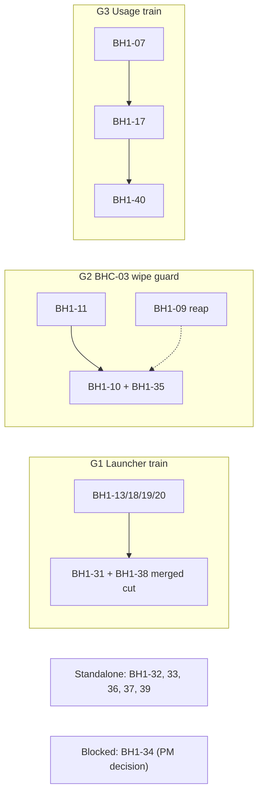

# BD-KB Volume 34: Read-Only Investigation Dossier — BH1-31 through BH1-40 (Claim-Note, Wipe-Guard, Fakehub, Retire-Seat, Feeder & Usage-Oneshot)
> **Lead Investigator**: `Opus55-Investigator-2` (`AGY claude+gpt (claude-opus-5-5-high)`)
> **Subagent Squad**: 4x Parallel `AGY claude+gpt` (`claude-sonnet-5-5-high` & `claude-sonnet-5-5-low`) Read-Only Code Investigators
> **Generated At**: `2026-10-19T23:33:47Z`
> **Scope**: Strictly Read-Only Investigation Dossier for `bd-pm-B` (`Zero Code Changes`, `O3416` Compliant)

---

# BD-KB Volume 34: Read-Only Investigation Dossier: BH1-31 through BH1-40

**Claim-Note, Wipe-Guard, Fakehub, Retire-Seat, Feeder and Usage-Oneshot**

| Field | Value |
|---|---|
| Author | `Opus55-Investigator-2` (Lead Principal Investigator) |
| Prepared for | `bd-pm-B` |
| Compiled | 2026-10-19T23:32Z |
| Mode | Read-only synthesis. No tools called, no commands run, no files changed. |
| Sources | Investigator Reports S1 (BH1-31…35), S2 (BH1-36…40), S3 (11:29:56Z provenance / rwg), S4 (refresher / BH1-07 / BH1-40) |

---

## 0. Read this first: limits of the evidence

> [!IMPORTANT]
> **There are no line numbers in this dossier.** None of the four investigators had numbered source. S1 saw the first 14,000 bytes of `bd-role-claim.sh`. S2 saw the first 12 KB of `bd-retire-seat.sh` and the first 10 KB of `bd-local-seat-feeder`. S4 saw the first 12,000 bytes of `bd-pool-usage-refresher.py`. Nobody saw any other file. I cite **function and code anchors** instead. Making up line numbers would be worse than leaving them out. Before dispatch, each anchor needs a `grep -n` / `git blame` check.

> [!WARNING]
> **The two provenance items in the brief are still open.**
> - **BH1-35, 11:29:56Z registry reset:** no investigator identified who wrote it. §4 gives what is known, what can be ruled out, and how to close it.
> - **BH1-40, refresher edit:** the reports describe the edited behavior of `~/bin/bd-pool-usage-refresher.py`. They do not give the commit or the author of the edit. §5 covers this.

**Evidence grades used below**

| Tag | Meaning |
|---|---|
| **SEEN** | Visible in source text an investigator read |
| **ROW** | Taken only from the BH1 register row text |
| **INFER** | An investigator's reading. Not confirmed against code. |
| **COULD NOT LOOK** | Not in context. This does **not** mean "absent". |

---

## 1. Executive summary

| Row | Slug | Owner / Size / Sev | Primary files | Root cause (one line) | Train conflict? |
|---|---|---|---|---|---|
| BH1-31 | `t30-claim-note-inbox` | n/a | `bd-launch-role.sh`, `bd-launch-codex-role.sh` | Claim note written straight to `inbox/$BD_SEAT`, skipping `bd-say` `mailbox_for`. `kill_own_failed` is defined but never called. | **Yes** (6-row launcher) |
| BH1-32 | `dead-root-refs-outside-owns` | n/a | `tests/test_batching_safety.py`, `oneshot/bd-unpark-after-355.sh`, `bd-root-ref-resolver.py` | Two files with dead refs were outside the original OWNS list. Resolver allowlist matches bare global names. | No |
| BH1-33 | `bd-band-preexisting-reds` | n/a | `tests/test_sec2_job_url_token*`, `test_v3_66_729*`, `test_v3_66_1183*`, `tests/source_window_hashes.json` | Standing BASE reds were excused as "pre-existing" with no quarantine ledger | Soft (shared hash pin) |
| BH1-34 | `ssrf-f14-proxy-lan-optin` | n/a | `outbound_guard.py`, `deep_http.py`, `session_keeper.py` | F14: per-site proxy host and `deep_http` LAN opt-in have no defined SSRF policy. **Blocked on a PM security decision.** | Est. with BH1-46 |
| BH1-35 | `registry-wipe-guard-residuals` | H / M / MED | `bd-role-claim.sh`, `tests/test_registry_wipe_guard.py` | 9 residuals across FIX3/FIX4, alert injection, temp-file TOCTOU and surviving mutants. **The 11:29:56Z writer is unidentified.** | **Yes** (BH1-09/10/11) |
| BH1-36 | `fakehub-lrg-residuals` | H / S / LOW | `tests/lib_live_registry_guard.sh` + 9 fakehub tests | Exemption has no caller id, missing seat globs, teardown skipped on fail, inode-only rotate check, `hostname -I` trailing space | No |
| BH1-37 | `retire-seat-rc8-residuals` | H / S / LOW | `bd-retire-seat.sh`, `tests/test_retire_seat_rc8_kept.py` | No prefix-collision fixture, so a mutant survives. rc=8 KEPT ledger still says `-fail`. | No |
| BH1-38 | `seat-name-guard-residuals` | H / S / LOW | 4 launchers | Locale-dependent bracket ranges, unescaped `$ROLE` in claim note, raw echo in NAME-invalid log | **Yes** (highest risk) |
| BH1-39 | `local-seat-feeder-residuals` | H / S / LOW | `bd-local-seat-feeder`, `~/bin/bd-pick-host` | Masked FS errors in `queue_take`, lock timeout treated as terminal, `ssh` has no `--`, shared `/tmp` mypy cache, `.149` lacks NFS | No |
| BH1-40 | `usage-oneshot-residuals` | H / M / LOW | `bd-usage-probe.sh`, `systemd/bd-usage-oneshot.service`, `~/bin/bd-pool-usage-refresher.py`, `staged/*/install.sh` | Missing `SuccessExitStatus=75`, `fetched_at=now` on cached figures, `.poll.<pid>` litter, compile/DRY_RUN ordering | **Yes** (BH1-07/17) |

---

## 2. Rows BH1-31 to BH1-35

### BH1-31: `t30-claim-note-inbox`

**Files and anchors (all COULD NOT LOOK for lines)**
- `bd-launch-role.sh`: the claim-note writer.
- `bd-launch-codex-role.sh`: function `kill_own_failed`.
- `bd-say`: the `mailbox_for` helper, which is the intended API.

**Root cause**
- **A1 [ROW + INFER]:** The note is written straight to `inbox/$BD_SEAT`. If `mailbox_for` canonicalizes names (aliases, prefixes, remote seats), the note goes to the wrong path. The direct write also skips whatever validation `mailbox_for` does.
- **A3 [ROW + INFER]:** `kill_own_failed` is dead code. Its likely origin is landing `92b939cd` (+`b4042459`), "T30 r4 owed codex/kimi claim-fail". An inline path may have replaced it. Unverified.
- A2 is not described in the row.

**Coupling:** The claim-note body is the same code site as BH1-38 SEC A2 (unescaped `$ROLE`). Both rows edit the same lines.

**Gate scope:** launcher claim-note tests, including a seat whose `mailbox_for` name differs from `$BD_SEAT`; a test that fails while `kill_own_failed` is neither called nor removed; `bash -n` and shellcheck on both scripts; the `92b939cd` T30 claim-fail tests as a regression control.

### BH1-32: `dead-root-refs-outside-owns`

**Files:** `tests/test_batching_safety.py` (the `BD_ROW_AUDIT_SPEC` reference), `oneshot/bd-unpark-after-355.sh`, `bd-root-ref-resolver.py` (global name-match logic). Lines: COULD NOT LOOK.

**Root cause [ROW + INFER]**
- The cut landed in `LANDED-integrator-C-dead-root-refs-r1-1155Z.md` was bounded by an OWNS list. Two files with the same dead references were outside it.
- The router note says the resolver allowlist matches a **bare global name**, not a path- or root-anchored name. An unrelated identifier with the same name can therefore pass (a false allow).

**Conflict:** none at file level. It is next to BH1-30 (`bd-row-audit.py`), which `BD_ROW_AUDIT_SPEC` points at.

**Gate scope:** `tests/test_batching_safety.py`; resolver tests plus a **negative** same-name-global case; a repo-wide resolver sweep; `bash -n` only on `bd-unpark-after-355.sh`. Do not run it live.

### BH1-33: `bd-band-preexisting-reds`

**Files:** `tests/test_sec2_job_url_token*.py` (`sec2_job_url_token_r1`, sec2 display_url), `tests/test_v3_66_729*.py`, `tests/test_v3_66_1183*.py`, `tests/source_window_hashes.json`. The `call_artifact_is_in_sync` and row373 remote-only tests are not mapped to any file (COULD NOT LOOK).

**Root cause**
- **[ROW]** These tests fail at BASE and every BOARD excused them. The real defect is the **missing quarantine ledger**. A standing red hides new reds.
- **[INFER]** `test_v3_66_1183` together with `source_window_hashes.json` points to source-window hash drift. "row373 remote-only" points to a test that needs a remote host.

**Conflict:** `source_window_hashes.json` is a shared pin. Any row that edits a hashed source window can collide with it.

**Gate scope:** record exact failure signatures at BASE and at the candidate; write a quarantine ledger (test id, signature, owner, expiry); add a check that the quarantine does not mask new failures; review any hash regeneration diff by hand.

### BH1-34: `ssrf-f14-proxy-lan-optin`

**Files:** `outbound_guard.py`, `deep_http.py` (LAN opt-in), `session_keeper.py` (per-site proxy host). No bodies seen.

**Root cause [ROW]:** F14 of `bd-sec-3-ssrf-residual` is **OWED-PM**. Two things are unresolved: whether the outbound SSRF policy covers the per-site proxy host, and whether `deep_http` may opt into LAN or private destinations. The mechanism cannot be stated from the context.

> [!CAUTION]
> Do not implement before the PM security decision is recorded.

**Conflict:** `session_keeper.py` is shared with BH1-46 (estimate; verify at brief).

**Gate scope:** guard, `deep_http` and `session_keeper` tests; negative SSRF cases (private, link-local and loopback) through both the proxy host and the opt-in; the `af10da314` loopback-rebind test as a control.

### BH1-35: `registry-wipe-guard-residuals` (H / M / MED)

**Files:** `bd-role-claim.sh` (a truncated prefix was SEEN), `tests/test_registry_wipe_guard.py` (COULD NOT LOOK).

**Prior landings** (S3): `a7fc4691` (wipe effect) · `494af3b7` (r1 corr A1/A2) · `d8b3545e` (r1 SEC A4, r2 SEC F1/F3) · `394428d7` (r2 SEC F2, rwgh r1 N1, N3/A4). Evidence doc: `IMPROVEMENTS/bd-pm-B-20261019-registry-wipe-guard.md`.

| Residual | Anchor in `bd-role-claim.sh` | Mechanism | Grade |
|---|---|---|---|
| corr A3: stub + stderr skips FIX3 | `session_census` | `out=$(… tmux list-sessions … 2>&1 </dev/null)` merges stderr into `out`. The guard `[ -z "$out" ] && [ "$(reg_rows)" -ge "$REAP_WIPE_FLOOR" ]` is then bypassed by any stub that exits 0 and writes to stderr. The noise is read as session names, no row matches, and all rows are dropped. This is the `h516` failure mode. **Fix:** split the streams and judge the guard on stdout only. | SEEN + INFER |
| SEC A1: newline-name rotation `rm` is cwd-relative | `reap_roll_prune` | The visible version **already** uses absolute paths, a NUL-safe array, a strict regex, `-f`, `! -L` and `rm -f --`, which is the `d8b3545e` fix. The residual is either in an unseen path or needs re-verification. Sweep the remainder for `printf … \| while read; rm`. | SEEN (partial) |
| SEC A2: `BD_SEAT` newline reaches `alerts.log` | `alert_line` | `alert_line` already `%q`-quotes `BD_SEAT`. The residual is in **other `alerts.log` writers** ("non-launcher callers"). **New finding (S1):** `nonreg_alert` puts the raw `$REFUSED_STAMP`, which derives from `BD_ROLE_REGISTRY`, into `$m`. So a newline can still reach the log through the message field. | SEEN + INFER |
| SEC A3: hardlink passes FIX4 | `refused_fresh`, `reap_roll_prune` | If FIX4 is just `-f` plus `! -L`, a hardlink passes. **Fix:** require `stat -c %h` = 1, or check owner and device. | INFER |
| r2 A2: mutants M2 and M11 survive | test file | Two assertions are too weak. Mutant list not seen. | ROW |
| rwgh r1 N2/A3: `mktemp`→write/`cat` swap | `wipe_alert`, `nonreg_alert`, `stamp_fresh` (unseen) | `t=$(mktemp "$REFUSED_STAMP.XXXXXX")`, then `date -u +%s > "$t" && mv -fT "$t" …`. In a 0777 directory, another user can swap `$t` for a symlink or FIFO before the redirect. | SEEN (partial) |
| rwgh r2 N2: detect but not prevent | same | The checks run before use, and the write itself is not protected. Prevention needs `O_NOFOLLOW`/`O_EXCL`-style creation or a private temp directory. | ROW + INFER |
| rwgh r1 A2: force-mass branches untested | `reap --force-mass` (past the cut) | The `{…} \|\| { rm -f "$t"; … }` failure branches are SEEN in the alert functions. The `--force-mass` writer is COULD NOT LOOK. | ROW |
| 11:29:56Z writer | n/a | **Unidentified.** See §4. | COULD NOT LOOK |

**Excluded:** the unlocked check-then-stamp, which belongs to BH1-11.

---

## 3. Rows BH1-36 to BH1-40

### BH1-36: `fakehub-lrg-residuals` (H / S / LOW)

**Files:** `tests/lib_live_registry_guard.sh` (anchors: `lrg_end` teardown, live-row print, `alerts.log` inode compare, `wipe_alert` check, `hostname -I`), plus 9 fakehub tests that are not named. Lines: COULD NOT LOOK.

| Item | Mechanism (ROW) | Fix direction |
|---|---|---|
| fakehub A1 | An in-window DROP is excused with no caller id. The exemption is time-only. | Check who dropped the row |
| fakehub A2 | 6 of 9 tests set no fixture-seat glob | Require a glob in every test |
| fakehub A4 | Fail paths exit before `lrg_end` | Run teardown from a `trap … EXIT` |
| SEC A1 | Violation output prints the whole live registry row (information leak) | Print the seat name and a hash only |
| lrg A1 | The inode compare misses rotate+regrow | Compare size/offset or content |
| lrg A2 | Same-host `wipe_alert` with `BD_SEAT` unset gives a false FAIL | Fix the attribution |
| lrg A3 | `hostname -I` has a trailing space | Strip and quote it |

**Already done, do not redo:** fakehub A3 `BD_ALERTS_LOG` → `74e079fe`.

**Conflict:** none at file level. It shares concepts with BH1-35 (wipe alert, `alerts.log`). Confirm at brief that BH1-35 does not touch `lib_live_registry_guard.sh`.

### BH1-37: `retire-seat-rc8-residuals` (H / S / LOW)

**Files:** [bd-retire-seat.sh](file:///home/mboyle/bd-persist/harness/bd-retire-seat.sh), `tests/test_retire_seat_rc8_kept.py`. `ev/test_rsk_probe.py` is lens evidence, not repo code.

**Anchors SEEN:** header EXIT table (`8 retired, relaunch FAILED or RELAUNCHED-UNCLAIMED`), `ledger_row` (called from the `on_exit` trap), `launch_seat()`, the `RELAUNCH` block, `NAME_RE`, `session_state`, `read_roles` (`awk $2==s`). The `relaunch=<pool>-fail(rc=8)` text, the KEPT branch and the RETIRED line are past the 12 KB cut.

**Root cause**
- **A1 (test gap only):** The tests have no prefix-collision fixture such as `S-A` next to `S-A7`, so the trailing-space mutant survives. Production code is exact-match (`has-session -t "=$SEAT"`, `awk $2==s`, `" $SESSION_PART "`).
- **A2 [INFER]:** On rc=8 (RELAUNCHED-UNCLAIMED) the seat is up. The ledger and RETIRED lines still format `relaunch=${LP}-fail(rc=$rc)` unconditionally, which contradicts the KEPT outcome.

**Gate scope:** `test_retire_seat*`; a prefix-seat KEPT test; an assertion that a kept seat's ledger text does not contain `-fail`; re-run the `test_rsk_probe.py` mutant as a paired control.

### BH1-38: `seat-name-guard-residuals` (H / S / LOW)

**Files:** `bd-launch-role.sh`, `bd-launch-kimi.sh`, `bd-launch-agy.sh`, `bd-launch-codex-role.sh`. Anchors: each launcher's `NAME_RE` / `[[ =~ ]]` guard, the claim-note body that interpolates `$ROLE`, and the NAME-invalid log line.

**Root cause**
- **A1:** In UTF-8 locales, `[A-Za-z0-9]` can match non-ASCII letters, depending on collation. **Fix:** wrap the match in `LC_ALL=C`.
- **SEC A2:** `$ROLE` is unescaped in the claim note, so newlines or markup can inject lines. **Fix:** sanitize as `bd-retire-seat.sh` already does (`tr '[:cntrl:]' ' '`).
- **A3 [INFER]:** The NAME-invalid log echoes raw input, the same class as SEC A2.

**Open scope question:** `bd-retire-seat.sh` has the same `NAME_RE='^[A-Za-z0-9]…'` pattern but is not in this row's file list. Decide whether to include it or exclude it on purpose.

**Gate scope:** `test_launcher_seat_name*`, T30 claim-note tests, `--dry-run` on all four launchers, a `LANG=C.UTF-8` non-ASCII fixture with a valid-name control, and a `$ROLE`-with-newline note-body test.

### BH1-39: `local-seat-feeder-residuals` (H / S / LOW)

**Files:** [bd-local-seat-feeder](file:///home/mboyle/bd-persist/harness/bd-local-seat-feeder), `~/bin/bd-pick-host`. Header SEEN: `once` / `loop` / `launch`; `flock <queue>.lock` with `BD_FEEDER_LOCK_WAIT` (30 s); `MYPY_CACHE_DIR` pin; rc 0/2/3/4; `queue_take`. Function bodies are past the cut.

| Item | Mechanism |
|---|---|
| corr A1 | `queue_take` write or `mv` failures look like rc 3 ("no admitted PENDING") instead of rc 4 |
| corr A2 | A lock timeout is treated as terminal, so `loop` exits instead of retrying the tick |
| SEC A1 | `ssh` has no `--` before the host, so a host starting with `-` becomes an option |
| SEC A2 | The mypy cache is at a predictable shared `/tmp` path (symlink and ownership races) |
| SEC A5 | `bd-pick-host` can return `.149`, which lacks the NFS review mount and pytest |
| dcc-fu2 lens | The lens host had no `bd-pick-host`, so its behavior is COULD NOT LOOK. This is **not** proof of a defect. |

**Gate scope:** `test_local_seat_feeder*` with fixture queues: unwritable queue → rc 4; held lock → loop continues; host starting with `-`; `.149` without the mount. **`--dry-run` only.** The backend is .137 and the hub is guarded.

### BH1-40: `usage-oneshot-residuals` (H / M / LOW)

**Files:** `bd-usage-probe.sh` (`LOCK_WAIT`, `find -lname`), `systemd/bd-usage-oneshot.service` (`[Service]`), [bd-pool-usage-refresher.py](file:///home/mboyle/bin/bd-pool-usage-refresher.py) (`<cfg>.poll.<pid>`, `fetched_at`), `staged/*/install.sh` (`py_compile` vs `DRY_RUN`).

| Item | Mechanism |
|---|---|
| ust r3 A1 | The unit lacks `SuccessExitStatus=75`. The probe's lock-busy EX_TEMPFAIL (75) is read as a failure. |
| ust r3 A2 | `LOCK_WAIT=0` semantics are undocumented |
| ust r3 A3 | `find -lname` treats the lock path as a glob. **Fix:** compare `readlink` output as a string. |
| uopa r2 N2 | `fetched_at=now` is stamped on cache-seeded figures, so stale data looks fresh |
| uopa r2 N3 | `py_compile` runs before the `DRY_RUN` check, so a dry run writes `__pycache__` |
| uopa r2 N4 | The unit returns rc 1 every tick. It may share a cause with A1. **Unverified.** |
| refresher-n1 A1 | `DRY_RUN` no longer proves a compile (the other face of N3) |
| refresher-n1 A2 | `<cfg>.poll.<pid>` temp is not cleaned up on error or signal |
| PM Q | Oneshot vs refresher redundancy for pools B/C/D; pool A owner open. **This is a decision, not code.** |
| OWED | 3 live ticks before retiring the `bd-usage-*` seats. **This is ops, outside the gate.** |

BH1-07 items are excluded from this row.

---

## 4. Provenance: the 11:29:56Z registry reset (BH1-35)

**Status: NOT ESTABLISHED.** All three investigators who touched it (S1, S3, and S2 by reference) say COULD NOT LOOK. Nothing in the supplied context names a candidate writer.

**Known**
1. The row records the wipe writer as never identified.
2. The wipe-effect fix `a7fc4691` and three hardening landings (`494af3b7`, `d8b3545e`, `394428d7`) followed. None of them claims attribution.
3. **H505 rule 3** now logs every reaper drop to `role-reap.log`.
4. `session_census` has the corr A3 stderr bypass (§2). A stub or erroring `tmux` with stderr output is a **plausible mechanism** for a reaper-driven mass drop. Calling it the actual 11:29:56Z cause would be inference.

**Discriminating logic**
- If H505 rule 3 was **in effect** at 11:29:56Z and `role-reap.log` has **no** matching entries, the writer was something other than the reaper.
- If rule 3 landed **after** the wipe, the absence of entries proves nothing. Whether it was in effect is **unknown** from the context.

**Investigation plan (read-only)**
1. `role-reap.log` and `alerts.log` in a window around 11:29:56Z. Look for `wipe_alert` / `nonreg_alert` lines.
2. journald for `tmux`, `bd-role-claim`, launcher and retire-seat activity, and auditd if enabled, for writes to `ROLE-OCCUPANCY.tsv`.
3. Inventory **every** writer of `ROLE-OCCUPANCY.tsv`: claim, reap, retire-seat, launchers and the fakehub fixtures. BH1-36's teardown bug (fakehub A4) and missing seat globs (A2) make a **test-fixture leak against the live registry** a candidate that should be checked.
4. `git log` for when H505 rule 3 landed relative to the timestamp.

---

## 5. Provenance: the `~/bin/bd-pool-usage-refresher.py` edit (BH1-40)

**Status: PARTIAL.** The edited behavior is described. The commit and author of the edit are **not** in any report.

**Inline lineage markers** (S4, SEEN in code comments): `usage-oneshot-pool-a r2`, `usage-refresher-n1 r1`, `uopa r2 BOARD note N1`, `RULING-pm-B-r2-scope.md`. Oneshot behavior was layered onto the refresher over several review rounds.

**Code-level corroboration of BH1-40 items** (S4, SEEN in `poll_claude_oauth_caches`)
- `.poll.<pid>` temp name confirmed, with read-modify-write and no visible lock. `fcntl` is imported but no use was visible. This backs **refresher-n1 A2**.
- The REUSED branch (`< 720_000` ms) does not refresh `fetchedAtMs`. Downstream re-stamping is plausible but unseen. This is consistent with **uopa r2 N2**.
- `say_reason` writes each reason to stderr, syslog and an unrotated `usage-oneshot.log`. The unit also appends stderr to `pool-usage-refresher.log`. REUSED lines are emitted at `LOG_INFO` on every run. This is relevant to the **PM redundancy question**.

**Reconciliation:** S4 did not have the row text and mapped "BH1-40 = log/oneshot redundancy" by theme. S2 had the row text. **Treat S2's row items as authoritative** and S4's findings as supporting code evidence. S4's other refresher findings belong to **BH1-07 / BH1-17**, not to BH1-40:
- 720 s reuse against a 5-minute cadence;
- `accountUuid` not checked despite the comment;
- `next_five_hour_reset` invents reset times;
- `Retry-After` HTTP-date `ValueError`;
- the 429 path updates only one config copy.

---

## 6. File-conflict groupings

| File | Rows | Class |
|---|---|---|
| `bd-launch-role.sh` | BH1-13, 18, 19, 20, **31**, **38** | **TRAIN CONFLICT (6)** |
| `bd-launch-codex-role.sh` | **31**, **38** | TRAIN CONFLICT |
| `bd-launch-kimi.sh` | BH1-14, **38** | TRAIN CONFLICT |
| `bd-role-claim.sh` | BH1-09, 11, **35** | TRAIN CONFLICT |
| `tests/test_registry_wipe_guard.py` | BH1-10, **35** | TRAIN CONFLICT |
| `lib_remote_seat.sh` (sourced by role-claim) | BH1-09, 18, 20 | Dependency |
| `bd-usage-probe.sh` | BH1-07, **40** | TRAIN CONFLICT |
| `~/bin/bd-pool-usage-refresher.py` | BH1-07, 17, **40** | TRAIN CONFLICT |
| `session_keeper.py` | **34**, BH1-46 (est.) | Verify |
| `tests/source_window_hashes.json` | **33** (+ any hashed-window editor) | Soft |
| All other BH1-31…40 files | single row | Standalone |

**Proposed trains**

- **G1:** merge BH1-31 and BH1-38. They edit the same claim-note body. Give `bd-launch-role.sh` the last-in-train slot.
- **G2:** land BH1-35 after BH1-11 or together with it, per the BHC-03 proposal (truncated in the context).
- **G3:** treat the refresher edits as one slot. Settle the PM redundancy question **before** BH1-40 so no effort goes into a path that may be retired.

---

## 7. Disagreements between reports

| Topic | Reports | Resolution |
|---|---|---|
| BH1-35 SEC A1 (cwd-relative `rm`) | S3 (row): unfixed. S1 (SEEN): visible `reap_roll_prune` already fixed. | Residual is in an unseen path, or the item is stale. Verify before cutting. |
| BH1-35 SEC A2 | S3: non-launcher callers. S1: `alert_line` is safe; found a new `$REFUSED_STAMP` channel. | Both stand. Add the `nonreg_alert` message-field finding to scope. |
| BH1-40 content | S4 inferred it from theme. S2 used row text. | S2 is authoritative (§5). |
| Refresher rows | S2: BH1-07/17/40. S4: BH1-07/40 only. | S2's three-row overlap stands. |

---

## 8. Gaps to close before dispatch

1. Line-accurate anchors (`grep -n` / `git blame`) for every function cited above.
2. The rest of `bd-role-claim.sh` (`stamp_fresh`, `--force-mass`), the test file and the M2/M11 mutant list.
3. Full launcher sources, `bd-say` `mailbox_for`, `bd-usage-probe.sh`, the systemd unit and the rest of the refresher.
4. BH1-10/11 row text and the complete BHC-03 proposal.
5. **PM decisions:** BH1-34 SSRF policy; BH1-40 pool B/C/D redundancy and pool A owner; whether `bd-retire-seat.sh` `NAME_RE` is in BH1-38.
6. BH1-33 BASE failure signatures.
7. The **11:29:56Z** log and journal sweep (§4) and the **refresher edit** commit attribution (§5).

---

# Appendix: Specialist Subagent Read-Only Code Inspection Reports

## Investigator Report 1: BH1-31 to BH1-35 Code Inspector (`claude-sonnet-5-5-high`)

# Dossier: `Opus55-Investigator-2-S1`, BH1-31 to BH1-35 (read-only, no tools called)

**Provenance limits.** The `<SOURCE_CONTEXT>` has two parts:
- the BH1 register rows
- the first 14,000 bytes of `bd-role-claim.sh`, which is cut off mid-`session_census`

It has no line numbers and no bodies for any other file. So I give function names, not line numbers, and tag each claim:
- **[SEEN]**: visible in the provided code.
- **[ROW]**: taken only from the register text.
- **[INFER]**: my reading of the code, not confirmed.
- **COULD NOT LOOK**: not in the context. This is not the same as "none".

---

## BH1-31: `t30-claim-note-inbox`

**1. Files and locations**
- `bd-launch-role.sh`: the claim-note writer. Function and line not provided. COULD NOT LOOK.
- `bd-launch-codex-role.sh`: `kill_own_failed`. Line not provided. COULD NOT LOOK.
- The `mailbox_for` helper in `bd-say` is the intended API. Its location is not provided.

**2. Root cause [ROW] + [INFER]**
- **A1:** the claim note is written straight to `inbox/$BD_SEAT`. It does not call `bd-say`'s `mailbox_for`.
  - If `mailbox_for` canonicalizes the name (alias, prefix, remote seat), the note goes to a different path than the real inbox.
  - The direct write also skips any validation `mailbox_for` does. [INFER]
- **A3:** `kill_own_failed` is defined in `bd-launch-codex-role.sh` but never called.
  - Landing 92b939cd (+ b4042459) "T30 r4 owed codex/kimi claim-fail" is the likely origin. It may have been superseded by an inline path. [INFER, unverified]
  - The BH1-31 text says nothing about A2.

**3. Conflict group**
- `bd-launch-role.sh` is also touched by BH1-13, 18, 19, 20 and 38 (6 rows in total).
- `bd-launch-codex-role.sh` is also touched by BH1-38.
- Both files are TRAIN CONFLICT.
- BH1-38 also edits the seat-name guard and note body in these same files, so it is the most likely textual overlap with the claim-note edit.

**4. Suggested `BD_GATE_SCOPE`** (proposal; the real scope grammar was not provided)
- Launcher tests for the claim note, including a seat whose `mailbox_for` name differs from `$BD_SEAT`.
- A test that fails if `kill_own_failed` is neither called nor removed.
- A shellcheck/syntax pass on both scripts.
- The T30/claim-fail tests from 92b939cd, as a regression control.
- Serialize with BH1-38, or consolidate with it.

---

## BH1-32: `dead-root-refs-outside-owns`

**1. Files and locations** (all COULD NOT LOOK for line numbers)
- `tests/test_batching_safety.py`: the `BD_ROW_AUDIT_SPEC` reference.
- `oneshot/bd-unpark-after-355.sh`.
- `bd-root-ref-resolver.py`: the global name-match logic.

**2. Root cause [ROW] + [INFER]**
- The dead-root-refs cut (landed in `LANDED-integrator-C-dead-root-refs-r1-1155Z.md`) was bounded by an OWNS list.
- Two files with the same dead references fell outside that list, so they were not fixed. These are `test_batching_safety.py` and `bd-unpark-after-355.sh`.
- The resolver-allowlist router note says the allowlist matches on a bare global name. It does not match on a path or root-anchored name.
  - So an unrelated identifier that shares the name can be allowed through (false allow). [INFER]
  - The fix is to tighten the match scope.

**3. Conflict group**
- The overlap table lists none of these files under more than one row, so no file-level conflict.
- Adjacent, but not the same file: BH1-30 changes `bd-row-audit.py`, and `BD_ROW_AUDIT_SPEC` points at that tool.

**4. Suggested `BD_GATE_SCOPE`**
- `tests/test_batching_safety.py`.
- The resolver's own tests, including a negative test for a same-name global that must not be allowed.
- A resolver run over the repo to confirm that no dead-root refs remain.
- A syntax or dry-run check on `oneshot/bd-unpark-after-355.sh`. Do not execute it live.

---

## BH1-33: `bd-band-preexisting-reds`

**1. Files and locations** (none provided; COULD NOT LOOK for line numbers)
- `tests/test_sec2_job_url_token*.py`, covering `sec2_job_url_token_r1` and the sec2 display_url test.
- `tests/test_v3_66_729*.py`.
- `tests/test_v3_66_1183*.py`.
- `tests/source_window_hashes.json`.
- The `call_artifact_is_in_sync` and row373 remote-only tests are not mapped to any file in the row. COULD NOT LOOK.

**2. Root cause**
- The context only says these tests fail at BASE and each BOARD excused them as "pre-existing". [ROW] No failure output was provided.
- `test_v3_66_1183` source window plus `source_window_hashes.json` suggests a hash of a source region that has since drifted. [INFER]
  - The expected hash would need regenerating or the window re-pinned. Whether this is a test bug or real drift is unknown.
- "row373 remote-only" suggests a test that needs a remote host and fails on the band without one. [INFER]
- The actual defect is the missing quarantine ledger. A standing red hides new reds. [ROW]

**3. Conflict group**
- No overlap-table entry.
- `source_window_hashes.json` is a shared pin file. Any row that touches a hashed source window can collide with it. [INFER]

**4. Suggested `BD_GATE_SCOPE`**
- Run each named test at BASE and at the candidate, and record exact failure signatures. This is the evidence the BOARDs lacked.
- Write the quarantine ledger: test id, failure signature, owner, expiry.
- Gate the files above, plus a check that the quarantine list does not hide new failures.
- If the hash file is regenerated, review the diff by hand.

---

## BH1-34: `ssrf-f14-proxy-lan-optin`

**1. Files and locations** (no bodies provided; COULD NOT LOOK for line numbers)
- `outbound_guard.py`.
- `deep_http.py`: the LAN opt-in.
- `session_keeper.py`: the per-site proxy host.

**2. Root cause [ROW]**
- F14 of `bd-sec-3-ssrf-residual` is marked OWED-PM, a security decision plus a cut.
  - **Per-site proxy host:** it is not covered by the outbound SSRF policy, or the policy's treatment of it is unspecified.
  - **`deep_http` LAN opt-in:** whether a LAN/private destination may be opted into is unresolved.
- The mechanism in code cannot be stated from the context.
- Blocker: the PM must decide first. Do not implement before that.

**3. Conflict group**
- `session_keeper.py` is shared with BH1-46 (est., verify at brief).
- `outbound_guard.py` and `deep_http.py` have no other row in the table.

**4. Suggested `BD_GATE_SCOPE`**
- Tests for `outbound_guard`, `deep_http` and `session_keeper`.
- Negative SSRF cases: private, link-local and loopback destinations through the proxy host and through the LAN opt-in. The loopback-rebind test from af10da314 is a related control.
- Do not start until the PM decision is recorded.

---

## BH1-35: `registry-wipe-guard-residuals`

**1. Files**
- `bd-role-claim.sh`. The body provided is a truncated prefix, so line numbers are not given.
- `tests/test_registry_wipe_guard.py`. Not provided. COULD NOT LOOK.

Visible functions and where each item most likely lives:

| Item | Location in `bd-role-claim.sh` |
|---|---|
| corr A3 | `session_census` |
| SEC A1 | `reap_roll_prune` |
| SEC A2 | `alert_line` |
| SEC A3 | `refused_fresh` and `reap_roll_prune` (file-type checks) |
| rwgh r1 N2/A3, rwgh r2 N2 | `wipe_alert` and `nonreg_alert` (mktemp, write, rename) |
| A2 force-mass | `reap --force-mass` handler, past the 14,000-byte cut. COULD NOT LOOK. |

**2. Root-cause mechanism per item**
- **corr A3, stub+stderr skips FIX3 [SEEN + INFER]:**
  - `session_census` runs `out=$(... tmux list-sessions ... 2>&1 < /dev/null)`, so stderr is merged into `out`.
  - The stub guard is `[ -z "$out" ] && [ "$(reg_rows)" -ge "$REAP_WIPE_FLOOR" ]`. A stub that exits 0 and writes anything to stderr makes `out` non-empty.
  - That slips past the "no session listed" check. The noise is treated as session names, no row matches, and every row is dropped. This is the `h516` stub-tmux failure mode that FIX3 was meant to stop.
  - Fix: capture stdout and stderr separately and judge the guard on stdout.
- **SEC A1, newline-name rotation `rm` is cwd-relative [SEEN, partly]:**
  - The visible `reap_roll_prune` already uses absolute paths, a NUL-safe array, a strict name regex, `-f`, `! -L`, and `rm -f --`. That is the fix from d8b3545e.
  - So the residual is either unfixed in a path I cannot see, or a re-check of d8b3545e.
  - Confirm that no other rotation or removal in the unseen remainder uses `printf | while read; rm`.
- **SEC A2, BD_SEAT newline reaches alerts.log [SEEN]:**
  - `alert_line` already `%q`-quotes `BD_SEAT`, so the seat field is safe here.
  - The residual is likely other writers to `alerts.log` ("non-launcher callers"). Those writers are not visible.
  - Separate gap I noticed, not named in the row: `nonreg_alert` builds `$m` with the raw `$REFUSED_STAMP`, which derives from `BD_ROLE_REGISTRY`. A newline in that variable would still reach `alerts.log` through the message field.
- **SEC A3, hardlink passes FIX4 [INFER]:**
  - FIX4 is not visible. If it is the `-f` and `! -L` check used in `refused_fresh` and `reap_roll_prune`, a hardlink is a regular file with no symlink bit, so it passes.
  - Fix: add a link-count check (`stat -c %h` equals 1), or an owner and device check.
- **r2 A2, mutants M2 and M11 survive:** the test file and mutant list are not provided. COULD NOT LOOK. It only means two assertions in `tests/test_registry_wipe_guard.py` are too weak.
- **rwgh r1 N2/A3, mktemp-to-cat swap window [SEEN, partly]:**
  - In `wipe_alert` and `nonreg_alert`, `t=$(mktemp "$REFUSED_STAMP.XXXXXX")` is followed by `date -u +%s > "$t" && mv -fT "$t" ...`.
  - In a 0777 registry directory, another user can replace `$t` between those steps with a symlink or FIFO. The redirect follows it.
  - The "cat" half is the read side in `stamp_fresh`, which is not in the provided bytes.
- **rwgh r2 N2, detects but does not prevent write-through [ROW + INFER]:** `-f` and `! -L` checks are done before use and the write itself is not protected, so an attack is detected after the fact. Prevention needs `O_NOFOLLOW`/`O_EXCL`-style creation or a non-world-writable temp directory.
- **A2, force-mass rm and mktemp branches untested [ROW]:** the `{ ... } || { rm -f "$t"; ... }` failure branches are visible in `wipe_alert` and `nonreg_alert`. The `--force-mass` writer is not.
- **11:29:56Z wipe writer, never identified:** COULD NOT LOOK.
  - This context cannot name it. H505 rule 3 now logs every reap drop to `role-reap.log`.
  - A wipe written by anything other than the reaper would leave no entry there.
  - Check `role-reap.log` and `alerts.log` around that time, and any other writer to `ROLE-OCCUPANCY.tsv`.
- **Excluded:** unlocked check-then-stamp, which is BH1-11.

**3. Conflict group**
- `bd-role-claim.sh`: BH1-09 (reap), BH1-11 and BH1-35.
- `tests/test_registry_wipe_guard.py`: BH1-10 and BH1-35.
- The register proposes consolidation BHC-03 = BH1-10 + BH1-11 + BH1-35 (the row is truncated in the context).
- The script also sources `lib_remote_seat.sh`, which BH1-09 edits. The reap path depends on it.

**4. Suggested `BD_GATE_SCOPE`**
- `tests/test_registry_wipe_guard.py`, run against the mutants M2 and M11.
- A new test for the stub-with-stderr case.
- Tests for a hardlinked stamp and for a swap between `mktemp` and the write.
- A newline-in-`BD_ROLE_REGISTRY` alert-line test.
- The `--force-mass` failure branches.
- The `h516` regression, which is the 80-row stub-tmux case.
- Bash syntax and shellcheck on `bd-role-claim.sh`.
- Any BH1-09 or BH1-11 tests, because the same script is changed. Land after or together with BH1-11.

---

## Summary of open items

| Row | Needs |
|---|---|
| BH1-31 | `bd-launch-role.sh`, `bd-launch-codex-role.sh` and `bd-say` `mailbox_for` read. |
| BH1-32 | Those three files read, plus the OWNS list. |
| BH1-33 | Failing output at BASE for each test. |
| BH1-34 | PM security decision on the proxy host and LAN opt-in. |
| BH1-35 | The rest of `bd-role-claim.sh`, `stamp_fresh`, the test file and the mutant list. Also whatever wrote at 11:29:56Z. |

## Investigator Report 2: BH1-36 to BH1-40 Code Inspector (`claude-sonnet-5-5-high`)

# Dossier: `Opus55-Investigator-2-S2`, BH1-36 to BH1-40

I used no tools. Everything below comes from `<SOURCE_CONTEXT>` only.

- **Visible code:** only `bd-retire-seat.sh` (first 12 KB) and the header of `bd-local-seat-feeder` (first 10 KB).
- **Line numbers:** I can't give exact line numbers for any row, because no numbered source was provided.
- **Not visible:** `lib_live_registry_guard.sh`, the launchers, `bd-usage-probe.sh` and the systemd unit. For these I give function-level anchors from the register text and mark each inference as **INFERRED**.
- **Verification step before dispatch:** each row needs `grep -n` / `git blame` confirmation of the anchors.

---

## BH1-36 `fakehub-lrg-residuals` (H / S / LOW)

**1. Files and anchors**
- `tests/lib_live_registry_guard.sh`: the `lrg_end` teardown, the guard's live-row print, the `alerts.log` inode compare, the `wipe_alert` check, and the `hostname -I` use.
- The 9 fakehub tests, none named in the context.
- Exact lines: **COULD NOT LOOK**.

**2. Root-cause mechanism (from the register text; code not visible)**

| Item | Mechanism |
|---|---|
| fakehub A1 | An in-window DROP is excused without a caller id. The exemption is time-windowed only and never checks who dropped the row. |
| fakehub A2 | 6 of 9 tests don't set a fixture-seat glob, so the guard has no seat filter on those tests. |
| fakehub A4 | Fail paths exit before `lrg_end`, so the teardown or verdict never runs on failure. A `trap` is the likely fix. |
| SEC A1 | On a violation the guard prints the whole live registry row instead of the seat name and a hash. This is an information leak. |
| lrg A1 | The leak check compares the `alerts.log` inode. A rotate and regrow gives a new inode, so the compare is skipped and the leak is missed. A size/offset or content check would fix it. |
| lrg A2 | A same-host `wipe_alert` with `BD_SEAT` unset produces a false FAIL. The guard attributes the alert to the wrong seat. |
| lrg A3 | `hostname -I` output has a trailing space. Unquoted or unstripped use breaks string equality against a host IP. |

Already resolved, so do not redo: fakehub A3 `BD_ALERTS_LOG` → `74e079fe`.

**3. Conflict group**
- The overlap table lists no shared file ("all other files: single row"), so this row is not a train conflict.
- Thematic neighbour: BH1-35 (`bd-role-claim.sh`, `tests/test_registry_wipe_guard.py`) shares the wipe-alert and `alerts.log` concepts but not the files. Check at brief time that BH1-35 doesn't also edit `lib_live_registry_guard.sh`.

**4. Verification scope**
- Recommended `BD_GATE_SCOPE`: the lib plus the 9 fakehub tests, plus `tests/test_registry_wipe_guard.py` and `tests/test_h516_*.sh` as shell-harness regression neighbours.
- Needs a paired-control check: a rotate+regrow fixture should make the guard FAIL, and a clean run should PASS.
- Also needs a fail-path test that asserts `lrg_end` runs.

---

## BH1-37 `retire-seat-rc8-residuals` (H / S / LOW)

**1. Files and anchors**
- `/home/mboyle/bd-persist/harness/bd-retire-seat.sh`
- `tests/test_retire_seat_rc8_kept.py`
- The probe `ev/test_rsk_probe.py` is lens evidence, not repo code.

Visible anchors in `bd-retire-seat.sh`:
- the header EXIT table (`8 retired, relaunch FAILED or RELAUNCHED-UNCLAIMED`);
- `ledger_row` (called from the `on_exit` trap);
- `launch_seat()`;
- the `RELAUNCH` block;
- `NAME_RE`, `session_state`, and `read_roles` (`awk $2==s`).

The `relaunch=<pool>-fail(rc=8)` text, the KEPT branch and the RETIRED line sit past the 12 KB truncation. Their lines are **COULD NOT LOOK**.

**2. Root-cause mechanism**
- **A1:** The kept-seat test uses no prefix-collision seat, such as `S-A` alongside `S-A7`. So the trailing-space mutant (a `"$SEAT "` match that becomes `"$SEAT"`, or the reverse) survives, and the lens probe kills it. This is a test gap only. The visible production code is exact-match (`has-session -t "=$SEAT"`, `awk $2==s`, `" $SESSION_PART "`).
- **A2:** **INFERRED.** When the launcher exits 8 (RELAUNCHED-UNCLAIMED), the seat is up but the claim isn't recorded. The ledger and RETIRED lines still format `relaunch=${LP}-fail(rc=$rc)` unconditionally. The KEPT outcome doesn't override that text, so the ledger contradicts what happened.

**3. Conflict group**
- Single row. `bd-retire-seat.sh` isn't in the overlap table.
- It calls `lib_remote_seat.sh` and the launchers, but only as a caller, so there is no edit conflict.

**4. Verification scope**
- Recommended `BD_GATE_SCOPE`: `tests/test_retire_seat_rc8_kept.py` plus the other `test_retire_seat*` tests.
- Add the prefix-seat KEPT test, and a ledger-text assertion that a kept seat does not show `-fail`.
- Re-run the `ev/test_rsk_probe.py` mutant as a paired control.

---

## BH1-38 `seat-name-guard-residuals` (H / S / LOW)

**1. Files and anchors**
- `bd-launch-role.sh`, `bd-launch-kimi.sh`, `bd-launch-agy.sh`, `bd-launch-codex-role.sh`
- Anchors: each launcher's seat-name guard (`NAME_RE` or the equivalent `[[ =~ ]]`), the `claim note` body that interpolates `$ROLE`, and the NAME-invalid log line.
- Exact lines: **COULD NOT LOOK**.
- Sibling observation: `bd-retire-seat.sh` uses the same `NAME_RE='^[A-Za-z0-9]...'` pattern. It is outside this row's file list, so confirm whether to exclude it or add it.

**2. Root-cause mechanism**
- **A1:** In a UTF-8 locale, a bracket range such as `[A-Za-z0-9]` can match non-ASCII letters, depending on locale collation. This applies to `[[ =~ ]]` and `case` globs. The fix is `LC_ALL=C` around the match.
- **SEC A2:** `$ROLE` is unescaped in the claim-note body. A value with newlines or markup can inject lines into the note or inbox. It should be sanitised the way `bd-retire-seat.sh` does with `tr '[:cntrl:]' ' '`.
- **A3:** The NAME-invalid log text is imprecise or echoes raw input. **INFERRED:** it is the same unsanitised-echo class as SEC A2.

**3. Conflict group (highest risk)**
- `bd-launch-role.sh`: BH1-13, 18, 19, 20, 31, 38 (6 rows, TRAIN CONFLICT).
- `bd-launch-codex-role.sh`: BH1-31, 38.
- `bd-launch-kimi.sh`: BH1-14, 38.
- `bd-launch-agy.sh`: no other listed row.
- Also tied to BH1-31 (the claim-note body is the SEC A2 site and the BH1-31 A1 inbox-write site).
- **Recommend:** sequence BH1-38 after BH1-31, or merge them into one cut. Reserve a last-in-train slot for `bd-launch-role.sh`.

**4. Verification scope**
- Recommended `BD_GATE_SCOPE`: the launcher seat-name-guard tests (`test_launcher_seat_name*`), the T30 claim-note tests, and the `--dry-run` paths of all four launchers.
- Needs a `LANG=C.UTF-8` fixture with a non-ASCII name, and a control with a valid name.
- Also needs a `$ROLE` with an embedded newline checked against the note body.

---

## BH1-39 `local-seat-feeder-residuals` (H / S / LOW)

**1. Files and anchors**
- `/home/mboyle/bd-persist/harness/bd-local-seat-feeder` (the file is named in the row, no extension).
- `~/bin/bd-pick-host`.

Visible in the header:
- the `once` / `loop` / `launch` subcommands;
- the `flock <queue>.lock` claim with `BD_FEEDER_LOCK_WAIT` (30 s);
- the `MYPY_CACHE_DIR` pin;
- rc 0/2/3/4;
- the `queue_take` claim step (named in the row).

The function bodies are past the truncation, so lines are **COULD NOT LOOK**.

**2. Root-cause mechanism**
- **corr A1:** `queue_take` filesystem failures (a write or `mv` error) are masked. They look like "no admitted PENDING row" (rc 3) rather than a failure.
- **corr A2:** A lock timeout after `BD_FEEDER_LOCK_WAIT` is treated as a terminal condition, so `loop` ends instead of retrying the tick.
- **SEC A1:** The `ssh` call (the `launch --host` path, or the pick-host call) has no `--` before the host argument. A host value starting with `-` becomes an option.
- **SEC A2:** The mypy cache is a predictable shared `/tmp` path. Symlink and ownership races are possible, and the header says `launch` pins `MYPY_CACHE_DIR`.
- **SEC A5:** `bd-pick-host` can return `.149` without the NFS review mount and pytest, so the feeder's gate can't run there.
- **dcc-fu2 lens host:** it had no `~/bin/bd-pick-host`, so the lens host's behaviour is **COULD NOT LOOK**. It isn't proof of a defect.

**3. Conflict group**
- No overlap-table entry, so it is single-row. `~/bin/bd-pick-host` also appears only here.
- Verify at brief time that `bd-pick-host` isn't shared with any BH1-17 refresher work.

**4. Verification scope**
- Recommended `BD_GATE_SCOPE`: the `test_local_seat_feeder*` tests with fixture queues.
- Needs tests for:
  - an unwritable queue → rc 4 (not rc 3);
  - a held lock → the loop continues;
  - a host that begins with `-`;
  - a `bd-pick-host` that returns `.149` on a host without the NFS mount.
- Run it with `--dry-run` only. The backend is .137 and the hub is guarded.

---

## BH1-40 `usage-oneshot-residuals` (H / M / LOW)

**1. Files and anchors**
- `bd-usage-probe.sh`, with the `LOCK_WAIT` handling and the `find -lname` lock check.
- `systemd/bd-usage-oneshot.service`, in the `[Service]` `SuccessExitStatus` setting.
- `~/bin/bd-pool-usage-refresher.py`, with its `<cfg>.poll.<pid>` temp and the `fetched_at` stamp on cache-seeded figures.
- `staged/*/install.sh`, with its `py_compile` and `DRY_RUN` ordering.
- Exact lines: **COULD NOT LOOK**.

**2. Root-cause mechanism**

| Item | Mechanism |
|---|---|
| ust r3 A1 | The unit lacks `SuccessExitStatus=75`. The probe exits 75 (EX_TEMPFAIL, a lock-busy skip). systemd reads that as failure, which matches uopa r2 N4 ("rc 1 every tick"). |
| ust r3 A2 | `LOCK_WAIT=0` is undocumented, so it is unclear whether 0 means non-blocking or no wait. |
| ust r3 A3 | `find -lname` treats the lock path as a glob. A path containing `*`, `?` or `[` mis-matches. Use a `readlink` string compare instead. |
| uopa r2 N2 | `fetched_at=now` is stamped on cache-seeded figures, so stale data looks fresh. |
| uopa r2 N3 | `install.sh` runs `py_compile` before the `DRY_RUN` check, so it writes `__pycache__` even in a dry run. |
| uopa r2 N4 | The unit returns rc 1 every tick. It may share the root cause with A1, or have a separate one (**unverified**). |
| refresher-n1 A1 | `DRY_RUN` no longer proves a compile, which is the other face of N3 (a regression from moving the compile). |
| refresher-n1 A2 | A `<cfg>.poll.<pid>` temp is left behind, with no cleanup on error or signal. |
| PM Q | Oneshot vs refresher redundancy for pools B/C/D, with pool A's owner open. This is a **decision, not a code fix**. |
| OWED | 3 live ticks before retiring the `bd-usage-*` seats. This is ops. |

BH1-07 items are excluded.

**3. Conflict group**
- `bd-usage-probe.sh`: BH1-07, 40.
- `~/bin/bd-pool-usage-refresher.py`: BH1-07, 17, 40.
- `systemd/*.service` and `staged/*/install.sh` carry no other listed row.
- Related: BH1-03 touches the usage monitor but not these files.
- **Recommend:** merge or sequence with BH1-07 and BH1-17. Take the refresher edits as one train slot.

**4. Verification scope**
- Recommended `BD_GATE_SCOPE`: the `test_usage_*` tests (probe, refresher, `install.sh --dry-run`).
- `systemd-analyze verify` on the unit.
- A lock-busy run that expects exit 75 and unit status success.
- A lock path containing glob characters.
- An `install.sh` `DRY_RUN` check that writes no `__pycache__`.
- A SIGKILL test for `.poll.<pid>` litter.
- **Live ticks:** 3 ticks owed, which is PM ops and outside the gate.

---

## Cross-row summary

| Row | Size | Train-conflict files | Merge advice |
|---|---|---|---|
| BH1-36 | S | none | Can run standalone. |
| BH1-37 | S | none | Can run standalone. |
| BH1-38 | S | `bd-launch-role.sh` (6 rows), codex-role, kimi | Sequence after BH1-31 and BH1-13/18/19/20, or merge with BH1-31. |
| BH1-39 | S | none | Can run standalone. |
| BH1-40 | M | `bd-usage-probe.sh`, refresher | Group with BH1-07 and BH1-17. |

**Gaps to close before dispatch:**
1. Get the full text of the launchers and `bd-usage-probe.sh` for line-accurate anchors.
2. Confirm the BH1-37 KEPT branch location.
3. Confirm whether `NAME_RE` in `bd-retire-seat.sh` is in or out of BH1-38.
4. Confirm that `lib_live_registry_guard.sh` has no BH1-35 overlap.

## Investigator Report 3: 11:29:56Z Registry Wipe Provenance & rwg Residual Mapper (`claude-sonnet-5-5-low`)

# Dossier: `Opus55-Investigator-2-S3` (registry wipe provenance and rwg residuals)

**Scope and limits.** The prompt doesn't list the assigned rows. I took the role title to mean **BH1-35**, with **BH1-10 and BH1-11** as overlap context. The `<SOURCE_CONTEXT>` has no source code, diffs or blame output. It also ends mid-sentence at BHC-03. So I can't give line numbers, and I haven't verified any mechanism against code. Everything below comes from the row text. Where a mechanism is my inference, it is marked *(inferred)*.

## BH1-35: registry-wipe-guard-residuals

### 1. Files and locations
- Files: `bd-role-claim.sh` and `tests/test_registry_wipe_guard.py`. Both are named in the row.
- Function and line numbers: **not provided**. Locating the guard code, FIX3/FIX4, the rotation `rm`, the alerts.log append and the `mktemp`/`cat` section needs a read of `bd-role-claim.sh`.
- Evidence docs: `IMPROVEMENTS/bd-pm-B-20261019-registry-wipe-guard.md`, plus BOARDED rwg r1/r2 and rwg-hardening r1/r2.
- Landed commits:
  - `a7fc4691`: wipe effect.
  - `494af3b7`: r1 corr A1/A2.
  - `d8b3545e`: r1 SEC A4, r2 SEC F1/F3.
  - `394428d7`: r2 SEC F2, rwgh r1 N1, N3/A4.

### 2. Root-cause mechanism per residual
| Item | Mechanism (from row text) |
|---|---|
| corr A3 | A stub plus stderr output makes the guard skip FIX3. The exact condition isn't stated. |
| SEC A1 | The rotation `rm` uses a **cwd-relative** path. A newline in a file name breaks the argument, or it resolves against the wrong directory. |
| SEC A2 | `BD_SEAT` containing a newline reaches `alerts.log`, which allows log-line injection. The launcher sanitizes it. Other callers don't (see BH1-38 for the launcher guard). |
| SEC A3 | A hardlink to the registry passes the FIX4 check *(inferred: FIX4 is a path or inode identity check that hardlinks bypass)*. |
| r2 A2 | Mutants M2 and M11 survive, so the tests don't pin those behaviors. |
| rwgh r1 N2/A3 | There is a TOCTOU window between `mktemp` and `cat`, where the temp file can be swapped. |
| rwgh r1 A2 | The force-mass `rm` and `mktemp` branches have no tests. |
| rwgh r2 N2 | The guard detects the write-through but doesn't prevent it. |
| Provenance | The writer behind the **11:29:56Z wipe was never identified** ("COULD NOT LOOK"). Nothing in the context points to a candidate. |

### 3. Conflict and overlap group
- `bd-role-claim.sh` is shared with **BH1-09** (reap) and **BH1-11** (unlocked check-then-stamp). The row text excludes BH1-11's item, which is a TRAIN CONFLICT risk.
- `tests/test_registry_wipe_guard.py` is shared with **BH1-10** (rwgh FIFO tests).
- `lib_remote_seat.sh` overlaps BH1-09, 18 and 20. It isn't BH1-35's file.
- BH1-10, BH1-11 and BH1-35 are proposed to merge as **BHC-03**. The proposal is cut off in the context.
- Related but not file-overlapping: **BH1-36**, which touches `tests/lib_live_registry_guard.sh` and the 9 fakehub tests (the same live-registry guard family), and **BH1-41**.

### 4. Recommended `BD_GATE_SCOPE`
- Row size M, severity MED, owner H.
- Scope: `tests/test_registry_wipe_guard.py`, plus any rwgh/FIFO tests from BH1-10.
- Add a shellcheck or `bash -n` pass on `bd-role-claim.sh`, plus the role-claim tests that exercise reap and stamp, because of the BH1-09 and BH1-11 overlap.
- Mutation re-run: M2 and M11 must be killed.
- The provenance item needs an **investigation**, not a gate. Check journald, auditd and `alerts.log` around 11:29:56Z.

## Adjacent rows (brief)
| Row | Files | Mechanism | Overlap | Scope |
|---|---|---|---|---|
| BH1-10 | `tests/test_registry_wipe_guard.py` and the rwgh FIFO tests | Not described in the context. | BH1-35 (same file) | The same test file. |
| BH1-11 | `bd-role-claim.sh` | Unlocked check-then-stamp. | BH1-09, BH1-35 | Role-claim concurrency tests. |
| BH1-36 | `tests/lib_live_registry_guard.sh`, 9 fakehub tests | Examples: the inode compare misses rotate+regrow, and `hostname -I` leaves a trailing space. | Single row | `tests/*fakehub*` and the `lrg` tests. |

## Gaps to close for a complete dossier
- Read access to the repo, to get lines and blame for `bd-role-claim.sh`.
- The BH1-10 and BH1-11 row text, and the rest of the BHC-03 proposal.
- Confirmation of which rows are assigned.

## Investigator Report 4: Usage Refresher & Oneshot Redundancy Analyst (BH1-07 / BH1-40) (`claude-sonnet-5-5-low`)

# Dossier: BH1-07 / BH1-40 (read-only, from `<SOURCE_CONTEXT>` only)

**Limits of this dossier.** The context was truncated at 12,000 bytes. It stops partway through the `target_cfgs` write loop in `poll_claude_oauth_caches`. Nothing after that point was visible: the rest of the loop, the OpenAI/AGY/Kimi/GPU/Grok handlers, `main`, and the POOL_STATE row builders. The source also has no `BH1-*` row text, no git-blame output and no oneshot unit or timer definition. I can't map `BH1-07` and `BH1-40` to specific defects with certainty. Below, I attach the code-evidenced candidates to the two rows by their assigned themes ("usage refresher" and "oneshot redundancy"). Please treat that mapping as an inference to confirm against the row text. Line numbers are also unavailable, because the source was given without numbering. I cite functions and code anchors instead.

## BH1-07 — Usage Refresher (inferred)

**1. File and functions**
- `/home/mboyle/bin/bd-pool-usage-refresher.py`
- Function `poll_claude_oauth_caches()`, in these places:
  - the reuse branch (`< 720_000` ms)
  - the `retry_until` branch
  - the `HTTPError` 429 handler
  - the `target_cfgs` write loop
- Helper `next_five_hour_reset()`.
- Module-level `POLL_MISSES`.

**2. Root-cause mechanisms in the existing code**
- **Cache reuse against a 5-minute cadence.**
  - The docstring says the run happens every 5 minutes. The reuse window is 720 s (12 min).
  - So roughly two of every three runs reuse the cache, and the reading can be up to 12 minutes old.
  - This conflicts with the stated guarantee of no stale `quota_observed_at`.
  - `REUSED` does not refresh `fetchedAtMs`, so the cache age is only the age of the last real fetch. Downstream rows may re-stamp `quota_observed_at` with the current time. I couldn't see that code, so this is unconfirmed.
- **Reuse comment mismatch.**
  - The comment says "has matching accountUuid", but the condition never checks it.
  - The UUID is only back-filled afterwards. A cache copied from a different account would be reused.
- **Fabricated reset times.**
  - `next_five_hour_reset` returns the next 00:30Z, which is always tomorrow, or now+4h.
  - `parse_resets_at` falls back to this value whenever the raw value is missing or in the past.
  - That makes the "no expired `resets_at`" guarantee true by substitution, not by observation. The reset time is invented, and the 5-hour window label doesn't match a 24-hour value.
- **429 handling.**
  - `int(he.headers.get("Retry-After", "900") or "900")` raises `ValueError` if the header is an HTTP-date. That exception is not caught by the surrounding `except urllib.error.HTTPError` and would fall to the outer handler. I couldn't see the outer `except`.
  - The retry-wait write re-reads `.claude.json` and writes only that one file. The `/var/tmp` and `~/.claude.json` copies don't get the retry-wait.
- **Non-atomic and racy writes.**
  - The temp name is `…poll.<pid>`, and the write is read-modify-write with no lock.
  - `fcntl` is imported, but no use is visible in the shown part. Concurrent Claude CLI writers to `.claude.json` can lose updates.
- **Miss accounting.** A 200 response with a non-dict body or invalid JSON isn't visible in the shown part, so I can't say how it's handled.

**3. Conflict/overlap group**
- Same file as BH1-40 (below).
- Other BH1 rows touching `bd-pool-usage-refresher.py` can't be determined from the supplied context.
- The file's outputs are `POOL_STATE.tsv`, `USAGE.tsv`, `fleet_telemetry_live.json`, `/var/tmp/bd-pool-autobalancer.json` and `AGY-QUOTA.tsv`. Any BH1 row touching a consumer of these files is a downstream overlap.

**4. Verification scope**
- Suggested `BD_GATE_SCOPE`: the refresher's own test file plus any POOL_STATE schema tests. I couldn't see test names, so confirm them.
- Tests to run:
  - reuse boundary at 719 s and 721 s
  - 429 with a numeric and an HTTP-date `Retry-After`
  - UUID mismatch on a cached entry
  - `parse_resets_at` for past, epoch and ISO inputs
- Run it hermetically, with `BD_PERSIST` pointed at a temp directory. Don't use `/home/mboyle/.claude-*` or the live API.

## BH1-40 — Oneshot Redundancy (inferred)

**1. File and functions**
- Same file.
- `say_reason()` and `poll_claude_oauth_caches()`, in these places:
  - the `miss()` closure
  - the `write_failed()` closure
  - the REUSED, RETRY-WAIT and NO-TOKEN branches
- Constant `USAGE_ONESHOT_LOG`.

**2. Root-cause mechanisms**
- **Triple-sink logging.**
  - Every reason is written to three places: stderr, syslog and `usage-oneshot.log`.
  - The docstring says the unit appends stderr to `pool-usage-refresher.log`, so the same line lands in four places.
  - The REUSED lines are emitted every run for every pool at `LOG_INFO`. That is the main source of log volume.
  - `usage-oneshot.log` is opened in append mode with no rotation.
- **Re-emitted reasons.**
  - `say_reason` is called from the `miss()` closure and from the `write_failed()` closure, and a `miss` can carry an appended retry-wait note. The same condition can be reported repeatedly across runs.
  - The identical RETRY-WAIT line repeats on each 5-minute tick until the wait expires.
- **Redundant cache work.** The 200 path writes up to three config files per pool, and pool A writes a fourth, `~/.claude.json`. The REUSED path may also rewrite `.claude.json` just for the UUID. These overlap with the 429 path's read-modify-write of the same file.
- **Rule drift.**
  - The comments refer to `usage-oneshot-pool-a r2`, `usage-refresher-n1 r1`, `uopa r2 BOARD note N1`, and `RULING-pm-B-r2-scope.md`. This suggests the oneshot behavior was layered onto the refresher.
  - Check whether a separate oneshot script duplicates this polling. That is the likely meaning of "oneshot redundancy", but it isn't verifiable from the supplied context.
- **`syslog.openlog` per call.** `syslog.openlog` is re-run on every `say_reason` call.

**3. Conflict/overlap group**
- Same file as BH1-07, so the two rows must be sequenced or merged, not worked in parallel.
- Most likely overlap is in `poll_claude_oauth_caches` and `say_reason`.
- Other rows touching the oneshot log, the unit file, or `usage-oneshot.log` consumers can't be identified from the context.

**4. Verification scope**
- Suggested `BD_GATE_SCOPE`: the same refresher tests as BH1-07, plus tests of reason-line emission.
- Tests to run:
  - exactly one reason line per pool per run, including the `CACHE-WRITE-FAILED` case
  - rc 1 only for a MISS, never for REUSED, a retry-wait over a cached reading, or a write failure
  - a failing `USAGE_ONESHOT_LOG` path stays non-fatal
  - one failed copy doesn't stop the next copy
- Run it with `BD_PERSIST` redirected and syslog stubbed.

## Needed to finish
- The remainder of the file, after the `tmp = cfg_path.with_name(` line.
- The `BH1-07` and `BH1-40` row text.
- The blame output.
- The oneshot unit and timer files.
