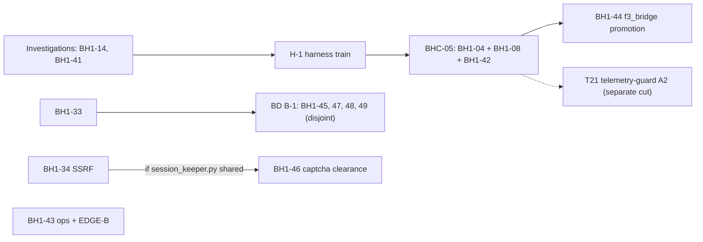

# BD-KB Volume 35: Read-Only Investigation Dossier — BH1-41 through BH1-48 (18:06 .claude.json Provenance, Telemetry Daemon, f3_bridge & BD Security)
> **Lead Investigator**: `Opus55-Investigator-3` (`AGY claude+gpt (claude-opus-5-5-high)`)
> **Subagent Squad**: 4x Parallel `AGY claude+gpt` (`claude-sonnet-5-5-high` & `claude-sonnet-5-5-low`) Read-Only Code Investigators
> **Generated At**: `2026-10-19T23:33:22Z`
> **Scope**: Strictly Read-Only Investigation Dossier for `bd-pm-B` (`Zero Code Changes`, `O3416` Compliant)

---

# BD-KB Volume 35: Read-Only Investigation Dossier — BH1-41 through BH1-48

**Topics:** 18:06 `.claude.json` provenance, telemetry daemon, `f3_bridge`, BD security
**Author:** Lead Principal Investigator `Opus55-Investigator-3`
**Consumer:** `bd-pm-B`
**Mode:** 100% read-only. No tools called, no commands run, nothing checked against live code.
**Compiled:** 2026-10-19T23:31Z

---

## 0. Read this first: what this dossier can and cannot support

This volume combines four specialist reports. The brief asked for exact file/line citations, but **none of the four reports had line numbers, blame data or source for the BulkDownloader files.**

- The register excerpts the investigators received had no line numbers.
- `watch_folder.py`, `cloak.py` and `app_pair.py` were marked `[FILE ABSENT]`.
- The only source for BH1-41 (the O3394 receipts file) was also absent.

This dossier therefore cites locations by **file + symbol** (function, constant or branch) and never by invented line numbers. Wherever a line number would go, the dossier says **"line: not determinable"** so no one mistakes it for a verified citation.

> [!WARNING]
> **The headline topic of this volume, the 18:06 `.claude.json` provenance (BH1-41), has no evidence at all.** Investigator 3, who was assigned to it, declined to produce findings because its only source file was absent. This dossier does **not** contain a root cause for BH1-41. Section 3.1 explains what is known and what has to be re-supplied.

Labels used throughout:
- **[V]** Visible in the register or source excerpts supplied to an investigator.
- **[I]** Inferred by an investigator from register text. Not checked against code.
- **[est.]** The register's own estimate. Confirm at brief time.
- **[GAP]** No evidence available.

---

## 1. Evidence base

| # | Investigator | Model | Assigned scope | Delivered | Main limitation |
|---|---|---|---|---|---|
| 1 | Code & Provenance Inspector (`Opus55-Investigator-3-S1`) | sonnet-5-5-high | BH1-41 to BH1-44 | Full analysis of BH1-44. Partial on BH1-42 and BH1-43. Nothing on BH1-41. | Rows 41 and 42 and the head of 43 were missing. No line numbers. `schema_v1.json`, the daemon and the tests not visible. |
| 2 | BulkDownloader Inspector | sonnet-5-5-high | BH1-45 to BH1-48 | Inferred analysis of all four rows | All BD source absent. No blame. BH1-47 files never named. |
| 3 | O3394 Closure Evidence Mapper | sonnet-5-5-low | BH1-41 (18:06:43Z `.claude.json`) | **Declined** (no evidence) | `O3394-24VM-4PLATFORM-PARITY-AUDIT-AND-FIX-RECEIPTS.md` absent |
| 4 | PM/Ops Leftovers Status Auditor | sonnet-5-5-low | BH1-43 | Covered BH1-44 to BH1-55. **Did not cover BH1-43.** | Source started partway through BH1-43 |

**Coverage:**
- BH1-44 has two independent reports (1 and 4), and they agree. It is the best-evidenced row.
- BH1-45 to BH1-48 also have two reports each (2 and 4). Both are inferred from the same register text, so they are not independent confirmation.
- BH1-41, BH1-42 and BH1-43 are poorly covered. **BH1-41 is uncovered.**

---

## 2. Summary table: rows BH1-41 to BH1-48

| Row | Slug / topic | Class | Size | Sev | Files (symbol anchor) | Root-cause confidence | Conflict group | Train slot |
|---|---|---|---|---|---|---|---|---|
| BH1-41 | 18:06:43Z `.claude.json` / O3394 closure evidence | Investigation | n/a | n/a | **None yet** ("investigation with no file yet") | **[GAP]** | None | Investigation, first, no train |
| BH1-42 | Telemetry daemon / registry residuals (+ T21 telemetry-guard A2) | H | n/a | LOW | `bd-telemetry-daemon.py`; `bd_telemetry/registry.py` (`_collect`, `build`, `max_age_s`) | **Low** (row text missing) | **BHC-05** (with BH1-04, BH1-08) | Harness, BHC-05 |
| BH1-43 | Optimistic-merge return (EDGE-B) + ops leftovers | H (ops) | S | LOW | `bd-optimistic-merge.sh` (EDGE-B path only); the rest is ops | **Low** (row head missing) | Single-row | Ops, no train |
| BH1-44 | `t09-f3-bridge-promotion` | H | S | LOW | `bd_telemetry/f3_bridge.py` (`SENTINELS`, `collect`, `_value`, `_TEXT`, `MAX_AGE_S`); `registry.py` (`Sensor("T09",…)`, `_declared`, `_unknown`, `_collect`, `build`); `schema_v1.json` | **Medium-high** [V] | `registry.py` is shared with BHC-05 | Harness, after H-1, after BHC-05 |
| BH1-45 | `watch-folder-failed-reporting` | BD | S | LOW | `watch_folder.py` (the `bulk_priority` call site and the `.failed` exception path) | Medium [I] | Single-row | BD B-1 |
| BH1-46 | `captcha-clearance-residuals` | BD (security) | S | LOW | `cloak.py` (clearance keying); `session_keeper.py` [est.] (`/dismiss`, pending store); tests (name unknown) | Medium [I] | **BH1-34** via `session_keeper.py` [est.] | BD, sequential with BH1-34 if confirmed |
| BH1-47 | `site-templates-vault-orphan` | BD (secret) | S | LOW | Site-templates module + secret backend [est.] (**files unnamed**) | Medium [I] | Unknown | BD B-1 |
| BH1-48 | `pair-code-blind-mint` | BD (security) | S | LOW | `app_pair.py` (mint and store); `app.py` (`_check_csrf`) | Medium [I] | None listed (`app.py` is a hot-file risk) | BD B-1 |

Line numbers for every file above: **not determinable** from the supplied evidence.

---

## 3. Per-row findings

### 3.1 BH1-41: 18:06:43Z `.claude.json` provenance / O3394 closure evidence

**Status: [GAP]. No findings.**

What is known:
- The consolidation notes say: *"BH1-14 and BH1-41 are investigations with no file yet."* [V, Report 1]
- The suggested train order puts investigations BH1-14 and BH1-41 **first, with no train**. [V, Report 1]
- Investigator 3's title says the row is about mapping closure evidence for **O3394** to a `.claude.json` event at **18:06:43Z**. [V, task assignment]
- The only source given was `/home/mboyle/bd-persist/state/O3394-24VM-4PLATFORM-PARITY-AUDIT-AND-FIX-RECEIPTS.md`, and it was marked `[FILE ABSENT]`. [V, Report 3]

What is **not** known:
- Which process or agent wrote `.claude.json` at 18:06:43Z.
- Which host or VM it happened on. The O3394 title implies a 24-VM, 4-platform parity scope.
- Whether the write is a defect, an expected config sync, or evidence needed to close O3394.
- Any file, function or line implicated.

**Root cause:** not determinable. None of the reports gives a mechanism, and this dossier does not offer one.

**Conflict group:** none. There is no file, so there is no train-conflict risk.

**`BD_GATE_SCOPE`:** none until the investigation names a file.

**To unblock (either option):**
1. Re-supply the O3394 receipts file and the BH1-41 row text to a fresh read-only investigator.
2. Lift the no-tools rule for one investigator so it can pull `row`/`brief` for BH1-41 and the provenance of the 18:06:43Z write (file mtime, the writing process, the fleet log slice around 18:06Z).

---

### 3.2 BH1-42: Telemetry daemon and registry residuals

**Status: partial. Reconstructed from the overlap tables only.** [Report 1]

**Files:**

| File | Also listed under | Anchor |
|---|---|---|
| `bd-telemetry-daemon.py` | BH1-04, BH1-08, BH1-42 | Unknown |
| `bd_telemetry/registry.py` | BH1-08, BH1-42, BH1-44 | `_collect`, `build`, `max_age_s` handling [I] |
| `tests/test_telemetry_registry_live.py` | BHC-05 | n/a |

**Root cause:** the row text is missing. Report 1 names three candidate sites in `registry.py`, labelled [est.], not confirmed:
- **The `_collect` outcome rule.** A section is marked `"unknown"` only when *all* readings are unknown with a reason, so partial degradation is reported as "built".
- **`build()` import and failure handling.** How a sensor module that fails to import gets degraded.
- **`max_age_s` handling.** Per-sensor freshness falls back to a default of 180 s.

**Split:** the BHC-05 text says *"T21 telemetry-guard A2 split out"*. So the BH1-42 residuals include a T21 `bd_telemetry_guard` item, and that item is **not** in BHC-05. BHC-05 keeps to four files. The T21 piece needs its own cut.

**Conflict group:**
- **BHC-05** (owner F1-D, LOW): BH1-04 + BH1-08 (daemon parts) + BH1-42.
- BH1-44 runs **after** BHC-05 on `registry.py` and the daemon.

**`BD_GATE_SCOPE` [est.]:**
- `tests/test_telemetry_registry_live.py` and the daemon tests.
- Add the telemetry-guard test only if T21 A2 is cut separately.

---

### 3.3 BH1-43: Optimistic-merge EDGE-B and ops leftovers

**Status: partial. Tail of the row only.** [Report 1. Report 4 did not cover it.]

**Visible facts [V]:**
- File column: *"bd-optimistic-merge.sh (EDGE-B only); rest ops"*.
- Class H (ops), size S, severity LOW. Listed among "ops with no code".
- Evidence files: `…-bh2-38-r1-0630Z.md`, `LANDED-integrator-D3-D-DR1-0115Z.md`, `…-cockpit-rest-r2-0615Z.md`.
- Sources: BOARDED `om-return-f1 r1` and `lcf r2`.

**Root cause:** the defect text is cut off. `om-return-f1` suggests a residual in the optimistic-merge **return path** [I]. Nobody has located the EDGE-B branch inside `bd-optimistic-merge.sh` yet (line: not determinable).

**Conflict group:** single-row. No other BH1 row lists `bd-optimistic-merge.sh` ("all other files: single row").

**`BD_GATE_SCOPE` [est.]:**
- The optimistic-merge script tests, only if EDGE-B needs a code change.
- Otherwise none, because the rest of the row is an ops step.

---

### 3.4 BH1-44: `t09-f3-bridge-promotion`

**Status: best-evidenced row in this volume.** Source excerpts were visible to Report 1, and Report 4 agrees with it.
**Sources:** BOARDED T09 r1; `LANDED-integrator-C-T09-r1-1535Z.md`. Class H, S, LOW.

#### 3.4.1 Locations

| File | Symbol anchor | Role | Line |
|---|---|---|---|
| `bd_telemetry/f3_bridge.py` | `SENTINELS = ("UNKNOWN","STALE","-")` | Defines which values are treated as sentinels | not determinable |
| `bd_telemetry/f3_bridge.py` | `collect()`, the sentinel branch | Turns a sentinel into `value:"unknown"` | not determinable |
| `bd_telemetry/f3_bridge.py` | `_value()`, the `flags` and `top_io` branches; `_TEXT = [!-~]{1,300}` | What `-` would become without the sentinel branch | not determinable |
| `bd_telemetry/f3_bridge.py` | `MAX_AGE_S = 2*SAMPLE_S` (120 s), `DEFAULT_TSV` | Freshness and source path binding | not determinable |
| `bd_telemetry/registry.py` | `Sensor("T09", "bd_telemetry.f3_bridge", ("f3_bridge",))` | Registration. Uses the default `max_age_s=180` and sits **outside** `sensors/`, unlike T10–T34 | not determinable |
| `bd_telemetry/registry.py` | `_declared()`, `_unknown()`, `_collect()`, `build()` | How the section is built and degraded | not determinable |
| `bd_telemetry/schema_v1.json` | `f3_bridge` section [est.] | Declared metrics; the promotion target | not visible |
| `ASK-PM-T09-edges.md` | n/a | PM ask document. The lens could not find it at the cited path | not visible |

#### 3.4.2 Root cause: four separate threads

**A. The `-` sentinel decision (N1). Needs a PM decision.**
- `collect()` checks `text in SENTINELS` **before** calling `_value()`. So `-` on any field becomes `value:"unknown"`, with reason `F3 wrote '-': not measured` and `measured_at` set to the row's own timestamp.
- For `top_io` and `flags`, F3 probably writes `-` as its normal "nothing to report" value. That is a *measured empty*, and the bridge reports it as *not measured*.
- Without the sentinel branch, `_TEXT` would accept `-` as the literal string `"-"`, or as `["-"]` for `flags`. Neither is a correct empty value.

| Option | Behavior | Upside | Risk |
|---|---|---|---|
| **(a)** Keep as unknown | All three sentinels become unknown everywhere | Fail-closed. No code change | A standing unknown on healthy hosts, the **same masking pattern as BH1-55** (a standing WARN hides real ones) |
| **(b)** Special-case `top_io`/`flags` | `-` becomes `None` / `[]` as a measured value | Accurate | Needs per-field logic and tests |
| **(c)** Narrow sentinel | `UNKNOWN`/`STALE` stay unknown; only `-` on the two text fields is treated as empty | Smallest accurate change | Same test surface as (b) |

Under every option, `pace_*` and the numeric fields **must stay unknown** on `-`.

**B. Interaction with the registry outcome rule.**
- `_collect` sets the section to `"unknown"` only when every reading is unknown with a reason. So `-` on two fields still leaves the section "built".
- `_all_unknown` (stale, torn or foreign header) does count toward "unknown" in `counts`.
- So the (a)/(b)/(c) choice changes per-metric readings, but changes section-level health only in the all-unknown case.

**C. `max_age_s` mismatch [est.].**
- The registry's T09 spec uses the default **180 s**. The sensor's own readings carry `MAX_AGE_S` **120 s**.
- The registry's `_unknown()` fallback readings would carry 180.
- Which value the consumer and `schema_v1.json` enforce has to be checked. The gap is up to 60 s of staleness tolerance.

**D. Promotion and live-store wiring [I].**
- T09 is already registered as an extra. "Promotion" most likely means two things:
  1. Declaring `f3_bridge` in `schema_v1.json`. Today `_declared()` falls back to `("available",)` for undeclared sections, so a failure gives a single placeholder metric instead of per-metric unknowns.
  2. Adding the section to whatever consumes the live store.
- If the wiring needs a change to `bd-telemetry-daemon.py`, BH1-44 also conflicts with BH1-04, BH1-08 and BH1-42.

**E. `ASK-PM-T09-edges.md` path mismatch.**
- This is a documentation and provenance defect, not a code defect.
- The file was moved, misnamed or never committed. Find it or recreate it before dispatch.

#### 3.4.3 Conflict group and gate

- **Train conflict:** `registry.py` is shared with BH1-08 and BH1-42 (BHC-05). BH1-44 is sequenced **after BHC-05**.
- **Single-row files:** `f3_bridge.py`, `schema_v1.json`.
- **Conditional conflict:** `bd-telemetry-daemon.py`, only if the live-store wiring touches it.
- Kept separate from BHC-05 because it is *"a feature row, not a residual"*.

**`BD_GATE_SCOPE` [est.]:**
- The `f3_bridge` unit tests, with new `-` cases for `top_io` and `flags`.
- `tests/test_telemetry_registry_live.py`. Run it **after BHC-05 lands**.
- The `schema_v1.json` contract/conformance test for the `f3_bridge` section.
- A daemon smoke test only if `bd-telemetry-daemon.py` changes.

---

### 3.5 BH1-45: `watch-folder-failed-reporting`

**File:** `/home/mboyle/BulkDownloader/watch_folder.py` (absent from the snapshot).
**Anchor:** the watch-folder handler's call to `bulk_priority`, and the exception path that writes the `.failed` report. Line: not determinable.

**Root cause [I]:**
- The dqb-fix-r3 (DQB3C-A) advisory records that a `bulk_priority` raise in `watch_folder` ends in `.failed` reporting.
- The `.failed` branch was **outside the cut's OWNS list**, so it was noted as advisory and left unchanged.
- Likely mechanism: the exception from `bulk_priority` is caught by the generic failure handler, which emits `.failed` without distinguishing a priority-path error from a real download failure.
- **Unresolved:** the register does not say what is wrong with the outcome. Candidates are a misleading failure reason, a lost item, or no retry. Pin this down at brief time.

**Conflict:** single-row. Disjoint from BH1-47, 48 and 49 within B-1. Rebase against the landed dqb-fix-r3 cut.

**`BD_GATE_SCOPE`:** module-scoped to `watch_folder` plus the DQB3C `bulk_priority` tests. Add a RED test where `bulk_priority` raises and the `.failed` report is asserted.

---

### 3.6 BH1-46: `captcha-clearance-residuals`

**Files:**
- `cloak.py`: clearance keying.
- `session_keeper.py` [est.]: `/dismiss` handler and the pending/clearance store.
- A test file the register does not name.

Lines: not determinable.

**Root cause: three sub-items [I].**

| Sub-item | Mechanism | Impact | Recommended disposition |
|---|---|---|---|
| **sac-f9: dormant key** | `cloak.py` has an `(egress\|UNKNOWN, domain)` keying path with no caller | Latent. Any future caller would key clearances under an `UNKNOWN` egress | Delete it, or document it and pin it with a test |
| **sac-fu1 RESIDUAL: cross-site `/dismiss`** | A bare-URL `/dismiss` from another site evicts site A's pending entry **and** its clearance. The lookup appears keyed on the URL alone, with no binding to the originating site or session | Availability only (captcha-solve loss). The register says this matches BASE, so it predates the cut | Fix by binding to the origin, or accept it in the ledger |
| **Missing guard test** | Nothing asserts that "a failed delete does not purge" | Regression exposure only | Add the test |

**Conflict:**
- `session_keeper.py` is **shared with BH1-34 (SSRF)** [est., verify at brief]. If confirmed, **BH1-34 and BH1-46 run one after the other.**
- BH1-34, 46 and 49 are BD security surfaces under the **one-boundary-per-cut** rule. Do not merge BH1-46 into another row.

**`BD_GATE_SCOPE`:**
- Module-scoped to `cloak.py`, `session_keeper.py` and the clearance tests.
- Paired tests: (a) a failed delete leaves the clearance intact; (b) cross-site bare-URL `/dismiss`, if a fix is chosen.
- Run the BH1-34 SSRF tests as a collision check if the shared file is confirmed.

---

### 3.7 BH1-47: `site-templates-vault-orphan`

**Files:** "site templates module + secret backend (est.)". **Neither file is named in the evidence.**
**Anchors:** the save-ok path (account-N key assignment) and the plaintext/locked backend's store path. Lines: not determinable.

**Root cause: two sub-items from deep-site-templates-med r2 [I].**
1. **RESIDUAL A2: orphaned vault key.**
   - A successful save writes the template under a new `account-N` key, and nothing deletes the previous key.
   - Writing new before deleting old is plausibly deliberate, so a credential is not lost if the write fails. What is missing is the cleanup **after confirmed success**.
2. **PM UX note: silent password drop.**
   - With a plaintext or locked backend, a typed account password is dropped and only a flag is set.
   - There is no error and nothing is persisted, so the user may believe it was saved.
   - The fix is a visible warning or refusal. The register asks for no other behavior change.

**Conflict:** unknown, because the files are unidentified. Check at brief whether BH1-19 (token exposure, on the harness side) shares secret-backend code. It is probably a different repo.

**`BD_GATE_SCOPE`:** site-template and secret-backend tests:
- save-ok deletes the prior key;
- a failed save does **not** delete it;
- the plaintext/locked backend shows the drop to the user.

---

### 3.8 BH1-48: `pair-code-blind-mint`

**Files:**
- `app_pair.py`: pair-code mint and the store of live codes.
- `app.py`: the Fetch-Metadata check in `_check_csrf`.

Lines: not determinable.

**Root cause [I]: aac-fu1 RESIDUAL A3, status DECIDED OPEN.**
- `_check_csrf` uses `Sec-Fetch-*` headers to reject cross-site requests.
- A **top-level GET without Fetch-Metadata** (older browsers, non-browser clients) falls outside the check. The absent-header case is probably allowed.
- A reachable GET can therefore **blind-mint** a pair code, or **evict** a legitimate pending code if the store is bounded.
- The code is 96-bit and cannot be read cross-site, so the impact is **DoS only**.
- The parent fix, aac-f8 Bearer-CSRF (BD `7e0d329d0`, train T282bs-D), has landed. This row is its documented leftover.

**Conflict:** none listed. `app.py` is a likely hot file and the context has no full BD overlap list. Check at brief for other cuts that touch `_check_csrf`.

**`BD_GATE_SCOPE`:** `app_pair.py`, `app.py` and the aac/pair CSRF tests. If a fix is attempted:
- a GET without Fetch-Metadata does not mint;
- a same-origin mint still works.

> [!TIP]
> Because the status is DECIDED OPEN, the cheapest closure is a **ledger entry accepting the residual**. Confirm intent before spending a cut on it.

---

## 4. Where the reports disagree

| Topic | Report A | Report B | Resolution |
|---|---|---|---|
| BH1-48 mechanism | R4: a GET without Fetch-Metadata "skips the CSRF check" (stated as fact) | R2: the absent-header case is "probably" allowed (inferred) | Treat as **[I]**. Neither report saw `_check_csrf` source. |
| BH1-45 mechanism | R4: "caught upstream" | R2: falls into the generic failure handler | The same claim worded differently. Still [I]. |
| BH1-44 gate | R4: telemetry + schema + registry-live tests | R1: the same, plus the after-BHC-05 ordering and a conditional daemon smoke test | Use R1's version, which is a superset. |
| BH1-43 coverage | R1: partial | R4: claimed BH1-43 but did not cover it | BH1-43 is still **partial**. |
| BH1-41 | R1: "no file yet" | R3: declined | Both are consistent: **[GAP]**. |

Report 4 also covered BH1-49 to BH1-55, which are out of scope for this volume. They matter here in three ways:
1. **BH1-49** shares BD train B-1 with BH1-45, 47 and 48, and is a BD security surface alongside BH1-34 and BH1-46.
2. **BH1-55** is the precedent for the masking risk under option (a) in BH1-44.
3. The register's B-1 order is **BH1-33 first, then {45, 47, 48, 49} as a disjoint set**.

---

## 5. File-conflict groupings

| Group | Files | Rows | Rule |
|---|---|---|---|
| **G1: Telemetry chain** | `bd_telemetry/registry.py`, `bd-telemetry-daemon.py`, `tests/test_telemetry_registry_live.py` | BH1-04, BH1-08, BH1-42 (as BHC-05) → BH1-44 | **Sequential.** BHC-05 lands first, then BH1-44 rebases. |
| **G1b: T21 split** | `bd_telemetry_guard` (file not given) | The BH1-42 T21 A2 piece | Separate cut. Not part of BHC-05. |
| **G2: BD session surface** | `session_keeper.py` [est.] | BH1-34, BH1-46 | **Sequential if the shared file is confirmed.** One security boundary per cut. |
| **G3: BD B-1 disjoint set** | `watch_folder.py`; site-templates + secret backend; `app_pair.py`/`app.py`; BH1-49's files | BH1-45, 47, 48, (49) | Can run in parallel after BH1-33. |
| **Single-row** | `bd_telemetry/f3_bridge.py`, `schema_v1.json`, `bd-optimistic-merge.sh`, `cloak.py` | 44, 44, 43, 46 | No conflict. |
| **No file** | n/a | BH1-41 (with BH1-14) | Investigation first, no train. |

---

## 6. `BD_GATE_SCOPE` matrix

The reports did not define the scope vocabulary, so every entry below is a recommendation.

| Row | Repo | Recommended scope | New RED/paired tests |
|---|---|---|---|
| BH1-41 | n/a | None until a file is named | n/a |
| BH1-42 | Harness | `tests/test_telemetry_registry_live.py` + daemon tests | T21 guard test if split |
| BH1-43 | Harness | Optimistic-merge script tests (only if EDGE-B is code) | EDGE-B return-path case |
| BH1-44 | Harness | `f3_bridge` units + registry-live + `schema_v1.json` conformance | `-` on `top_io`/`flags`; numeric `-` stays unknown; 120 vs 180 freshness |
| BH1-45 | BD | `watch_folder` + DQB3C tests | `bulk_priority` raise leads to the asserted `.failed` |
| BH1-46 | BD | `cloak.py`, `session_keeper.py`, clearance tests (+ BH1-34 SSRF as a collision check) | Failed delete does not purge; cross-site `/dismiss` |
| BH1-47 | BD | Site-templates + secret-backend tests | Old key deleted on success only; password drop shown to the user |
| BH1-48 | BD | `app_pair.py`, `app.py`, aac/pair CSRF tests | GET without Fetch-Metadata does not mint; same-origin mint still works |

---

## 7. Decisions needed from `bd-pm-B`

1. **N1 (BH1-44):** choose option (a), (b) or (c) for the `-` sentinel. The dossier leans toward (c) because it avoids the BH1-55 masking pattern with the smallest change.
2. **BH1-48:** accept in the ledger (DECIDED OPEN) or fund a code cut.
3. **BH1-46 sac-fu1:** fix cross-site `/dismiss` or accept it as BASE.
4. **BH1-47 UX:** warn or refuse on a plaintext/locked backend.
5. **BH1-41:** re-supply the evidence, or approve a tool-enabled provenance investigator.

---

## 8. Gaps to close before re-dispatch

| # | Gap | Blocks | Fix |
|---|---|---|---|
| 1 | O3394 receipts file absent; BH1-41 row text missing | BH1-41 entirely | Re-supply, or allow a tool-enabled investigator |
| 2 | BH1-42 row text missing | BH1-42 root cause | Re-supply the row |
| 3 | BH1-43 row head missing | BH1-43 root cause | Re-supply the row |
| 4 | `ASK-PM-T09-edges.md` not at the cited path | BH1-44 brief | Find it or recreate it |
| 5 | Does live-store wiring touch the daemon? | Size of the G1 conflict | Confirm at brief |
| 6 | All BD source absent; no blame | Line citations for BH1-45 to BH1-48 | Re-run with the BD repo checked out |
| 7 | BH1-47 files unnamed | BH1-47 scope and overlap | Identify the files at brief |
| 8 | `session_keeper.py` sharing unconfirmed | G2 sequencing | Verify at brief |
| 9 | `BD_GATE_SCOPE` vocabulary undefined | All gate recommendations | PM to supply the vocabulary |

---

**Bottom line:**
- **BH1-44** is ready for a brief once the N1 decision is made and the `.md` path is found. It runs after BHC-05.
- **BH1-45 to BH1-48** have plausible inferred mechanisms but need code checks at brief time. BH1-48 is probably a ledger-only closure.
- **BH1-42 and BH1-43** need their row text re-supplied.
- **BH1-41, the 18:06 `.claude.json` provenance item this volume is named for, is still uninvestigated**, and this dossier does not invent findings for it.

---

# Appendix: Specialist Subagent Read-Only Code Inspection Reports

## Investigator Report 1: BH1-41 to BH1-44 Code & Provenance Inspector (`claude-sonnet-5-5-high`)

# Dossier: `BH1-41` to `BH1-44` (`Opus55-Investigator-3-S1`)

No tools were called. Everything below comes from `<SOURCE_CONTEXT>`, and the context has gaps:
- The rows for `BH1-41` and `BH1-42`, and the head of `BH1-43`, are missing from the pasted text.
- The file excerpts carry no line numbers, so I cite functions and constants instead of line numbers.
- I can't see `schema_v1.json`, `bd-telemetry-daemon.py`, `bd-optimistic-merge.sh` or any test file.

Anything marked **(est.)** is inferred and should be checked at brief time.

---

## BH1-41: not enough context
- **(1) Files:** none known. The consolidation notes say "BH1-14 and BH1-41 are investigations with no file yet."
- **(2) Root cause:** the row text is not in the context, so I can't document a mechanism.
- **(3) Overlap:** none known. It has no file, so there is no train-conflict risk. The suggested train order puts investigations `BH1-14` and `BH1-41` first, with no train.
- **(4) `BD_GATE_SCOPE`:** none until the investigation names a file. Re-dispatch me with the row text.

---

## BH1-42: partial, from the overlap tables only
- **(1) Files:**
  - `bd-telemetry-daemon.py`, which is in `BH1-04`, `08` and `42`.
  - `bd_telemetry/registry.py`, which is in `BH1-08`, `42` and `44`.
  - `BHC-05` also lists `tests/test_telemetry_registry_live.py`.
  - The `BHC-05` text says "T21 telemetry-guard A2 split out", so the `BH1-42` residuals appear to include a T21 `bd_telemetry_guard` item. That part is not in `BHC-05`, which keeps to four files.
- **(2) Root cause:** the row text is missing. In the visible code, `registry.py` has these candidate spots (est.):
  - The `_collect` outcome rule.
  - `build()` import and failure handling.
  - `max_age_s` handling.
- **(3) Overlap:**
  - It is consolidated into `BHC-05` with `BH1-04` and `BH1-08` (daemon parts only), owner F1-D, severity LOW.
  - `BH1-44` is sequenced after `BHC-05` on `registry.py` and the daemon.
  - The T21 A2 piece goes in a separate cut.
- **(4) `BD_GATE_SCOPE` (est.):** `tests/test_telemetry_registry_live.py` and the daemon tests. Add the telemetry-guard test if the T21 item is cut separately.

---

## BH1-43: partial, tail of the row only
- **(1) Files:**
  - The row's file column reads "bd-optimistic-merge.sh (EDGE-B only); rest ops".
  - The consolidation notes list `BH1-43` among "ops with no code".
  - The visible evidence points to `bd-optimistic-merge.sh` for the EDGE-B part, and nothing for the rest.
  - The row is H (ops), size S, severity LOW.
  - The evidence files visible are `…-bh2-38-r1-0630Z.md`, `LANDED-integrator-D3-D-DR1-0115Z.md` and `…-cockpit-rest-r2-0615Z.md`. The sources are BOARDED `om-return-f1 r1` and `lcf r2`.
- **(2) Root cause:** the defect text is cut off, so I can't state a mechanism. `om-return-f1` implies an optimistic-merge return-path residual (est.). The EDGE-B code path in `bd-optimistic-merge.sh` has to be located.
- **(3) Overlap:** no other `BH1-*` row lists `bd-optimistic-merge.sh`. The overlap table says "all other files: single row". It has no train conflict and no train slot.
- **(4) `BD_GATE_SCOPE` (est.):** the optimistic-merge script tests only, if the EDGE-B change is code. Otherwise no gate, because it is an ops step.

---

## BH1-44: `t09-f3-bridge-promotion` (full row visible)
Row: H, size S, severity LOW. Sources are BOARDED T09 r1 and `LANDED-integrator-C-T09-r1-1535Z.md`.

### (1) Files and locations
| File | Location | Relevance |
|---|---|---|
| `bd_telemetry/f3_bridge.py` | `SENTINELS = ("UNKNOWN","STALE","-")` and the sentinel branch in `collect()` | N1 (the `-` decision) |
| `bd_telemetry/f3_bridge.py` | `_value()` (the `flags` and `top_io` branches), `_TEXT` | What a `-` would become without the sentinel branch |
| `bd_telemetry/f3_bridge.py` | `MAX_AGE_S = 2*SAMPLE_S` (120 s), `DEFAULT_TSV` | Freshness and path binding |
| `bd_telemetry/registry.py` | `Sensor("T09", "bd_telemetry.f3_bridge", ("f3_bridge",))` | The registration. It uses the default `max_age_s=180` and sits outside `sensors/`, unlike T10–T34. |
| `bd_telemetry/registry.py` | `_declared()`, `_unknown()`, `_collect()`, `build()` | How the section is built and degraded |
| `bd_telemetry/schema_v1.json` | not visible | The `f3_bridge` section's declared metrics, plus a live-store or promotion step (est.) |
| `ASK-PM-T09-edges.md` | not visible | The path mismatch: the lens could not find it |

### (2) Root-cause mechanism
1. **The `-` decision (N1).**
   - `collect()` checks `text in SENTINELS` before calling `_value()`. A `-` on any field therefore becomes `value:"unknown"` with reason `F3 wrote '-': not measured`, and `measured_at` is the row's own ts.
   - For `top_io` and `flags`, F3 probably writes `-` as its normal "nothing to report" value. It is a measured empty, and the bridge reports it as unknown.
   - Without the sentinel branch, `_TEXT` (`[!-~]{1,300}`) would accept `-` as the literal string `"-"`, or as `["-"]` for `flags`. So the options are:
     - **(a)** Keep unknown. This is fail-closed, but it can leave a standing unknown on a healthy system. That is the same masking pattern as `BH1-55`.
     - **(b)** Special-case `top_io` and `flags` so `-` becomes `None` or `[]` as a measured value.
     - **(c)** Leave `UNKNOWN` and `STALE` as unknown, and treat only `-` differently on the two text fields.
   - `pace_*` and numeric fields should stay unknown on `-`.
2. **Registry outcome interaction.**
   - `_collect` marks the section `"unknown"` only if all readings are unknown with a reason, so a `-` on two fields leaves the section "built".
   - `_all_unknown` (stale, torn, foreign header) does count as "unknown" in `counts`.
   - So the (a) versus (b) choice changes the sensor's reported health only in the all-unknown case, but it still changes per-metric readings.
3. **`max_age_s` mismatch (est.).**
   - The registry's T09 spec uses the default 180 s, while the sensor's readings carry `MAX_AGE_S` 120 s.
   - The registry's `_unknown()` fallback readings would stamp 180. Check which value the consumer and the schema enforce.
4. **Promotion and live-store wiring.**
   - The code to wire the live store is not in the visible context. The registry already lists T09 as an extra, so "promotion" most likely means:
     - declaring `f3_bridge` in `schema_v1.json`, so failures yield per-metric unknowns instead of the undeclared `available` placeholder (`_declared()` falls back to `("available",)`), and
     - adding it to whatever consumes the live store.
   - A daemon change is possible (est.), which would pull `BH1-04`, `08` and `42` into the conflict.
5. **`ASK-PM-T09-edges.md`.** This is a documentation issue, not code. The file was moved, misnamed or never committed, and has to be found or recreated.

### (3) Conflict / overlap group
- `bd_telemetry/registry.py`: shared with `BH1-08` and `BH1-42`. This is a TRAIN CONFLICT, and `BH1-44` is sequenced after `BHC-05`.
- `bd_telemetry/f3_bridge.py` and `schema_v1.json`: not listed under any other row, so single-row.
- `bd-telemetry-daemon.py`: listed under `BH1-04`, `08` and `42`. It would overlap `BH1-44` only if live-store wiring touches it (est.).
- Kept separate from `BHC-05` as "a feature row, not a residual".
- It rides after `H-1` in the harness train, on the daemon and registry chain `BHC-05` → `BH1-44`.

### (4) Recommended `BD_GATE_SCOPE` (est.)
- The `f3_bridge` unit tests, covering the sentinel decision, plus any new `-` cases for `top_io` and `flags`.
- `tests/test_telemetry_registry_live.py`, shared with `BHC-05`, so it must run after that cut lands.
- The `schema_v1.json` contract and conformance test, covering the `f3_bridge` section and its declared metrics.
- A daemon smoke test only if `bd-telemetry-daemon.py` changes.

### Open items before dispatch
1. Re-supply the missing text for `BH1-41`, `BH1-42` and the head of `BH1-43`.
2. Get the PM decision on N1 (options a, b or c above).
3. Locate `ASK-PM-T09-edges.md`.
4. Confirm whether live-store wiring touches the daemon.

## Investigator Report 2: BH1-45 to BH1-48 BulkDownloader Inspector (`claude-sonnet-5-5-high`)

# Dossier: BH1-45 to BH1-48 (BulkDownloader inspector)

> [!WARNING]
> **Evidence limits.** The `<SOURCE_CONTEXT>` marks `watch_folder.py`, `cloak.py` and `app_pair.py` as `[FILE ABSENT]`. It contains no source, no blame and no line numbers for any BulkDownloader file. Section (1) therefore gives only the files and functions named in the register, with "line numbers: not determinable". The root causes in (2) are my reading of the register text. I haven't checked them against code, so confirm each at brief time. The `BD_GATE_SCOPE` values in (4) are recommendations. The context doesn't define the scope vocabulary.

All four rows are BD (BulkDownloader), size S, severity LOW, and sit in BD train B-1. The register runs BH1-33 first, then BH1-45, 47, 48 and 49 together as a disjoint set.

---

## BH1-45: watch-folder-failed-reporting

**(1) Files and locations**
- `watch_folder.py` is the only file named. The BD repo path in the context is `/home/mboyle/BulkDownloader/watch_folder.py`, which is absent from the snapshot.
- The relevant site is the watch-folder handler that calls `bulk_priority` and the exception path that writes the `.failed` report.
- Line numbers: not determinable.

**(2) Root-cause mechanism (inferred)**
- The dqb-fix-r3 (DQB3C-A) advisory says a `bulk_priority` raise in `watch_folder` ends in `.failed` reporting.
- The `.failed` branch is outside the cut's OWNS list, so the cut didn't change it.
- The likely cause is that an exception from `bulk_priority` falls into the generic failure handler. That handler emits `.failed` output, with no distinction made for a priority-path error.
- The register doesn't say what is wrong with that outcome. Possible defects are a wrong or misleading failure reason, a lost item, or a failure that is not retried. Pin this down at brief time.

**(3) Conflict/overlap group**
- No other BH1 row touches `watch_folder.py`. The overlap table lists it under "all other files: single row".
- It is disjoint from BH1-47, 48 and 49 in B-1.
- It has a historical link to the dqb-fix-r3 cut, which is already landed and boarded. Rebase against that.

**(4) Recommended `BD_GATE_SCOPE`**
- Module-scoped: `watch_folder` plus the DQB3C tests that cover the `bulk_priority` path.
- Add a RED test where `bulk_priority` raises and the `.failed` report is asserted.
- No wider BD gate is needed.

---

## BH1-46: captcha-clearance-residuals

**(1) Files and locations**
- `cloak.py` (absent). The dormant `(egress|UNKNOWN, domain)` key is in the clearance keying code. The register says no caller uses it.
- `session_keeper.py` (BD, est.) probably holds the `/dismiss` handling and the pending-entry and clearance store. This is unverified.
- Tests: the register gives no name. It says only "tests", so the file is unknown.
- Line numbers: not determinable.

**(2) Root-cause mechanism (inferred)**

There are three sub-items.
- **sac-f9, dormant key.**
  - `cloak.py` has a keying path for `(egress|UNKNOWN, domain)` that nothing calls.
  - It is dead code, but it is a latent hazard. Any future caller would key clearances under an `UNKNOWN` egress.
  - Resolution is either to delete it or to document and test it.
- **sac-fu1 RESIDUAL, cross-site `/dismiss`.**
  - A `/dismiss` carrying only a bare URL, sent from another site, evicts site A's pending entry and its clearance.
  - The dismiss lookup appears keyed on the URL alone. It carries no binding to the originating site or session.
  - The register rates this LOW and says it equals BASE, so the behavior predates the cut. The impact is a captcha-solve availability loss, not a confidentiality loss.
- **Missing test.**
  - Nothing pins "a failed delete does not purge" the clearance.
  - The behavior may be correct today but is unguarded against regression.

**(3) Conflict/overlap group**
- `session_keeper.py` is shared with **BH1-34** (SSRF). The register marks this "est.; verify at brief" and says BH1-34 and BH1-46 must be sequential if the overlap is confirmed.
- `cloak.py` has no other BH1 row.
- BH1-34, 46 and 49 are listed together as BD security surfaces, with one boundary per cut. Do not merge BH1-46 into another row.

**(4) Recommended `BD_GATE_SCOPE`**
- Module-scoped to `cloak.py` and `session_keeper.py`, plus the captcha/clearance test file.
- Add paired tests:
  - (a) a failed delete leaves the clearance intact;
  - (b) the behavior of a cross-site bare-URL `/dismiss`, if the fix is chosen over leaving it as BASE.
- Run the BH1-34 SSRF tests as a collision check if `session_keeper.py` turns out to be shared.

---

## BH1-47: site-templates-vault-orphan

**(1) Files and locations**
- The register says only "site templates module + secret backend (est.)". It doesn't name the files, and no source for them is in the context. Both files must be found at brief time.
- The relevant sites are the save-ok path of the site-template save (account-N key assignment) and the plaintext/locked secret backend's store path.
- Line numbers: not determinable.

**(2) Root-cause mechanism (inferred)**

There are two sub-items, both from the deep-site-templates-med r2 cut.
- **RESIDUAL A2, orphaned vault key.**
  - On a successful save, the template is written under a new `account-N` vault key, and nothing deletes the previous `account-N` key.
  - The prior secret stays in the vault with no reference to it.
  - Cleanup after a successful save is missing. The ordering choice (write new, then delete old) is plausibly deliberate, to avoid losing a credential if the write fails.
  - A fix would need an old-key delete after confirmed success.
- **PM UX note, backend password drop.**
  - When the secret backend is plaintext or locked, a typed account password is dropped.
  - The only signal is a flag. There is no error and no persistence, so the user may believe it was saved.
  - The fix is a visible warning or refusal. The register doesn't ask for a behavior change.

**(3) Conflict/overlap group**
- No other BH1 row is listed against these files. The context doesn't name the files, so overlap can't be confirmed.
- It is disjoint from 45, 48 and 49 in the B-1 batch.
- Check whether BH1-19 (token exposure, a secret boundary on the harness side) shares any secret-backend code. It is almost certainly a different repo, but the register is silent.

**(4) Recommended `BD_GATE_SCOPE`**
- Module-scoped to the site-templates module and the secret-backend tests.
- Add tests that:
  - a save-ok deletes the prior vault key;
  - a failed save does not delete it;
  - the plaintext/locked backend signals the dropped password.
- Keep the old-key delete behind a success check so the credential is never lost.

---

## BH1-48: pair-code-blind-mint

**(1) Files and locations**
- `app_pair.py` (absent) holds the pair-code mint and the store of live pair codes.
- `app.py`, function `_check_csrf`, holds the Fetch-Metadata check.
- Line numbers: not determinable.

**(2) Root-cause mechanism (inferred)**
- This is aac-fu1 RESIDUAL A3, status DECIDED OPEN.
- `_check_csrf` evidently uses `Sec-Fetch-*` metadata to reject cross-site requests. A top-level GET without Fetch-Metadata falls outside that check. Older browsers or non-browser clients omit those headers, and the code probably allows the absent-header case.
- A reachable GET can then mint a pair code, or evict one if the store is bounded.
- The register's impact analysis:
  - The code is 96-bit and unreadable cross-site, so an attacker can't read or guess it.
  - The effect is DoS only: blind-minting codes, or evicting a legitimate pending code.
- The aac-f8 Bearer-CSRF fix (BD `7e0d329d0`, in the aac-fu1 train T282bs-D) is already landed. This row is its documented leftover.

**(3) Conflict/overlap group**
- No other BH1 row is listed against `app_pair.py` or `app.py`.
- It is disjoint from 45, 47 and 49 in B-1.
- `app.py` is a likely hot file, and the context gives no full overlap list for BD. Check at brief for other BD cuts touching `_check_csrf`.

**(4) Recommended `BD_GATE_SCOPE`**
- Module-scoped to `app_pair.py` and `app.py`, plus the aac/pair CSRF test file.
- If a fix is attempted, add tests for:
  - a GET without Fetch-Metadata is refused or does not mint;
  - a legitimate same-origin mint still works.
- The register says DECIDED OPEN, so the cheapest closure is a ledger entry accepting the residual instead of a code change. Confirm intent before spending a cut on it.

---

## Cross-row summary

| Row | Files named | Overlap | Confidence |
|---|---|---|---|
| BH1-45 | `watch_folder.py` | none | file named; defect detail unverified |
| BH1-46 | `cloak.py`, `session_keeper.py` (est.), tests | **BH1-34** (est.) | the `session_keeper.py` overlap is unconfirmed |
| BH1-47 | unnamed (site templates + secret backend) | none known | files unidentified |
| BH1-48 | `app_pair.py`, `app.py` (`_check_csrf`) | none listed | `app.py` may be shared outside the table |

**Gaps that block a code-level dossier:**
- All three named BD files are absent from the snapshot.
- There is no blame data.
- The BH1-47 files are unidentified.
- The `BD_GATE_SCOPE` vocabulary isn't defined in the context.

Re-run with the BD repo checked out for exact lines and blame.

## Investigator Report 3: BH1-41 18:06:43Z .claude.json O3394 Closure Evidence Mapper (`claude-sonnet-5-5-low`)

I can't produce the dossier. The `<SOURCE_CONTEXT>` is empty: it only says `[FILE ABSENT: /home/mboyle/bd-persist/state/O3394-24VM-4PLATFORM-PARITY-AUDIT-AND-FIX-RECEIPTS.md]`. It names no `BH1-*` rows, files, functions, line numbers or blame data.

The task is also read-only with no tool calls allowed, so I can't look the rows up myself. Anything I wrote for the four required fields would be invented:

1. File paths and line numbers
2. Root-cause mechanism
3. Conflict and overlap group
4. `BD_GATE_SCOPE`

I can go ahead in either of these ways:

- **Paste the content:** give me the O3394 receipts file, or the text of your assigned `BH1-*` rows and the relevant code. I'll then write the dossier from it.
- **Allow tools:** let me read the repo and git history, for example `mcp_bd_row`, `mcp_bd_brief` and `git blame`, so I can find the rows myself. This would mean lifting the no-tools rule.

Which would you like?

## Investigator Report 4: BH1-43 PM/Ops Leftovers Status Auditor (`claude-sonnet-5-5-low`)

# Read-only dossier: BH1-44 to BH1-55

I used no tools. Everything below comes from the `<SOURCE_CONTEXT>`, and nothing was checked against code. Line numbers are not in the context, so I list functions and areas only. Paths marked "(est.)" are the register's own estimates.

The source context starts partway through BH1-43, so BH1-43 is not covered.

| Row | Files and functions | Root cause | Overlap group | `BD_GATE_SCOPE` |
|---|---|---|---|---|
| **BH1-44** | `bd_telemetry/f3_bridge.py`, `bd_telemetry/registry.py`, `schema_v1.json` | The f3_bridge sensor has not been promoted or wired into the live store. A `-` value on `top_io`/`flags` maps to `unknown`, and nobody has decided whether that is right. The `ASK-PM-T09-edges.md` path in the lens does not match the real location, so the lens could not find it. | `registry.py` is also touched by BH1-08 and BH1-42 (BHC-05). The register has BH1-44 run after BHC-05. | Harness: telemetry tests, a schema validation test and a registry live test. |
| **BH1-45** | `watch_folder.py`, in the path where `bulk_priority` raises | A raise from `bulk_priority` is caught upstream and ends in `.failed` reporting. That code sits outside the dqb-fix-r3 OWNS list, so it was only noted as advisory. | None. It is a single-row file. | BD: watch_folder tests, including a raise-injection case. |
| **BH1-46** | `cloak.py`, `session_keeper.py` (est.), tests | `cloak.py` has a dormant `(egress\|UNKNOWN, domain)` key with no caller. A bare-url `/dismiss` from another site evicts site A's pending entry and its clearance (an availability issue, same as BASE). No test pins "failed delete does not purge". | `session_keeper.py` is shared with BH1-34 (est.). Check this at brief time. If it is shared, run BH1-34 and BH1-46 one after the other. | BD: captcha and clearance tests, plus a new test for failed delete not purging. |
| **BH1-47** | Site templates module and secret backend (est.) | Save-ok leaves the previous `account-N` vault key orphaned. The plaintext/locked secret backend drops a typed account password and only sets a flag. | Unknown, because the files are only estimated. | BD: site-template and secret-backend tests, including account re-save cases. |
| **BH1-48** | `app_pair.py`, `app.py` (`_check_csrf`) | A top-level GET without Fetch-Metadata skips the CSRF check. It can mint or evict pair codes without the user seeing it. The code is 96-bit and cannot be read cross-site, so the impact is DoS only. aac-fu1 DECIDED this OPEN. | `app.py` may be shared with other BD rows, but none are listed. | BD: pairing and CSRF tests, including a GET without Fetch-Metadata. |
| **BH1-49** | `login_impl/_common.py`, `synthetic_input_scheduler.py` | `page.keyboard` leaves a gap of at most one character between the origin check and the keystroke (TOCTOU). The fix is to bind keys to the locator with `press_sequentially`. Separately, the origin guard accepts a same-brand `:port`, a trailing dot, or http. That comes from the row 722 predicate and is by design, but needs confirming. | None. | BD: origin-guard and login-prefill tests, including race and brand-variant cases. Severity is MED. |
| **BH1-50** | `cockpit_frontend` `app/api/bd/[...path]/route.ts` and `app/api/bd/ping/route.ts` | `[...path]` relays BD 3xx statuses to the client, and `arrayBuffer()` is called outside the `try`. `ping` follows redirects without sending a Bearer token. | None. It is disjoint from BHC-08 (backend vs frontend). | Cockpit frontend: route tests with 3xx and error mocks. |
| **BH1-51** | `jarvisos_backend/threat_gate.py`, `jarvisos_backend/test_dcc_f9_hardening.py` | The classifier marks a command DANGEROUS when any later word is `restore` or `checkout`. That blocks `git commit -m "restore ..."`, `git log -S restore` and `git grep checkout .`. The N2 note is about switch `-C` text. The OWED verbs are: stash drop/clear, `checkout --ours/--theirs/-p`, `:/` magic and globs, read-tree index forms, and an A1 timing item (≤50 ms). The over-block asks are CRLF, NBSP, redirections, `commit -m "$VAR"` and braces. U+202F, U+3000 and U+2028 are unpinned. | Same files as BH1-16 (BHC-08), so they must not land in parallel. | Cockpit backend: `test_dcc_f9_hardening.py` plus a false-positive table. |
| **BH1-52** | None (deploy only) | Eight cockpit landings end with "deploy/push = PM step". STEP0 is to compare the deployed build with cockpit main `6899fda`. | None. It comes after BHC-08 and BH1-50 for the deploy. | No gate. Check the deployed build hash against `6899fda`. |
| **BH1-53** | `bd-claim-object.sh`, the A3 claim guard (realpath call) | The pre-existing A3 guard fails open when `realpath` is absent or errors (the base behaves the same). A2: the REFUSED message says "mounted", which is misleading. | BH1-02 on the same file (BHC-02). | Harness: claim-object tests with `realpath` stubbed missing and failing. |
| **BH1-54** | `bd-backlog-append.sh` and the rewriter (not identified) | Something rewrote `IMPROVEMENT_BACKLOG.md` at 02:30 from a stale read and dropped rows appended at 00:2x and 01:2x. The append and rewrite are not synchronised (no lock or merge). | Unknown until the rewriter is found. | Harness: a concurrent append and rewrite test. Find the rewriter first. |
| **BH1-55** | `bd_cost_accounting.py`, `bd_telemetry/sensors/bd_cost_accounting.py` | The sensor reports unknown with "response host has no collection receipt: [None]". The hub has been at STATUS WARN since 20:37Z, and a standing WARN hides real ones. The receipt is never set (None), so the receipt gap needs a fix. The alternative is to accept it and suppress it with a ledger entry. | BH1-24 (BHC-07). | Harness: cost sensor and collector tests, plus a check that the receipt field is populated. |

## Conflict summary
- **Merge as a pair:** BH1-51 with BH1-16 (BHC-08), BH1-53 with BH1-02 (BHC-02), and BH1-55 with BH1-24 (BHC-07).
- **Run after BHC-05:** BH1-44.
- **Confirm shared file:** BH1-46 with BH1-34 (`session_keeper.py`).
- **No conflicts:** BH1-45, 47, 48, 49, 50 (the register puts BH1-45, 47, 48 and 49 together on the BD train).
