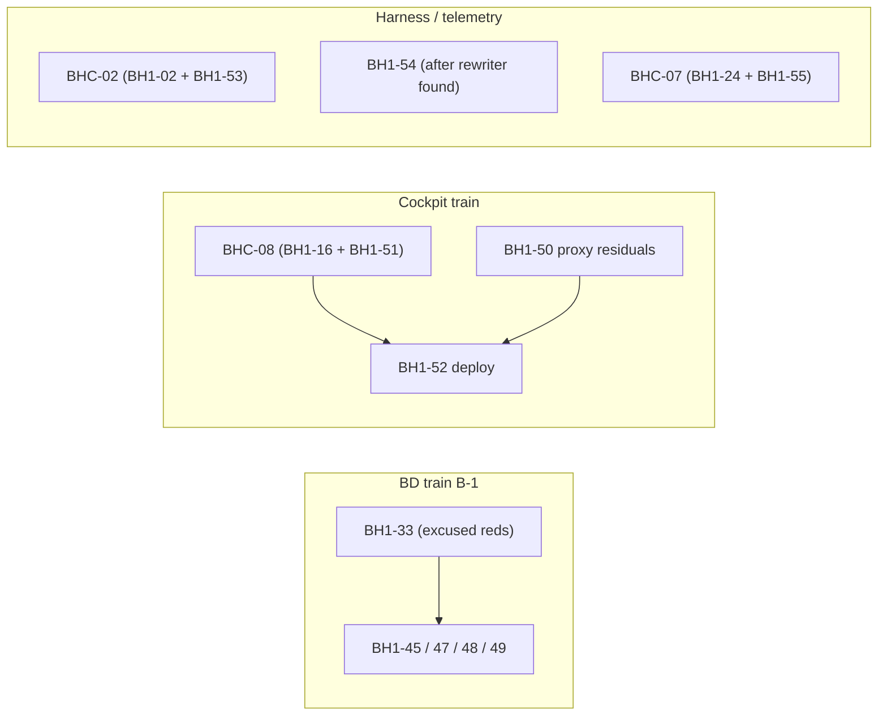

# BD-KB Volume 36: Read-Only Investigation Dossier — BH1-49 through BH1-55 (Origin-Guard, JarvisOS Cockpit Threat Gate, Backlog Lock & Cost Sensor)
> **Lead Investigator**: `Opus55-Investigator-4` (`AGY claude+gpt (claude-opus-5-5-high)`)
> **Subagent Squad**: 4x Parallel `AGY claude+gpt` (`claude-sonnet-5-5-high` & `claude-sonnet-5-5-low`) Read-Only Code Investigators
> **Generated At**: `2026-10-19T23:33:34Z`
> **Scope**: Strictly Read-Only Investigation Dossier for `bd-pm-B` (`Zero Code Changes`, `O3416` Compliant)

---

# BD-KB Volume 36: Read-Only Investigation Dossier, BH1-49 to BH1-55

**Origin-Guard, JarvisOS Cockpit Threat Gate, Backlog Lock and Cost Sensor**

| Field | Value |
|---|---|
| Lead Principal Investigator | `Opus55-Investigator-4` |
| Consumer | `bd-pm-B` |
| Rows covered | BH1-49, BH1-50, BH1-51, BH1-52, BH1-53, BH1-54, BH1-55 |
| Source reports | S1 (BH1-49 to 52), S2 (BH1-53 to 55), S3 (BH1-52 deploy proof), S4 (BH1-54 rewrite provenance) |
| Mode | **100% read-only.** No tools were called and no files were read or changed. |
| Compiled | 2026-10-19T23:31Z |

> [!IMPORTANT]
> **Citation limits.** None of the four reports had line numbers.
> - Three of the source files were `[FILE ABSENT]` in the checkout: `login_impl/_common.py`, `jarvisos_backend/threat_gate.py` and `cockpit_frontend/app/api/bd/[...path]/route.ts`.
> - Two excerpts were cut off: `bd-claim-object.sh` stops at 10,000 bytes, and `bd_cost_accounting.py` stops partway through `collect()`.
>
> So every citation below gives the **path plus function or block**. The line column says **n/d** (not determinable). I did not make up any line numbers. Anything marked **[INFERRED]** is a hypothesis to confirm with a read-only `grep`, `git blame` or `git log -p` before a brief is written.

---

## 1. Executive Summary

These seven rows cover three repos and three lanes:

- **BD app security** (BH1-49): a leftover gap in the login-prefill origin guard, found by security reviews `fu1` and `r3`.
- **JarvisOS cockpit** (BH1-50, BH1-51, BH1-52):
  - BH1-50: the frontend proxy passes BD's redirects straight through and doesn't catch errors.
  - BH1-51: the backend git-verb threat gate matches words wherever they appear, so it both over-blocks and under-blocks.
  - BH1-52: an ops-only deploy that is owed. Eight landings ended with "deploy/push = PM step", and none were deployed.
- **Harness and telemetry** (BH1-53, BH1-54, BH1-55):
  - BH1-53: a claim guard that fails open when `realpath` is missing or errors.
  - BH1-54: a backlog rewriter that drops rows other writers appended concurrently. The rewriter hasn't been identified yet.
  - BH1-55: a cost-sensor WARN that never clears, caused by occurrence rows with a NULL host.

Three rows share files with rows outside this volume and should be merged into combined cuts:

- **BHC-08** = BH1-16 + BH1-51
- **BHC-02** = BH1-02 + BH1-53
- **BHC-07** = BH1-24 + BH1-55

BH1-49, BH1-50 and BH1-54 stand alone. BH1-52 has no file overlap, but it has a strict ordering dependency: it deploys after BHC-08 and BH1-50.

### 1.1 Master summary table

| Row | Slug / theme | Repo | Size | Sev | Primary files | Conflict group | Train / order | Briefable now? |
|---|---|---|---|---|---|---|---|---|
| BH1-49 | login origin-guard residual (row text cut off) | BD | S | MED | `login_impl/_common.py`, `synthetic_input_scheduler.py` | none | BD **B-1** with 45, 47, 48, after BH1-33 | **No.** Recover the full row text and the two VERDICT files first. |
| BH1-50 | cockpit proxy redirect residuals | jarvisos_cockpit | S | LOW | `cockpit_frontend/app/api/bd/[...path]/route.ts`, `.../bd/ping/route.ts` | none | Cockpit train with BHC-08 | Yes |
| BH1-51 | threat-gate fu2 owed items and over-block | jarvisos_cockpit | M | MED | `jarvisos_backend/threat_gate.py`, `jarvisos_backend/test_dcc_f9_hardening.py` | **BHC-08** (with BH1-16) | Cockpit train | Yes, as BHC-08 |
| BH1-52 | cockpit-deploy-owed (ops) | jarvisos_cockpit | S | MED | none (deploy) | none (ordering only) | **After** BHC-08 and BH1-50 | Yes, STEP0 first |
| BH1-53 | `a3-claim-guard-realpath-failopen` | harness | S | n/s | `harness/bd-claim-object.sh` (`take`, A3 guard) | **BHC-02** (with BH1-02) | Harness | Yes, as BHC-02 |
| BH1-54 | `backlog-file-rewrite-drops-rows` | harness | S* | n/s | `harness/bd-backlog-append.sh` and an unknown rewriter | none known (provisional) | Harness **H-1**, standalone | **No.** Find the rewriter first. |
| BH1-55 | `cost-sensor-standing-warn` | harness/telemetry | n/s | n/s | `harness/bd_telemetry/sensors/bd_cost_accounting.py` | **BHC-07** (with BH1-24) | Harness/telemetry | Yes, as BHC-07 |

`n/s` means the size or severity wasn't stated in the source excerpts given to the investigators. `S*` means S only once the rewriter is found. Until then the scope is open-ended (S2).

---

## 2. Citation Index

| # | Path | Function / block | Line | Status |
|---|---|---|---|---|
| C1 | `login_impl/_common.py` (BD) | not given | n/d | `[FILE ABSENT]` |
| C2 | `synthetic_input_scheduler.py` (BD) | not given | n/d | not excerpted |
| C3 | `cockpit_frontend/app/api/bd/[...path]/route.ts` | exported HTTP method handlers; upstream `arrayBuffer()` read | n/d | `[FILE ABSENT]` |
| C4 | `cockpit_frontend/app/api/bd/ping/route.ts` | ping handler (fetch with redirect-follow, no Bearer) | n/d | not excerpted |
| C5 | `jarvisos_backend/threat_gate.py` | git verb classifier (DANGEROUS or safe) | n/d | `[FILE ABSENT]` |
| C6 | `jarvisos_backend/test_dcc_f9_hardening.py` | hardening tests | n/d | not excerpted |
| C7 | `/home/mboyle/bd-persist/harness/bd-claim-object.sh` | `take` path A3 guard, REFUSED "mounted" text, `hubpath()`, `carried_by_train()` | n/d | cut off at 10 KB; A3 is in the missing tail |
| C8 | `/home/mboyle/bd-persist/harness/bd-backlog-append.sh` | `( flock -w 30 9 … printf >> "$HB" ) 9>"$LOCK"` | n/d | excerpted |
| C9 | `/home/mboyle/bd-persist/harness/bd_telemetry/sensors/bd_cost_accounting.py` | `collect()`: `for host, raw in collections:`, `POPULATION_SQL` `min(o.host)`, `unjoinable_responses` filter (`row[9]`), receipt-coverage check | n/d | cut off partway through `collect()`; the coverage check is not shown |

**Evidence artifacts referenced:**

- **BH1-49:**
  - `dispatch-F2-D/cuts/o1698-origin-guard-fu1/.review/VERDICT-security-OGF1S-D-o1698-origin-guard-fu1.md`
  - `o1698-login-prefill-origin-guard/r3/.review/VERDICT-security-OGR3S-C-o1698-origin-guard-r3.md`
- **BH1-50:** BOARDED from dcc-fu1 r1.
- **BH1-51:**
  - `dispatch-H1-A/cuts/dcc-fu2/.review/VERDICT-correctness-DFU2C-A-dcc-f9-fu1.md`
  - `dcc-fu2/r2/LANDED-integrator-C.md`
  - `dcc-fu2/r2/.review/VERDICT-correctness-DFU22C-B-dcc-f9-fu1-r2-lf.md`
  - BOARDED dcc-f9 r7
- **BH1-52:** `LANDED-integrator-C-cockpit-*.md` (O1789/landing).
- **BH1-54:** `IMPROVEMENTS/bd-pm-B-20261019-backlog-closed-markers.md`, which led to fix `2bdb59f5`.
- **BH1-55:** `harness-work/O1789/dispatch-F1-D/NOTE-PM-cost-sensor-WARN.md`.

---

## 3. Per-Row Findings

### 3.1 BH1-49: Login origin-guard residual

**Files:** C1, C2. **Size/Sev:** S / MED.

**What we know.** The register row is cut off. The visible text starts mid-sentence at `…esign; confirm)`. The description is lost; only the file list and the two security VERDICT paths survive. The related "Resolved today" entry is *og r3 SEC A2/A3/A4 (+ corr A1 m2) → BD `7516a2370` (fu1, train T282bu-D `63bb75930`)*. BH1-49 is whatever those security findings left open after that fix.

**Root cause (low confidence, [INFERRED]):**

- The surviving fragment `…esign; confirm)` points to an item that needs a **design** decision followed by confirmation. It is not a simple patch.
- `synthetic_input_scheduler.py` is in the file list next to the origin-guard helper module. That suggests the **origin check isn't applied the same way on the synthetic or scheduled input path** as on the interactive login-prefill path. A scheduled prefill could skip the origin assertion that `_common` enforces for the main flow.
- This is unverified and must not be briefed as a confirmed mechanism.

**Conflict group:**

- No file overlap.
- It is one of three BD security surfaces (with BH1-34 and BH1-46). The rule is "one boundary per cut", so it must not be combined with those even though the files differ.

**Recommended `BD_GATE_SCOPE`:**

- Login origin-guard tests.
- Synthetic-input-scheduler tests.
- Every `login_impl/` module that imports `_common`.
- A security lens.
- **Precondition:** BH1-33 lands first, so its excused band reds don't pollute this gate.

**Blockers:** recover the full row text and read both VERDICT files before briefing.

---

### 3.2 BH1-50: Cockpit proxy redirect residuals

**Files:** C3, C4. **Size/Sev:** S / LOW. **Origin:** BOARDED from dcc-fu1 r1.

**Root cause.** These are three separate defects in the Next.js route handlers that the earlier "dcc-f13-f15 redirect sweep + health 502" fix (cockpit `251d1c7`) didn't fully cover:

| Defect | Location | Mechanism | Impact |
|---|---|---|---|
| D1: 3xx passthrough | C3, catch-all proxy handler | BD's 3xx status and `Location` are forwarded to the browser as-is, instead of being treated as an upstream anomaly. | The browser may be redirected off-origin or to a BD login page. This breaks the proxy boundary. |
| D2: `arrayBuffer()` outside `try` | C3, upstream body read | Reading the body is outside the error-handling block. | A body abort or reset throws an unhandled error, so the client gets a generic 500 instead of the controlled **502** that `251d1c7` introduced. |
| D3: ping follows redirects, no Bearer | C4 | The fetch uses the default `redirect: follow` and sends no `Authorization: Bearer`. | Health reflects wherever the redirect ends up. A 200 from a login page looks healthy (false-green), or the probe hits an unintended target. |

**Conflict group:**

- None at file level.
- It shares the cockpit train with BHC-08. Frontend (C3, C4) and backend (C5, C6) are disjoint, so they can land together.
- BH1-52 must come after.

**Recommended `BD_GATE_SCOPE`:**

- Cockpit frontend route-handler tests for `app/api/bd/**`, covering:
  - upstream 301, 302 and 307 responses (expect 502 or a sanitized response, never a forwarded `Location`);
  - `arrayBuffer()` rejecting (expect 502);
  - ping receiving a redirect (expect unhealthy) and the Bearer header being present.
- Also run `tsc`, lint and `next build`.
- No backend scope.

---

### 3.3 BH1-51: Threat-gate fu2 owed items and over-block

**Files:** C5, C6. **Size/Sev:** M / MED.

**Root cause.** All the findings come from one design flaw: the classifier **scans for tokens anywhere in the command**. It does not first locate the git subcommand and then classify that subcommand's flags and arguments. Several defect families follow from that:

| ID | Class | Detail |
|---|---|---|
| **N1** (MED, *not fixed in r2*) | False positive | `restore`/`checkout` match as *any later word*. So `git commit -m "restore …"`, `git log -S restore` and `git grep checkout .` are all flagged DANGEROUS. |
| **N2** | Text handling | Text handling around `switch -C`. |
| Owed verbs | False negative (missing coverage) | `stash drop`, `stash clear`; `checkout --ours`, `--theirs`, `-p`; `:/` pathspec magic and globs; `read-tree` index forms. |
| **A1** | Performance | Must classify in **≤ 50 ms**. |
| Over-block | False positive | CRLF, NBSP, redirections, `commit -m "$VAR"`, braces. |
| Unicode | Untested | U+202F, U+3000 and U+2028 whitespace have no tests. |

**Fix direction:**

1. Normalize whitespace with a pinned Unicode set.
2. Tokenize with shell-aware quoting.
3. Skip git global options to find the **subcommand**.
4. Classify on (subcommand, flags, pathspec) using an explicit table.
5. Treat arguments to `-m`, `-S`, `grep` patterns and similar as data, never as verbs.

**Conflict group: BHC-08.** BH1-16 touches the same two files, and the overlap table marks it as a TRAIN CONFLICT. Both rows refine the same verb and over-block table, so they **must be one cut with one owner**.

**Recommended `BD_GATE_SCOPE`:**

- `test_dcc_f9_hardening.py` and every test that imports `threat_gate`.
- New tests:
  - one per owed verb;
  - the N1 commands, which must now be **safe**;
  - each over-block case;
  - each pinned Unicode code point;
  - an A1 timing assertion.
- A **paired regression control**: every dangerous variant must stay DANGEROUS.
- Security and correctness lenses.

---

### 3.4 BH1-52: Cockpit deploy owed (ops, no code)

**Files:** none. **Size/Sev:** S / MED. S1 and S3 are combined here.

**Root cause (process gap, not a code defect).** Eight cockpit landings today each ended with "deploy/push = PM step", and nothing shows a deploy happened:

1. cockpit-rest
2. dcc-f4 (`85a8a14`, F8a/F9)
3. cockpit-184 trio
4. routers-mount
5. dccf8a-uiv11
6. dcc-fu1
7. dcc-f9 r7 (`6899fda`, ungated verbs; the **current cockpit main HEAD**)
8. dcc-f9-fu1

The redirect sweep and health 502 (`251d1c7`) are also in the landed but undeployed set. So the live cockpit may lack the threat-gate hardening and the redirect fixes, even though git says they are fixed. That gap between landed and live is the MED severity.

**Ordering decision for PM:**

| Option | Sequence | Cost |
|---|---|---|
| A (recommended) | Land BHC-08 and BH1-50, then deploy once | One deploy. The live gap lasts until the train lands. |
| B | Deploy `6899fda` now, then redeploy after BHC-08 and BH1-50 | Two deploys. Closes today's live gap right away. |

**Verification:**

- **STEP0:** record the deployed build ID and compare it with `6899fda`. If it differs, list which of `85a8a14`, `251d1c7` and `6899fda` are missing.
- **After deploy, smoke-test:**
  - `/api/bd/ping` and the health route (the 502 behaviour);
  - redirect handling;
  - one ungated-verb case in `threat_gate`.
- Record the deployed SHA in a landing or ledger note.

**Still unknown:** the deploy target, the deploy mechanism, where the build marker lives, whether the `LANDED-integrator-C-cockpit-*.md` files record deploy state, and the gate-scope token for ops-only rows.

---

### 3.5 BH1-53: `a3-claim-guard-realpath-failopen`

**File:** C7.

**Root cause, A1: fail-open [INFERRED shape].**

- The header comment says claim objects are compared by `realpath`, then mapped through `hubpath()` into the hub spelling (the `MNT`/`HUBP` prefix canonicaliser from vm-claim-path-canon).
- The register says the A3 guard "fails OPEN if realpath is absent or erroring (base identical)". The likely shape is:
  ```sh
  p=$(realpath … 2>/dev/null)
  case "$p" in <refusal patterns>) refuse ;; esac
  ```
- If `realpath` is missing (rc 127) or errors, `$p` is empty. An empty string matches no refusal pattern, so `take` **proceeds**.
- "Base identical" means the behaviour existed before the hotfix. It was not introduced by it.

**Contrast with the same file.** `carried_by_train()` (the H185 double-assembly guard) already fails closed, following CLAUDE.md A2. When its helper is missing, or it gets an UNKNOWN that isn't "no cut dir", it returns `ERROR`, and `take` then refuses with **rc 6**. A3 should do the same: a failed measurement is a refusal, never a pass. Per the file's A7 note, it needs its **own distinct rc** so it can't be confused with held (3), closed (4) or carried (5).

**A2: wording.** The REFUSED text says "mounted". That is misleading. The `/mnt/bd` spelling is the VM prefix that `hubpath()` rewrites. It says nothing about whether the object is mounted. Fix the text in the same cut.

**Conflict group: BHC-02.** BH1-02 (scope-bound `find` on the same `take` path) edits `bd-claim-object.sh`. This is a TRAIN CONFLICT of 2, so the rows are merged with one owner. BH1-09 and BH1-11 touch `bd-role-claim.sh`, a different file, so they don't conflict.

**Recommended `BD_GATE_SCOPE`:** harness-only (the token string is unverified). Paired RED/GREEN controls per the bd-harness-cut skill:

| Control | Setup | Expected |
|---|---|---|
| RED to GREEN | `realpath` absent (PATH shim) | `take` returns non-zero with a distinct rc and message |
| RED to GREEN | `realpath` exits non-zero | refuse |
| Regression | `realpath` works normally | grant |
| Regression | `/mnt/bd/...` object via `BD_CLAIM_MOUNT_PREFIX` | canonicalises to the hub spelling |
| Regression | existing H185 cases | rc 5 and 6 unchanged; held (3) and closed (4) unchanged |

---

### 3.6 BH1-54: `backlog-file-rewrite-drops-rows`

**Files:** C8 and an **unidentified rewriter**. S2 and S4 are combined here.

**Observation.** Rows appended around 00:2x and 01:2x were gone after a rewrite at **02:30Z**.

**First, resolve which file was affected:**

- S2 notes that `bd-backlog-append.sh` writes `HARNESS_BACKLOG.md` (`BD_HARNESS_BACKLOG`, lock `${HB}.lock`).
- The row says the rows disappeared from `project-knowledge/IMPROVEMENT_BACKLOG.md`.
- So either the script is set up to write both files, or a second append path exists. Confirm which file and which appender produced the lost rows.

**Mechanism (certain part):**

- The appender's `flock -w 30` on fd 9 locks a **separate lock file**, not the data file. It only serialises appenders against each other.
- Any rewriter that reads, transforms and replaces the file without taking `${HB}.lock` loses every append made between its read and its write. Examples: `sed -i`, writing a temp file then `mv`, `cp`, git checkout/reset/merge, or regenerating from a snapshot.
- A rename-based rewrite would defeat even a lock-aware appender that held the old inode open.

**The two investigators disagree on the cause. Here is how their views fit together:**

| View | Source | Argument |
|---|---|---|
| Unlocked read-modify-write race | S2 | Matches the appender's sidecar-lock design. |
| Stale source overwrite | S4 | Rows were lost across about a 2-hour gap. That is far longer than a millisecond race window. It fits a stale checkout or HEAD blob, or a merge or rebase that resolved against the older side. |

**Synthesis:** these are the same failure at different time scales. In both cases the rewriter's *input snapshot* was taken before 00:2x and its *output* landed at 02:30. The window was simply very wide. **Discriminating test:** did the lost rows ever reach git?

- **Committed, then removed:** run `git log -p` on the file around 02:30. A git-level stale overwrite is likely.
- **Never committed:** the working file was clobbered by a script or timer.

**Leads for the rewriter [INFERRED], in priority order:**

1. The **backlog-closed-markers** work (`2bdb59f5`). This row's source note comes from it, and adding closed markers means something edits the backlog in place. Check whether its marker pass rewrites the whole file.
2. A job scheduled for **02:30** (cron, systemd timer or PM sweep).
3. Git operations in the train or integrator flow (`checkout` or `reset --hard`) on the checkout that holds the tracked file.
4. PM `ALL.tsv` re-derivation, or any "register regen" tool.

**Fix design (recommended):**

1. The rewriter takes the **same** lock as the appender.
2. While holding the lock, it re-reads the file and applies a **row-level edit by id**, not a whole-file regeneration.
3. It writes a temp file and does an atomic `mv` while still holding the lock.
4. If it can't get the lock, it refuses with UNKNOWN and writes nothing.

Alternatives: have the rewriter re-append any lines that were in the old file but are missing from the new one, or have appenders write to an append-only spool that a single writer folds in.

**Conflict group:** no listed overlap. It is standalone in H-1. **Risk:** once the rewriter is found, it may turn out to be a shared tool, for example the closed-markers code. In that case the overlap table must be updated. Don't land this while a backlog regeneration or O1042 ledger reconciliation is running.

**STEP0 (read-only):**

1. `grep` the harness, `~/bin` and `~/.local/bin` for the backlog filenames and for `sed -i`, `>`, `mv` and Python `write`.
2. Run `git log -S IMPROVEMENT_BACKLOG`.
3. Run `crontab -l` and list the systemd timers, looking for a 02:30 trigger.
4. **Recover the lost rows** from the reflog, shell history, `.review` files or BOARDED notes.

**Recommended `BD_GATE_SCOPE`:** harness-only.

- `bd-backlog-append.sh` and rewriter tests.
- A concurrency test: N appenders running against the rewriter, and every row must survive.
- A lock-wait test: an appender blocked by the rewriter gets rc 3 only after 30 s.
- A refuse-on-no-lock test.
- A closed-markers output regression test.
- `shellcheck`, if the gate has it.

---

### 3.7 BH1-55: `cost-sensor-standing-warn`

**Files:** C9, plus the collector/writer that fills `usage_collection` and `usage_occurrences.host` (not shown).

**Symptom:** WARN `response host has no collection receipt: [None]`. `[None]` is a Python `None` printed inside a list.

**Mechanism:**

1. `POPULATION_SQL` selects `min(o.host)` over `usage_responses LEFT JOIN usage_occurrences`. If a response's occurrences all have a NULL host, `min()` returns NULL, which becomes `None` in Python.
2. The `unjoinable_responses` filter checks `row[9]`, the occurrence **count**. That count is non-zero, so the response is let through into `rows` with `host=None`.
3. The receipt-coverage check (in the truncated tail of `collect()`, [INFERRED]) compares the row hosts against the receipt hosts from `for host, raw in collections:`. `None` isn't among the receipt hosts, so the check returns unknown and raises a WARN listing `[None]`.

**Why the WARN never clears:**

- The NULL-host occurrences are **persistent ledger state**.
- It isn't a staleness problem either. `MAX_AGE_S=1200` and `measured_at = min(receipt stamps)` handle staleness separately.
- The WARN will stay until one of these happens:
  - the writer stops emitting NULL hosts;
  - the existing NULL-host rows are quarantined or backfilled;
  - the reader explicitly handles that cohort.

**Fix options (the row allows either "fix" or "accept and suppress with a ledger entry"):**

| Option | Approach | Guardrail |
|---|---|---|
| 1. Fix at source | Find the provider that writes occurrences without a host. Check the legacy shapes first: agy `'agy?'` / `headless-wrapper`, and grok `UNKNOWN` / zeroed. Extend the `legacy_thread()` / `legacy_zero_model()` pattern. | Must not regress trl r1/r2 (`d7d5de76`, `cda3b91c`) or agy-ledger-grammar (`f2814bec`, `4c1a9cee`). `git blame` the receipt and legacy-shape code first. |
| 2. Accept and suppress | Add a ledger entry for the **exact** known cohort. | No blanket suppression. The file's rules are "unknown is not permission" and "never run its collector". Keep the check on every other row. |

**Conflict group: BHC-07.** BH1-24 (cost-coverage debt) edits `bd_cost_accounting.py` and shares its fixtures. This is a TRAIN CONFLICT of 2, so the rows are merged.

**Recommended `BD_GATE_SCOPE`:** harness/telemetry. Run the sensor and collector tests on the shared fixtures, with these controls:

- **RED:** a NULL-host fixture reproduces `[None]`.
- **GREEN:** the receipt is present, or the cohort is suppressed through the ledger.
- **Guard:** a different, real receipt gap still produces UNKNOWN.
- **Regression:** the `FUTURE_SKEW_S`, `MAX_AGE_S` and quarantine paths are unchanged.
- **Live check (read-only):** a *fresh* hub snapshot shows OK. An old snapshot counts as COULD NOT LOOK.

---

## 4. File-Conflict Groupings

| Group | Rows | Shared file(s) | Verdict | Rationale |
|---|---|---|---|---|
| **BHC-08** | BH1-16 + **BH1-51** | `jarvisos_backend/threat_gate.py`, `test_dcc_f9_hardening.py` | TRAIN CONFLICT, so **one cut** | Both rows edit the same verb and over-block table. |
| **BHC-02** | BH1-02 + **BH1-53** | `harness/bd-claim-object.sh` (`take`) | TRAIN CONFLICT, so **one cut** | Both rows edit the same `take` path. One owner. |
| **BHC-07** | BH1-24 + **BH1-55** | `bd_telemetry/sensors/bd_cost_accounting.py` | TRAIN CONFLICT, so **one cut** | Shared fixtures and shared receipt code. |
| Singleton | BH1-49 | `login_impl/_common.py`, `synthetic_input_scheduler.py` | No overlap | The BD security rule is one boundary per cut (separate from BH1-34 and BH1-46). |
| Singleton | BH1-50 | `cockpit_frontend/app/api/bd/**` | No overlap | Disjoint from BHC-08, so it can share a train with it. |
| Singleton (provisional) | BH1-54 | `bd-backlog-append.sh` and an unknown rewriter | None known | Re-check once the rewriter is found. Possible link to the `2bdb59f5` code. |
| Ordering only | BH1-52 | none | No overlap | Must come after BHC-08 and BH1-50. |

### 4.1 Train ordering



> [!NOTE]
> The source puts BH1-54 in Harness train **H-1** as a standalone row. The excerpts don't give the exact train slot for BHC-02 or BHC-07. Confirm both against the register.

---

## 5. Open Questions and Blockers for `bd-pm-B`

| # | Row | Question | Blocks the brief? |
|---|---|---|---|
| Q1 | BH1-49 | What is the full row text (cut off at `…esign; confirm)`), and what do the two security VERDICT files say? | **Yes** |
| Q2 | BH1-49/50/51 | What are the line numbers and function names in the three `[FILE ABSENT]` files? | Partly. The brief can cite by function. |
| Q3 | BH1-52 | What build is deployed now, and how and where is the cockpit deployed? Option A or B? | STEP0 only |
| Q4 | BH1-53 | What are the exact lines of the A3 guard in the truncated tail of `bd-claim-object.sh`? | No. Grep at brief time. |
| Q5 | BH1-54 | Which process is the rewriter? Which file was affected, `HARNESS_BACKLOG.md` or `IMPROVEMENT_BACKLOG.md`? Can the lost rows be recovered? | **Yes** |
| Q6 | BH1-55 | Which provider writes NULL-host occurrences? Fix or suppress? | It decides the fix direction. |
| Q7 | All | What is the exact `BD_GATE_SCOPE` syntax, including for ops-only rows? | Confirm with fleet law (`law`: "gate scope"). |

---

## 6. Conclusions

1. **Ready to brief now:**
   - BH1-50, a frontend-only cut.
   - BHC-08 (BH1-51 merged with BH1-16).
   - BHC-02 (BH1-53 merged with BH1-02).
   - BHC-07 (BH1-55 merged with BH1-24, once Q6 is answered).
2. **Needs read-only STEP0 before briefing:**
   - BH1-49: recover the cut-off row text.
   - BH1-54: find the rewriter and recover the lost rows.
3. **Ops:** BH1-52 is a deploy, sequenced after the cockpit train.
4. **Shared themes:**
   - **Fail-closed:** BH1-53, and the lock-refusal design for BH1-54.
   - **Classify by structure, not by matching words:** BH1-51.
   - **Landed is not live:** BH1-52.
   - **Unknown is not permission:** BH1-55 suppression must be scoped to the exact cohort.

   Reviewers should check every cut against all four.

---

# Appendix: Specialist Subagent Read-Only Code Inspection Reports

## Investigator Report 1: BH1-49 to BH1-52 BD & Cockpit Inspector (`claude-sonnet-5-5-high`)

# Dossier: BH1-49 to BH1-52 (Opus55-Investigator-4-S1)

Read-only, no tools called. This dossier uses only `<SOURCE_CONTEXT>`.

> [!WARNING]
> The context has gaps, so this dossier is limited in four ways.
> - **No line numbers.** All three source files are marked `[FILE ABSENT]`: `login_impl/_common.py`, `threat_gate.py` and `app/api/bd/[...path]/route.ts`. Every line number below is therefore "not determinable".
> - **BH1-49 is cut off.** Its row starts mid-sentence at `esign; confirm)`, so its description is lost. I only have its evidence paths and file list.
> - **Mechanisms are inferred.** Each one comes from the row text and nearby "Resolved today" entries. Treat them as hypotheses to confirm against code at brief time.
> - **No `BD_GATE_SCOPE` syntax.** The context doesn't define the value format, so the scopes below are free-text recommendations.

---

## BH1-49: login origin-guard residual (truncated row)

**1. Files and functions**
- `login_impl/_common.py` and `synthetic_input_scheduler.py`, both in BD.
- The `login_impl/_common.py` path is absent in the checkout.
- No function names or line numbers are given.
- Evidence:
  - `dispatch-F2-D/cuts/o1698-origin-guard-fu1/.review/VERDICT-security-OGF1S-D-o1698-origin-guard-fu1.md`
  - `o1698-login-prefill-origin-guard/r3/.review/VERDICT-security-OGR3S-C-o1698-origin-guard-r3.md`
- Size S, severity MED.

**2. Root cause (low confidence)**
- The row is a security residual on the login-prefill origin guard, found in OG fu1 and r3 security reviews.
- Related resolved item: "og r3 SEC A2/A3/A4 (+ corr A1 m2) → BD 7516a2370 (fu1, train T282bu-D 63bb75930)". BH1-49 is what was left after that fix.
- The text I can see ends in "…esign; confirm)". This suggests an item that needs a design choice and a confirmation, but I can't tell what it is.
- The presence of `synthetic_input_scheduler.py` suggests the origin check isn't applied consistently on the scheduled or synthetic input path. This is unverified.

**3. Conflict group**
- No other row lists these two files in the overlap table, so the file-level risk is none.
- BH1-49 is one of the BD security surfaces (alongside BH1-34 and BH1-46), which are "one boundary per cut".
- Planned train: BD train B-1, together with BH1-45, 47 and 48 (disjoint), after BH1-33.

**4. Recommended `BD_GATE_SCOPE`**
- Login origin-guard tests and synthetic-input-scheduler tests.
- Anything in `login_impl/` that imports `_common`.
- A security lens review.
- BH1-33 must land first so the excused band reds don't affect this gate.
- Before briefing, recover the full row text and the two VERDICT files.

---

## BH1-50: cockpit proxy redirect residuals

**1. Files and functions**
- `cockpit_frontend/app/api/bd/[...path]/route.ts`: the catch-all proxy handler (probably the exported HTTP method handlers). This file is absent in the checkout.
- `cockpit_frontend/app/api/bd/ping/route.ts`: the ping handler.
- Repo: `jarvisos_cockpit`. No line numbers available.
- Evidence: BOARDED from dcc-fu1 r1. Size S, severity LOW.

**2. Root cause**
- **`[...path]` proxy:** it passes BD's 3xx status straight to the browser instead of treating it as an upstream anomaly. The likely cause is that it doesn't normalize or block redirects.
- **`arrayBuffer()` outside `try`:** reading the upstream body is outside the error handling. If the upstream body read fails or aborts, the route throws an unhandled error. The client gets a generic 500 instead of the controlled 502 that the earlier health fix introduced.
- **`app/api/bd/ping`:** it follows redirects and sends no Bearer token, so the health result can reflect wherever a redirect leads. A redirect to a login page can look healthy, or a redirect can be followed to an unintended target.
- Related earlier fix: "dcc-f13-f15 redirect sweep + health 502 → cockpit 251d1c7". The sweep missed these two routes, or only partly covered them.

**3. Conflict group**
- No other BH1 row names these files.
- It sits in the same cockpit train as BHC-08 (BH1-16 + BH1-51), but backend and frontend are disjoint, so the two can land together.
- BH1-52 (deploy) must come after it.

**4. Recommended `BD_GATE_SCOPE`**
- Cockpit frontend route-handler tests for `app/api/bd/**`:
  - an upstream 301/302/307 response,
  - an `arrayBuffer()` rejection,
  - a ping redirect.
- Also run tsc, lint and a `next build` for the frontend.
- No backend scope is needed.

---

## BH1-51: threat-gate fu2 owed items and over-block

**1. Files and functions**
- `jarvisos_backend/threat_gate.py`: the git verb classifier that decides DANGEROUS or safe. The file is absent in the checkout.
- `jarvisos_backend/test_dcc_f9_hardening.py`: the test file.
- Repo: `jarvisos_cockpit`. No line numbers available.
- Evidence:
  - `dispatch-H1-A/cuts/dcc-fu2/.review/VERDICT-correctness-DFU2C-A-dcc-f9-fu1.md`
  - `dcc-fu2/r2/LANDED-integrator-C.md`
  - `dcc-fu2/r2/.review/VERDICT-correctness-DFU22C-B-dcc-f9-fu1-r2-lf.md`
  - BOARDED dcc-f9 r7.
- Size M, severity MED.

**2. Root cause**
- **N1 (MED, not fixed in r2):** the gate matches `restore` or `checkout` as any later word, not only as the git subcommand. These commands are wrongly flagged DANGEROUS:
  - `git commit -m "restore ..."`
  - `git log -S restore`
  - `git grep checkout .`
- **N2:** text handling around `switch -C`.
- **Owed verbs not yet classified:**
  - `stash drop` and `stash clear`
  - `checkout --ours`, `--theirs` and `-p`
  - `:/` pathspec magic and globs
  - `read-tree` index forms
- **A1:** a performance budget of ≤50 ms.
- **Over-block cases:**
  - CRLF
  - NBSP
  - redirections
  - `commit -m "$VAR"`
  - braces
- **Unpinned Unicode whitespace:** U+202F, U+3000 and U+2028 have no tests.
- The common cause is lexical matching of tokens anywhere in the command, instead of locating the subcommand first and classifying its flags and arguments.

**3. Conflict group**
- **BH1-16** touches the same two files. The overlap table marks this as TRAIN CONFLICT, so don't land them in parallel.
- Proposed consolidation: BHC-08 = BH1-16 + BH1-51, in one cut.
- The cockpit train pairs BHC-08 with BH1-50, then BH1-52 deploys.

**4. Recommended `BD_GATE_SCOPE`**
- `test_dcc_f9_hardening.py`, plus any other test that imports `threat_gate`.
- Add tests for:
  - each owed verb,
  - the N1 false-positive commands, which must now be safe,
  - the over-block cases,
  - the pinned Unicode whitespace,
  - the A1 timing check.
- Use a paired regression control: dangerous variants must stay DANGEROUS.
- Run a security lens and a correctness lens.

---

## BH1-52: cockpit deploy owed (ops, no code)

**1. Files and functions**
- None. This is a deploy step on the cockpit service.
- Evidence: `LANDED-integrator-C-cockpit-*.md` (O1789/landing). Size S, severity MED.

**2. Root cause (process gap)**
- Eight cockpit landings all end "deploy/push = PM step", so landed code isn't live. The eight are:
  - cockpit-rest
  - dcc-f4
  - cockpit-184 trio
  - routers-mount
  - dccf8a-uiv11
  - dcc-fu1
  - dcc-f9 r7
  - dcc-f9-fu1
- Whether anything was deployed is unknown, so STEP0 is to compare the deployed build against cockpit main `6899fda`.
- `6899fda` is the "dcc-f9 r7 ungated verbs" fix, the newest landing named in the context.

**3. Conflict group**
- No file overlap.
- Ordering: if BHC-08 and BH1-50 land in the same train, deploy after them so one deploy covers everything.
- Otherwise deploy `6899fda` now and redeploy later.

**4. Recommended `BD_GATE_SCOPE`**
- No code gate. Verify with:
  - STEP0: the deployed build identifier equals `6899fda`, or the contents of the diff between them.
  - After deploy: a smoke test of `/api/bd/ping` and the health route, and a check that the new gated verbs are live.
  - Record the deployed SHA in a landing note.

---

## Summary

| Row | Files | Size / severity | Overlaps | Order |
|---|---|---|---|---|
| BH1-49 | `login_impl/_common.py`, `synthetic_input_scheduler.py` | S / MED | none | BD B-1 with 45, 47, 48, after 33 |
| BH1-50 | `app/api/bd/[...path]/route.ts`, `app/api/bd/ping/route.ts` | S / LOW | none | cockpit train with BHC-08 |
| BH1-51 | `threat_gate.py`, `test_dcc_f9_hardening.py` | M / MED | BH1-16 | BHC-08 (one cut with BH1-16) |
| BH1-52 | none (deploy) | S / MED | none | after BHC-08 and BH1-50 |

**To confirm at brief time:** the full BH1-49 text, line numbers and function names for all three absent files, and what the cockpit is deployed at.

## Investigator Report 2: BH1-53 to BH1-55 Harness & Cost Sensor Inspector (`claude-sonnet-5-5-high`)

# Dossier: BH1-53, BH1-54, BH1-55 (`Opus55-Investigator-4-S2`)

I made no tool calls and changed no files. Everything below comes from the `<SOURCE_CONTEXT>` text. The source excerpts are truncated: `bd-claim-object.sh` stops at 10,000 bytes and the sensor stops mid-`collect()`. Findings marked **[INFERRED]** are not visible in the excerpts and need confirming with a read-only grep or blame before a brief is written. No line numbers were provided, so locations are given by function name.

---

## BH1-53: `a3-claim-guard-realpath-failopen`

**1. Files and locations**
- `/home/mboyle/bd-persist/harness/bd-claim-object.sh`
- The `take` path's A3 guard is in the truncated tail of the file, which was not shown.
- Visible neighbours:
  - `hubpath()` (the `MNT`/`HUBP` prefix canonicaliser, from vm-claim-path-canon).
  - `carried_by_train()` (the H185 double-assembly guard).
- The "REFUSED … mounted" text (A2) also sits in the `take` tail, not shown.

**2. Root-cause mechanism**
- **A1, fail-open [INFERRED].**
  - The header comment says objects are compared by `realpath`, then mapped through `hubpath` into the hub spelling.
  - The register says the A3 guard "fails OPEN if realpath is absent or erroring (base identical)".
  - The likely shape is `p=$(realpath … 2>/dev/null)`, then a `case`/`[ ]` test on `$p`.
  - If `realpath` is missing (rc 127) or errors, `$p` is empty. An empty string matches none of the refusal patterns, so the guard is skipped and `take` proceeds.
  - "Base identical" means the hotfix did not introduce this. The pre-existing code already behaved this way.
  - The fix is to check `realpath`'s rc and non-empty output, and refuse `take` otherwise.
- **Contrast with the file's own rules.** The visible `carried_by_train()` already follows the fail-closed rule (CLAUDE.md A2). Its helper-missing and non-"no cut dir" UNKNOWN cases return `ERROR`, which `take` refuses with rc=6. A3 should use the same pattern: a measurement failure is a refusal, never a pass. It needs its own distinct rc, so the result is not confused with "held" (rc 3), "closed" (rc 4) or "carried" (rc 5). This follows the file's own A7 note.
- **A2, wording.** The REFUSED message says "mounted". That text is misleading for the realpath/mount-prefix case. The mounted-path spelling is the VM `/mnt/bd` prefix that `hubpath` rewrites, not a mount-state fact about the object. Fix the text alongside A1.

**3. Overlap group**
- BH1-02 (scope-bound `find`, on the `take` path) shares `bd-claim-object.sh`. This is a TRAIN CONFLICT of 2.
- The proposal is to consolidate them into **BHC-02** (BH1-02 + BH1-53), one owner on one file.
- BH1-09 and BH1-11 touch `bd-role-claim.sh`, a different file, so they do not conflict.

**4. Verification scope (`BD_GATE_SCOPE`)**
- Harness-only scope covering `bd-claim-object.sh` and its tests. I have not verified the exact scope token syntax.
- Add paired RED/GREEN controls (per the bd-harness-cut skill):
  - `realpath` absent, via a PATH shim, must give `take` rc≠0 with a distinct message.
  - `realpath` erroring must also refuse.
  - `realpath` working must grant, with no regression.
  - A `/mnt/bd/...` object, via `BD_CLAIM_MOUNT_PREFIX`, must still canonicalise to the hub spelling.
- Also run the existing H185 `carried_by_train` tests (rc 5/6) and the `held`/`closed` codes.

---

## BH1-54: `backlog-file-rewrite-drops-rows`

**1. Files and locations**
- `/home/mboyle/bd-persist/harness/bd-backlog-append.sh` (whole file; the `( flock -w 30 9 … printf >> "$HB" ) 9>"$LOCK"` block).
- The rewriter is unknown. **[Unresolved, no evidence in the context.]**

**2. Root-cause mechanism**
- **Target mismatch to resolve first.**
  - `bd-backlog-append.sh` writes to `HARNESS_BACKLOG.md` (`BD_HARNESS_BACKLOG`, lock `${HB}.lock`).
  - The row says the dropped rows were in `IMPROVEMENT_BACKLOG.md`, which the `bd_row` tool describes as `project-knowledge/IMPROVEMENT_BACKLOG.md`.
  - The row therefore assumes one append script writes both files, or there is a second append path. Confirm which file and which appender produced the 00:2x and 01:2x rows.
- **What is clear.**
  - The appender's flock only serialises appenders against each other.
  - Any process that does read, edit, then replace (`sed -i`, `mv tmp`, `cp`, a git checkout/reset/merge of a tracked file, a PM script regenerating from a snapshot) without taking `${HB}.lock` will lose every append made between its read and its write. This matches rows from 00:2x and 01:2x vanishing at a single 02:30 rewrite.
  - The `flock` on fd 9 is on the sidecar lock file, not the data file. A rename-based rewriter would defeat even a lock-aware appender that held the data file's fd.
- **Leads for the rewriter [INFERRED].**
  1. The "backlog-closed-markers" work (`IMPROVEMENTS/bd-pm-B-20261019-backlog-closed-markers.md`, landed as `2bdb59f5`). This source note is the origin of the row, and closed markers mean something rewrites the file. Check whether the marker pass rewrites the whole file.
  2. A 02:30 timed job, such as a cron entry, systemd timer or PM sweep.
  3. A git operation on the checkout holding the tracked file that discards uncommitted appended lines. For example, `git checkout`/`reset --hard` in the train or integrator flow.
- **Recommended method (read-only first).**
  - Grep the harness, `~/bin` and `~/.local/bin` for the backlog filenames.
  - Check `crontab -l` and the systemd timers for a 02:30 trigger.
  - Run `git log -p` on the file around 02:30.
  - Then fix by making the rewriter take the same lock and re-read under it. A merge approach is the alternative: re-append any lines in the old file that are missing from the new one.
  - Also consider writing the rewrite via temp file and atomic `mv` while holding the lock.

**3. Overlap group**
- No other BH1 row lists these files.
- The rewriter is unknown, so it may be shared with anything that touches the markers, including the already-resolved `2bdb59f5`.
- It is in the proposed H-1 train as a standalone row.
- Flag a possible conflict group once the rewriter is identified.

**4. Verification scope (`BD_GATE_SCOPE`)**
- Harness-only scope, with the exact tokens unverified: `bd-backlog-append.sh`, the rewriter, and their tests.
- Controls:
  - A concurrency test that runs N appenders against a rewriter and asserts that every appended row survives.
  - A test that the rewriter holding the lock makes an appender wait, giving rc 3 only after 30 seconds.
  - A test that the rewriter refuses (UNKNOWN, no write) if it cannot lock.
  - A regression check that the closed-markers output is unchanged.
- This row cannot be briefed as S until the rewriter is located. Scope is **S only after identification**. It is open-ended before that.

---

## BH1-55: `cost-sensor-standing-warn`

**1. Files and locations**
- `/home/mboyle/bd-persist/harness/bd_telemetry/sensors/bd_cost_accounting.py`, in `collect()`:
  - the `usage_collection` receipt loop, `for host, raw in collections:`
  - the `POPULATION_SQL` host column, `min(o.host)`
  - the tail of the file, where the "response host has no collection receipt" check lives. **[Not shown; truncated mid-`collect()`.]**
- `bd_cost_accounting.py`, the writer/collector. **[Not shown.]** It is the code that populates `usage_collection` and `usage_occurrences.host`.
- Source note: `harness-work/O1789/dispatch-F1-D/NOTE-PM-cost-sensor-WARN.md`.

**2. Root-cause mechanism**
- **The warning text.** The WARN is "response host has no collection receipt: [None]". `[None]` is a Python `None` rendered in a list. The sensor reached the response-vs-receipt host comparison with a response whose host is NULL. I did not see the check itself. **[INFERRED from the message.]**
- **Where `None` comes from.**
  - `POPULATION_SQL` selects `min(o.host)` over a LEFT JOIN of `usage_responses` to `usage_occurrences`. `min()` over only-NULL hosts yields `NULL`/`None`.
  - A response with ≥1 occurrence but a NULL `host` column passes the `unjoinable_responses` filter (`row[9]` is the occurrence count, so it is nonzero). It is then admitted to `rows` with `host=None`.
  - The receipt-coverage check compares `{row['host']}` against the receipt host set (`collections`) and finds `None` absent. The result is an unknown (WARN) with the host list `[None]`.
- **Why it is standing, not transient.**
  - The occurrence rows with NULL host are persistent ledger state, not a stale reading.
  - It is also not the staleness check. `MAX_AGE_S=1200` and `measured_at = min(receipt stamps)` handle staleness separately.
  - So the WARN will not clear until the writer stops emitting NULL-host occurrences, or the NULL-host rows are quarantined or backfilled, or the reader treats them explicitly.
- **Two valid fix directions** (the row says "fix or accept and suppress with a ledger entry"):
  1. **Fix the receipt gap at the source.** Find which provider/source writes occurrences without `host`. The visible code has legacy shapes for agy (`'agy?'` / `headless-wrapper`) and grok (`UNKNOWN`/zeroed). Check whether the NULL host is one of these legacy forms, which would extend the pattern of `legacy_thread()` and `legacy_zero_model()`.
  2. **Accept and suppress.** Add a ledger entry for the known cohort. Do not weaken the check generally. The file's rule is "unknown is not permission" and "never run its collector", and a blanket suppression would hide real receipt gaps. If suppressing, scope it to the exact legacy cohort and keep the check on every other row.
- The reader must stay read-only and never run the collector, per its docstring.

**3. Overlap group**
- BH1-24 (cost coverage debt) shares `bd_cost_accounting.py`. This is a TRAIN CONFLICT of 2.
- The proposal is to consolidate them into **BHC-07** (BH1-24 + BH1-55), because they share fixtures.
- `bd_telemetry/sensors/bd_cost_accounting.py` is not listed under any other row.
- The resolved trl r1/r2 items (`d7d5de76`, `cda3b91c`) and agy-ledger-grammar (`f2814bec`, `4c1a9cee`) touched this sensor. Check `git blame` for the receipt/legacy-shape code so the fix does not regress them.

**4. Verification scope (`BD_GATE_SCOPE`)**
- Harness/telemetry scope, with the exact tokens unverified: the sensor, the collector, and their tests (the existing cost-accounting sensor tests and shared fixtures).
- Controls:
  - **RED:** a fixture with a NULL-host occurrence reproducing "[None]".
  - **GREEN:** after the fix, either the receipt exists or the cohort is suppressed with a ledger entry.
  - A different real receipt gap must still produce UNKNOWN. This guards against a blanket suppression.
  - Receipt-future, stale and quarantine paths are unchanged, covering the `FUTURE_SKEW_S` and `MAX_AGE_S` tests.
- Live check, **read-only**: the hub STATUS should return to OK. A fresh snapshot would be needed, and an old one counts as COULD NOT LOOK.

---

## Summary

| Row | Primary file | Overlap | Open question |
|---|---|---|---|
| BH1-53 | `bd-claim-object.sh` (`take`, A3 guard) | BH1-02 (BHC-02) | Exact A3 realpath lines are in the truncated tail. |
| BH1-54 | `bd-backlog-append.sh` + unknown rewriter | None known; closed-markers lead (`2bdb59f5`) | Rewriter unidentified. `HARNESS_BACKLOG.md` vs `IMPROVEMENT_BACKLOG.md` mismatch. |
| BH1-55 | `bd_cost_accounting.py` (sensor + collector) | BH1-24 (BHC-07) | Where the NULL host originates, and fix vs suppress. |

## Investigator Report 3: BH1-52 Cockpit 6899fda Deployment & Sync Proof (`claude-sonnet-5-5-low`)

# Dossier: `Opus55-Investigator-4-S3` (BH1-52 Cockpit 6899fda Deployment & Sync Proof)

This dossier is read-only and comes only from the provided `<SOURCE_CONTEXT>`. I called no tools and checked nothing against live code. The context has no line numbers, no git-blame output and no deployed-build data. Every "Not in source" entry below is a gap I could not fill from the context.

## BH1-52: cockpit-deploy-owed

**(1) Files and lines**
- The source lists "none (deploy)" as the file. This is an ops row with no code change.
- The evidence trail is the `LANDED-integrator-C-cockpit-*.md` files (O1789/landing).
- The relevant commits are in the "Resolved today" list:
  - `85a8a14`: dcc-f4 F8a/F9.
  - `251d1c7`: dcc-f13-f15 redirect sweep and health 502.
  - `6899fda`: dcc-f9 r7 ungated verbs. This is the cockpit main HEAD to compare against.
- Not in source: function names, line numbers, the deploy target, the deploy mechanism and the location of the deployed-build marker.

**(2) Root cause**
- There is no code defect.
- Eight cockpit landings today each ended "deploy/push = PM step", so none of them was deployed. The landings are cockpit-rest, dcc-f4, the cockpit-184 trio, routers-mount, dccf8a-uiv11, dcc-fu1, dcc-f9 r7 and dcc-f9-fu1.
- The deployed cockpit may therefore be behind `6899fda`. In that case the fixes are landed in git but not live. Those fixes include the ungated-verb hardening in `threat_gate.py` and the redirect and health fixes.
- STEP0 in the row is to compare the deployed build with `6899fda`. Nothing in the source says what the deployed build is, so that comparison has not been done.

**(3) Conflict and overlap group**
- No file overlap. The overlap table lists no files for BH1-52, and the consolidation notes call it "ops with no code".
- It has an ordering dependency. The suggested train order puts the Cockpit step as "BHC-08 and BH1-50 together, then BH1-52 deploy".
- Deploying `6899fda` now would ship the cockpit without two pending changes:
  - BHC-08 covers BH1-16 and BH1-51 in `jarvisos_backend/threat_gate.py` and `test_dcc_f9_hardening.py`.
  - BH1-50 covers `cockpit_frontend` `app/api/bd/[...path]/route.ts` and `app/api/bd/ping/route.ts`.
- A deploy before those land would need a second deploy afterwards.

**(4) Recommended `BD_GATE_SCOPE`**
- Use a cockpit-scoped, ops-only gate with no code gate. The source defines no scope token, so the exact string must be confirmed against the gate tooling.
- Verification steps:
  1. Record the deployed cockpit commit or build ID.
  2. Confirm it equals `6899fda`, or list the commits it is missing from `85a8a14`, `251d1c7` and `6899fda`.
  3. After deploying, run a smoke check on:
     - the health endpoint (the 502 fix in `251d1c7`);
     - redirect behaviour (the `251d1c7` sweep);
     - one `threat_gate` ungated-verb case (`6899fda`).
  4. Record the result in a ledger entry.
- The deploy should wait for the BHC-08 and BH1-50 landings, or the PM should accept a two-step deploy.

## Related rows named in the source

These rows touch the same cockpit surface as BH1-52. They are context for the deploy, not assigned rows.

| Row | Files | Overlap | Note |
|---|---|---|---|
| BH1-50 | `cockpit_frontend` `app/api/bd/[...path]/route.ts`, `app/api/bd/ping/route.ts` | None (single row) | Backend and frontend are disjoint from BHC-08. It must land before the final deploy. |
| BH1-51 | `jarvisos_backend/threat_gate.py`, `jarvisos_backend/test_dcc_f9_hardening.py` | BH1-16 (also BHC-08) | Both rows refine the verb and over-block table, so they cannot land in parallel. |

## Gaps to fill before acting
- Deploy target, mechanism and the deployed-build marker for the cockpit.
- Whether the per-landing `LANDED-integrator-C-cockpit-*.md` files record any deploy state.
- The exact `BD_GATE_SCOPE` token for ops-only rows.

## Investigator Report 4: BH1-54 02:30Z Backlog Rewrite Provenance & Lock Design (`claude-sonnet-5-5-low`)

# Investigation Dossier: BH1-54 (Backlog Rewrite Provenance & Lock Design)

**Scope and limits:** This is read-only and uses only the provided `<SOURCE_CONTEXT>`. I called no tools. The context has no code, no git blame and no line numbers for these files. Anything below that goes beyond the register text is a hypothesis to confirm at brief time, and I mark it as one.

## BH1-54 `backlog-file-rewrite-drops-rows`

### (1) File paths and function/line numbers
- **Known:** `bd-backlog-append.sh` is the append path. It is named in the register's file column, with no path or line numbers.
- **Known:** the file being rewritten is `project-knowledge/IMPROVEMENT_BACKLOG.md`.
- **Unknown:** the rewriter. The register says "(unknown)".
- **Provenance lead:** the source note is `IMPROVEMENTS/bd-pm-B-20261019-backlog-closed-markers.md`.
  - The "Resolved today" list says `backlog-closed-markers (IMPROVEMENTS) -> 2bdb59f5`.
  - That fix added closed markers to the backlog, so it probably added or changed code that edits the file in place.
  - Suspect candidates, to be checked with `git log -S` / `git blame` on commit `2bdb59f5`: the closed-marker writer, the PM's `ALL.tsv` re-derivation, and any "register regen" tool.
- **Line numbers:** none available. They need `git blame` on the rewriter once it is found.

### (2) Root-cause mechanism
- **Observed:** rows appended at 00:2x and 01:2x were gone after a rewrite at 02:30.
- **Hypothesis (most likely):** the rewriter does read-modify-write on the whole file with no lock shared with `bd-backlog-append.sh`.
  1. The rewriter reads the file into memory.
  2. It transforms the content, for example by stamping closed markers.
  3. It writes the result back, by truncate-and-write or by temp file plus `mv`.
  - Any append that lands between the read and the write is lost.
- **Alternative cause (hypothesis):** the rewriter works from a stale copy, such as a checkout at an older commit, an old `HEAD` blob, or a worktree. It would then overwrite newer rows.
  - The 00:2x and 01:2x rows were dropped over about a 2-hour gap, which is far longer than a race window.
  - That favors this stale-source cause.
  - A write from a stale checkout, or a git merge/rebase that resolved against the older side, fits better than a millisecond race.
- **Discriminating test:** check whether the dropped rows ever reached git.
  - If they were committed and then removed, run `git log -p` on the file around 02:30Z.
  - If they were never committed, the rewriter clobbered the working file.
- **Fix design:**
  - **Lock option:** use `flock` on a shared lockfile, held by both the appender and the rewriter around the whole read-modify-write.
  - **Merge option:** make the rewriter re-read the file under the lock, apply only a row-level edit (for example, set one row's closed marker by id), and write via temp file plus atomic `mv`.
  - **Append-only option:** have the appender write to a separate spool file, and have a single writer fold it in.
  - **Recommended:** the lock plus a row-level edit. Add a regression test that appends concurrently with a rewrite and checks that no row is lost.

### (3) Conflict/overlap group
- The overlap table lists no row on `bd-backlog-append.sh` or `IMPROVEMENT_BACKLOG.md`.
- The source context says BH1-54 is in the Harness train H-1 list ("BH1-54" is included, with no BHC merge).
- It is not in any TRAIN CONFLICT group, so its overlap risk with other BH1 rows is **none known**.
- The rewriter is unknown, so the file list is incomplete. That is a risk in itself: the rewriter may be a shared tool, and the overlap table would need updating once it is found.
- **Ordering note:** the PM's ledger and backlog tooling is also used by the denominator/ledger reconciliation (O1042). Do not land this in the middle of a backlog regeneration.

### (4) Recommended `BD_GATE_SCOPE`
- **Scope:** harness-only (shell and tooling), not the full BD suite.
  - `bd-backlog-append.sh` tests.
  - The rewriter's tests.
  - A new concurrent-append regression test.
  - The shell lint/`shellcheck` gate, if the harness has one.
- **Stay out of scope:** BD app tests, cockpit, and telemetry.
- Verify the exact `BD_GATE_SCOPE` token name against fleet law. For example, ask `mcp_bd_law` for "gate scope".

## Step 0 before any fix
1. Identify the rewriter. Search the harness for writes to `IMPROVEMENT_BACKLOG.md`, including `sed -i`, `>`, `mv`, and python `write`. Use `git log -S IMPROVEMENT_BACKLOG` and check cron/systemd timers firing near 02:30Z.
2. Recover the dropped rows from shell history, the git reflog, or the `.review` and BOARDED notes, so they are not lost permanently.
3. Confirm whether the cause was a race or a stale source, using the discriminating test above.
